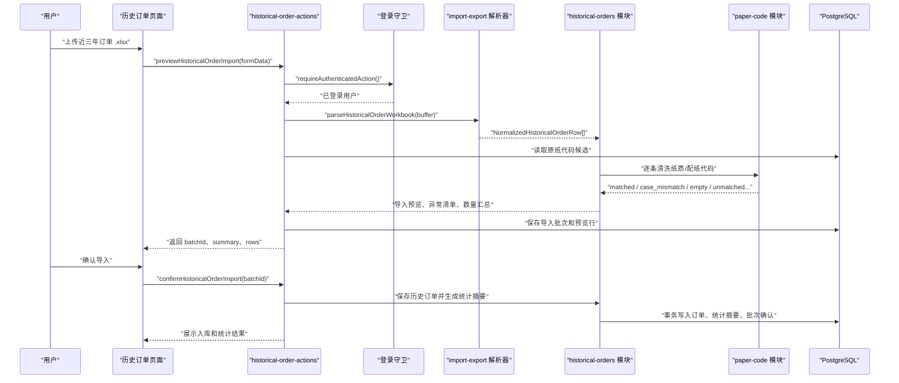
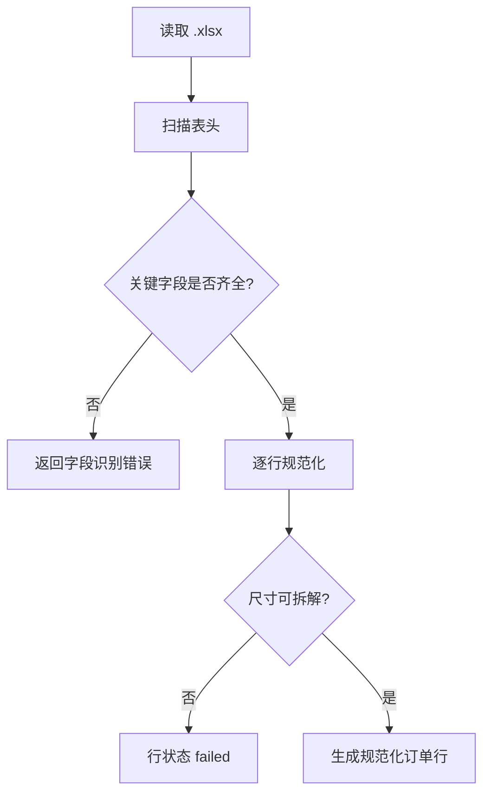

# 历史订单建库与习惯提取 — 技术设计文档

## 1. 设计概要

**功能描述**：新增 `historical-orders` 能力，把近三年订单 `.xlsx` 文件解析为历史订单导入预览，复用 `paper-code` 清洗纸质/配纸代码，确认后保存历史订单和统计摘要；只有关键字段完整且纸质/配纸代码明确匹配的订单参与习惯统计。→ AC-001 到 AC-017

**影响范围**：`src/modules/historical-orders`、`src/modules/import-export`、`src/modules/paper-code`、`src/db/schema`、`src/server/actions`、`src/app/(main)/history` 或新增历史订单页面组件、`tests/unit/historical-orders`、`tests/integration/historical-orders`。

**技术难点**：历史订单表字段可能不稳定，纸质/配纸代码可能包含空值、单代码、双代码、大小写候选、克重误填和无法匹配；统计摘要既要保留可追溯订单，又不能让异常订单或历史成本口径影响统计和后续推荐硬规则。→ AC-005, AC-006, AC-007, AC-011, AC-012, AC-013

**外部依赖**：不新增依赖。首版只支持 `.xlsx`，旧 `.xls` 文件需由用户另存为 `.xlsx` 后导入；继续复用项目已有 `exceljs`、PostgreSQL、Drizzle ORM、Next.js Server Actions。→ AC-001, AC-014

---

## 2. 架构概览

本功能沿用现有主数据导入的项目模式：页面只负责上传、预览、确认和展示；`server/actions` 负责鉴权和动作编排；`import-export` 负责读取 Excel；`historical-orders` 负责订单字段识别、清洗、统计和入库；`paper-code` 提供大小写敏感代码映射能力。



### 模块职责

| 模块 | 职责 | 对应 AC |
|------|------|---------|
| `src/app/(main)/history` 或 `src/app/(main)/historical-orders` | 上传历史订单、展示预览数量、异常清单、失败原因和习惯摘要 | AC-001, AC-003, AC-004, AC-007, AC-008, AC-009 |
| `src/server/actions/historical-order-actions.ts` | 提供预览、确认、查询摘要等 Server Actions，并统一做登录校验和错误返回 | AC-001, AC-002, AC-008, AC-009 |
| `src/modules/import-export/historical-order-workbook-parser.ts` | 解析 `.xlsx`，识别表头和规范化订单字段 | AC-001, AC-005, AC-010 |
| `src/modules/historical-orders/import-preview.ts` | 生成导入预览，判定可统计、异常、待确认和失败 | AC-002, AC-005, AC-006, AC-007, AC-008, AC-011 |
| `src/modules/historical-orders/import-commit.ts` | 确认入库、保存历史订单、生成统计摘要，保证事务一致性 | AC-002, AC-003, AC-004, AC-009, AC-011 |
| `src/modules/historical-orders/habit-summary.ts` | 按产品、尺寸区间、重量区间聚合常用组合和频率 | AC-003, AC-004, AC-010, AC-016, AC-017 |
| `src/modules/paper-code/match-paper-code.ts` | 复用原纸代码精确匹配、大小写候选、疑似克重、空代码和无法匹配状态 | AC-006, AC-007, AC-011 |
| `src/db/schema/historical-orders.ts` | 保存导入批次、导入行、历史订单、统计口径和统计摘要 | AC-002, AC-003, AC-008, AC-011, AC-017 |

---

## 3. 数据库设计

### 新增表

#### `historical_order_import_batches`

**用途**：保存一次历史订单导入的来源文件、状态、数量汇总和尺寸区间口径。→ AC-008, AC-009, AC-017

| 字段名 | 类型 | 约束 | 说明 |
|--------|------|------|------|
| id | uuid | PK, DEFAULT gen_random_uuid() | 主键 |
| file_name | text | NOT NULL | 来源文件名 |
| status | varchar(20) | NOT NULL | `previewed` / `confirmed` / `cancelled` / `failed` |
| summary | jsonb | NOT NULL | 成功入库、可统计、待确认、异常、失败数量 |
| size_bucket_config | jsonb | NOT NULL | 小箱、中箱、大箱边界及确认状态 |
| created_by | varchar(100) | NOT NULL | 创建人 |
| confirmed_by | varchar(100) | NULL | 确认人 |
| created_at | timestamptz | NOT NULL, DEFAULT now() | 创建时间 |
| confirmed_at | timestamptz | NULL | 确认时间 |

**索引**：`status, created_at` 支持查询最近导入批次。→ AC-008

```sql
CREATE TABLE "historical_order_import_batches" (
  "id" uuid PRIMARY KEY DEFAULT gen_random_uuid() NOT NULL,
  "file_name" text NOT NULL,
  "status" varchar(20) NOT NULL,
  "summary" jsonb NOT NULL,
  "size_bucket_config" jsonb NOT NULL,
  "created_by" varchar(100) NOT NULL,
  "confirmed_by" varchar(100),
  "created_at" timestamp with time zone DEFAULT now() NOT NULL,
  "confirmed_at" timestamp with time zone
);

CREATE INDEX "historical_order_import_batches_status_created_at_idx"
  ON "historical_order_import_batches" ("status", "created_at");
```

#### `historical_order_import_rows`

**用途**：保存导入预览行、规范化数据、代码清洗结果、候选项和失败原因。→ AC-001, AC-005, AC-006, AC-007, AC-008, AC-009

| 字段名 | 类型 | 约束 | 说明 |
|--------|------|------|------|
| id | uuid | PK, DEFAULT gen_random_uuid() | 主键 |
| batch_id | uuid | NOT NULL, FK | 导入批次 |
| sheet_name | text | NULL | 工作表名 |
| row_number | integer | NOT NULL | 原始行号 |
| row_status | varchar(24) | NOT NULL | `statistical` / `pending` / `exception` / `failed` |
| raw_data | jsonb | NOT NULL | 原始行数据 |
| normalized_data | jsonb | NOT NULL | 规范化订单字段 |
| paper_code_match_result | jsonb | NOT NULL | `paper-code` 清洗结果 |
| matched_material_ids | jsonb | NOT NULL, DEFAULT '[]' | 明确匹配到的原纸 ID |
| candidate_material_ids | jsonb | NOT NULL, DEFAULT '[]' | 候选原纸 ID |
| errors | jsonb | NOT NULL, DEFAULT '[]' | 失败或异常原因 |
| created_at | timestamptz | NOT NULL, DEFAULT now() | 创建时间 |

**索引**：`batch_id, row_status` 支持预览分组展示；`row_status` 支持统计候选筛选。→ AC-008, AC-011

```sql
CREATE TABLE "historical_order_import_rows" (
  "id" uuid PRIMARY KEY DEFAULT gen_random_uuid() NOT NULL,
  "batch_id" uuid NOT NULL REFERENCES "historical_order_import_batches"("id"),
  "sheet_name" text,
  "row_number" integer NOT NULL,
  "row_status" varchar(24) NOT NULL,
  "raw_data" jsonb NOT NULL,
  "normalized_data" jsonb NOT NULL,
  "paper_code_match_result" jsonb NOT NULL,
  "matched_material_ids" jsonb DEFAULT '[]'::jsonb NOT NULL,
  "candidate_material_ids" jsonb DEFAULT '[]'::jsonb NOT NULL,
  "errors" jsonb DEFAULT '[]'::jsonb NOT NULL,
  "created_at" timestamp with time zone DEFAULT now() NOT NULL
);

CREATE INDEX "historical_order_import_rows_batch_status_idx"
  ON "historical_order_import_rows" ("batch_id", "row_status");
```

#### `historical_orders`

**用途**：保存确认后的历史订单资料。异常订单可以入库，但通过 `is_statistical` 控制是否参与习惯统计。→ AC-002, AC-006, AC-010, AC-011

| 字段名 | 类型 | 约束 | 说明 |
|--------|------|------|------|
| id | uuid | PK, DEFAULT gen_random_uuid() | 主键 |
| import_batch_id | uuid | NOT NULL, FK | 来源批次 |
| import_row_id | uuid | NOT NULL, FK, UNIQUE | 来源导入行 |
| order_date | date | NOT NULL | 订单日期 |
| product_name | text | NOT NULL | 产品名称或类别原文 |
| product_category | text | NULL | 归一化产品类别，首版可为空 |
| length_mm | integer | NOT NULL | 纸箱长度 |
| width_mm | integer | NOT NULL | 纸箱宽度 |
| height_mm | integer | NOT NULL | 纸箱高度 |
| quantity | integer | NOT NULL | 生产数量 |
| weight_kg | numeric(10,2) | NULL | 重量，可为空 |
| raw_paper_code | text | NOT NULL | 原始纸质/配纸代码 |
| parsed_layer_count | integer | NULL | 从代码或字段识别出的层数 |
| parsed_flute | varchar(20) | NULL | 从代码或字段识别出的瓦型 |
| matched_material_ids | jsonb | NOT NULL, DEFAULT '[]' | 明确匹配原纸 ID |
| paper_code_status | varchar(40) | NOT NULL | 代码清洗状态 |
| exception_reasons | jsonb | NOT NULL, DEFAULT '[]' | 异常原因 |
| is_statistical | boolean | NOT NULL | 是否参与习惯统计 |
| created_at | timestamptz | NOT NULL, DEFAULT now() | 创建时间 |

**索引**：`is_statistical, order_date` 支持统计；产品、尺寸、重量字段建组合索引用于摘要查询。→ AC-003, AC-004, AC-011

```sql
CREATE TABLE "historical_orders" (
  "id" uuid PRIMARY KEY DEFAULT gen_random_uuid() NOT NULL,
  "import_batch_id" uuid NOT NULL REFERENCES "historical_order_import_batches"("id"),
  "import_row_id" uuid NOT NULL REFERENCES "historical_order_import_rows"("id"),
  "order_date" date NOT NULL,
  "product_name" text NOT NULL,
  "product_category" text,
  "length_mm" integer NOT NULL,
  "width_mm" integer NOT NULL,
  "height_mm" integer NOT NULL,
  "quantity" integer NOT NULL,
  "weight_kg" numeric(10,2),
  "raw_paper_code" text NOT NULL,
  "parsed_layer_count" integer,
  "parsed_flute" varchar(20),
  "matched_material_ids" jsonb DEFAULT '[]'::jsonb NOT NULL,
  "paper_code_status" varchar(40) NOT NULL,
  "exception_reasons" jsonb DEFAULT '[]'::jsonb NOT NULL,
  "is_statistical" boolean NOT NULL,
  "created_at" timestamp with time zone DEFAULT now() NOT NULL,
  CONSTRAINT "historical_orders_import_row_unique" UNIQUE("import_row_id")
);

CREATE INDEX "historical_orders_statistical_date_idx"
  ON "historical_orders" ("is_statistical", "order_date");
CREATE INDEX "historical_orders_product_size_weight_idx"
  ON "historical_orders" ("product_name", "length_mm", "width_mm", "height_mm", "weight_kg");
```

#### `historical_order_habit_summaries`

**用途**：保存确认导入后生成的习惯摘要，后续推荐评分功能只读取该表，不反扫全部订单。→ AC-003, AC-004, AC-012, AC-013, AC-016, AC-017

| 字段名 | 类型 | 约束 | 说明 |
|--------|------|------|------|
| id | uuid | PK, DEFAULT gen_random_uuid() | 主键 |
| import_batch_id | uuid | NOT NULL, FK | 生成来源 |
| dimension_type | varchar(40) | NOT NULL | `product` / `size_bucket` / `weight_bucket` |
| dimension_key | varchar(120) | NOT NULL | 产品名、尺寸区间或重量区间 |
| layer_count | integer | NULL | 常用层数 |
| flute | varchar(20) | NULL | 常用瓦型 |
| factory_names | jsonb | NOT NULL, DEFAULT '[]' | 常用纸厂 |
| gram_weights | jsonb | NOT NULL, DEFAULT '[]' | 常用克重组合 |
| order_count | integer | NOT NULL | 出现次数 |
| frequency | numeric(8,4) | NOT NULL | 在该维度下的占比 |
| generated_at | timestamptz | NOT NULL, DEFAULT now() | 生成时间 |

**索引**：`dimension_type, dimension_key, order_count` 支持按维度展示频率排序。→ AC-004

```sql
CREATE TABLE "historical_order_habit_summaries" (
  "id" uuid PRIMARY KEY DEFAULT gen_random_uuid() NOT NULL,
  "import_batch_id" uuid NOT NULL REFERENCES "historical_order_import_batches"("id"),
  "dimension_type" varchar(40) NOT NULL,
  "dimension_key" varchar(120) NOT NULL,
  "layer_count" integer,
  "flute" varchar(20),
  "factory_names" jsonb DEFAULT '[]'::jsonb NOT NULL,
  "gram_weights" jsonb DEFAULT '[]'::jsonb NOT NULL,
  "order_count" integer NOT NULL,
  "frequency" numeric(8,4) NOT NULL,
  "generated_at" timestamp with time zone DEFAULT now() NOT NULL
);

CREATE INDEX "historical_order_habit_summaries_dimension_idx"
  ON "historical_order_habit_summaries" ("dimension_type", "dimension_key", "order_count");
```

### 修改现有表

无需修改现有主数据、推荐、计算或历史方案表。新增 schema 通过 `src/db/schema/index.ts` 导出，由 Drizzle 生成迁移。→ AC-013, AC-014

---

## 4. API 设计

本项目首版使用 Server Actions，本功能不新增公开 REST API。所有动作第一步调用 `requireAuthenticatedAction()`，并返回统一 `ActionResult<T>`。→ AC-001, AC-009

### `previewHistoricalOrderImport(formData)`

**描述**：上传历史订单 `.xlsx` 文件，解析字段、清洗代码并保存导入预览。→ AC-001, AC-005, AC-006, AC-007, AC-008

**鉴权**：需要登录。

**Request**：

```ts
interface PreviewHistoricalOrderImportInput {
  file: File;
}
```

**Response（成功）**：

```ts
interface PreviewHistoricalOrderImportResult {
  batchId: string;
  summary: {
    importedCount: number;
    statisticalCount: number;
    pendingCount: number;
    exceptionCount: number;
    failedCount: number;
  };
  sizeBucketPreview: HistoricalOrderSizeBucketConfig;
  rows: HistoricalOrderImportPreviewRow[];
}
```

**异常响应**：

| 场景 | 响应 | 对应 AC |
|------|------|---------|
| 未登录 | `AUTH_REQUIRED` / `SESSION_EXPIRED` | AC-001 |
| 未上传文件 | `VALIDATION_ERROR`，提示上传历史订单文件 | AC-001 |
| 文件不是 `.xlsx` | `VALIDATION_ERROR`，提示先将旧 `.xls` 另存为 `.xlsx` | AC-001 |
| 无法识别必要表头 | `VALIDATION_ERROR`，提示缺少关键字段 | AC-001, AC-005 |
| 解析失败 | `VALIDATION_ERROR`，提示文件无法解析，不展示底层堆栈 | AC-008 |

### `confirmHistoricalOrderImport(input)`

**描述**：确认导入批次，保存可入库订单，跳过失败行，并生成习惯摘要。→ AC-002, AC-003, AC-004, AC-009, AC-011, AC-016, AC-017

**鉴权**：需要登录。

**Request**：

```ts
interface ConfirmHistoricalOrderImportInput {
  batchId: string;
  sizeBucketConfig: HistoricalOrderSizeBucketConfig;
}
```

**Response（成功）**：

```ts
interface ConfirmHistoricalOrderImportResult {
  batchId: string;
  importedCount: number;
  statisticalCount: number;
  skippedFailedRowCount: number;
  habitSummaryCount: number;
}
```

**异常响应**：

| 场景 | 响应 | 对应 AC |
|------|------|---------|
| 批次不存在 | `DATA_NOT_FOUND` | AC-009 |
| 批次不是预览状态 | `VALIDATION_ERROR`，提示不可重复确认 | AC-009 |
| 尺寸区间未确认 | `VALIDATION_ERROR`，提示先确认尺寸区间 | AC-017 |
| 入库失败 | `SAVE_FAILED`，提示历史订单导入失败 | AC-002 |

### `listHistoricalOrderHabitSummaries(query)`

**描述**：查询历史习惯摘要，按产品、尺寸区间或重量区间返回频率排序结果。→ AC-003, AC-004, AC-014, AC-015

**鉴权**：需要登录。

**Request**：

```ts
interface ListHistoricalOrderHabitSummariesQuery {
  dimensionType?: "product" | "size_bucket" | "weight_bucket";
  dimensionKey?: string;
  limit?: number;
}
```

**Response（成功）**：

```ts
interface ListHistoricalOrderHabitSummariesResult {
  items: HistoricalOrderHabitSummaryItem[];
}
```

### `cancelHistoricalOrderImport(batchId)`

**描述**：取消预览批次，确保本次预览内容不进入历史订单库。→ AC-009

**鉴权**：需要登录。

**Response（成功）**：

```ts
interface CancelHistoricalOrderImportResult {
  batchId: string;
  status: "cancelled";
}
```

---

## 5. 核心逻辑

### 历史订单字段识别 → AC-001, AC-005

**触发条件**：用户上传 `.xlsx` 并请求预览。

**处理流程**：
1. 使用 `exceljs` 读取工作簿，扫描前 30 行、前 40 列寻找表头。
2. 必须识别订单日期、尺寸、产品名称或类别、生产数量、纸质/配纸代码。
3. 尺寸支持两种来源：独立列 `长/宽/高`，或合并列如 `尺寸`、`规格` 中的 `L*W*H` 文本。
4. 重量字段可选；识别不到重量不作为失败。→ AC-010
5. 关键字段缺失或尺寸无法拆解的行进入失败清单。→ AC-005



### 纸质/配纸代码清洗 → AC-002, AC-006, AC-007, AC-011

**触发条件**：历史订单行完成字段规范化后。

**处理流程**：
1. 从原纸资料库读取候选原纸的 `id`、`paperCode`、纸厂、克重等字段。
2. 对纸质/配纸代码做轻量拆分，识别空代码、单代码、双代码。
3. 每个代码片段调用 `matchPaperCode`，保留原始代码、状态、候选项和异常原因。
4. 所有代码片段均 `matched`，且关键字段完整时，行状态为 `statistical`。
5. 出现 `case_mismatch` 或 `ambiguous_case` 时，行状态为 `pending`。
6. 出现 `empty`、`suspected_gram_weight`、`unmatched`、单代码或双代码无法完全解释时，行状态为 `exception`。
7. `pending` 和 `exception` 行确认导入后可保存到 `historical_orders`，但 `is_statistical = false`。→ AC-006, AC-011

### 导入预览汇总 → AC-008

**触发条件**：所有行完成清洗后。

**处理流程**：
1. `importedCount` = 非 `failed` 行数量。
2. `statisticalCount` = `rowStatus === "statistical"` 行数量。
3. `pendingCount` = `rowStatus === "pending"` 行数量。
4. `exceptionCount` = `rowStatus === "exception"` 行数量。
5. `failedCount` = `rowStatus === "failed"` 行数量。

页面展示这四类结果，异常清单展示原始代码、原因和候选项。→ AC-007, AC-008

### 取消导入 → AC-009

**触发条件**：用户在预览后取消导入。

**处理流程**：
1. 批次状态从 `previewed` 更新为 `cancelled`。
2. 保留预览行用于排查导入记录，但不写入 `historical_orders`。
3. 已取消批次不能再次确认。

### 尺寸区间生成与确认 → AC-017

**触发条件**：预览阶段生成尺寸区间建议，确认导入时由用户提交确认后的口径。

**处理流程**：
1. 使用可统计候选订单的纸箱体积 `lengthMm * widthMm * heightMm` 作为排序依据。
2. 按三等分生成小箱、中箱、大箱边界预览。
3. 用户确认后保存到 `historical_order_import_batches.size_bucket_config`。
4. 习惯摘要按确认后的区间归类。

### 重量区间统计 → AC-010, AC-016

**触发条件**：生成习惯摘要时。

**处理流程**：
1. 订单有重量时按 `≤20kg`、`20-30kg`、`≥30kg` 分类。
2. 订单缺少重量时不进入重量区间统计。
3. 缺少重量不影响该订单进入产品维度和尺寸区间维度统计。→ AC-010

### 习惯摘要生成 → AC-003, AC-004, AC-011, AC-012, AC-014, AC-015

**触发条件**：确认导入批次成功写入历史订单后。

**处理流程**：
1. 只读取 `is_statistical = true` 的订单。→ AC-011
2. 生成三个维度：产品名称/类别、尺寸区间、重量区间。
3. 在每个维度内按层数、瓦型、纸厂组合、克重组合聚合。
4. 计算 `orderCount` 和 `frequency = orderCount / 当前维度总订单数`。
5. 按 `orderCount` 降序写入 `historical_order_habit_summaries`。→ AC-004
6. 不读取、不计算、不输出历史价格和历史成本结论。→ AC-012
7. 不保存客户字段，不建立客户档案关联。→ AC-014, AC-015

### 后续推荐边界 → AC-013

本功能只生成摘要表。后续“历史习惯评分与理由展示”读取摘要时，只能把历史习惯作为排序辅助分，不能修改计算结果、达标状态或设备状态。技术上通过模块边界控制：

- `historical-orders` 不依赖 `recommendation`。
- `calculations` 不依赖 `historical-orders`。
- `recommendation` 后续可读取 `historical_order_habit_summaries`，但必须在硬规则过滤之后使用。

---

## 6. 现有代码改动

| 模块 / 文件 | 改动内容 | 原因 | 对应 AC |
|-------------|---------|------|---------|
| `src/db/schema/historical-orders.ts` | 新增历史订单导入批次、导入行、订单、习惯摘要表 | 保存预览、入库订单和统计摘要 | AC-002, AC-003, AC-008, AC-011, AC-017 |
| `src/db/schema/index.ts` | 导出历史订单 schema | 让 Drizzle 迁移识别新增表 | AC-002 |
| `src/modules/import-export/historical-order-workbook-parser.ts` | 新增 `.xlsx` 解析、表头识别、尺寸拆解和规范化行输出 | 识别历史订单关键字段 | AC-001, AC-005, AC-010 |
| `src/modules/historical-orders/import-preview.ts` | 新增清洗、分类、异常清单和预览汇总逻辑 | 区分可统计、待确认、异常和失败 | AC-002, AC-005, AC-006, AC-007, AC-008, AC-011 |
| `src/modules/historical-orders/import-commit.ts` | 新增确认入库事务和取消导入逻辑 | 保存历史订单并阻止取消批次入库 | AC-002, AC-009, AC-011 |
| `src/modules/historical-orders/habit-summary.ts` | 新增产品、尺寸、重量维度统计 | 输出习惯摘要并按频率排序 | AC-003, AC-004, AC-010, AC-016, AC-017 |
| `src/modules/historical-orders/types.ts` | 定义状态、规范化行、摘要项和仓储契约 | 保持模块类型清晰 | AC-001 到 AC-017 |
| `src/modules/historical-orders/README.md` | 补充模块边界，明确不参与推荐硬规则 | 防止后续越界实现 | AC-012, AC-013, AC-014 |
| `src/server/actions/historical-order-actions.ts` | 新增预览、确认、取消、查询摘要动作 | 页面到业务模块的入口 | AC-001, AC-003, AC-008, AC-009 |
| `src/app/(main)/history/page.tsx` 或历史订单子页面 | 接入上传预览、导入结果和习惯摘要展示 | 用户可完成历史订单建库流程 | AC-001, AC-003, AC-007, AC-008 |
| `tests/unit/historical-orders/*` | 覆盖字段识别、代码清洗、统计摘要、尺寸/重量区间 | 历史订单清洗属于 P0 测试范围 | AC-001 到 AC-017 |
| `tests/integration/historical-orders/*` | 覆盖 Server Action、导入确认、取消、数据库 schema | 验证导入闭环和数据保存 | AC-001 到 AC-017 |

---

## 7. 技术决策

### 历史订单导入单独建表，不复用主数据导入表

**背景**：主数据导入表已经服务原纸、纸价、质量标准；历史订单导入也有预览和确认，但行状态、规范化字段、统计摘要完全不同。

**选项**：
- A: 复用 `master_data_import_batches / rows` — 表少，但字段语义混杂，后续维护容易误用。
- B: 新建 `historical_order_import_batches / rows` — 多两张表，但边界清晰，方便历史订单异常和统计扩展。

**结论**：选择 B。历史订单是独立业务模块，单独建表符合 `src/modules/historical-orders` 的边界。→ AC-006, AC-008, AC-011

### 首版不引入 `.xls` 解析依赖

**背景**：现有历史订单样例是旧 `.xls`，但项目已有解析链路基于 `exceljs`，更适合 `.xlsx`。

**选项**：
- A: 新增 `.xls` 解析依赖 — 用户少一步转换，但扩大依赖、测试和安全面。
- B: 要求用户把 `.xls` 另存为 `.xlsx` 后导入 — 符合现有技术栈，首版风险更小。

**结论**：选择 B。本功能不新增依赖，避免为旧文件格式扩大实现范围。→ AC-001, AC-014

### 统计摘要落表，而不是每次实时聚合

**背景**：后续推荐评分会读取历史习惯，如果每次实时扫描三年订单，推荐链路可能被历史数据量拖慢。

**选项**：
- A: 每次查看或推荐时实时聚合订单 — 数据最新，但查询成本高。
- B: 导入确认时生成摘要表 — 查询快，后续推荐读取稳定。

**结论**：选择 B。历史订单首版是批量导入，不需要秒级实时统计；摘要表更适合作为后续推荐输入。→ AC-003, AC-004, AC-013

### 异常订单可入库但不参与统计

**背景**：需求明确异常订单仍可入库，但不能影响习惯统计。

**选项**：
- A: 异常订单不入库 — 统计干净，但丢失真实订单清洗线索。
- B: 异常订单入库并标记 `is_statistical = false` — 保留追溯，同时保护统计质量。

**结论**：选择 B。它同时满足留痕和统计准入控制。→ AC-006, AC-011

---

## 8. 安全与性能

**输入校验**：只接受 `.xlsx`；所有单元格当作不可信输入处理，日期、尺寸、数量、重量和纸质代码都在服务端重新校验；不执行 Excel 宏或公式，只读取可见值。→ AC-001, AC-005

**敏感数据处理**：历史订单可能包含真实产品、客户或业务信息；测试夹具必须脱敏，不复制真实订单全量数据；错误信息只展示业务原因，不输出 SQL、堆栈、连接串或文件绝对路径。→ AC-014, AC-015

**性能考量**：导入预览保存批次和行，页面分页展示；代码清洗时先把原纸候选构造成 Map，避免逐行扫描；确认导入时在事务内批量写入订单和摘要。→ AC-008, AC-011

**一致性**：确认导入必须在事务中完成：批次状态、历史订单、习惯摘要一起成功或一起回滚；取消批次不能再确认。→ AC-009

**推荐隔离**：本功能不修改 `recommendation`、`calculations` 或当前方案结果；摘要表仅作为后续功能输入，避免历史习惯越过强度、成本和设备限制。→ AC-012, AC-013

---

## 9. AC 覆盖总表

| AC 编号 | 验收标准概述 | 实现位置 |
|---------|-------------|---------|
| AC-001 | 识别历史订单字段 | `parseHistoricalOrderWorkbook` + `previewHistoricalOrderImport` |
| AC-002 | 明确匹配订单可统计 | `createHistoricalOrderImportPreview` + `confirmHistoricalOrderImport` |
| AC-003 | 展示习惯摘要 | `historical_order_habit_summaries` + `listHistoricalOrderHabitSummaries` |
| AC-004 | 常用组合按频率排序 | `habit-summary.ts` 按 `orderCount` / `frequency` 排序 |
| AC-005 | 关键字段缺失进入失败清单 | 解析器字段校验 + 预览行 `failed` 状态 |
| AC-006 | 纸质代码异常订单可入库但不参与统计 | `pending` / `exception` 状态 + `is_statistical = false` |
| AC-007 | 候选代码不自动替换 | 复用 `paper-code` 候选状态，只展示候选，不写入匹配成功 |
| AC-008 | 导入结果数量可见 | 预览 summary + 导入页面统计展示 |
| AC-009 | 取消导入不保存预览 | `cancelHistoricalOrderImport` 标记批次 `cancelled` |
| AC-010 | 缺少重量不影响其他维度统计 | `habit-summary.ts` 跳过重量维度但保留产品和尺寸维度 |
| AC-011 | 只有明确匹配订单参与统计 | `is_statistical` 准入 + 摘要只查询可统计订单 |
| AC-012 | 历史成本不作为当前结论 | 解析和摘要不保存/不计算历史成本结论 |
| AC-013 | 历史习惯不得覆盖硬规则 | 模块边界说明，后续推荐只在硬规则后读取摘要 |
| AC-014 | 不扩大到推荐排序和客户关联 | 不新增客户表、不改推荐模块、不做成本趋势 |
| AC-015 | 产品维度不等于客户关联 | 只保存产品名称/类别维度，不保存客户关联 |
| AC-016 | 重量区间口径固定 | `getWeightBucket` 使用 `≤20kg`、`20-30kg`、`≥30kg` |
| AC-017 | 尺寸区间需确认 | `size_bucket_config` 预览并在确认导入时保存 |

---

## 附录：变更记录

| 日期 | 变更内容 | 原因 |
|------|---------|------|
| 2026-07-03 | 初始版本 | 根据“历史订单建库与习惯提取”需求文档产出可执行技术方案 |
