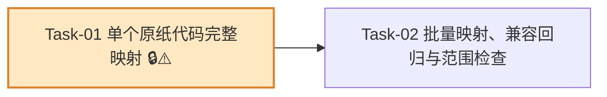

# 原纸代码映射 — 开发任务计划

## 1. 任务概览

**总任务数**：2 个
**预计总工时**：190 分钟（约 3 小时）
**开发方法**：TDD — 每个任务按 RED → GREEN → REFACTOR 循环执行

**关键标注**：
- 🔒 阻塞任务：被多个任务依赖，建议优先完成
- ⚠️ 风险任务：技术难度高，可能需要额外时间

### 依赖关系图

### 可并行任务组

| 并行组 | 任务 | 说明 |
|--------|------|------|
| 暂无 | - | Task-02 依赖 Task-01 的结果类型和状态口径，建议顺序完成。 |

---

## 2. 开发任务

> 本功能是纯业务逻辑能力，没有用户页面和数据库变更。阶段按“调用方可以获得的可验证行为”组织，每个任务都要先写对应单元测试，再实现最小逻辑。

### 阶段一：调用方可以完整判断单个原纸代码

**阶段完成标准**：调用方传入一个原纸代码和候选原纸列表后，系统能返回精确匹配、大小写候选、疑似克重、空代码或无法匹配等清晰结果。

---

#### [x] Task-01: 单个原纸代码完整映射 🔒⚠️

**通俗解释**：系统能判断一个原纸代码到底是匹配成功、大小写写错、像克重、为空，还是确实找不到。

**做什么**：扩展 `src/modules/paper-code/match-paper-code.ts`，新增 `PaperCodeMatchResult`、`matchPaperCode` 等完整映射契约；保留并兼容 `matchPaperCodeExactly`。一次性实现精确匹配、大小写敏感匹配、`aδ` 特殊历史代码、大小写候选、多候选待确认、疑似克重误填、空代码和无法匹配状态。

**涉及文件**：`src/modules/paper-code/match-paper-code.ts`、`tests/unit/paper-code/match-paper-code.test.ts`

**参考**：技术方案 2、3、4、5、6、7、8、9 → AC-001, AC-002, AC-003, AC-004, AC-005, AC-006, AC-007, AC-009, AC-010

**依赖**：无

**预估工时**：105 分钟

**验证标准**（TDD RED 阶段直接转化为测试用例）：
- [x] 候选列表包含 `{ id: "paper-1", paperCode: "r2" }`，调用 `matchPaperCode({ paperCode: "r2" })` → 返回 `status = "matched"`，且 `material.id = "paper-1"`。
- [x] 候选列表同时包含 `dC` 和 `DC`，调用 `matchPaperCode({ paperCode: "dC" })` → 返回 `status = "matched"`，且只匹配 `dC` 对应原纸。
- [x] 候选列表包含 `{ id: "paper-special", paperCode: "aδ" }`，调用 `matchPaperCode({ paperCode: "aδ" })` → 返回 `status = "matched"`，且 `normalizedInput = "aδ"`。
- [x] 候选列表包含 `r2`，调用 `matchPaperCode({ paperCode: " r2 " })` → 返回 `status = "matched"`，且结果保留原始输入并将 `normalizedInput` 设为 `r2`。
- [x] 候选列表包含 `DC` 但不包含 `dc`，调用 `matchPaperCode({ paperCode: "dc" })` → 返回 `status = "case_mismatch"`，候选数组只包含 `DC`。
- [x] 候选列表包含 `dC` 和 `DC` 但不包含 `dc`，调用 `matchPaperCode({ paperCode: "dc" })` → 返回 `status = "ambiguous_case"`，候选数组包含 `dC` 和 `DC`。
- [x] 候选列表不包含 `250g`，调用 `matchPaperCode({ paperCode: "250g" })` → 返回 `status = "suspected_gram_weight"`，message 包含“疑似克重”。
- [x] 候选列表不包含 `250G`，调用 `matchPaperCode({ paperCode: "250G" })` → 返回 `status = "suspected_gram_weight"`。
- [x] 候选列表不包含 `250`，调用 `matchPaperCode({ paperCode: "250" })` → 返回 `status = "suspected_gram_weight"`。
- [x] 候选列表包含 `250`，调用 `matchPaperCode({ paperCode: "250" })` → 优先返回 `status = "matched"`，不得误判为克重。
- [x] 调用 `matchPaperCode({ paperCode: "" })`、`matchPaperCode({ paperCode: "   " })`、`matchPaperCode({ paperCode: undefined })` → 均返回 `status = "empty"`。
- [x] 候选列表不包含 `unknown` 且没有大小写候选，调用 `matchPaperCode({ paperCode: "unknown" })` → 返回 `status = "unmatched"`，并保留原始输入。
- [x] 调用 `matchPaperCodeExactly("r2", candidates)` → 返回 `paperCode = "r2"` 的候选原纸。
- [x] 调用 `matchPaperCodeExactly("R2", [{ paperCode: "r2" }])` → 返回 `undefined`，不得忽略大小写匹配。
- [x] 调用 `matchPaperCodeExactly("dc", [{ paperCode: "DC" }])` → 返回 `undefined`，不得把大小写候选自动替换为成功匹配。

---

### 阶段二：后续导入流程可以批量使用映射结果，且现有主数据导入不受影响

**阶段完成标准**：调用方传入一组原纸代码后，系统能逐条返回结果和异常汇总；同时主数据纸价导入仍只接受精确原纸代码自动匹配，本功能不接入历史订单导入、页面或数据库。

---

#### [x] Task-02: 批量映射、兼容回归与范围检查

**通俗解释**：系统可以一次处理一批代码，把成功、待确认和失败分好类；同时确保旧的主数据导入不会被新规则影响。

**做什么**：新增 `matchPaperCodes` 和 `summarizePaperCodeMatches`；批量映射逐条复用 `matchPaperCode`，生成稳定的 `PaperCodeMatchSummary`。检查并必要时微调 `src/modules/master-data/match-import-row.ts`，确保它继续通过 `matchPaperCodeExactly` 只做精确自动匹配；补充 `src/modules/paper-code/README.md` 的模块边界说明；补充范围回归测试，确认不依赖 `historical-orders`、不新增页面、Server Action 或数据库表。

**涉及文件**：`src/modules/paper-code/match-paper-code.ts`、`src/modules/paper-code/README.md`、`src/modules/master-data/match-import-row.ts`、`tests/unit/paper-code/match-paper-code.test.ts`、`tests/unit/master-data/paper-price-import-preview.test.ts`

**参考**：技术方案 2、4、5、6、8、9 → AC-001, AC-008, AC-010, AC-011, AC-012

**依赖**：Task-01

**预估工时**：85 分钟

**验证标准**（TDD RED 阶段直接转化为测试用例）：
- [x] 候选列表包含 `r2`、`DC`、`dC`、`aδ`，批量输入 `["r2", "aδ", "dc", "250g", "", "unknown"]` → 返回 6 条 `rows`，每条保留对应原始输入顺序。
- [x] 上述批量结果中，`r2` 和 `aδ` → `status = "matched"`。
- [x] 上述批量结果中，`dc` → `status = "ambiguous_case"`，候选包含 `dC` 和 `DC`。
- [x] 上述批量结果中，`250g` → `status = "suspected_gram_weight"`。
- [x] 上述批量结果中，空字符串 → `status = "empty"`。
- [x] 上述批量结果中，`unknown` → `status = "unmatched"`。
- [x] 上述批量结果的 `summary` → `matchedCount = 2`、`confirmationRequiredCount = 1`、`suspectedGramWeightCount = 1`、`emptyCount = 1`、`unmatchedCount = 1`、`failedCount = 3`。
- [x] 单独调用 `summarizePaperCodeMatches(rows)` → 得到与 `matchPaperCodes(...).summary` 一致的汇总。
- [x] 纸价导入候选原纸包含 `DC` 但导入行 `paperCode = "dc"`，且没有原纸编码和组合匹配信息 → 纸价预览不得自动匹配 `DC`，应进入失败或继续按现有规则处理。
- [x] 纸价导入候选原纸包含 `r2` 且导入行 `paperCode = "r2"` → 纸价预览仍返回更新状态并指向该原纸。
- [x] 检查 `src/modules/paper-code` 源码引用 → 不包含从 `src/modules/historical-orders`、`src/app`、`src/server`、`src/db` 的导入。
- [x] 检查本次变更文件列表 → 不新增历史订单导入文件、页面文件、Server Action 或数据库 schema。
- [x] `src/modules/paper-code/README.md` 说明：候选只提示、不自动替换；本模块不导入历史订单、不创建或修改原纸资料。
- [x] 运行 `pnpm vitest run tests/unit/paper-code tests/unit/master-data/paper-price-import-preview.test.ts` → 映射和主数据兼容测试通过。
- [x] 运行 `pnpm exec tsc --noEmit` 和 `pnpm exec eslint .` → 类型与代码规范通过。

---

## 3. AC 覆盖总表

| AC 编号 | 验收标准概述 | 承接任务 | 验证方式 |
|---------|-------------|---------|---------|
| AC-001 | 精确匹配原纸代码 | Task-01, Task-02 | `matchPaperCode("r2")` 和 `matchPaperCodeExactly("r2")` 返回匹配；纸价导入 `r2` 仍自动更新 |
| AC-002 | 区分大小写匹配 | Task-01 | 候选 `dC` / `DC` 同时存在时，输入 `dC` 只命中 `dC` |
| AC-003 | 支持特殊历史代码 | Task-01 | 候选 `aδ` 存在时，输入 `aδ` 返回匹配并保留原始写法 |
| AC-004 | 单一大小写候选提示 | Task-01 | 候选只有 `DC`，输入 `dc` 返回 `case_mismatch` |
| AC-005 | 多个大小写候选进入待确认 | Task-01, Task-02 | 候选 `dC` / `DC` 同时存在，输入 `dc` 返回 `ambiguous_case`，批量结果归入人工确认 |
| AC-006 | 疑似克重误填 | Task-01, Task-02 | 输入 `250g` / `250G` / `250` 在无精确候选时返回 `suspected_gram_weight` |
| AC-007 | 空代码进入异常清单 | Task-01, Task-02 | 输入空字符串、纯空格或 `undefined` 返回 `empty`，批量汇总计入空代码 |
| AC-008 | 批量映射返回逐条结果 | Task-02 | 批量输入混合代码后，`rows` 按输入顺序逐条返回状态 |
| AC-009 | 无候选代码无法匹配 | Task-01, Task-02 | 输入 `unknown` 且无候选时返回 `unmatched`，批量汇总计入无法匹配 |
| AC-010 | 疑似候选不得自动替换 | Task-01, Task-02 | `matchPaperCodeExactly("dc", [{ paperCode: "DC" }])` 返回 `undefined`；纸价导入不自动匹配大小写候选 |
| AC-011 | 批量异常清单可用于后续导入 | Task-02 | `summary` 能区分匹配成功、需要人工确认、疑似克重、空代码和无法匹配 |
| AC-012 | 本功能不处理历史订单数据 | Task-02 | 源码不依赖 `historical-orders`，不新增历史订单导入、页面、Server Action 或数据库 schema |

---

## 4. 完成定义

- [x] Task-01 到 Task-02 的验证标准均已按 TDD 执行并通过。
- [x] `pnpm vitest run tests/unit/paper-code` 通过，覆盖精确匹配、大小写候选、`aδ`、疑似克重、空代码、无法匹配和批量汇总。
- [x] `pnpm vitest run tests/unit/master-data/paper-price-import-preview.test.ts` 通过，确认主数据纸价导入仍只接受精确原纸代码自动匹配。
- [x] `pnpm exec tsc --noEmit` 通过，确认新增类型在 strict 配置下可用。
- [x] `pnpm exec eslint .` 通过，确认导入、命名和未使用变量符合规范。
- [x] 检查 `src/modules/paper-code` 不依赖 `src/modules/historical-orders`、`src/app`、`src/server`、`src/db`。
- [x] 检查本功能没有新增页面、Server Action、数据库表、真实业务样例或真实敏感数据。

---

## 附录：变更记录

| 日期 | 变更内容 | 原因 |
|------|---------|------|
| 2026-07-01 | 初始版本 | 根据“原纸代码映射”需求文档和技术方案拆分 TDD 开发任务 |
| 2026-07-01 | 压缩为 2 个任务 | 用户确认合并可一起完成的步骤，减少执行切换成本 |
