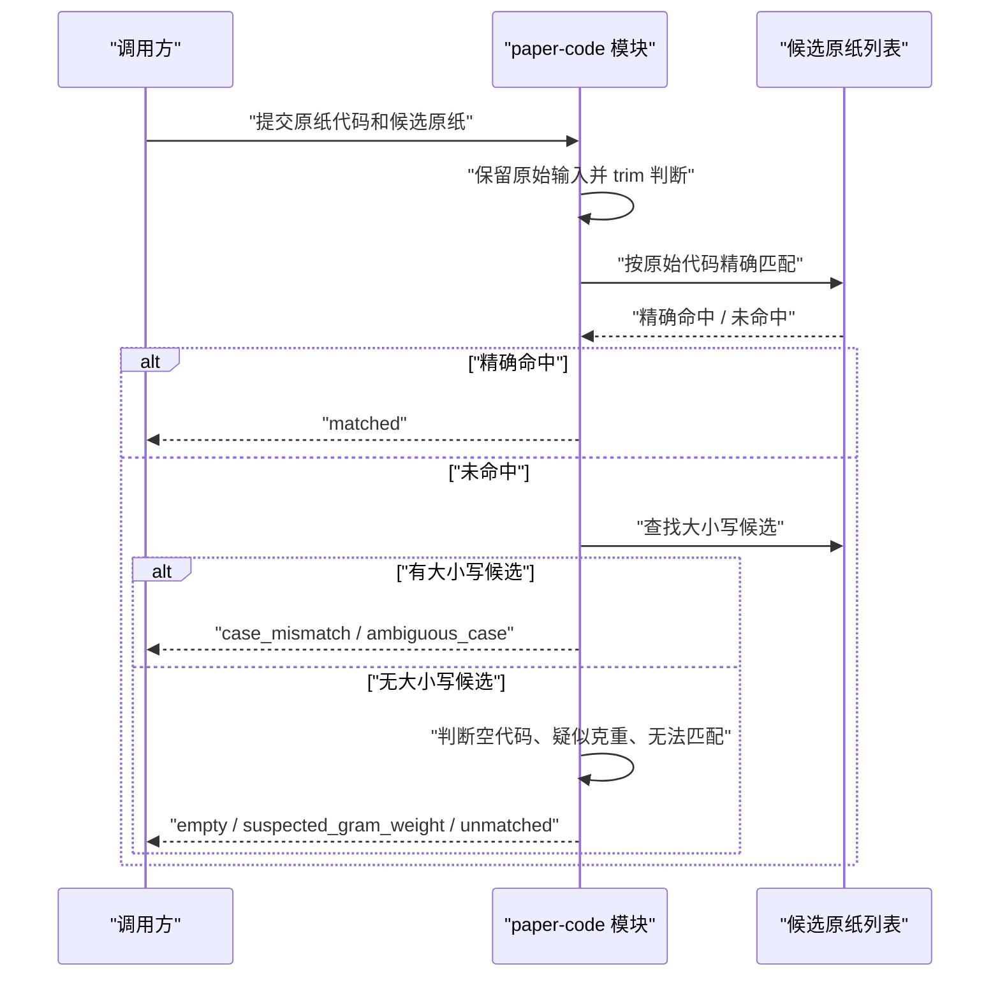
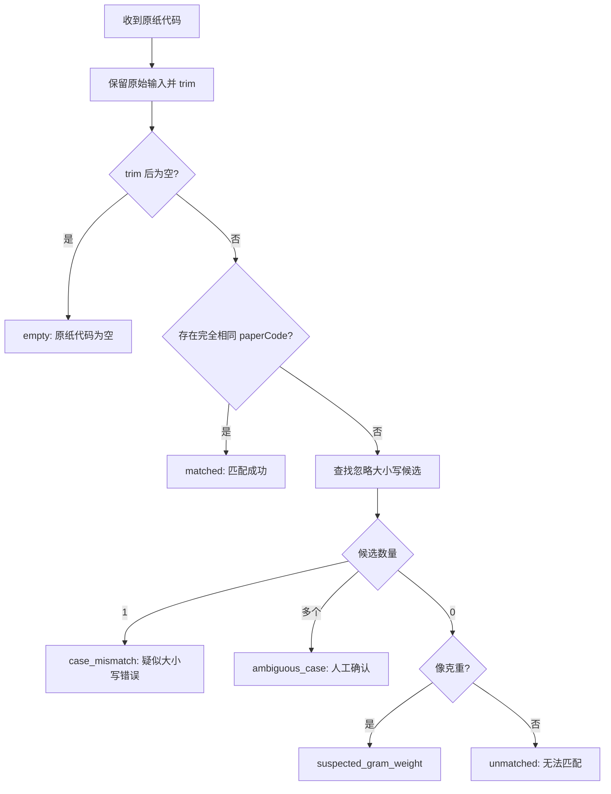

# 原纸代码映射 — 技术设计文档

## 1. 设计概要

**功能描述**：扩展 `paper-code` 模块，使它从“只支持精确匹配”的辅助函数，升级为可复用的原纸代码映射能力：支持大小写敏感精确匹配、`aδ` 等特殊代码、大小写候选提示、疑似克重误填识别、空代码识别、无法匹配识别和批量异常清单。→ AC-001 到 AC-012

**影响范围**：`src/modules/paper-code`、`tests/unit/paper-code`，以及少量复用方 `src/modules/master-data/match-import-row.ts` 的兼容调整。无需新增页面、Server Action、数据库表或第三方依赖。→ AC-012

**技术难点**：原纸代码必须区分大小写，但又要在精确匹配失败时给出大小写候选；`aδ` 这类非普通英文字母必须原样保留；`250g`、`250G`、`250` 要被识别为疑似克重误填，但不能影响真实存在的同名原纸代码。→ AC-002, AC-003, AC-004, AC-006, AC-010

**外部依赖**：无新增依赖。使用 TypeScript 字符串处理、正则和 Vitest 单元测试即可。→ AC-012

---

## 2. 架构概览

本功能保持 `paper-code` 为纯业务模块。调用方传入候选原纸列表和待匹配代码，模块返回结构化结果。当前主数据纸价关联仍可继续使用精确匹配；后续历史订单导入可以使用完整映射结果展示待确认和异常清单。



### 模块职责

| 模块 / 文件 | 职责 | 对应 AC |
|-------------|------|---------|
| `src/modules/paper-code/match-paper-code.ts` | 定义候选原纸、匹配状态、单个代码映射、批量映射、异常汇总 | AC-001 到 AC-011 |
| `src/modules/master-data/match-import-row.ts` | 继续复用精确匹配，必要时只读取 `matched` 结果，保持主数据导入行为稳定 | AC-001, AC-010, AC-012 |
| `tests/unit/paper-code/match-paper-code.test.ts` | 覆盖大小写、`aδ`、`dc` 歧义、`250g`、空代码、无法匹配和批量汇总 | AC-001 到 AC-012 |

---

## 3. 数据模型与存储

本功能不新增数据库表，也不修改现有表。→ AC-012

理由：

- 原纸代码来源已经存在于当前原纸资料 `paper_materials.paper_code`，本功能只负责“给定候选列表后如何匹配”。→ AC-001
- 大小写候选、疑似克重、空代码和无法匹配都是本次映射过程的结果，不需要长期保存。后续历史订单导入可以把这些结果保存到自己的导入批次或异常行中。→ AC-008, AC-011
- 不新增存储可避免提前进入历史订单导入和异常确认流程。→ AC-012

### 候选原纸契约

`paper-code` 不直接依赖数据库 schema，只要求候选项具备最小字段：

| 字段 | 类型 | 说明 | 对应 AC |
|------|------|------|---------|
| `id` | `string` | 原纸唯一标识，由调用方传入 | AC-001 |
| `paperCode` | `string` | 原纸代码，必须保留大小写和特殊字符 | AC-001, AC-002, AC-003 |

保留泛型能力，允许调用方额外携带原纸名称、纸厂、克重等字段，匹配结果原样返回候选对象，方便页面或导入流程展示。→ AC-004, AC-005

---

## 4. API / 函数契约

本功能不新增公开 REST API 或 Server Action，只新增模块内纯函数。→ AC-012

### `matchPaperCode`

**描述**：对单个原纸代码执行完整映射。→ AC-001 到 AC-007, AC-009, AC-010

**位置**：`src/modules/paper-code/match-paper-code.ts`

**输入**：

```ts
interface MatchPaperCodeInput<TCandidate extends PaperCodeMatchCandidate> {
  paperCode: string | undefined;
  candidates: TCandidate[];
}
```

**输出**：

```ts
type PaperCodeMatchResult<TCandidate> =
  | { status: "matched"; input: string; normalizedInput: string; material: TCandidate }
  | { status: "case_mismatch"; input: string; normalizedInput: string; candidates: TCandidate[]; message: string }
  | { status: "ambiguous_case"; input: string; normalizedInput: string; candidates: TCandidate[]; message: string }
  | { status: "suspected_gram_weight"; input: string; normalizedInput: string; message: string }
  | { status: "empty"; input: string; normalizedInput: string; message: string }
  | { status: "unmatched"; input: string; normalizedInput: string; message: string };
```

**状态说明**：

| 状态 | 触发条件 | 用户可见含义 | 对应 AC |
|------|----------|--------------|---------|
| `matched` | 原始输入 trim 后与候选 `paperCode` 完全一致 | 匹配成功 | AC-001, AC-002, AC-003 |
| `case_mismatch` | 无精确匹配，但忽略大小写后只有一个候选 | 疑似大小写错误 | AC-004, AC-010 |
| `ambiguous_case` | 无精确匹配，但忽略大小写后有多个候选 | 无法唯一确定，需要人工确认 | AC-005, AC-010 |
| `suspected_gram_weight` | 无精确匹配和大小写候选，输入形如 `250g` / `250G` / `250` | 疑似克重误填 | AC-006 |
| `empty` | 输入为空、`undefined` 或 trim 后为空 | 原纸代码为空 | AC-007 |
| `unmatched` | 以上都不满足 | 无法匹配 | AC-009 |

### `matchPaperCodes`

**描述**：批量映射一组原纸代码，逐条保留原始输入和状态。→ AC-008, AC-011

**输入**：

```ts
interface MatchPaperCodesInput<TCandidate extends PaperCodeMatchCandidate> {
  paperCodes: Array<string | undefined>;
  candidates: TCandidate[];
}
```

**输出**：

```ts
interface PaperCodeBatchMatchResult<TCandidate> {
  rows: Array<PaperCodeMatchResult<TCandidate>>;
  summary: PaperCodeMatchSummary;
}
```

### `summarizePaperCodeMatches`

**描述**：把批量结果按匹配成功、需要人工确认、无法匹配、异常原因汇总。→ AC-011

**输出**：

```ts
interface PaperCodeMatchSummary {
  matchedCount: number;
  confirmationRequiredCount: number;
  failedCount: number;
  suspectedGramWeightCount: number;
  emptyCount: number;
  unmatchedCount: number;
}
```

### `matchPaperCodeExactly`

**描述**：保留现有精确匹配函数，作为兼容入口。内部可复用 `matchPaperCode`，只在 `status === "matched"` 时返回原纸，否则返回 `undefined`。→ AC-001, AC-010, AC-012

保留该函数可以让 `master-data` 当前纸价自动关联不被改变：纸价导入仍然只接受精确原纸代码匹配，不会因为大小写候选而自动关联。→ AC-010

---

## 5. 核心逻辑

### 单个代码映射流程 → AC-001 到 AC-007, AC-009, AC-010

1. 把输入转成 `input` 字段保存；`undefined` 统一视为空字符串。
2. 使用 `trim()` 得到 `normalizedInput`，只去除前后空白，不改变大小写，不移除 `δ` 等特殊字符。→ AC-003
3. 如果 `normalizedInput` 为空，返回 `empty`。→ AC-007
4. 在候选列表中查找 `candidate.paperCode === normalizedInput` 的精确匹配。
5. 如果命中，返回 `matched`。→ AC-001, AC-002, AC-003
6. 如果未命中，查找 `candidate.paperCode.toLocaleLowerCase() === normalizedInput.toLocaleLowerCase()` 的候选。
7. 如果大小写候选为 1 个，返回 `case_mismatch`。→ AC-004
8. 如果大小写候选多于 1 个，返回 `ambiguous_case`。→ AC-005
9. 如果没有大小写候选，再判断是否疑似克重误填。→ AC-006
10. 仍不命中时返回 `unmatched`。→ AC-009



### 疑似克重判断 → AC-006

判断规则：

- `^\d{2,3}\s*[gG]?$`
- 数值范围建议为 `30` 到 `999`，覆盖常见原纸克重并避免单个数字误判。
- 只有在没有精确匹配、没有大小写候选时才启用疑似克重判断。

这样如果资料库里真实存在原纸代码 `250`，仍会优先返回精确匹配，不会误判为克重。→ AC-001, AC-006

### 大小写候选查找 → AC-002, AC-004, AC-005, AC-010

大小写候选只用于提示，不参与自动成功匹配。

处理规则：

- 精确匹配永远优先于候选提示。
- 忽略大小写比较只用于找候选。
- 一个候选返回 `case_mismatch`。
- 多个候选返回 `ambiguous_case`。
- 两种候选状态都不得被 `matchPaperCodeExactly` 当作成功。→ AC-010

### 特殊历史代码处理 → AC-003

本功能不限制原纸代码字符集，不用“只允许英文数字”的校验。`aδ` 这类代码只要候选中存在完全相同字符串，就返回匹配成功。

注意：

- 不做 Unicode 归一化替换。
- 不把 `δ` 转成 `d`。
- 不移除内部字符。
- 只 trim 前后空白，保留用户输入主体。

### 批量映射与异常汇总 → AC-008, AC-011

批量映射是对 `matchPaperCode` 的逐条调用，不做跨行自动修正。返回结果包含：

- `rows`：每条输入的原始值、状态、匹配原纸或候选/原因。
- `summary`：汇总匹配成功、需要人工确认、疑似克重、空代码、无法匹配等数量。

“需要人工确认”包含：

- `case_mismatch`
- `ambiguous_case`

“无法匹配”包含：

- `unmatched`
- `empty`
- `suspected_gram_weight`

后续历史订单导入可以基于这些分组展示待确认和失败清单，但本功能不实现历史订单导入页面。→ AC-011, AC-012

### 与主数据导入的兼容 → AC-001, AC-010, AC-012

当前 `master-data` 纸价表关联调用 `matchPaperCodeExactly`。本次保留该入口：

- 精确匹配成功时，行为不变。
- 大小写候选、疑似克重、空代码和无法匹配仍返回 `undefined`。
- 主数据纸价关联继续走原纸编码和组合匹配分支，不会因为大小写候选自动关联错误原纸。

如果后续希望纸价表也展示大小写候选，可另开变更任务；本次不扩大主数据页面行为。→ AC-012

---

## 6. 现有代码改动

| 模块 / 文件 | 改动内容 | 原因 | 对应 AC |
|-------------|---------|------|---------|
| `src/modules/paper-code/match-paper-code.ts` | 扩展类型和函数：`matchPaperCode`、`matchPaperCodes`、`summarizePaperCodeMatches`，保留 `matchPaperCodeExactly` | 集中实现原纸代码映射规则 | AC-001 到 AC-011 |
| `src/modules/paper-code/README.md` | 补充模块能力和边界说明 | 让后续开发知道本模块不依赖历史订单、不自动替换候选 | AC-010, AC-012 |
| `src/modules/master-data/match-import-row.ts` | 如有必要，仅调整为继续调用兼容后的 `matchPaperCodeExactly` | 保持现有纸价表自动关联行为稳定 | AC-001, AC-010 |
| `tests/unit/paper-code/match-paper-code.test.ts` | 新增 P0 单元测试，覆盖所有匹配状态和批量汇总 | 原纸代码映射属于 P0 测试范围 | AC-001 到 AC-012 |

---

## 7. 技术决策

### 使用纯函数模块，不新增数据库表

**背景**：需求只要求给定候选原纸和输入代码后输出映射结果；候选原纸已经由主数据提供。

**选项**：

- A: 在 `paper-code` 中新增数据库读取能力 — 调用更省事，但会让模块依赖数据库，也不符合 `paper-code` 不反向依赖历史订单和页面的边界。
- B: 由调用方传入候选原纸，`paper-code` 只做纯匹配 — 复用性强、测试简单、不扩大存储范围。

**结论**：选择 B。后续历史订单导入、纸价表导入、测试都可以复用同一套纯函数。→ AC-008, AC-011, AC-012

### 保留 `matchPaperCodeExactly` 兼容入口

**背景**：当前主数据纸价表关联已经依赖 `matchPaperCodeExactly`，并且只希望精确代码自动匹配。

**选项**：

- A: 直接替换为完整映射结果 — 功能更强，但可能改变已完成的纸价导入行为。
- B: 新增完整映射函数，同时保留精确匹配入口 — 兼容现有能力，后续功能可按需使用完整结果。

**结论**：选择 B。疑似候选不会被现有主数据导入静默当作成功。→ AC-001, AC-010, AC-012

### 疑似克重只在无候选时判断

**背景**：`250` 可能是用户误填克重，也可能极端情况下是真实原纸代码。

**选项**：

- A: 看到数字或 `g` 后缀就优先判为克重 — 容易误伤真实代码。
- B: 先做精确匹配和大小写候选，再判断疑似克重 — 既保护真实代码，又能识别常见脏数据。

**结论**：选择 B。真实存在的代码永远优先匹配。→ AC-001, AC-006

### 不限制原纸代码字符集

**背景**：需求明确支持 `aδ`，历史代码可能包含非普通英文字母。

**选项**：

- A: 只允许英文字母和数字 — 校验简单，但不满足历史代码。
- B: 不做字符集限制，只做 trim 和精确比较 — 能最大程度保留历史原貌。

**结论**：选择 B。异常识别通过状态和候选完成，不通过字符集硬拒绝。→ AC-003

---

## 8. 安全与性能

**输入处理**：输入只做 `trim()`，不执行、不拼接 SQL、不写日志；结果保留原始输入，便于后续导入展示和人工修正。→ AC-007, AC-008, AC-011

**敏感数据**：测试只使用脱敏样例，如 `r2`、`dC`、`DC`、`aδ`、`250g`，不复制真实业务表中的原纸价格、供应商或订单数据。→ AC-012

**性能考量**：首版候选原纸数量可直接数组查找。若后续历史订单批量数据量大，可在 `matchPaperCodes` 内部预构建两个索引：

- `exactMap: Map<string, TCandidate>`
- `lowercaseMap: Map<string, TCandidate[]>`

这样批量映射从逐条全表扫描优化为近似 O(n + m)，其中 n 为候选数，m 为输入代码数。→ AC-008, AC-011

**一致性**：如果候选列表中出现重复 `paperCode`，该问题应由主数据唯一约束先保证；`paper-code` 可在批量索引构建时把重复精确代码视为 `ambiguous_case` 或保留第一个并在测试中记录风险。当前数据库已约束原纸代码唯一，因此首版按唯一候选处理。→ AC-001, AC-002

---

## 9. AC 覆盖总表

| AC 编号 | 验收标准概述 | 实现位置 |
|---------|-------------|---------|
| AC-001 | 精确匹配原纸代码 | `matchPaperCode` 的 `matched` 分支、`matchPaperCodeExactly` |
| AC-002 | 区分大小写匹配 | 精确比较使用 `===`，不做大小写转换 |
| AC-003 | 支持特殊历史代码 | 输入只 trim，不限制字符集，`aδ` 可精确匹配 |
| AC-004 | 单一大小写候选提示 | `case_mismatch` 状态 |
| AC-005 | 多个大小写候选进入待确认 | `ambiguous_case` 状态 |
| AC-006 | 疑似克重误填 | `isSuspectedGramWeightCode` + `suspected_gram_weight` 状态 |
| AC-007 | 空代码进入异常清单 | `empty` 状态 |
| AC-008 | 批量映射返回逐条结果 | `matchPaperCodes` 返回 `rows` |
| AC-009 | 无候选代码无法匹配 | `unmatched` 状态 |
| AC-010 | 疑似候选不得自动替换 | `matchPaperCodeExactly` 只接受 `matched`，候选状态不返回成功 |
| AC-011 | 批量异常清单可用于后续导入 | `summarizePaperCodeMatches` 返回汇总 |
| AC-012 | 本功能不处理历史订单数据 | 不新增历史订单导入、页面、数据库表或 `historical-orders` 依赖 |

---

## 附录：变更记录

| 日期 | 变更内容 | 原因 |
|------|---------|------|
| 2026-07-01 | 初始版本 | 根据“原纸代码映射”需求文档产出可执行技术方案 |
