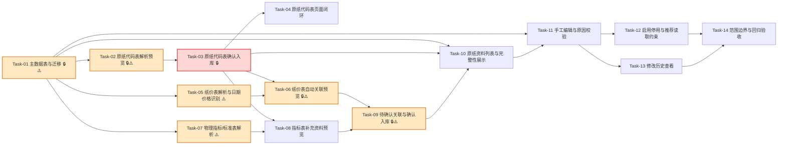

# 原纸资料自动建库与可追溯维护 — 开发任务计划

## 1. 任务概览

**总任务数**：14 个
**预计总工时**：1040 分钟（约 17.5 小时）
**开发方法**：TDD — 每个任务按 RED → GREEN → REFACTOR 循环执行

**关键标注**：
- 🔒 阻塞任务：被多个任务依赖，建议优先完成
- ⚠️ 风险任务：技术难度高，可能需要额外时间

### 依赖关系图

### 可并行任务组

| 并行组 | 任务 | 说明 |
|--------|------|------|
| 组 1 | Task-05, Task-07 | 主数据表完成后，纸价表解析和物理指标/标准表解析互不依赖，可并行推进。 |
| 组 2 | Task-10, Task-11 | Task-03 完成后可先做基础资料列表；Task-11 依赖列表入口，但变更原因纯逻辑可先并行开发。 |
| 组 3 | Task-12, Task-13 | 手工编辑和变更日志完成后，启停能力和历史查看可并行。 |

---

## 2. 开发任务

> 按垂直切片组织。每个阶段对应一个可独立运行和验证的用户行为（加可选的基础设施层）。切片内部的任务按技术层自然顺序排列。
>
> 每个任务按 TDD 循环执行：RED（根据验证标准写测试）→ GREEN（写最小实现通过测试）→ REFACTOR（重构）

### 阶段一：用户可以导入原纸代码表建立基础资料库

**阶段完成标准**：用户上传原纸代码表后，可以看到新增、失败、不完整预览；确认后系统建立纸厂和原纸基础档案。

---

#### [x] Task-01: 主数据表与迁移 🔒⚠️

**通俗解释**：系统先准备好保存纸厂、原纸、导入记录和修改历史的位置，后面导入的数据才有地方放。

**做什么**：新增主数据相关 schema，包含 `paper_factories`、`paper_materials`、`paper_material_price_histories`、`paper_quality_standards`、`master_data_import_batches`、`master_data_import_rows`、`paper_material_match_rules`、`master_data_change_logs`；更新 schema 汇总导出；生成 Drizzle 迁移；确保迁移不写入真实业务数据。

**涉及文件**：`src/db/schema/paper-factories.ts`、`src/db/schema/paper-materials.ts`、`src/db/schema/master-data-imports.ts`、`src/db/schema/index.ts`、`src/db/migrations/*`、`tests/integration/master-data/master-data-schema.test.ts`

**参考**：技术方案 3、6 → AC-003, AC-019, AC-023, AC-025

**依赖**：无

**预估工时**：110 分钟

**验证标准**（TDD RED 阶段直接转化为测试用例）：
- [ ] 导入 `src/db/schema` 时，可以获取 `paperFactories`、`paperMaterials`、`masterDataImportBatches`、`masterDataImportRows`、`masterDataChangeLogs` 等 schema 导出。
- [ ] `paper_materials.paper_code` 定义唯一约束；`paper_materials.paper_encoding` 不定义唯一约束。
- [ ] `paper_materials` 包含 `completeness_status`、`missing_fields`、`is_active` 字段。
- [ ] 迁移文件包含主数据业务表创建语句，不包含真实原纸代码、真实纸价、真实订单或客户名称。
- [ ] schema 文件均位于 `src/db/schema`，未新增项目顶层目录。

---

#### [x] Task-02: 原纸代码表解析预览 🔒⚠️

**通俗解释**：用户上传原纸代码表后，系统能读懂表头，告诉用户哪些原纸会新增、哪些行有问题。

**做什么**：在 `import-export` 中实现原纸代码表解析，扫描表头并规范化字段；在 `master-data` 中实现原纸代码表预览分组，校验必填字段、数值字段、批次内重复代码、原纸编码重复提示和资料完整性。

**涉及文件**：`src/modules/import-export/master-data-workbook-parser.ts`、`src/modules/master-data/import-preview.ts`、`src/modules/master-data/completeness.ts`、`tests/unit/import-export/master-data-workbook-parser.test.ts`、`tests/unit/master-data/paper-code-import-preview.test.ts`

**参考**：技术方案 5 / 表头识别与规范化、原纸代码表预览 → AC-001, AC-002, AC-010, AC-011, AC-014, AC-015, AC-020

**依赖**：Task-01

**预估工时**：100 分钟

**验证标准**（TDD RED 阶段直接转化为测试用例）：
- [ ] 传入包含标题行和说明行的 `.xlsx` 原纸代码表样例，解析器能定位到 `原纸代码、原纸编码、克重、原纸供应商简称、原纸名称` 表头。
- [ ] 传入一行 `{ 原纸代码: "r2", 原纸编码: "B04033", 克重: "105", 原纸供应商简称: "供应商A", 原纸名称: "105g高强瓦楞纸" }` → 预览行状态为 `new`，并包含待创建纸厂名称。
- [ ] 传入两行相同 `原纸代码: "r2"` → 两行都进入 `failed`，错误原因包含“原纸代码重复”。
- [ ] 传入两行相同 `原纸编码: "B02022"` 但不同原纸代码 → 不进入失败，预览提示原纸编码仅作为辅助字段。
- [ ] 传入缺少原纸代码、克重、供应商简称或原纸名称的行 → 该行进入 `failed`，错误中指出具体缺失字段。
- [ ] 传入克重为 `"abc"` 的行 → 该行进入 `failed`，错误中指出克重不是有效数值。
- [ ] 原纸代码表只提供基础字段时 → 预览可标记 `incomplete`，缺失字段至少包含纸类、纸价、强度指标相关项。

---

#### [x] Task-03: 原纸代码表确认入库 🔒

**通俗解释**：用户确认预览后，系统真正创建纸厂和原纸，并把这次导入记录下来。

**做什么**：新增 `previewMasterDataImport` 和 `confirmMasterDataImport` 的服务端动作骨架；保存导入批次和预览行；实现原纸代码表确认入库事务，自动创建纸厂和原纸，写入导入批次状态和基础变更记录。

**涉及文件**：`src/server/actions/master-data-actions.ts`、`src/modules/master-data/import-commit.ts`、`src/modules/master-data/change-log.ts`、`tests/integration/master-data/paper-code-import-actions.test.ts`

**参考**：技术方案 4 / `previewMasterDataImport`、`confirmMasterDataImport`，技术方案 5 / 确认入库事务 → AC-003, AC-006, AC-019, AC-023

**依赖**：Task-02

**预估工时**：95 分钟

**验证标准**（TDD RED 阶段直接转化为测试用例）：
- [ ] 未登录调用 `previewMasterDataImport` → 返回 `AUTH_REQUIRED`，不执行解析和写入。
- [ ] 已登录上传有效原纸代码表样例 → 返回 `ok: true`，包含 `batchId` 和新增/不完整数量摘要。
- [ ] 确认包含两条新原纸的批次 → 创建对应纸厂和原纸，批次状态变为 `confirmed`。
- [ ] 确认已确认过的批次 → 返回 `VALIDATION_ERROR`，不重复创建原纸。
- [ ] 确认入库前数据库中已存在同名原纸代码 → 返回校验失败或将相关行标记失败，不破坏已有原纸。
- [ ] 入库后打开变更历史查询原纸 → 能看到来源为 `import` 的创建记录。

---

#### [x] Task-04: 原纸代码表页面闭环

**通俗解释**：用户能在页面上上传原纸代码表、看到预览结果，并点击确认完成建库。

**做什么**：替换主数据占位页，新增上传入口、来源类型选择、预览摘要、分组表格和确认按钮；接入 `previewMasterDataImport` 与 `confirmMasterDataImport`；失败和不完整信息使用业务语言展示。

**涉及文件**：`src/app/(main)/master-data/page.tsx`、`src/app/(main)/master-data/_components/import-upload-panel.tsx`、`src/app/(main)/master-data/_components/import-preview-table.tsx`、`tests/integration/master-data/master-data-import-page.test.tsx`

**参考**：技术方案 2、4、6 → AC-001, AC-002, AC-003, AC-010, AC-014

**依赖**：Task-03

**预估工时**：80 分钟

**验证标准**（TDD RED 阶段直接转化为测试用例）：
- [x] 渲染主数据页面 → 页面包含原纸代码表导入入口、文件选择控件和预览区域。
- [x] 模拟上传成功返回 `{ newCount: 2, failedCount: 1, incompleteCount: 2 }` → 页面展示新增、失败、资料不完整分组数量。
- [x] 预览行含错误“缺少原纸代码” → 页面在失败分组展示该错误，不展示堆栈或内部异常。
- [x] 点击确认入库且动作成功 → 页面展示入库成功摘要。
- [x] 点击确认入库且存在动作错误 `VALIDATION_ERROR` → 页面展示业务提示，确认按钮恢复可用。

---

### 阶段二：用户可以导入价格和指标表补齐资料

**阶段完成标准**：用户上传纸价表或物理指标/标准表后，系统能自动关联唯一原纸；不确定的进入待确认，无法关联的进入失败。

---

#### Task-05: 纸价表解析与日期价格识别 ⚠️

**通俗解释**：系统能读懂按月份和日期散落的纸价表，把价格整理成可用于关联的记录。

**做什么**：实现纸价表解析：识别供应商、原纸品种、纸价/日期纸价列；支持多 sheet；提取可识别日期；把一行多列价格转为规范价格记录；非法价格标记字段错误。

**涉及文件**：`src/modules/import-export/master-data-workbook-parser.ts`、`tests/unit/import-export/paper-price-workbook-parser.test.ts`

**参考**：技术方案 5 / 表头识别与规范化、纸价表自动关联 → AC-004, AC-015

**依赖**：Task-01

**预估工时**：90 分钟

**验证标准**（TDD RED 阶段直接转化为测试用例）：
- [ ] 传入包含 sheet `23-3`、表头 `供应商、原纸品种、3月纸价、3.8纸价` 的样例 → 解析出供应商、原纸品种和两条价格字段。
- [ ] 传入供应商列为空但上一行供应商存在的样例 → 解析器沿用上一条供应商。
- [ ] 传入价格单元格 `"3230"` → 解析为 `3230` 元/吨。
- [ ] 传入价格单元格 `"abc"` → 该价格字段进入错误，不作为有效价格。
- [ ] 传入没有任何纸价列的 sheet → 该 sheet 不产生价格记录，并返回可诊断提示。

---

#### Task-06: 纸价表自动关联预览 🔒⚠️

**通俗解释**：纸价表没有原纸代码时，系统会尽量自动找对应原纸；找不准时不会乱猜，会留给用户确认。

**做什么**：实现纸价表自动关联规则：已确认规则优先、原纸代码精确匹配、原纸编码辅助匹配、供应商简称 + 原纸名称/品种 + 克重组合匹配；生成更新、待确认、失败预览；更新当前价格变化集。

**涉及文件**：`src/modules/master-data/import-preview.ts`、`src/modules/master-data/match-import-row.ts`、`src/modules/paper-code/match-paper-code.ts`、`tests/unit/master-data/paper-price-import-preview.test.ts`

**参考**：技术方案 5 / 纸价表自动关联，技术方案 7 / 原纸编码不能作为唯一标识 → AC-004, AC-012, AC-013, AC-020, AC-021, AC-022

**依赖**：Task-03, Task-05

**预估工时**：100 分钟

**验证标准**（TDD RED 阶段直接转化为测试用例）：
- [ ] 已存在原纸代码 `r2`，导入行包含 `paperCode: "r2"` → 关联结果为唯一匹配，预览状态为 `update`。
- [ ] 已存在两张原纸使用同一原纸编码 `B02022`，导入行只包含该编码 → 预览状态为 `pending`，候选项为两张原纸。
- [ ] 已存在一条确认规则匹配来源签名，导入同类纸价行 → 优先关联到确认规则中的原纸。
- [ ] 供应商简称 + 原纸品种 + 克重组合只匹配一张原纸 → 预览状态为 `update`。
- [ ] 组合信息匹配多张原纸 → 预览状态为 `pending`，不自动选择其中一张。
- [ ] 没有任何候选原纸 → 预览状态为 `failed`，错误原因包含“无法关联原纸”。
- [ ] 有效价格比当前价格不同 → `changeSet` 包含 `price_yuan_per_ton` 的旧值和新值。

---

#### Task-07: 物理指标/标准表解析 ⚠️

**通俗解释**：系统能从质量标准表中整理出纸类、克重范围、耐破和环压这些后续配纸会用到的规则。

**做什么**：实现物理指标/标准表解析，支持识别 `质量标准`、`基础表`、`瓦纸标准`、`箱板纸标准` 等 sheet 中可结构化的标准行；输出 `paperQualityStandard` 规范记录；无法确定为具体原纸的标准只作为规则保存。

**涉及文件**：`src/modules/import-export/master-data-workbook-parser.ts`、`tests/unit/import-export/quality-standard-workbook-parser.test.ts`

**参考**：技术方案 5 / 表头识别与规范化、物理指标/标准表导入 → AC-005, AC-015

**依赖**：Task-01

**预估工时**：90 分钟

**验证标准**（TDD RED 阶段直接转化为测试用例）：
- [ ] 传入包含 `瓦纸标准` 表头 `物理指标、单位、等级` 的样例 → 解析出瓦纸相关标准记录。
- [ ] 传入包含 `箱板纸标准` 和等级字段的样例 → 解析出箱板纸相关标准记录。
- [ ] 传入耐破或环压为有效数字的单元格 → 输出标准记录包含对应数值。
- [ ] 传入耐破或环压为非法文本 → 输出字段错误，不写入该指标值。
- [ ] 只能表达纸类标准、无法唯一指向原纸的行 → 输出为标准规则，不生成具体原纸更新。

---

#### Task-08: 指标表补充资料预览

**通俗解释**：导入指标表后，系统能告诉用户哪些原纸可以补充强度资料，哪些只是标准规则。

**做什么**：把物理指标/标准表解析结果接入主数据预览；唯一关联具体原纸时生成更新预览；只能作为纸类标准时生成标准规则预览；重新计算资料完整性缺失项。

**涉及文件**：`src/modules/master-data/import-preview.ts`、`src/modules/master-data/completeness.ts`、`tests/unit/master-data/quality-standard-import-preview.test.ts`

**参考**：技术方案 5 / 物理指标/标准表导入、资料完整性判断 → AC-005, AC-008, AC-016

**依赖**：Task-03, Task-07

**预估工时**：70 分钟

**验证标准**（TDD RED 阶段直接转化为测试用例）：
- [ ] 指标记录能唯一关联原纸，且包含耐破指数和横向环压指数 → 预览状态为 `update`，`changeSet` 包含两个指标字段。
- [ ] 指标记录只能表示“瓦纸某等级克重区间” → 预览结果包含将写入标准规则的提示，不覆盖具体原纸。
- [ ] 原纸原本缺少强度指标，导入后补齐耐破和环压但仍缺少纸价 → 完整性仍为 `incomplete`，缺失字段只剩纸价等未补字段。
- [ ] 原纸通过指标表补齐最后缺失字段 → 完整性变为 `complete`。

---

### 阶段三：用户可以处理待确认项并正式入库

**阶段完成标准**：用户能处理待确认关联，确认入库后当前资料、价格历史、标准规则和变更历史保持一致。

---

#### Task-09: 待确认关联与确认入库 🔒⚠️

**通俗解释**：系统找不准的关联，用户可以选对；确认后系统会记住，下次就少问一次。

**做什么**：实现 `resolveMasterDataImportRow`；保存确认关联规则；完善纸价/指标表确认入库事务，写入价格历史、当前价格、质量标准、变更日志；页面展示待确认候选并允许选择。

**涉及文件**：`src/server/actions/master-data-actions.ts`、`src/modules/master-data/import-commit.ts`、`src/modules/master-data/import-preview.ts`、`src/app/(main)/master-data/_components/pending-match-table.tsx`、`tests/integration/master-data/pending-match-and-confirm.test.ts`、`tests/integration/master-data/pending-match-table.test.tsx`

**参考**：技术方案 4 / `resolveMasterDataImportRow`、`confirmMasterDataImport`，技术方案 5 / 确认入库事务 → AC-006, AC-007, AC-012, AC-021, AC-022, AC-023

**依赖**：Task-06, Task-08

**预估工时**：115 分钟

**验证标准**（TDD RED 阶段直接转化为测试用例）：
- [ ] 对 `pending` 行调用 `resolveMasterDataImportRow` 并传入有效原纸 ID → 行状态变为 `update`，`targetMaterialId` 被写入。
- [ ] 处理待确认行后，`paper_material_match_rules` 新增一条确认规则。
- [ ] 对非 `pending` 行调用 `resolveMasterDataImportRow` → 返回 `VALIDATION_ERROR`。
- [ ] 批次存在未解决 `pending` 行时调用 `confirmMasterDataImport` → 返回 `VALIDATION_ERROR`，提示先处理待确认项。
- [ ] 确认纸价批次 → 写入价格历史，并同步更新原纸当前价格。
- [ ] 确认指标批次 → 写入质量标准或更新原纸强度指标。
- [ ] 确认入库后，对有字段变化的原纸写入 `master_data_change_logs`。
- [ ] 页面渲染待确认行时展示候选原纸和不确定原因；用户选择候选后可提交确认。

---

### 阶段四：用户可以查看、维护和停用资料库

**阶段完成标准**：用户可以查看资料完整性，手工编辑原纸，按要求填写原因，停用后该原纸不再被后续推荐读取。

---

#### Task-10: 原纸资料列表与完整性展示

**通俗解释**：用户能看到哪些原纸资料已经可用，哪些还缺价格、纸类或强度指标。

**做什么**：实现 `listPaperMaterials` 服务端动作和列表页面；支持按资料完整性、启用状态、纸类、纸厂、关键字筛选；展示缺失字段和是否可用于正式推荐。

**涉及文件**：`src/server/actions/master-data-actions.ts`、`src/modules/master-data/list-paper-materials.ts`、`src/app/(main)/master-data/_components/paper-material-list.tsx`、`tests/integration/master-data/list-paper-materials.test.ts`、`tests/integration/master-data/paper-material-list.test.tsx`

**参考**：技术方案 4 / `listPaperMaterials`，技术方案 5 / 资料完整性判断 → AC-008, AC-016

**依赖**：Task-03

**预估工时**：70 分钟

**验证标准**（TDD RED 阶段直接转化为测试用例）：
- [ ] 已存在一条 `complete` 原纸和一条 `incomplete` 原纸，查询不带筛选 → 返回两条并包含完整性状态。
- [ ] 查询 `completenessStatus: "incomplete"` → 只返回资料不完整原纸。
- [ ] 原纸缺少纸价和强度指标 → 列表项 `missingFields` 包含纸价、耐破指数、横向环压指数。
- [ ] 页面渲染资料列表 → 每行显示原纸代码、名称、纸厂、克重、当前价格、完整性状态和启用状态。
- [ ] 用户按“资料不完整”筛选 → 页面只展示资料不完整的原纸。

---

#### Task-11: 手工编辑与原因校验

**通俗解释**：用户能修正导入后的资料；改影响计算的字段时，必须写清楚为什么改。

**做什么**：实现 `updatePaperMaterial`；计算变化字段；重要字段修改原因校验；保存当前资料并重新计算完整性；写入变更历史；新增编辑弹窗或表单。

**涉及文件**：`src/server/actions/master-data-actions.ts`、`src/modules/master-data/update-paper-material.ts`、`src/modules/master-data/change-log.ts`、`src/modules/master-data/completeness.ts`、`src/app/(main)/master-data/_components/paper-material-edit-form.tsx`、`tests/integration/master-data/update-paper-material.test.ts`、`tests/integration/master-data/paper-material-edit-form.test.tsx`

**参考**：技术方案 4 / `updatePaperMaterial`，技术方案 5 / 修改原因校验 → AC-009, AC-017, AC-019, AC-023

**依赖**：Task-10

**预估工时**：85 分钟

**验证标准**（TDD RED 阶段直接转化为测试用例）：
- [ ] 修改备注字段且不填写原因 → 保存成功，并写入变更历史。
- [ ] 修改纸价且不填写原因 → 返回 `VALIDATION_ERROR`，提示需要填写修改原因。
- [ ] 修改纸价并填写原因“供应商调价” → 保存成功，当前价格更新，变更历史包含旧值、新值和原因。
- [ ] 修改原纸代码为已存在代码 → 返回 `VALIDATION_ERROR`，提示原纸代码重复。
- [ ] 修改字段后补齐所有缺失资料 → 原纸完整性变为 `complete`。
- [ ] 编辑表单收到重要字段缺少原因错误 → 页面展示业务提示，不展示内部错误。

---

#### Task-12: 启用停用与推荐读取约束

**通俗解释**：不用的原纸可以停用；停用后它还在资料库里，但不会再被新方案拿去推荐。

**做什么**：实现 `setPaperMaterialActive`；停用/启用必须填写原因；写变更历史；提供供后续推荐模块读取的“可推荐原纸查询”函数，仅返回启用且资料完整的原纸。

**涉及文件**：`src/server/actions/master-data-actions.ts`、`src/modules/master-data/set-paper-material-active.ts`、`src/modules/master-data/list-recommendable-paper-materials.ts`、`src/app/(main)/master-data/_components/paper-material-list.tsx`、`tests/integration/master-data/set-paper-material-active.test.ts`、`tests/unit/master-data/list-recommendable-paper-materials.test.ts`

**参考**：技术方案 4 / `setPaperMaterialActive`，技术方案 5 / 资料完整性判断、修改原因校验 → AC-016, AC-017, AC-018

**依赖**：Task-11

**预估工时**：65 分钟

**验证标准**（TDD RED 阶段直接转化为测试用例）：
- [ ] 停用原纸且原因为空 → 返回 `VALIDATION_ERROR`。
- [ ] 停用原纸且原因为“停止采购” → 原纸 `isActive` 变为 false，并写入变更历史。
- [ ] 启用原纸且填写原因 → 原纸 `isActive` 变为 true，并写入变更历史。
- [ ] `listRecommendablePaperMaterials` 面对一条停用原纸、一条资料不完整原纸、一条启用且完整原纸 → 只返回启用且完整的原纸。
- [ ] 列表页面对停用原纸显示停用状态，且仍允许查看历史。

---

#### Task-13: 修改历史查看

**通俗解释**：用户能打开一张原纸，看清楚它什么时候被谁改过、改了什么、为什么改。

**做什么**：实现 `getMasterDataChangeHistory`；按原纸或纸厂查询变更历史；页面新增历史弹窗；历史展示字段旧值、新值、修改人、修改时间、修改原因和来源。

**涉及文件**：`src/server/actions/master-data-actions.ts`、`src/modules/master-data/change-log.ts`、`src/app/(main)/master-data/_components/change-history-modal.tsx`、`tests/integration/master-data/change-history.test.ts`、`tests/integration/master-data/change-history-modal.test.tsx`

**参考**：技术方案 4 / `getMasterDataChangeHistory`，技术方案 5 / 历史方案快照边界 → AC-023, AC-024

**依赖**：Task-11

**预估工时**：55 分钟

**验证标准**（TDD RED 阶段直接转化为测试用例）：
- [ ] 原纸存在一条导入变更和一条手工变更 → 查询历史按时间倒序返回两条。
- [ ] 历史记录包含 `price_yuan_per_ton` 变化 → 返回旧值、新值、修改人、修改时间和修改原因。
- [ ] 查询不存在的原纸历史 → 返回空列表或 `DATA_NOT_FOUND`，按实现约定稳定返回。
- [ ] 页面打开历史弹窗 → 展示字段名、旧值、新值、修改人、修改时间、原因。
- [ ] 更新当前原纸价格后，历史记录只新增变更日志，不回写或修改任何历史方案相关数据结构。

---

### 阶段五：用户获得稳定的建库边界和回归保障

**阶段完成标准**：功能范围清晰，不处理近三年订单数据；主流程和相关质量检查都能证明没有越界。

---

#### Task-14: 范围边界与回归验收

**通俗解释**：最后确认这次只做原纸资料建库，不把历史订单清洗等后续大功能混进来。

**做什么**：补充范围边界测试和文档检查；确认 `.xls` 近三年订单不被本功能接受；确认不接入 `historical-orders`；运行与本功能相关的质量检查；如实现中发现 AI 错误，记录到错题本。

**涉及文件**：`tests/integration/master-data/master-data-import-scope.test.ts`、`tests/integration/master-data/master-data-regression.test.ts`、必要时 `docs/ai-error-notebook.md`

**参考**：技术方案 1、7、8、9 → AC-024, AC-025

**依赖**：Task-12, Task-13

**预估工时**：45 分钟

**验证标准**（TDD RED 阶段直接转化为测试用例）：
- [ ] 上传 `.xls` 文件并选择本功能导入来源 → 返回 `VALIDATION_ERROR`，提示本功能只支持 `.xlsx` 和 `.csv`。
- [ ] 选择近三年订单数据导入本功能 → 返回范围错误或文件类型错误，且不写入 `historical-orders` 相关结构。
- [ ] 检查源码引用关系 → `src/modules/master-data` 不依赖 `src/modules/historical-orders`。
- [ ] 本功能相关测试通过：导入解析、自动关联、确认入库、完整性、手工编辑、启停、历史查看。
- [ ] 类型检查和 lint 通过，确认没有新增 `any`、未脱敏真实业务样例或真实连接信息。

---

## 3. AC 覆盖总表

> 最终检查：每条 AC 是否都有任务承接。这是全文档唯一的 AC 映射汇总。

| AC 编号 | 验收标准概述 | 承接任务 | 验证方式 |
|---------|-------------|---------|---------|
| AC-001 | 上传原纸代码表并识别字段 | Task-02, Task-04 | 解析器识别原纸代码表头；页面展示字段识别和导入入口。 |
| AC-002 | 预览原纸基础档案新增结果 | Task-02, Task-04 | 原纸代码表样例生成新增清单和纸厂数量摘要。 |
| AC-003 | 确认后建立原纸和纸厂资料 | Task-03, Task-04 | 确认批次后数据库出现纸厂和原纸，页面展示成功。 |
| AC-004 | 导入纸价表并自动关联唯一原纸 | Task-05, Task-06 | 纸价表样例解析后唯一匹配原纸并生成价格更新预览。 |
| AC-005 | 导入物理指标/标准表并补充资料 | Task-07, Task-08 | 指标表样例生成标准规则或原纸强度更新预览。 |
| AC-006 | 再次导入同一原纸代码更新当前资料 | Task-03, Task-09 | 同代码导入生成更新清单，确认后更新当前资料并写变更日志。 |
| AC-007 | 用户确认待确认关联 | Task-09 | 待确认行选择候选后变为可入库，并保存确认规则。 |
| AC-008 | 查看资料完整性 | Task-02, Task-08, Task-10 | 原纸列表展示完整/不完整状态和缺失字段。 |
| AC-009 | 导入后手工维护原纸 | Task-11 | 编辑导入原纸并保存，当前资料更新且生成历史。 |
| AC-010 | 原纸代码重复 | Task-02, Task-03, Task-04 | 批次内重复和确认前冲突均进入失败或校验错误。 |
| AC-011 | 原纸编码重复不作为失败 | Task-02, Task-06 | 重复原纸编码不失败，仅在自动关联时作为非唯一辅助信息。 |
| AC-012 | 无法唯一关联进入待确认 | Task-06, Task-09 | 多候选价格行进入待确认，页面展示候选项。 |
| AC-013 | 无可用关联进入失败 | Task-06 | 无候选导入行进入失败清单，错误为无法关联原纸。 |
| AC-014 | 必填字段缺失 | Task-02, Task-04 | 原纸代码表缺少必填字段时失败清单展示具体字段。 |
| AC-015 | 数值字段非法 | Task-02, Task-05, Task-07 | 克重、纸价、耐破、环压非法时进入字段错误。 |
| AC-016 | 资料不完整不得参与推荐 | Task-08, Task-10, Task-12 | 不完整原纸列表可见，但可推荐查询不返回。 |
| AC-017 | 修改重要字段未填写原因 | Task-11, Task-12 | 修改纸价或启停状态不填原因时保存失败。 |
| AC-018 | 停用原纸 | Task-12 | 停用后列表显示停用，可推荐查询排除该原纸。 |
| AC-019 | 原纸代码全局唯一 | Task-01, Task-03, Task-11 | 数据库唯一约束和保存校验共同保证全局唯一。 |
| AC-020 | 原纸编码不能作为唯一标识 | Task-02, Task-06 | 同编码多原纸时不会唯一匹配，进入待确认。 |
| AC-021 | 不静默猜测关联 | Task-06, Task-09 | 多候选行必须待确认，不能自动入库。 |
| AC-022 | 自动关联优先级 | Task-06, Task-09 | 单元测试覆盖确认规则、原纸代码、原纸编码、组合匹配顺序。 |
| AC-023 | 变更历史可查看 | Task-03, Task-09, Task-11, Task-13 | 导入、确认、手工编辑均写历史，页面可查看。 |
| AC-024 | 历史方案不被主数据更新覆盖 | Task-13, Task-14 | 主数据更新只新增变更日志，不修改历史方案结构；后续快照边界测试保留。 |
| AC-025 | 不处理历史订单数据 | Task-01, Task-14 | `.xls` 和历史订单文件不进入本功能，不接入 `historical-orders`。 |

---

## 4. 完成定义

- [ ] Task-01 到 Task-14 的验证标准均已按 TDD 执行并通过。
- [ ] 原纸代码表导入可以完成“上传 → 预览 → 确认入库 → 列表查看”的完整闭环。
- [ ] 纸价表导入可以完成唯一关联更新、待确认处理、确认入库和价格历史写入。
- [ ] 物理指标/标准表可以保存标准规则，并在唯一关联时补充原纸强度资料。
- [ ] 原纸资料列表能准确展示完整性、缺失字段和启用状态。
- [ ] 手工编辑和启用/停用的重要字段修改必须要求原因，并能查看修改历史。
- [ ] 可推荐原纸查询只返回启用且资料完整的原纸。
- [ ] 本功能不导入近三年订单数据，不新增 `historical-orders` 业务实现。
- [ ] 所有新增测试使用脱敏小样例，不复制 `数据/` 中的真实业务数据到测试夹具。
- [ ] `pnpm typecheck`、`pnpm lint`、本功能相关单元和集成测试通过。

---

## 附录：变更记录

| 日期 | 变更内容 | 原因 |
|------|---------|------|
| 2026-06-29 | 初始版本 | 根据“原纸资料自动建库与可追溯维护”技术方案拆分 TDD 开发任务 |
