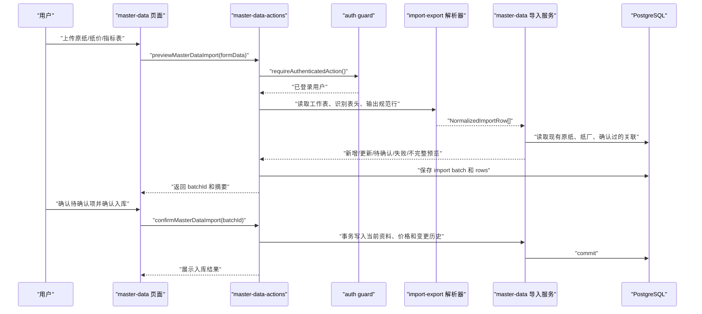

# 原纸资料自动建库与可追溯维护 — 技术设计文档

## 1. 设计概要

**功能描述**：实现原纸代码表、纸价表、物理指标/标准表的导入预览、自动关联、人工确认、确认入库和可追溯维护，形成后续计算与推荐可读取的当前原纸资料库。

**影响范围**：`src/modules/master-data`、`src/modules/import-export`、`src/modules/paper-code`、`src/db/schema`、`src/server/actions`、`src/app/(main)/master-data`、`tests/unit`、`tests/integration`。

**技术难点**：真实表格表头位置不固定，纸价表按年月拆分且缺少原纸代码；原纸编码会重复，不能作为唯一标识；导入必须先预览并把不确定关联留给用户确认；确认入库要在事务中同时更新当前资料、价格、导入记录和变更历史。→ AC-001, AC-004, AC-010, AC-012, AC-020, AC-021

**外部依赖**：复用项目已有 `exceljs` 和 `papaparse`，不新增依赖。首版支持 `.xlsx` 和 `.csv`；旧 `.xls` 的近三年订单数据不在本功能范围内。→ AC-025

---

## 2. 架构概览

本功能采用“页面触发导入 → 服务端动作鉴权 → import-export 解析表格 → master-data 生成预览和执行入库 → db 保存当前资料与历史”的结构。页面只展示上传、预览、待确认和资料列表；导入解析放在 `import-export`，主数据规则放在 `master-data`，原纸代码的精确匹配和大小写敏感校验由 `paper-code` 提供纯函数。



### 模块职责

| 模块 | 职责 | 对应 AC |
|------|------|---------|
| `src/app/(main)/master-data` | 上传文件、展示预览分组、待确认选择、原纸列表、修改历史入口 | AC-001, AC-002, AC-007, AC-008, AC-023 |
| `src/server/actions/master-data-actions.ts` | 所有页面动作入口，第一步调用登录守卫，返回统一 `ActionResult` | AC-001, AC-003, AC-007, AC-017 |
| `src/modules/import-export` | 识别 `.xlsx` / `.csv`、扫描表头、把原始表格转成规范导入行 | AC-001, AC-004, AC-005, AC-014, AC-015 |
| `src/modules/master-data` | 自动关联、资料完整性判断、预览分组、确认入库、手工维护、启停和变更历史 | AC-002 到 AC-024 |
| `src/modules/paper-code` | 原纸代码大小写敏感匹配、代码唯一性校验辅助、代码组合解析的基础能力 | AC-010, AC-019, AC-022 |
| `src/db/schema` | 纸厂、原纸、价格历史、导入批次、导入行、确认关联、变更历史表 | AC-003, AC-006, AC-023, AC-024 |

---

## 3. 数据库设计

### 新增表

#### `paper_factories`

**用途**：保存纸厂/供应商资料。原纸代码表中的“原纸供应商简称”会自动建立或匹配到该表。→ AC-002, AC-003

| 字段名 | 类型 | 约束 | 说明 |
|--------|------|------|------|
| id | uuid | PK, DEFAULT gen_random_uuid() | 主键 |
| name | varchar(120) | NOT NULL, UNIQUE | 纸厂名称或供应商简称 |
| contact_name | varchar(80) | NULL | 联系人 |
| phone | varchar(40) | NULL | 联系电话 |
| supply_types | jsonb | NOT NULL, DEFAULT '[]' | 供应类型：箱板纸、瓦纸，后续由原纸资料反推或手工维护 |
| is_active | boolean | NOT NULL, DEFAULT true | 是否启用 |
| created_at | timestamptz | NOT NULL, DEFAULT now() | 创建时间 |
| updated_at | timestamptz | NOT NULL, DEFAULT now() | 更新时间 |

**索引**：`name` 唯一索引，支持导入时按供应商简称自动匹配。→ AC-003

```sql
CREATE TABLE "paper_factories" (
  "id" uuid PRIMARY KEY DEFAULT gen_random_uuid() NOT NULL,
  "name" varchar(120) NOT NULL,
  "contact_name" varchar(80),
  "phone" varchar(40),
  "supply_types" jsonb DEFAULT '[]'::jsonb NOT NULL,
  "is_active" boolean DEFAULT true NOT NULL,
  "created_at" timestamp with time zone DEFAULT now() NOT NULL,
  "updated_at" timestamp with time zone DEFAULT now() NOT NULL,
  CONSTRAINT "paper_factories_name_unique" UNIQUE("name")
);
```

#### `paper_materials`

**用途**：保存当前原纸资料。选择单表承载箱板纸和瓦纸，用 `paper_kind` 区分类型，保证原纸代码全局唯一。→ AC-003, AC-006, AC-008, AC-019

| 字段名 | 类型 | 约束 | 说明 |
|--------|------|------|------|
| id | uuid | PK, DEFAULT gen_random_uuid() | 主键 |
| paper_code | varchar(60) | NOT NULL, UNIQUE | 原纸代码，大小写敏感，全局唯一 |
| paper_encoding | varchar(100) | NULL | 原纸编码，可重复 |
| factory_id | uuid | NOT NULL, FK | 所属纸厂 |
| name | text | NOT NULL | 原纸名称/牌号 |
| paper_kind | varchar(20) | NOT NULL, DEFAULT 'unknown' | `linerboard` / `corrugating` / `unknown` |
| grade | varchar(80) | NULL | 纸板等级 |
| gram_weight_gsm | integer | NOT NULL | 克重，g/m² |
| usage | varchar(20) | NULL | 面纸 / 里纸 / 面里通用 |
| applicable_flutes | jsonb | NOT NULL, DEFAULT '[]' | 适用瓦型 |
| price_yuan_per_ton | numeric(12,2) | NULL | 当前原纸纸价 |
| burst_index | numeric(10,4) | NULL | 当前耐破指数 |
| ring_crush_index | numeric(10,4) | NULL | 当前横向环压指数 |
| completeness_status | varchar(20) | NOT NULL, DEFAULT 'incomplete' | `complete` / `incomplete` |
| missing_fields | jsonb | NOT NULL, DEFAULT '[]' | 缺失资料清单 |
| is_active | boolean | NOT NULL, DEFAULT true | 是否启用 |
| created_at | timestamptz | NOT NULL, DEFAULT now() | 创建时间 |
| updated_at | timestamptz | NOT NULL, DEFAULT now() | 更新时间 |

**索引**：`paper_code` 唯一索引；`paper_encoding` 普通索引用于辅助关联；`factory_id`、`paper_kind`、`completeness_status`、`is_active` 支持列表筛选和推荐读取。→ AC-008, AC-019, AC-020

```sql
CREATE TABLE "paper_materials" (
  "id" uuid PRIMARY KEY DEFAULT gen_random_uuid() NOT NULL,
  "paper_code" varchar(60) NOT NULL,
  "paper_encoding" varchar(100),
  "factory_id" uuid NOT NULL REFERENCES "paper_factories"("id"),
  "name" text NOT NULL,
  "paper_kind" varchar(20) DEFAULT 'unknown' NOT NULL,
  "grade" varchar(80),
  "gram_weight_gsm" integer NOT NULL,
  "usage" varchar(20),
  "applicable_flutes" jsonb DEFAULT '[]'::jsonb NOT NULL,
  "price_yuan_per_ton" numeric(12,2),
  "burst_index" numeric(10,4),
  "ring_crush_index" numeric(10,4),
  "completeness_status" varchar(20) DEFAULT 'incomplete' NOT NULL,
  "missing_fields" jsonb DEFAULT '[]'::jsonb NOT NULL,
  "is_active" boolean DEFAULT true NOT NULL,
  "created_at" timestamp with time zone DEFAULT now() NOT NULL,
  "updated_at" timestamp with time zone DEFAULT now() NOT NULL,
  CONSTRAINT "paper_materials_paper_code_unique" UNIQUE("paper_code")
);
```

#### `paper_material_price_histories`

**用途**：保存导入纸价表得到的价格历史，同时把最新确认价格同步到 `paper_materials.price_yuan_per_ton`。→ AC-004, AC-006, AC-024

| 字段名 | 类型 | 约束 | 说明 |
|--------|------|------|------|
| id | uuid | PK | 主键 |
| paper_material_id | uuid | NOT NULL, FK | 原纸 |
| price_yuan_per_ton | numeric(12,2) | NOT NULL | 纸价 |
| effective_date | date | NULL | 价格生效日期，无法确定时为空 |
| source_file_name | text | NOT NULL | 来源文件 |
| source_sheet_name | text | NULL | 来源工作表 |
| source_row_number | integer | NULL | 来源行号 |
| import_batch_id | uuid | NULL, FK | 导入批次 |
| created_at | timestamptz | NOT NULL, DEFAULT now() | 创建时间 |

**索引**：`paper_material_id, effective_date` 支持查历史和取最新价格。→ AC-023, AC-024

```sql
CREATE TABLE "paper_material_price_histories" (
  "id" uuid PRIMARY KEY DEFAULT gen_random_uuid() NOT NULL,
  "paper_material_id" uuid NOT NULL REFERENCES "paper_materials"("id"),
  "price_yuan_per_ton" numeric(12,2) NOT NULL,
  "effective_date" date,
  "source_file_name" text NOT NULL,
  "source_sheet_name" text,
  "source_row_number" integer,
  "import_batch_id" uuid,
  "created_at" timestamp with time zone DEFAULT now() NOT NULL
);
```

#### `paper_quality_standards`

**用途**：保存物理指标/标准表中的纸类规则，用于补充或带出耐破指数、横向环压指数、纸类和标准参数。→ AC-005, AC-016

| 字段名 | 类型 | 约束 | 说明 |
|--------|------|------|------|
| id | uuid | PK | 主键 |
| paper_kind | varchar(20) | NOT NULL | 箱板纸 / 瓦纸归一化类型 |
| grade | varchar(80) | NULL | 等级 |
| gram_weight_min_gsm | integer | NULL | 克重下限 |
| gram_weight_max_gsm | integer | NULL | 克重上限 |
| burst_index | numeric(10,4) | NULL | 耐破指数 |
| ring_crush_index | numeric(10,4) | NULL | 横向环压指数 |
| raw_label | text | NOT NULL | 原表标签 |
| source_file_name | text | NOT NULL | 来源文件 |
| source_sheet_name | text | NOT NULL | 来源工作表 |
| created_at | timestamptz | NOT NULL, DEFAULT now() | 创建时间 |

**索引**：`paper_kind, grade, gram_weight_min_gsm, gram_weight_max_gsm` 用于自动带出指标。→ AC-005

```sql
CREATE TABLE "paper_quality_standards" (
  "id" uuid PRIMARY KEY DEFAULT gen_random_uuid() NOT NULL,
  "paper_kind" varchar(20) NOT NULL,
  "grade" varchar(80),
  "gram_weight_min_gsm" integer,
  "gram_weight_max_gsm" integer,
  "burst_index" numeric(10,4),
  "ring_crush_index" numeric(10,4),
  "raw_label" text NOT NULL,
  "source_file_name" text NOT NULL,
  "source_sheet_name" text NOT NULL,
  "created_at" timestamp with time zone DEFAULT now() NOT NULL
);
```

#### `master_data_import_batches`

**用途**：保存一次导入的状态、来源和摘要。预览后先保存为 `previewed`，确认后变为 `confirmed`。→ AC-001, AC-003, AC-007

| 字段名 | 类型 | 约束 | 说明 |
|--------|------|------|------|
| id | uuid | PK | 主键 |
| source_type | varchar(40) | NOT NULL | `paper_code_table` / `paper_price_table` / `quality_standard_table` |
| file_name | text | NOT NULL | 文件名 |
| status | varchar(20) | NOT NULL | `previewed` / `confirmed` / `cancelled` / `failed` |
| summary | jsonb | NOT NULL | 新增、更新、待确认、失败、不完整数量 |
| created_by | varchar(100) | NOT NULL | 创建人账号 |
| confirmed_by | varchar(100) | NULL | 确认人账号 |
| created_at | timestamptz | NOT NULL, DEFAULT now() | 创建时间 |
| confirmed_at | timestamptz | NULL | 确认时间 |

**索引**：`status, created_at` 支持查询最近导入记录。→ AC-008

```sql
CREATE TABLE "master_data_import_batches" (
  "id" uuid PRIMARY KEY DEFAULT gen_random_uuid() NOT NULL,
  "source_type" varchar(40) NOT NULL,
  "file_name" text NOT NULL,
  "status" varchar(20) NOT NULL,
  "summary" jsonb NOT NULL,
  "created_by" varchar(100) NOT NULL,
  "confirmed_by" varchar(100),
  "created_at" timestamp with time zone DEFAULT now() NOT NULL,
  "confirmed_at" timestamp with time zone
);
```

#### `master_data_import_rows`

**用途**：保存预览行、错误、候选项和变更集，支撑用户查看失败原因、待确认和确认入库。→ AC-010, AC-012, AC-013, AC-014, AC-015

| 字段名 | 类型 | 约束 | 说明 |
|--------|------|------|------|
| id | uuid | PK | 主键 |
| batch_id | uuid | NOT NULL, FK | 导入批次 |
| sheet_name | text | NULL | 工作表名 |
| row_number | integer | NOT NULL | 原始行号 |
| row_status | varchar(20) | NOT NULL | `new` / `update` / `pending` / `failed` / `incomplete` |
| raw_data | jsonb | NOT NULL | 原始行数据 |
| normalized_data | jsonb | NOT NULL | 规范化后的数据 |
| target_material_id | uuid | NULL, FK | 确认或自动关联的原纸 |
| candidate_material_ids | jsonb | NOT NULL, DEFAULT '[]' | 候选原纸 |
| change_set | jsonb | NOT NULL, DEFAULT '{}' | 字段变化 |
| errors | jsonb | NOT NULL, DEFAULT '[]' | 失败原因 |
| created_at | timestamptz | NOT NULL, DEFAULT now() | 创建时间 |

**索引**：`batch_id, row_status` 支持预览分组读取。→ AC-002, AC-007, AC-012

```sql
CREATE TABLE "master_data_import_rows" (
  "id" uuid PRIMARY KEY DEFAULT gen_random_uuid() NOT NULL,
  "batch_id" uuid NOT NULL REFERENCES "master_data_import_batches"("id"),
  "sheet_name" text,
  "row_number" integer NOT NULL,
  "row_status" varchar(20) NOT NULL,
  "raw_data" jsonb NOT NULL,
  "normalized_data" jsonb NOT NULL,
  "target_material_id" uuid REFERENCES "paper_materials"("id"),
  "candidate_material_ids" jsonb DEFAULT '[]'::jsonb NOT NULL,
  "change_set" jsonb DEFAULT '{}'::jsonb NOT NULL,
  "errors" jsonb DEFAULT '[]'::jsonb NOT NULL,
  "created_at" timestamp with time zone DEFAULT now() NOT NULL
);
```

#### `paper_material_match_rules`

**用途**：保存用户确认过的关联关系，例如某个纸价表的“供应商 + 原纸品种 + 克重”对应哪张原纸，后续导入优先复用。→ AC-007, AC-022

| 字段名 | 类型 | 约束 | 说明 |
|--------|------|------|------|
| id | uuid | PK | 主键 |
| source_type | varchar(40) | NOT NULL | 来源类型 |
| source_signature | varchar(255) | NOT NULL, UNIQUE | 规范化后的来源签名 |
| paper_material_id | uuid | NOT NULL, FK | 关联原纸 |
| confirmed_by | varchar(100) | NOT NULL | 确认人 |
| created_at | timestamptz | NOT NULL, DEFAULT now() | 创建时间 |

**索引**：`source_signature` 唯一索引。→ AC-007

```sql
CREATE TABLE "paper_material_match_rules" (
  "id" uuid PRIMARY KEY DEFAULT gen_random_uuid() NOT NULL,
  "source_type" varchar(40) NOT NULL,
  "source_signature" varchar(255) NOT NULL,
  "paper_material_id" uuid NOT NULL REFERENCES "paper_materials"("id"),
  "confirmed_by" varchar(100) NOT NULL,
  "created_at" timestamp with time zone DEFAULT now() NOT NULL,
  CONSTRAINT "paper_material_match_rules_signature_unique" UNIQUE("source_signature")
);
```

#### `master_data_change_logs`

**用途**：记录导入更新、手工编辑、启用/停用造成的主数据变化。→ AC-006, AC-009, AC-017, AC-018, AC-023, AC-024

| 字段名 | 类型 | 约束 | 说明 |
|--------|------|------|------|
| id | uuid | PK | 主键 |
| entity_type | varchar(40) | NOT NULL | `paper_factory` / `paper_material` |
| entity_id | uuid | NOT NULL | 实体 ID |
| change_source | varchar(20) | NOT NULL | `import` / `manual` |
| import_batch_id | uuid | NULL, FK | 导入批次 |
| changed_fields | jsonb | NOT NULL | 字段旧值、新值 |
| reason | text | NULL | 修改原因 |
| changed_by | varchar(100) | NOT NULL | 修改人 |
| created_at | timestamptz | NOT NULL, DEFAULT now() | 修改时间 |

**索引**：`entity_type, entity_id, created_at` 支持查看单条资料历史。→ AC-023

```sql
CREATE TABLE "master_data_change_logs" (
  "id" uuid PRIMARY KEY DEFAULT gen_random_uuid() NOT NULL,
  "entity_type" varchar(40) NOT NULL,
  "entity_id" uuid NOT NULL,
  "change_source" varchar(20) NOT NULL,
  "import_batch_id" uuid REFERENCES "master_data_import_batches"("id"),
  "changed_fields" jsonb NOT NULL,
  "reason" text,
  "changed_by" varchar(100) NOT NULL,
  "created_at" timestamp with time zone DEFAULT now() NOT NULL
);
```

### 修改现有表

无需修改现有 `system_metadata` 表。本功能新增业务表均放在 `src/db/schema`，并通过 `src/db/schema/index.ts` 汇总导出。→ AC-003, AC-019

**数据迁移**：通过 Drizzle 生成一条业务迁移；迁移只创建主数据相关表，不写入真实原纸、纸价或订单数据。→ AC-025

---

## 4. API 设计

本项目首版使用 Server Actions，本方案不新增公开 REST API。所有关键动作第一步调用 `requireAuthenticatedAction()`，失败时直接返回 `AUTH_REQUIRED` 或 `SESSION_EXPIRED`。→ AC-001, AC-003, AC-007, AC-009, AC-017

### `previewMasterDataImport(formData)`

**描述**：上传 `.xlsx` 或 `.csv` 文件，解析并生成导入预览。→ AC-001, AC-002, AC-004, AC-005, AC-010, AC-014, AC-015

**鉴权**：需要登录。

**Request**：
```ts
interface PreviewMasterDataImportInput {
  file: File;
  sourceType: "paper_code_table" | "paper_price_table" | "quality_standard_table";
}
```

**Response（成功）**：
```ts
interface PreviewMasterDataImportResult {
  batchId: string;
  sourceType: "paper_code_table" | "paper_price_table" | "quality_standard_table";
  summary: {
    newCount: number;
    updateCount: number;
    pendingCount: number;
    failedCount: number;
    incompleteCount: number;
  };
  rows: ImportPreviewRow[];
}
```

**异常响应**：

| 场景 | 响应 | 对应 AC |
|------|------|---------|
| 未登录 | `AUTH_REQUIRED` / `SESSION_EXPIRED` | AC-001 |
| 文件为空或类型不支持 | `VALIDATION_ERROR`，提示只支持 `.xlsx` 和 `.csv` | AC-001, AC-025 |
| 识别不到必要表头 | `VALIDATION_ERROR`，提示缺少可识别字段 | AC-001, AC-014 |
| 文件解析失败 | `IMPORT_PARSE_FAILED`，提示文件无法解析 | AC-001 |

### `resolveMasterDataImportRow(input)`

**描述**：用户为待确认行选择目标原纸，并保存为已确认关联。→ AC-007, AC-012, AC-021

**鉴权**：需要登录。

**Request**：
```ts
interface ResolveMasterDataImportRowInput {
  batchId: string;
  rowId: string;
  paperMaterialId: string;
}
```

**Response（成功）**：
```ts
interface ResolveMasterDataImportRowResult {
  rowId: string;
  rowStatus: "update" | "incomplete";
  targetMaterialId: string;
}
```

**异常响应**：

| 场景 | 响应 | 对应 AC |
|------|------|---------|
| 行不存在 | `DATA_NOT_FOUND` | AC-007 |
| 行不属于待确认状态 | `VALIDATION_ERROR` | AC-007 |
| 目标原纸不存在 | `DATA_NOT_FOUND` | AC-007 |

### `confirmMasterDataImport(input)`

**描述**：确认预览结果并正式入库。失败行和未解决的待确认行不会入库。→ AC-003, AC-006, AC-007, AC-010, AC-012

**鉴权**：需要登录。

**Request**：
```ts
interface ConfirmMasterDataImportInput {
  batchId: string;
}
```

**Response（成功）**：
```ts
interface ConfirmMasterDataImportResult {
  batchId: string;
  createdCount: number;
  updatedCount: number;
  skippedCount: number;
  incompleteCount: number;
}
```

**异常响应**：

| 场景 | 响应 | 对应 AC |
|------|------|---------|
| 批次不存在 | `DATA_NOT_FOUND` | AC-003 |
| 批次已确认或已取消 | `VALIDATION_ERROR` | AC-003 |
| 存在未解决待确认行 | `VALIDATION_ERROR`，提示先处理待确认项 | AC-007, AC-012 |
| 事务写入失败 | `IMPORT_COMMIT_FAILED`，不暴露底层堆栈 | AC-003 |

### `updatePaperMaterial(input)`

**描述**：手工编辑导入后的原纸资料。重要字段必须填写修改原因。→ AC-009, AC-017, AC-023

**鉴权**：需要登录。

**Request**：
```ts
interface UpdatePaperMaterialInput {
  paperMaterialId: string;
  patch: Partial<EditablePaperMaterialFields>;
  reason?: string;
}
```

**Response（成功）**：
```ts
interface UpdatePaperMaterialResult {
  paperMaterialId: string;
  completenessStatus: "complete" | "incomplete";
  missingFields: string[];
}
```

**异常响应**：

| 场景 | 响应 | 对应 AC |
|------|------|---------|
| 原纸不存在 | `DATA_NOT_FOUND` | AC-009 |
| 原纸代码重复 | `VALIDATION_ERROR`，提示原纸代码重复 | AC-019 |
| 重要字段缺少修改原因 | `VALIDATION_ERROR`，提示需要填写修改原因 | AC-017 |

### `setPaperMaterialActive(input)`

**描述**：启用或停用原纸。→ AC-018

**鉴权**：需要登录。

**Request**：
```ts
interface SetPaperMaterialActiveInput {
  paperMaterialId: string;
  isActive: boolean;
  reason: string;
}
```

**Response（成功）**：
```ts
interface SetPaperMaterialActiveResult {
  paperMaterialId: string;
  isActive: boolean;
}
```

**异常响应**：

| 场景 | 响应 | 对应 AC |
|------|------|---------|
| 原纸不存在 | `DATA_NOT_FOUND` | AC-018 |
| 未填写原因 | `VALIDATION_ERROR` | AC-017, AC-018 |

### `listPaperMaterials(query)`

**描述**：查询原纸资料库，支持按完整性、启用状态、纸类、纸厂筛选。→ AC-008, AC-016

**鉴权**：需要登录。

**Request**：
```ts
interface ListPaperMaterialsQuery {
  completenessStatus?: "complete" | "incomplete";
  isActive?: boolean;
  paperKind?: "linerboard" | "corrugating" | "unknown";
  factoryId?: string;
  keyword?: string;
  page: number;
  pageSize: number;
}
```

**Response（成功）**：
```ts
interface ListPaperMaterialsResult {
  items: PaperMaterialListItem[];
  total: number;
}
```

### `getMasterDataChangeHistory(input)`

**描述**：查看原纸或纸厂修改历史。→ AC-023, AC-024

**鉴权**：需要登录。

**Request**：
```ts
interface GetMasterDataChangeHistoryInput {
  entityType: "paper_factory" | "paper_material";
  entityId: string;
}
```

**Response（成功）**：
```ts
interface GetMasterDataChangeHistoryResult {
  items: Array<{
    changedFields: Record<string, { before: unknown; after: unknown }>;
    reason?: string;
    changedBy: string;
    createdAt: string;
  }>;
}
```

---

## 5. 核心逻辑

### 表头识别与规范化 → AC-001, AC-014, AC-015

**触发条件**：用户上传文件并请求预览。

**处理流程**：
1. 根据文件扩展名选择 `exceljs` 或 `papaparse`。
2. 对每个工作表扫描前 30 行，寻找满足来源类型的表头。
3. 原纸代码表要求识别：原纸代码、原纸编码、克重、原纸供应商简称、原纸名称。
4. 纸价表要求识别：供应商、原纸品种，以及至少一列纸价或日期纸价。
5. 物理指标/标准表要求识别：纸类/等级/克重区间/耐破/环压中的可用组合。
6. 将每一行转成规范化结构，所有数值字段先解析为数字，失败则写入字段错误。

**伪代码**：
```text
parseWorkbook(file, sourceType):
  sheets = readWorkbook(file)
  for sheet in sheets:
    header = findHeader(sheet.rows, sourceType)
    if header missing:
      continue
    rows += normalizeRows(sheet, header, sourceType)
  if rows empty:
    return VALIDATION_ERROR
  return rows
```

### 原纸代码表预览 → AC-002, AC-003, AC-010, AC-011, AC-014, AC-019, AC-020

**触发条件**：来源类型为 `paper_code_table`。

**处理流程**：
1. 检查每行是否有原纸代码、克重、供应商简称和原纸名称。
2. 以原纸代码做大小写敏感比较。
3. 同一批次内原纸代码重复时，相关行进入失败。
4. 已存在原纸代码时生成更新清单；不存在时生成新增清单。
5. 原纸编码重复不作为失败，只记录提示。
6. 根据供应商简称匹配或计划创建纸厂。
7. 计算资料完整性：原纸代码表只提供基础档案，多数记录会因缺少纸价、纸类、用途/适用瓦型或强度指标而标记为资料不完整。

### 纸价表自动关联 → AC-004, AC-012, AC-013, AC-021, AC-022

**触发条件**：来源类型为 `paper_price_table`。

**处理流程**：
1. 先查 `paper_material_match_rules`，命中已确认来源签名时直接关联。
2. 如果导入行包含原纸代码，按原纸代码精确匹配。
3. 如果导入行包含原纸编码，查找同编码原纸；只有唯一候选时可进入更新，否则进入待确认。
4. 如果没有代码和编码，用供应商简称 + 原纸品种 + 克重组合匹配。
5. 组合匹配唯一时进入更新；多个候选时进入待确认；没有候选时进入失败。
6. 纸价表有多列价格时，按能识别的日期生成价格历史；当前价格取该记录中日期最新且有效的价格。

**伪代码**：
```text
matchPriceRow(row):
  rule = findConfirmedRule(row.signature)
  if rule: return matched(rule.material)

  if row.paperCode:
    return exactMatchByPaperCode(row.paperCode)

  if row.paperEncoding:
    candidates = findByPaperEncoding(row.paperEncoding)
    if candidates.length == 1: return matched(candidates[0])
    if candidates.length > 1: return pending(candidates)

  candidates = findBySupplierNameAndProduct(row.supplier, row.productName, row.gramWeight)
  if candidates.length == 1: return matched(candidates[0])
  if candidates.length > 1: return pending(candidates)
  return failed("无法关联原纸")
```

### 物理指标/标准表导入 → AC-005, AC-016

**触发条件**：来源类型为 `quality_standard_table`。

**处理流程**：
1. 优先解析为标准规则，写入 `paper_quality_standards`。
2. 如果行能唯一关联到具体原纸，则生成该原纸的强度指标更新。
3. 如果只能表达某类纸的标准范围，则不直接覆盖具体原纸，而作为后续资料补齐的带出依据。
4. 带出指标时必须可追溯来源文件和工作表。

### 资料完整性判断 → AC-008, AC-016

**触发条件**：导入预览、确认入库、手工编辑、启停后。

**处理流程**：
1. 检查基础字段：原纸代码、纸厂、原纸名称、克重。
2. 检查业务字段：纸类、纸价、耐破指数、横向环压指数。
3. 箱板纸还需用途；瓦纸还需适用瓦型。
4. 启用状态为 false 时，不参与推荐。
5. 任何必需字段缺失时，`completeness_status = incomplete`，并写入 `missing_fields`。

### 确认入库事务 → AC-003, AC-006, AC-007, AC-023

**触发条件**：用户确认导入批次。

**处理流程**：
1. 开启数据库事务。
2. 锁定导入批次，确认其仍为 `previewed`。
3. 如果存在未解决 `pending` 行，返回校验错误。
4. 跳过 `failed` 行。
5. 对 `new` 行创建纸厂和原纸。
6. 对 `update` / `incomplete` 行更新当前资料、写价格历史、写标准规则。
7. 对有变化的字段写入 `master_data_change_logs`。
8. 将批次状态改为 `confirmed`。
9. 提交事务；任一步失败则回滚。

### 修改原因校验 → AC-009, AC-017, AC-018, AC-023

**触发条件**：手工编辑或启用/停用。

**处理流程**：
1. 计算本次变化字段。
2. 如果变化字段包含纸价、克重、用途、适用瓦型、耐破指数、横向环压指数、启用状态，要求 `reason` 非空。
3. 保存当前资料并写入变更历史。

### 历史方案快照边界 → AC-024

**触发条件**：后续历史方案保存功能读取原纸资料。

**处理流程**：
1. `paper_materials` 只代表当前资料。
2. 后续历史方案保存必须复制当时的原纸代码、名称、纸厂、克重、纸价和强度指标到方案快照。
3. 本功能只提供当前资料和变更历史，不在主数据更新时回写历史方案。

---

## 6. 现有代码改动

| 模块 / 文件 | 改动内容 | 原因 | 对应 AC |
|-------------|---------|------|---------|
| `src/db/schema/paper-factories.ts` | 新增纸厂 schema | 自动建立和维护纸厂资料 | AC-002, AC-003 |
| `src/db/schema/paper-materials.ts` | 新增原纸、价格历史、质量标准 schema | 支撑当前资料、资料完整性和价格历史 | AC-003, AC-004, AC-005, AC-008, AC-019 |
| `src/db/schema/master-data-imports.ts` | 新增导入批次、导入行、确认关联、变更历史 schema | 支撑预览、待确认和追溯 | AC-007, AC-010, AC-012, AC-023 |
| `src/db/schema/index.ts` | 汇总导出新增 schema | 让 Drizzle 迁移识别业务表 | AC-003 |
| `src/modules/import-export/master-data-workbook-parser.ts` | 新增表格解析和表头识别 | 复用导入导出模块处理 Excel/CSV | AC-001, AC-014, AC-015 |
| `src/modules/master-data/import-preview.ts` | 新增预览分组、自动关联和字段校验 | 生成新增、更新、待确认、失败、不完整清单 | AC-002, AC-004, AC-012, AC-021 |
| `src/modules/master-data/import-commit.ts` | 新增确认入库事务 | 保证当前资料、价格和变更历史一致 | AC-003, AC-006, AC-007, AC-023 |
| `src/modules/master-data/completeness.ts` | 新增资料完整性判断 | 阻止不完整资料参与推荐 | AC-008, AC-016 |
| `src/modules/master-data/change-log.ts` | 新增变更记录构造和重要字段原因校验 | 支撑可追溯维护 | AC-009, AC-017, AC-018, AC-023 |
| `src/modules/paper-code/match-paper-code.ts` | 新增大小写敏感精确匹配辅助 | 保证原纸代码匹配规则集中 | AC-010, AC-019, AC-022 |
| `src/server/actions/master-data-actions.ts` | 新增导入预览、确认、手工编辑、启停、历史查询动作 | 页面到业务模块的入口 | AC-001, AC-003, AC-007, AC-009, AC-018 |
| `src/app/(main)/master-data/page.tsx` | 替换占位页为主数据导入和列表入口 | 提供用户操作界面 | AC-001, AC-008 |
| `src/app/(main)/master-data/_components/*` | 新增导入上传、预览表、待确认表、资料列表、历史弹窗组件 | 展示预览、确认和历史 | AC-002, AC-007, AC-010, AC-023 |
| `tests/unit/master-data/*` | 新增自动关联、完整性、变更原因单元测试 | 覆盖核心纯业务规则 | AC-008, AC-017, AC-020, AC-021, AC-022 |
| `tests/integration/master-data/*` | 新增导入预览、确认入库、变更历史集成测试 | 覆盖数据库和服务端动作 | AC-001 到 AC-025 |

---

## 7. 技术决策

### 原纸使用单表建模，而不是箱板纸/瓦纸两张业务表

**背景**：PRD 按箱板纸、瓦纸分别描述字段，但用户确认原纸代码全局唯一，且导入来源先建立“原纸身份基础表”，类型和用途可能由后续表格补齐。

**选项**：
- A: 箱板纸和瓦纸分表 — 字段更贴近 PRD，但跨表唯一代码约束和“资料未分类”状态处理复杂。
- B: 单一 `paper_materials` 表 + `paper_kind` 字段 — 可直接保证原纸代码全局唯一，也能表达未分类、不完整、停用等状态。

**结论**：选择 B。后续推荐和计算按 `paper_kind`、`usage`、`applicable_flutes` 筛选即可，不牺牲业务表达，同时降低唯一性和导入合并复杂度。→ AC-019, AC-020

### 预览结果入库保存，而不是只存在浏览器内存

**背景**：导入预览可能包含大量行、待确认候选和错误信息；用户确认前可能需要逐条处理待确认项。

**选项**：
- A: 预览只返回给前端内存保存 — 实现轻，但刷新页面会丢失，确认入库时还要重新解析文件。
- B: 保存导入批次和导入行 — 表结构更多，但可追溯、可恢复、可分页展示。

**结论**：选择 B。它更符合“导入前预览、待确认、失败原因可查看”的需求，也为后续导出失败行保留基础。→ AC-007, AC-010, AC-012

### 纸价历史单独保存，同时同步当前价格

**背景**：纸价表按年月和日期保存多个价格，推荐计算需要快速读取当前价格，追溯又需要知道来源。

**选项**：
- A: 只保存当前价格 — 推荐读取简单，但无法追溯导入来源和历史变化。
- B: 保存价格历史，并把最新确认价格同步到原纸当前资料 — 同时满足推荐读取和追溯。

**结论**：选择 B。`paper_materials.price_yuan_per_ton` 服务当前推荐，`paper_material_price_histories` 服务追溯。→ AC-004, AC-006, AC-024

### 不为旧 `.xls` 引入新依赖

**背景**：项目已有 `exceljs` 和 `papaparse`，但 `exceljs` 不处理旧 `.xls`。当前需求明确近三年订单数据不进入本功能，首版导入的原纸、纸价和指标文件均为 `.xlsx`。

**选项**：
- A: 引入额外 `.xls` 解析依赖 — 能覆盖旧订单表，但扩大本功能范围。
- B: 首版只支持 `.xlsx` / `.csv`，旧 `.xls` 留到历史订单导入功能处理。

**结论**：选择 B。避免为本次不处理的历史订单数据扩大依赖和测试面。→ AC-025

---

## 8. 安全与性能

**输入校验**：导入文件限制扩展名和大小；所有单元格值先转成规范字段，再做必填、数值、枚举和关联校验；Excel 公式不执行，只读取计算后的文本/数值结果。→ AC-014, AC-015

**敏感数据处理**：导入错误提示只展示业务原因，不输出数据库错误、SQL、堆栈、连接信息或真实路径。真实数据不得复制到测试夹具，测试使用脱敏小样例。→ AC-010, AC-013, AC-015

**事务一致性**：确认入库使用数据库事务；批次状态、原纸资料、价格历史、确认关联和变更历史必须一起成功或一起回滚。→ AC-003, AC-006, AC-007, AC-023

**性能考量**：导入预览按批次落库并分页展示；自动关联时预先读取原纸代码、原纸编码、供应商和名称索引，避免逐行查询；原纸代码、原纸编码、导入批次状态、原纸完整性均建立索引。→ AC-004, AC-008, AC-012

**并发处理**：确认导入时重新检查原纸代码唯一性和批次状态；如果其他用户已导入相同原纸代码，当前批次相关行转为失败或更新预览需重新生成。→ AC-010, AC-019

---

## 9. AC 覆盖总表

| AC 编号 | 验收标准概述 | 实现位置 |
|---------|-------------|---------|
| AC-001 | 上传原纸代码表并识别字段 | `previewMasterDataImport` + 表头识别逻辑 |
| AC-002 | 预览原纸基础档案新增结果 | 原纸代码表预览逻辑 + 导入行分组 |
| AC-003 | 确认后建立原纸和纸厂资料 | `confirmMasterDataImport` + 确认入库事务 |
| AC-004 | 导入纸价表并自动关联唯一原纸 | 纸价表自动关联 + 价格历史表 |
| AC-005 | 导入物理指标/标准表并补充资料 | 物理指标/标准表导入 + `paper_quality_standards` |
| AC-006 | 再次导入同一原纸代码更新当前资料 | 预览 changeSet + 确认入库更新逻辑 |
| AC-007 | 用户确认待确认关联 | `resolveMasterDataImportRow` + `paper_material_match_rules` |
| AC-008 | 查看资料完整性 | `listPaperMaterials` + `completeness_status` / `missing_fields` |
| AC-009 | 导入后手工维护原纸 | `updatePaperMaterial` + 变更历史 |
| AC-010 | 原纸代码重复 | 原纸代码表预览校验 + 确认前唯一性复检 |
| AC-011 | 原纸编码重复不作为失败 | 原纸代码表预览提示 + 非唯一辅助关联规则 |
| AC-012 | 无法唯一关联进入待确认 | 自动关联逻辑 + 待确认行状态 |
| AC-013 | 无可用关联进入失败 | 自动关联失败分组 |
| AC-014 | 必填字段缺失 | 表格规范化与字段校验 |
| AC-015 | 数值字段非法 | 数值解析和字段错误 |
| AC-016 | 资料不完整不得参与推荐 | 完整性判断 + 推荐读取约束 |
| AC-017 | 修改重要字段未填写原因 | 修改原因校验 |
| AC-018 | 停用原纸 | `setPaperMaterialActive` + 推荐读取约束 |
| AC-019 | 原纸代码全局唯一 | `paper_materials.paper_code` 唯一约束 + 保存校验 |
| AC-020 | 原纸编码不能作为唯一标识 | 自动关联逻辑和待确认分支 |
| AC-021 | 不静默猜测关联 | 待确认状态和预览页面 |
| AC-022 | 自动关联优先级 | `matchPriceRow` / `matchImportRow` 规则 |
| AC-023 | 变更历史可查看 | `master_data_change_logs` + `getMasterDataChangeHistory` |
| AC-024 | 历史方案不被主数据更新覆盖 | 当前资料/历史快照边界说明 + 后续历史方案读取约束 |
| AC-025 | 不处理历史订单数据 | 文件类型和范围校验，不接入 `historical-orders` |

---

## 附录：变更记录

| 日期 | 变更内容 | 原因 |
|------|---------|------|
| 2026-06-29 | 初始版本 | 根据“原纸资料自动建库与可追溯维护”需求文档产出可执行技术方案 |
