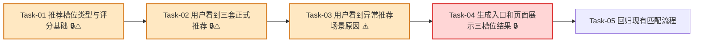

# 推荐策略 — 开发任务计划

## 1. 任务概览

**总任务数**：5 个  
**预计总工时**：660 分钟（约 11 小时）  
**开发方法**：TDD — 每个任务按 RED → GREEN → REFACTOR 循环执行

**关键标注**：
- 🔒 阻塞任务：被多个任务依赖，建议优先完成
- ⚠️ 风险任务：业务规则容易写错，执行时需要重点核对 AC

### 依赖关系图



### 合并说明

| 原任务 | 合并后任务 | 合并原因 |
|--------|------------|----------|
| 原 Task-03 + 原 Task-04 | 新 Task-03 | 不足三套、重复展示、全部不达标参考方案都属于 `selectMatchingRecommendations` 的异常推荐分支，放在同一个 TDD 循环中更连贯。 |
| 原 Task-05 + 原 Task-06 | 新 Task-04 | 服务端返回三槽位结果和页面展示三槽位结果是一条完整用户可见链路，合并后可以直接验证“点击生成 → 看见三类方案和原因”。 |
| 原 Task-07 | 新 Task-05 | 保留为收尾回归，专门确认旧匹配流程没有被改坏。 |

---

## 2. 开发任务

> 按垂直切片组织。Task-01 是最薄基础层；Task-02 打通正常三套推荐；Task-03 处理异常推荐场景；Task-04 接入用户生成结果并展示；Task-05 做现有流程回归。
>
> 每个任务按 TDD 循环执行：RED（根据验证标准写测试）→ GREEN（写最小实现通过测试）→ REFACTOR（重构）。测试不是独立任务。

### 阶段一：系统具备推荐槽位和评分口径

**阶段完成标准**：开发者可以用统一类型表达经济型、安全型、均衡型三个槽位，并能稳定计算成本、安全和均衡型排序所需分数。

---

#### Task-01: 推荐槽位类型与评分基础 🔒⚠️

**通俗解释**：系统先把“三个方案位置长什么样、怎么比较成本和安全”说清楚，后续推荐才不会各写各的。

**做什么**：新增 `src/modules/recommendation/types.ts` 和 `src/modules/recommendation/scoring.ts`；定义推荐策略、槽位状态、槽位结果、推荐选项；实现候选指纹、抗压富余率、经济型排序、安全型排序、均衡型评分和稳定排序；更新 `src/modules/recommendation/README.md`，明确本模块不访问数据库、不调用 AI、不读取历史习惯。

**涉及文件**：`src/modules/recommendation/types.ts`、`src/modules/recommendation/scoring.ts`、`src/modules/recommendation/README.md`、`tests/unit/recommendation/scoring.test.ts`

**参考**：技术方案 2、4.1、5.1、5.2、5.3、5.4、7、9 → AC-002, AC-003, AC-011, AC-012, AC-013

**依赖**：无

**预估工时**：105 分钟

**状态**：已完成（2026-07-02）

**验证标准**（TDD RED 阶段直接转化为测试用例）：
- [x] 传入同一候选的两份评估对象 → `createCandidateFingerprint` 返回相同字符串。
- [x] 传入两个候选，候选 A 含税成本 `2.10`，候选 B 含税成本 `2.30` → 经济型排序结果 A 在 B 前。
- [x] 传入两个候选成本都为 `2.10`，候选 A 抗压富余率 `1.10`，候选 B 抗压富余率 `1.80` → 经济型稳定排序优先 A，因为它更接近最低达标冗余。
- [x] 传入候选 BCT `1200`，三层最低 BCT `400` → 抗压富余率返回 `3`。
- [x] 安全型排序输入候选 A 富余率 `1.5`、候选 B 富余率 `1.8` → B 在 A 前。
- [x] 安全型排序输入候选 C 富余率 `2.01` → C 被排除在安全型候选列表外。
- [x] 均衡型输入两套候选，默认权重不传 → 使用成本 `0.5`、安全 `0.5` 计算综合分。
- [x] 均衡型输入所有候选成本相同 → 成本分均为 `1`，不出现除零或 `NaN`。
- [x] 均衡型输入所有候选富余率相同 → 安全分均为 `1`，不出现除零或 `NaN`。
- [x] 候选富余率超过 `2` 时参与均衡型评分 → 安全分按 `2` 封顶，不因为过度冗余获得额外优势。
- [x] 检查 `src/modules/recommendation` 源码 → 不导入 `@/db`、`@/app`、`@/server`、`historical-orders`、`ai-reasoning`。

---

### 阶段二：用户生成后能看到三套正式推荐

**阶段完成标准**：当存在足够的达标且可生产候选时，系统能返回经济型、安全型、均衡型三个方案位置，并优先展示不同配纸组合。

---

#### Task-02: 选择三套正式推荐 🔒⚠️

**通俗解释**：用户点击生成后，系统能把一堆可用候选整理成经济型、安全型、均衡型三套清楚的推荐。

**做什么**：新增 `src/modules/recommendation/select-matching-recommendations.ts`；从 `EvaluateMatchingCandidatesResult.eligibleCandidates` 中选择三个固定槽位；经济型取含税成本最低，安全型取抗压富余率最高且不超过 200%，均衡型取综合分最高；三槽位优先使用不同候选组合；返回 `recommended` 状态和必要展示信息。

**涉及文件**：`src/modules/recommendation/select-matching-recommendations.ts`、`src/modules/recommendation/types.ts`、`src/modules/recommendation/scoring.ts`、`tests/unit/recommendation/select-matching-recommendations.test.ts`

**参考**：技术方案 4.2、5.2、5.3、5.4、5.5、9 → AC-001, AC-002, AC-003, AC-010, AC-011, AC-012, AC-013

**依赖**：Task-01

**预估工时**：120 分钟

**状态**：已完成（2026-07-02）

**验证标准**（TDD RED 阶段直接转化为测试用例）：
- [x] 输入 3 个达标且可生产候选 → 返回 `slots.length = 3`，标题依次为“经济型”“安全型”“均衡型”。
- [x] 输入候选 A 成本 `2.10`、候选 B 成本 `2.30`、候选 C 成本 `2.50` → 经济型槽位选择 A。
- [x] 输入候选 A 富余率 `1.3`、候选 B 富余率 `1.9`、候选 C 富余率 `2.1` → 安全型槽位选择 B，且 C 不参与安全型正式推荐。
- [x] 输入候选 A 成本最低但安全最低，候选 B 成本较高但安全最高，候选 C 成本和安全综合分最高 → 均衡型槽位选择 C。
- [x] 三类策略首选分别为 A、B、C → 三个槽位状态均为 `recommended`，且三个候选指纹互不相同。
- [x] 某 rejected 候选成本最低但状态为 `rejected` → 经济型不得选择该候选。
- [x] 某 rejected 候选安全最高但设备不可生产 → 安全型不得选择该候选。
- [x] 推荐结果生成完成 → 结果中不包含历史习惯评分字段，不包含 AI 生成字段。

---

### 阶段三：用户能看到异常推荐场景原因

**阶段完成标准**：当达标且可生产候选不足、需要重复展示、或所有候选都不达标/不可生产时，系统仍保留三个方案位置，并展示清楚原因。

---

#### Task-03: 处理不足三套、重复展示和参考方案 ⚠️

**通俗解释**：如果系统凑不出三套不同合格方案，它不会悄悄少显示；如果完全没有合格方案，它也会给用户参考方案和失败原因。

**做什么**：扩展 `selectMatchingRecommendations` 的异常分支；当某策略首选已被使用时，先找该策略下一个不同候选；没有不同候选但存在首选时返回 `repeated`；没有任何可用正式候选时返回 `unavailable` 或 `reference`；从 `rejectedCandidates` 中选择参考方案；生成“没有更多不同的达标可生产候选组合”“该组合同时也是某策略下最优”“当前没有达标可生产方案，以下仅供调整参考”等业务提示。

**涉及文件**：`src/modules/recommendation/select-matching-recommendations.ts`、`src/modules/recommendation/reason-messages.ts`、`tests/unit/recommendation/select-matching-recommendations.test.ts`

**参考**：技术方案 4.1、4.2、5.5、5.6、5.7、7、9 → AC-001, AC-004, AC-005, AC-006, AC-007, AC-008, AC-010, AC-011

**依赖**：Task-02

**预估工时**：165 分钟

**状态**：已完成（2026-07-02）

**验证标准**（TDD RED 阶段直接转化为测试用例）：
- [x] 经济型和安全型首选都是候选 A，安全型还有候选 B 可选 → 安全型槽位选择 B，状态为 `recommended`。
- [x] 经济型、安全型、均衡型都只有候选 A 可选 → 三个槽位都带候选 A，其中后两个槽位状态为 `repeated`。
- [x] 槽位状态为 `repeated` → `messages` 包含“该组合同时也是某策略下最优”。
- [x] 只有 1 个达标可生产候选，安全型因富余率超过 200% 无可用候选 → 安全型槽位状态为 `unavailable`。
- [x] 安全型槽位 `unavailable` 且所有候选富余率超过 200% → 原因包含“所有安全型候选抗压富余率超过 200% 上限”。
- [x] 达标可生产候选只有 2 个不同组合 → 三槽位结果仍包含 3 个槽位，不因为不足而缩短数组。
- [x] 不可用槽位没有候选 → `isOfficialRecommendation = false`，并带有至少一条可展示原因。
- [x] 输入 `eligibleCandidates=[]`，且有 2 个 strength rejected 候选 → 返回 3 个槽位，至少一个槽位状态为 `reference`。
- [x] 无 eligible 时 → `globalMessages` 包含“当前没有达标可生产方案，以下仅供调整参考”。
- [x] 经济型参考候选 A 成本 `2.10`，候选 B 成本 `2.30` → 经济型参考槽位选择 A。
- [x] 安全型参考候选 A 空箱抗压 `600N`，候选 B 空箱抗压 `800N` → 安全型参考槽位选择 B。
- [x] 均衡型参考候选 A 有 1 条原因，候选 B 有 2 条原因，且两者都有强度和成本结果 → 均衡型参考槽位选择 A。
- [x] 参考槽位带有强度不达标原因“边压不足” → 槽位可展示原因中包含“边压不足”。
- [x] 参考槽位带有设备不可生产原因“纸板宽超过设备限制” → 槽位可展示原因中包含“纸板宽超过设备限制”。
- [x] 所有参考槽位 → `isOfficialRecommendation = false`，不得被标记为达标推荐。
- [x] rejected 候选没有可展示计算结果 → 对应槽位返回 `unavailable`，并显示没有可展示参考方案的原因。

---

### 阶段四：用户生成方案时看到三类方案和原因

**阶段完成标准**：用户点击生成方案后，服务端返回固定三个推荐槽位；结果页展示经济型、安全型、均衡型三个位置，以及正式推荐、重复推荐、不可用或参考方案原因。

---

#### Task-04: 接入生成入口并展示三槽位结果 🔒

**通俗解释**：用户点“生成方案”后，页面直接看到三类方案；少方案、重复方案、不达标或不可生产时都能看到原因。

**做什么**：更新 `src/server/actions/matching-actions.ts`，在 `evaluateMatchingCandidates` 后调用 `selectMatchingRecommendations`；成功响应新增 `recommendationSlots` 和 `recommendationMessages`，保留 `rejectedSummary`、`rejectedCandidates`；更新 `src/app/(main)/matching/_components/box-spec-form.tsx` 和样式，推荐区从遍历 `recommendations` 改为遍历 `recommendationSlots`；展示方案标题、状态标签、候选摘要、面积、空箱抗压、边压、耐破、含税成本、重复说明、不可用原因和全局参考提示。

**涉及文件**：`src/server/actions/matching-actions.ts`、`src/app/(main)/matching/_components/box-spec-form.tsx`、`src/app/(main)/matching/_components/box-spec-form.module.css`、`tests/integration/matching/matching-actions.test.ts`、`tests/integration/matching/matching-page.test.tsx`

**参考**：技术方案 4.3、6、7、8.2、9 → AC-001, AC-003, AC-004, AC-005, AC-006, AC-007, AC-008, AC-009, AC-010, AC-013

**依赖**：Task-03

**预估工时**：180 分钟

**状态**：已完成（2026-07-02）

**验证标准**（TDD RED 阶段直接转化为测试用例）：
- [x] `evaluateMatchingCandidatesFn` 返回 3 个 eligible 候选 → `generateMatchingScheme` 成功响应包含 `recommendationSlots`，长度为 `3`。
- [x] 成功响应中 → `recommendationSlots[0].title = "经济型"`、`recommendationSlots[1].title = "安全型"`、`recommendationSlots[2].title = "均衡型"`。
- [x] 评估结果含 rejected summary → 成功响应继续返回原 `rejectedSummary`。
- [x] 评估结果含 rejected candidates → 成功响应继续返回原 `rejectedCandidates`。
- [x] 无 eligible 且 recommendation 模块返回全局提示 → 成功响应 `recommendationMessages` 包含该提示。
- [x] 基础数据缺失时 → `generateMatchingScheme` 返回 `VALIDATION_ERROR`，且不调用 `evaluateMatchingCandidatesFn`，也不调用推荐选择函数。
- [x] 未登录时 → `generateMatchingScheme` 返回 `AUTH_REQUIRED`，且不调用推荐选择函数。
- [x] 成功生成推荐时 → 响应数据中不包含历史习惯评分字段，不包含 AI 改写结果字段。
- [x] 检查 `matching-actions.ts` → 仍返回 `Promise<ActionResult<GenerateMatchingSchemeResult>>`。
- [x] 页面收到 3 个 `recommendationSlots` → 显示“经济型”“安全型”“均衡型”三个方案标题。
- [x] 槽位状态为 `recommended` 且有候选 → 页面显示层数瓦型、纸张组合、面积、空箱抗压、边压、耐破和含税成本。
- [x] 三个槽位候选不同 → 页面显示三套不同配纸组合。
- [x] 槽位状态为 `repeated` → 页面显示重复说明“该组合同时也是某策略下最优”。
- [x] 槽位状态为 `unavailable` → 页面显示可用方案不足原因，而不是隐藏该槽位。
- [x] `recommendationMessages` 包含“当前没有达标可生产方案，以下仅供调整参考” → 页面在推荐区顶部显示该提示。
- [x] 槽位状态为 `reference` 且原因包含“边压不足” → 页面显示“边压不足”。
- [x] 槽位状态为 `reference` 且原因包含“纸板宽超过设备限制” → 页面显示“纸板宽超过设备限制”。
- [x] 服务端返回基础数据缺失错误 → 页面不展示推荐槽位，显示“请先维护纸厂、箱板纸、瓦纸和基础参数”。
- [x] 页面展示状态时 → 不只依赖颜色表达状态，状态文案必须可见。

---

### 阶段五：现有匹配流程保持可用

**阶段完成标准**：推荐策略接入后，现有单次配纸流程、输入校验、基础数据错误、不推荐原因汇总和候选明细仍能正常工作。

---

#### Task-05: 回归现有匹配流程

**通俗解释**：新推荐策略接上后，原来能生成、能报错、能看不推荐原因的流程不能被改坏。

**做什么**：更新现有 matching 集成测试中对旧 `recommendations` 契约的断言；保留并调整输入校验、堆码显示、基础数据缺失、不推荐原因汇总、不可推荐候选明细、设备不可生产不展示强度成本、强度不达标展示计算结果等回归场景；确保页面和服务端只消费新的 `recommendationSlots` 主契约。

**涉及文件**：`tests/integration/matching/matching-actions.test.ts`、`tests/integration/matching/matching-page.test.tsx`

**参考**：技术方案 7、8.2、9 → AC-001 到 AC-013

**依赖**：Task-04

**预估工时**：90 分钟

**状态**：已完成（2026-07-02）

**验证标准**（TDD RED 阶段直接转化为测试用例）：
- [x] 未登录提交生成方案 → 返回 `AUTH_REQUIRED`，页面不出现推荐槽位。
- [x] 输入长度为空 → 页面显示“纸箱长度不能为空”，不调用推荐选择函数。
- [x] 输入长度小于宽度 → 服务端返回字段错误“纸箱长度必须大于或等于宽度”。
- [x] 堆码层数为空且生成成功 → 页面继续显示“未填写堆码层数，承重未校核”。
- [x] 堆码层数为 `5` 且生成成功 → 页面继续显示“已纳入堆码承重校核（5 层）”。
- [x] rejected summary 包含设备不可生产 `2`、数据不足 `1`、参数异常 `1`、强度不达标 `1` → 页面分别显示对应汇总数量。
- [x] rejected candidate 有两条设备原因 → 页面展开明细时同时显示两条原因。
- [x] 设备不可生产候选 → 明细中不显示空箱抗压、边压、耐破和含税成本。
- [x] 强度不达标候选有面积、强度、成本结果 → 明细中显示面积、空箱抗压、边压、耐破和含税成本。
- [x] 检查页面组件源码 → 不包含面积、强度、成本或推荐排序核心公式。

---

## 3. AC 覆盖矩阵

| AC | 覆盖任务 |
|----|----------|
| AC-001 | Task-02, Task-03, Task-04, Task-05 |
| AC-002 | Task-01, Task-02 |
| AC-003 | Task-01, Task-02, Task-04 |
| AC-004 | Task-03, Task-04 |
| AC-005 | Task-03, Task-04 |
| AC-006 | Task-03, Task-04 |
| AC-007 | Task-03, Task-04, Task-05 |
| AC-008 | Task-03, Task-04, Task-05 |
| AC-009 | Task-04, Task-05 |
| AC-010 | Task-02, Task-03, Task-04 |
| AC-011 | Task-01, Task-02, Task-03 |
| AC-012 | Task-01, Task-02 |
| AC-013 | Task-01, Task-02, Task-04, Task-05 |

---

## 4. 验证计划

| 检查项 | 关联任务 | 关联 AC |
|--------|----------|---------|
| 运行推荐评分单元测试，覆盖成本排序、安全富余率、均衡权重和依赖方向 | Task-01 | AC-002, AC-003, AC-011, AC-012, AC-013 |
| 运行推荐选择单元测试，覆盖正式推荐、不足三套、重复展示、不可用和参考方案 | Task-02, Task-03 | AC-001 到 AC-013 |
| 运行 matching actions 集成测试，确认服务端返回三槽位契约且基础数据错误仍在推荐前拦截 | Task-04 | AC-001, AC-004, AC-006, AC-009, AC-010 |
| 运行 matching page 集成测试，确认三个方案位置、重复说明、参考提示和不足原因可见 | Task-04 | AC-001, AC-003 到 AC-008 |
| 运行 matching 既有回归测试，确认输入校验、堆码展示、不推荐明细没有退化 | Task-05 | AC-001 到 AC-013 |
| 检查 `src/modules/recommendation` 依赖方向，不导入页面、服务端、数据库、AI 或历史习惯模块 | Task-01, Task-05 | AC-013 |

建议命令：

```bash
pnpm vitest run tests/unit/recommendation tests/integration/matching
```

---

## 5. Mock 闭环检查

本功能不引入新的 Mock 接口或外部服务。测试中可使用内存候选、内存仓储和函数替身构造候选评估结果；这些替身只用于 TDD，不需要额外接口对接任务。

---

## 附录：变更记录

| 日期 | 变更内容 | 原因 |
|------|---------|------|
| 2026-07-02 | 初始版本 | 基于《推荐策略》和《推荐策略_技术方案》拆解 TDD 开发任务 |
| 2026-07-02 | 合并为 5 个任务 | 合并异常推荐分支与生成展示链路，降低任务切换成本，同时保留 TDD 验证标准 |
