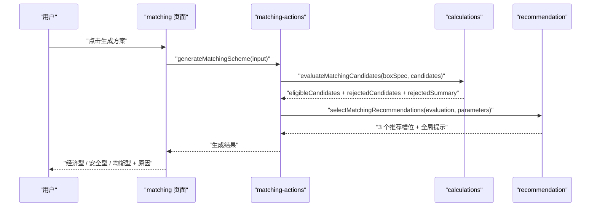
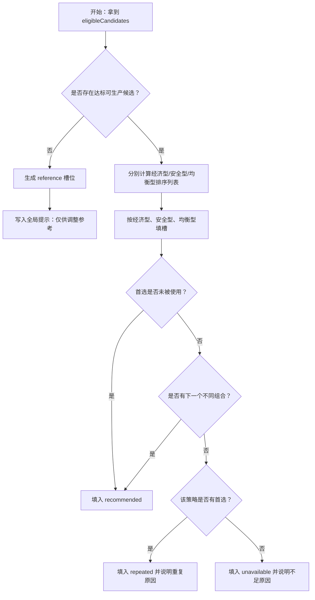

# 推荐策略 — 技术设计文档

## 1. 设计概要

**功能描述**：在现有配纸确定性计算之后，新增 `recommendation` 纯业务模块，从已评估候选中生成经济型、安全型、均衡型三个固定方案位置。正式推荐只来自达标且可生产候选；不足三套时保留槽位并展示原因；全部不达标时展示参考方案且标记仅供调整参考。→ AC-001 到 AC-013

**影响范围**：`src/modules/recommendation`、`src/server/actions/matching-actions.ts`、`src/app/(main)/matching/_components/box-spec-form.tsx`、`tests/unit/recommendation`、`tests/integration/matching`。本功能不新增数据库表，不新增第三方依赖，不改面积、强度、成本和设备限制公式。→ AC-001, AC-009, AC-013

**关键设计决策**：

- 推荐策略接在 `evaluateMatchingCandidates` 之后，只消费 `eligibleCandidates`、`rejectedCandidates` 和 `rejectedSummary`，不重新计算公式。→ AC-002, AC-010, AC-013
- 服务端成功响应从“推荐候选数组”升级为“经济型、安全型、均衡型三个固定槽位”，页面按槽位展示方案、重复说明、不可用原因或参考方案。→ AC-001, AC-004, AC-005, AC-006
- 安全型按空箱抗压富余率排序，并排除富余率超过 200% 的候选；经济型和均衡型仍可使用达标且可生产候选，均衡型安全分按 200% 封顶计分。→ AC-002, AC-011, AC-012
- 历史习惯和 AI 不进入推荐模块输入，不影响排序结果。→ AC-013

---

## 2. 架构概览

推荐策略采用“服务端动作编排 + calculations 评估 + recommendation 选择 + 页面展示”的结构。`recommendation` 是纯函数模块，不访问数据库、不依赖页面、不调用 AI。



### 模块职责

| 模块 / 文件 | 职责 | 对应 AC |
|-------------|------|---------|
| `src/modules/recommendation/types.ts` | 定义推荐策略、槽位状态、推荐槽位、重复说明、不可用原因 | AC-001, AC-004, AC-005, AC-006 |
| `src/modules/recommendation/select-matching-recommendations.ts` | 从候选评估结果中选择经济型、安全型、均衡型方案 | AC-002 到 AC-013 |
| `src/modules/recommendation/scoring.ts` | 计算含税成本排序、抗压富余率、均衡型综合分和稳定排序 | AC-002, AC-011, AC-012 |
| `src/modules/recommendation/reason-messages.ts` | 生成可用方案不足、重复展示、参考方案等业务提示 | AC-004, AC-005, AC-006, AC-007, AC-008 |
| `src/server/actions/matching-actions.ts` | 在候选评估后调用推荐模块，并返回三槽位推荐结果 | AC-001 到 AC-013 |
| `src/app/(main)/matching/_components/box-spec-form.tsx` | 固定展示三个方案位置、状态标签、指标、重复说明和不可用原因 | AC-001, AC-003 到 AC-009 |
| `tests/unit/recommendation/*` | 覆盖三类排序、去重、重复、不可用、参考方案和 AI/历史不参与 | AC-002 到 AC-013 |
| `tests/integration/matching/*` | 覆盖服务端动作返回契约和页面展示 | AC-001, AC-003 到 AC-009 |

---

## 3. 数据库设计

本功能不新增数据库表，也不修改现有表。→ AC-009, AC-013

理由：

- 推荐结果是单次生成过程中的派生结果，当前阶段只需要返回页面展示；历史方案保存会在后续“历史方案保存”功能中设计快照。→ AC-001, AC-013
- 本次排序只依赖 `calculations` 已输出的候选、强度、成本、设备状态和不推荐原因，不需要额外存储。→ AC-002, AC-007, AC-008
- 均衡型默认权重 50% / 50% 先作为推荐模块默认配置使用；后续若设置页支持调整，再接入基础参数读取。→ AC-012
- 历史习惯明确不参与本次推荐，因此不读取历史订单或历史方案表。→ AC-013

---

## 4. API / 函数契约

本项目首版使用 Server Actions，本功能不新增公开 REST API。→ AC-013

### 4.1 推荐模块类型

**位置**：`src/modules/recommendation/types.ts`

```ts
import type {
  CandidateEvaluation,
  EligibleCandidateEvaluation,
  RejectedCandidateEvaluation,
  RejectedCandidateSummary,
  RejectionReason,
} from "@/modules/calculations/types";

export type RecommendationStrategy = "economy" | "safety" | "balanced";

export type RecommendationSlotStatus =
  | "recommended"
  | "repeated"
  | "unavailable"
  | "reference";

export interface RecommendationSlot {
  strategy: RecommendationStrategy;
  title: "经济型" | "安全型" | "均衡型";
  status: RecommendationSlotStatus;
  isOfficialRecommendation: boolean;
  evaluation?: CandidateEvaluation;
  messages: string[];
  repeatedFrom?: RecommendationStrategy;
  unavailableReasons: RejectionReason[];
}

export interface SelectMatchingRecommendationsResult {
  slots: [RecommendationSlot, RecommendationSlot, RecommendationSlot];
  rejectedSummary: RejectedCandidateSummary[];
  rejectedCandidates: RejectedCandidateEvaluation[];
  globalMessages: string[];
}

export interface RecommendationOptions {
  balancedCostWeight: number;
  balancedSafetyWeight: number;
  maxSafetySurplusRate: number;
}
```

设计说明：

- `slots` 固定为三个位置，保证页面始终展示经济型、安全型、均衡型。→ AC-001, AC-004
- `status = recommended` 表示达标可生产且非重复的正式推荐。→ AC-002, AC-003, AC-010
- `status = repeated` 表示达标可生产，但为满足三槽位展示而重复使用同一组合。→ AC-005
- `status = unavailable` 表示该方案位置没有可用结果，只展示原因。→ AC-004, AC-011
- `status = reference` 表示没有达标可生产方案时展示的参考方案，`isOfficialRecommendation` 必须为 `false`。→ AC-006, AC-010

### 4.2 推荐选择入口

**位置**：`src/modules/recommendation/select-matching-recommendations.ts`

```ts
import type { CalculationParameters } from "@/modules/calculations/types";
import type { EvaluateMatchingCandidatesResult } from "@/modules/calculations/types";

import type { RecommendationOptions, SelectMatchingRecommendationsResult } from "./types";

export function selectMatchingRecommendations(input: {
  evaluation: EvaluateMatchingCandidatesResult;
  parameters: CalculationParameters;
  options?: Partial<RecommendationOptions>;
}): SelectMatchingRecommendationsResult;
```

流程：

1. 从 `evaluation.eligibleCandidates` 中得到正式候选。→ AC-002, AC-010
2. 如果存在正式候选，按经济型、安全型、均衡型分别计算首选候选。→ AC-002
3. 按“经济型 → 安全型 → 均衡型”的槽位顺序优先选择不同组合。→ AC-003, AC-004
4. 如果某槽位首选与已使用组合重复，则尝试选择该策略下的下一个不同组合。→ AC-004
5. 如果没有不同组合，但该策略有首选候选，则允许重复展示，并写入重复说明。→ AC-005
6. 如果该策略没有可用候选，返回 `unavailable` 槽位和具体原因。→ AC-004, AC-011
7. 如果没有任何正式候选，从 rejected 候选中生成参考槽位，并写入全局提示。→ AC-006, AC-007, AC-008

### 4.3 服务端动作返回契约

**位置**：`src/server/actions/matching-actions.ts`

```ts
export interface GenerateMatchingSchemeResult {
  boxSpec: NormalizedBoxSpec;
  stackingIncluded: boolean;
  stackingDisplayText: string;
  recommendationSlots: [RecommendationSlot, RecommendationSlot, RecommendationSlot];
  recommendationMessages: string[];
  rejectedSummary: RejectedCandidateSummary[];
  rejectedCandidates: RejectedCandidateEvaluation[];
}
```

调整说明：

- 新增 `recommendationSlots` 作为页面展示主数据。→ AC-001, AC-004, AC-005, AC-006
- `recommendationMessages` 用于承载“当前没有达标可生产方案，以下仅供调整参考”等全局提示。→ AC-006
- 保留 `rejectedSummary` 和 `rejectedCandidates`，继续支持不推荐原因汇总和明细。→ AC-004, AC-007, AC-008
- 原有 `recommendations: EligibleCandidateEvaluation[]` 不再作为推荐区主契约，避免无法表达固定三个方案位置和不可用槽位。→ AC-001, AC-004

---

## 5. 核心逻辑设计

### 5.1 候选身份

为判断“三套方案优先不同组合”，推荐模块使用稳定指纹识别同一配纸组合。→ AC-003, AC-004, AC-005

```ts
function createCandidateFingerprint(evaluation: CandidateEvaluation): string {
  return [
    evaluation.candidate.layerCount,
    evaluation.candidate.fluteType,
    ...evaluation.candidate.layers.map((layer) =>
      [layer.role, layer.flute ?? "", layer.paper.id].join(":"),
    ),
  ].join("|");
}
```

不用单纯依赖 `candidate.id` 的原因：候选生成逻辑后续可能调整 ID 规则，指纹按业务组合生成更稳定。→ AC-005

### 5.2 经济型排序

经济型只从达标且可生产候选中选择，按含税成本升序排序。→ AC-002, AC-010

排序规则：

1. `cost.taxIncludedCostYuan` 越低越优。
2. 成本相同或差距小于 `0.0001` 时，抗压富余率更接近但不低于 100% 的候选优先。
3. 仍相同时，按候选指纹升序，保证结果稳定。

### 5.3 安全型排序

安全型只从达标且可生产候选中选择，并排除抗压富余率超过 200% 的候选。→ AC-002, AC-011

抗压富余率计算：

```ts
surplusRate = evaluation.strength.bctN / parameters.strengthThresholds[layerCount].minBctN;
```

排序规则：

1. 只保留 `surplusRate <= 2` 的候选。
2. `surplusRate` 越高越优。
3. 富余率相同时，含税成本更低者优先。
4. 仍相同时，按候选指纹升序。

如果所有达标可生产候选的抗压富余率都超过 200%，安全型槽位返回 `unavailable`，原因显示“所有安全型候选抗压富余率超过 200% 上限”。→ AC-004, AC-011

### 5.4 均衡型排序

均衡型只从达标且可生产候选中选择，默认成本 50%、安全 50%。→ AC-002, AC-012

评分规则：

```text
costScore = (maxCost - currentCost) / (maxCost - minCost)
safetyScore = (min(currentSurplusRate, 2) - minSurplusRate) / (maxSurplusRate - minSurplusRate)
balancedScore = costScore * 0.5 + safetyScore * 0.5
```

边界处理：

- 如果所有候选成本相同，`costScore = 1`。
- 如果所有候选富余率相同，`safetyScore = 1`。
- 富余率超过 200% 时，均衡型安全分按 200% 封顶，不让过度冗余获得额外优势。
- 综合分相同时，含税成本更低者优先；仍相同时按候选指纹升序。

### 5.5 三槽位选择与重复规则



说明：

- “优先不同组合”只在同一轮结果内生效，不改变候选本身排序。→ AC-003, AC-004
- 重复槽位仍是达标且可生产候选，因此 `isOfficialRecommendation = true`。→ AC-005, AC-010
- 不可用槽位没有候选，页面展示标题和原因。→ AC-004, AC-011

### 5.6 全部不达标时的参考方案

当 `eligibleCandidates.length === 0` 时，推荐模块不生成正式推荐，改为参考方案展示。→ AC-006, AC-010

参考方案选择规则：

| 槽位 | 参考候选选择 | 对应 AC |
|------|--------------|---------|
| 经济型 | 优先选择已计算成本的 rejected 候选中含税成本最低者 | AC-006, AC-007 |
| 安全型 | 优先选择已计算强度的 rejected 候选中空箱抗压最高者 | AC-006, AC-007 |
| 均衡型 | 优先选择同时具备强度和成本结果、问题数量最少的 rejected 候选 | AC-006, AC-007, AC-008 |

如果没有足够不同参考候选，允许重复参考候选，但所有参考槽位都必须 `isOfficialRecommendation = false`，并显示该候选的 `reasons`。→ AC-006, AC-010

如果 rejected 候选也没有可展示的面积、强度或成本结果，例如整体数据不足，则三个槽位展示 `unavailable`，服务端动作继续返回 `VALIDATION_ERROR` 的场景不进入推荐模块。→ AC-009

### 5.7 不足原因生成

不可用原因从以下来源生成。→ AC-004, AC-007, AC-008, AC-011

| 场景 | 显示原因 |
|------|----------|
| 没有任何达标可生产候选 | 使用 rejected summary 和候选 reasons 汇总 |
| 安全型无候选 | “所有安全型候选抗压富余率超过 200% 上限”或“没有达标可生产候选” |
| 不同组合不足 | “没有更多不同的达标可生产候选组合” |
| 强度不足 | 直接展示 `STRENGTH_UNQUALIFIED` 的 reason message，例如边压不足 |
| 设备不可生产 | 直接展示 `NOT_MANUFACTURABLE` 的 reason message，例如超过设备最大宽度 |
| 数据不足 / 参数异常 | 展示已有 `DATA_MISSING` 或 `PARAMETER_ERROR` reason message |

---

## 6. 页面展示设计

`box-spec-form.tsx` 的推荐区从遍历 `recommendations` 改为遍历 `recommendationSlots`。→ AC-001, AC-004, AC-005, AC-006

每个槽位展示：

- 方案标题：经济型、安全型、均衡型。→ AC-001
- 状态标签：正式推荐、重复推荐、不可用、参考方案。→ AC-004, AC-005, AC-006, AC-010
- 有候选时展示层数、瓦型、纸张组合、面积、空箱抗压、边压、耐破、含税成本。→ AC-003, AC-007
- `messages` 中的说明，例如“该组合同时也是均衡型下最优”。→ AC-005
- `unavailableReasons` 或 `evaluation.reasons` 中的原因。→ AC-004, AC-007, AC-008

当 `recommendationMessages` 包含全局提示时，在推荐区顶部展示，例如：

```text
当前没有达标可生产方案，以下仅供调整参考
```

---

## 7. 错误处理与安全

- 输入校验、登录校验、整体基础数据缺失继续由 `generateMatchingScheme` 在推荐前处理。→ AC-009
- 推荐模块不抛出业务异常；候选不足、安全型无候选、全部不达标都通过槽位状态和原因表达。→ AC-004, AC-006, AC-011
- 页面只展示业务原因，不展示堆栈、数据库错误或内部对象。→ AC-004, AC-007, AC-008, AC-009
- AI 不进入推荐模块，不读取 AI 结果，不接受 AI 改写推荐结果。→ AC-013
- 历史订单和历史方案不进入本次推荐模块输入，避免历史习惯影响排序。→ AC-013

---

## 8. 测试方案

### 8.1 单元测试

新增 `tests/unit/recommendation/select-matching-recommendations.test.ts`。

| 场景 | 断言 | 对应 AC |
|------|------|---------|
| 有多套达标可生产候选 | 返回三个固定槽位 | AC-001 |
| 经济型排序 | 含税成本最低者进入经济型 | AC-002 |
| 安全型排序 | 富余率最高且不超过 200% 者进入安全型 | AC-002, AC-011 |
| 安全型全超 200% | 安全型槽位为 unavailable 并显示原因 | AC-004, AC-011 |
| 均衡型默认权重 | 默认 50% / 50% 计算综合分 | AC-012 |
| 三策略首选不同 | 三槽位展示三个不同组合 | AC-003 |
| 首选重复但有替代 | 使用下一个不同组合 | AC-004 |
| 首选重复且无替代 | 允许 repeated 并显示重复说明 | AC-005 |
| 没有 eligible | 返回 reference 槽位和全局提示 | AC-006, AC-010 |
| 强度不达标参考方案 | 展示耐破、边压、空箱抗压不足原因 | AC-007 |
| 设备不可生产参考方案 | 展示设备限制原因 | AC-008 |
| 历史习惯和 AI 不参与 | 推荐输入和结果不包含历史/AI 字段 | AC-013 |

### 8.2 集成测试

更新 `tests/integration/matching/matching-actions.test.ts`。

- `generateMatchingScheme` 调用 `selectMatchingRecommendations`，返回 `recommendationSlots`。→ AC-001
- 基础数据不足时仍在推荐前返回 `VALIDATION_ERROR`。→ AC-009
- 服务端返回固定三个槽位，且不可用槽位含原因。→ AC-004
- 全部不达标时返回全局提示和参考槽位。→ AC-006
- 未达标或不可生产候选不被标记为达标推荐。→ AC-010

更新 `tests/integration/matching/matching-page.test.tsx`。

- 页面展示经济型、安全型、均衡型三个位置。→ AC-001
- 页面展示重复说明。→ AC-005
- 页面展示“当前没有达标可生产方案，以下仅供调整参考”。→ AC-006
- 页面展示强度不足、设备限制和可用方案不足原因。→ AC-004, AC-007, AC-008

---

## 9. AC 覆盖矩阵

| AC | 技术覆盖点 |
|----|------------|
| AC-001 | `recommendationSlots` 固定三槽位；页面按槽位展示 |
| AC-002 | `selectMatchingRecommendations` 的经济型、安全型、均衡型排序 |
| AC-003 | 候选指纹去重和三槽位不同组合优先 |
| AC-004 | `unavailable` 槽位、不同组合不足原因、rejected summary |
| AC-005 | `repeated` 槽位、`repeatedFrom` 和重复说明 |
| AC-006 | `reference` 槽位、`isOfficialRecommendation=false`、全局参考提示 |
| AC-007 | rejected strength reasons 透传到参考方案和明细 |
| AC-008 | rejected device reasons 透传到参考方案和明细 |
| AC-009 | `matching-actions` 在推荐前执行基础数据就绪检查，失败返回字段错误 |
| AC-010 | 正式推荐只来自 `eligibleCandidates`；参考方案不标记为正式推荐 |
| AC-011 | 安全型 `surplusRate <= 2` 过滤和不可用原因 |
| AC-012 | 默认 `balancedCostWeight=0.5`、`balancedSafetyWeight=0.5` |
| AC-013 | 推荐模块无历史习惯输入、无 AI 输入，服务端动作不调用 AI |

---

## 10. 实施顺序建议

1. 新增 `src/modules/recommendation/types.ts` 和 `scoring.ts`，先写单元测试覆盖排序与富余率。→ AC-002, AC-011, AC-012
2. 新增 `select-matching-recommendations.ts`，覆盖三槽位、去重、重复和不可用原因。→ AC-001, AC-003, AC-004, AC-005
3. 接入 `matching-actions.ts`，把候选评估结果转换为推荐槽位。→ AC-001, AC-009, AC-010
4. 更新 matching 页面展示固定槽位、状态标签、全局提示和原因。→ AC-001, AC-004 到 AC-008
5. 补充 integration 测试，确认服务端契约和页面展示。→ AC-001 到 AC-013

---

## 附录：变更记录

| 日期 | 变更内容 | 原因 |
|------|---------|------|
| 2026-07-02 | 初始版本 | 基于《推荐策略》需求文档生成技术设计，明确三槽位推荐契约、排序规则、重复规则和测试方案 |
