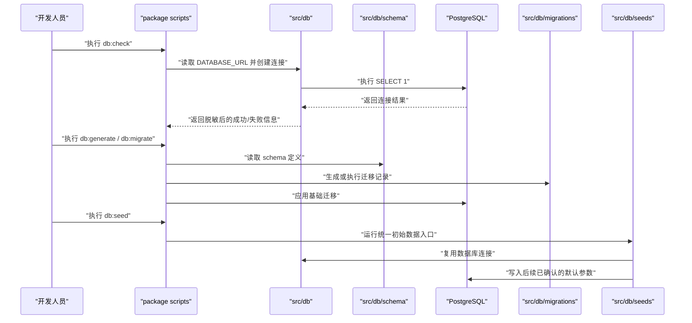

# 数据保存基础 — 技术设计文档

## 1. 设计概要

**功能描述**：建立 PostgreSQL + Drizzle 的数据保存地基，使项目能连接数据库、执行一次基础迁移、保留迁移记录，并为后续业务模块提供 schema 拆分和初始数据入口。

**影响范围**：`src/db`、`src/db/schema`、`src/db/migrations`、`src/db/seeds`、`scripts`、`package.json`、`.env.example`。

**技术难点**：错误信息必须可排查但不暴露连接串、密码、底层堆栈或业务敏感数据；首个迁移要能验证链路，但不能提前实现纸厂、原纸、基础参数、历史方案等业务能力。

**外部依赖**：PostgreSQL 数据库服务；项目已有 `drizzle-orm`、`drizzle-kit`、`pg`，不新增依赖。

---

## 2. 架构概览

本功能只建立数据基础层，不提供页面能力，不新增业务模块。开发人员通过包脚本执行连接检查、迁移生成、迁移执行和初始数据入口；脚本调用 `src/db` 中的统一连接封装，schema 按模块放在 `src/db/schema`，迁移文件由 Drizzle 生成到 `src/db/migrations`。



---

## 3. 数据库设计

### 新增表

#### `system_metadata`

**用途**：作为非业务基线表，验证迁移链路可运行，并保存少量系统级元信息。该表不保存纸厂、原纸、公式参数、历史方案等业务数据。→ AC-002, AC-003, AC-008, AC-010

| 字段名 | 类型 | 约束 | 说明 |
|--------|------|------|------|
| id | uuid | PK, DEFAULT gen_random_uuid() | 主键 |
| key | varchar(100) | NOT NULL, UNIQUE | 元信息键，例如 `schema_baseline` |
| value | text | NOT NULL | 元信息值，不存敏感信息 |
| description | text | NULL | 元信息说明 |
| created_at | timestamp with time zone | NOT NULL, DEFAULT now() | 创建时间 |
| updated_at | timestamp with time zone | NOT NULL, DEFAULT now() | 更新时间 |

**索引**：`key` 使用唯一索引，支持初始数据入口重复执行时按键判断是否已存在。→ AC-008

```sql
CREATE TABLE "system_metadata" (
  "id" uuid PRIMARY KEY DEFAULT gen_random_uuid() NOT NULL,
  "key" varchar(100) NOT NULL,
  "value" text NOT NULL,
  "description" text,
  "created_at" timestamp with time zone DEFAULT now() NOT NULL,
  "updated_at" timestamp with time zone DEFAULT now() NOT NULL,
  CONSTRAINT "system_metadata_key_unique" UNIQUE("key")
);
```

### 修改现有表

无需修改现有业务表。当前项目还没有业务数据表，本功能不创建纸厂、原纸、基础参数、历史方案、导出记录或 AI 缓存表。→ AC-010, AC-013

**数据迁移**：生成一条基础迁移，用于创建 `system_metadata`。Drizzle 自身迁移记录表由 Drizzle Kit 管理，用于识别迁移是否已执行。→ AC-002, AC-008

---

## 4. 执行契约

本功能没有用户页面，也不新增 REST API 或 Server Action。面向开发人员的执行入口使用 `package.json` scripts。

### `pnpm db:check`

**描述**：检查 `DATABASE_URL` 是否存在，并验证 PostgreSQL 是否可连接。→ AC-001, AC-005, AC-006, AC-012

**鉴权**：不涉及登录；仅在开发、部署和运维环境手动执行。

**输入**：读取服务端环境变量 `DATABASE_URL`。

**成功输出**：

```text
数据库连接成功
```

**异常输出**：

| 场景 | 输出 | 对应 AC |
|------|------|---------|
| 未配置 `DATABASE_URL` | `DATABASE_URL 未配置，请先配置数据连接信息。` | AC-005 |
| 连接不可用 | `数据库连接不可用，请检查地址、账号、密码或网络。` | AC-006 |
| 其他未知错误 | `数据库检查失败，请查看运行环境配置。` | AC-006, AC-012 |

所有异常输出不得包含完整连接串、密码、SQL 语句、底层堆栈或真实业务数据。→ AC-006, AC-012

### `pnpm db:generate`

**描述**：根据 `src/db/schema` 生成 Drizzle 迁移文件。→ AC-002, AC-003, AC-009

**鉴权**：不涉及登录；仅开发人员执行。

**输入**：读取 `src/db/schema/index.ts` 汇总导出的 schema。

**成功结果**：`src/db/migrations` 下出现由 Drizzle 生成的迁移文件。

**异常处理**：

| 场景 | 输出 | 对应 AC |
|------|------|---------|
| schema 定义错误 | Drizzle 生成失败，开发人员修复 schema 后重试 | AC-007 |
| `DATABASE_URL` 缺失 | 不影响纯生成；如果 Drizzle Kit 当前版本要求连接信息，则输出脱敏配置提示 | AC-005, AC-012 |

### `pnpm db:migrate`

**描述**：把已生成的迁移应用到 PostgreSQL。→ AC-002, AC-007, AC-008

**鉴权**：不涉及登录；仅开发、部署和运维环境执行。

**输入**：读取 `DATABASE_URL` 和 `src/db/migrations`。

**成功结果**：数据库完成基础迁移，并由 Drizzle 记录迁移状态。

**异常处理**：

| 场景 | 输出 | 对应 AC |
|------|------|---------|
| 连接缺失 | 提示先配置数据连接信息 | AC-005 |
| 连接不可用 | 提示连接不可用，不展示连接串和密码 | AC-006 |
| 迁移失败 | 输出脱敏失败原因，迁移流程返回失败状态 | AC-007, AC-012 |
| 迁移已执行 | Drizzle 识别已执行状态，不重复破坏已有数据 | AC-008 |

### `pnpm db:seed`

**描述**：提供统一初始数据入口。当前只写入非业务基线元信息；后续“基础参数维护”在这里接入已确认的默认参数。→ AC-004, AC-011

**鉴权**：不涉及登录；仅开发、部署和运维环境执行。

**成功结果**：`system_metadata` 中存在 `schema_baseline` 记录；重复执行不产生冲突。

**异常处理**：

| 场景 | 输出 | 对应 AC |
|------|------|---------|
| 基础迁移尚未执行 | 提示先执行数据库迁移 | AC-007 |
| 重复执行 | 检测已存在记录并跳过或更新，不插入重复数据 | AC-008 |
| 连接失败 | 输出脱敏连接错误 | AC-006, AC-012 |

---

## 5. 核心逻辑

### 数据连接封装 → AC-001, AC-005, AC-006, AC-012

**触发条件**：任何脚本或服务端能力需要访问数据库时。

**处理流程**：
1. 从服务端环境变量读取 `DATABASE_URL`。
2. 如果为空，返回稳定错误码 `DATABASE_URL_MISSING` 和业务提示。
3. 如果存在，创建 PostgreSQL 连接池，并通过 Drizzle 暴露数据库实例。
4. 健康检查执行最小查询 `SELECT 1`。
5. 捕获异常后只返回脱敏错误，不输出完整连接串、密码或堆栈。

**伪代码**：

```text
function getDatabaseUrl():
  if DATABASE_URL is empty:
    return error DATABASE_URL_MISSING
  return DATABASE_URL

function checkDatabaseConnection():
  url = getDatabaseUrl()
  if url is error:
    return safe error message
  try:
    run SELECT 1
    return success
  catch:
    return safe connection unavailable message
```

### Schema 拆分与汇总 → AC-003, AC-009, AC-013

**触发条件**：新增数据库 schema 或生成迁移时。

**处理流程**：
1. 每个领域 schema 使用独立文件，例如 `system.ts`、后续 `paper-factories.ts`、`paper-materials.ts`。
2. `src/db/schema/index.ts` 只做 schema 汇总导出。
3. `drizzle.config.ts` 读取 `./src/db/schema`，迁移输出到 `./src/db/migrations`。
4. `src/db` 不引用页面层，不拼接用户可见文案，不承载业务计算。

### 初始数据入口 → AC-004, AC-008, AC-011

**触发条件**：开发人员或部署流程执行 `pnpm db:seed`。

**处理流程**：
1. 复用 `src/db` 连接封装。
2. 先检查 `system_metadata` 是否存在基线键。
3. 若不存在，写入 `schema_baseline`。
4. 若已存在，则跳过或更新 `updated_at`，保证重复执行不冲突。
5. 后续“基础参数维护”只在 `src/db/seeds` 内新增默认参数种子，不修改本功能的连接与迁移架构。

### 迁移失败处理 → AC-007, AC-012

**触发条件**：执行 `pnpm db:migrate` 或 `pnpm db:seed` 失败。

**处理流程**：
1. 命令返回非零状态，让开发人员明确知道失败。
2. 控制台输出只保留必要的排查方向，例如“连接不可用”“迁移失败”“请先执行迁移”。
3. 不吞掉失败结果，不伪装成功。
4. 不把底层堆栈、连接串、密码或业务敏感数据输出给终端。

---

## 6. 现有代码改动

| 模块 / 文件 | 改动内容 | 原因 | 对应 AC |
|-------------|---------|------|---------|
| `src/db/index.ts` | 替换占位内容，提供数据库连接池、Drizzle 实例、连接检查和关闭连接能力 | 建立统一数据访问入口 | AC-001, AC-005, AC-006, AC-012 |
| `src/db/schema/system.ts` | 新增 `system_metadata` schema | 提供非业务基线表，验证迁移链路 | AC-002, AC-008, AC-010 |
| `src/db/schema/index.ts` | 从占位导出改为汇总导出 schema 文件 | 支持按模块拆分 schema | AC-003, AC-009, AC-013 |
| `src/db/seeds/index.ts` | 新增统一初始数据入口 | 支持后续已确认默认参数初始化 | AC-004, AC-008, AC-011 |
| `scripts/check-database.ts` | 新增数据库连接检查脚本 | 让开发人员能独立验证连接 | AC-001, AC-005, AC-006 |
| `scripts/seed-database.ts` | 新增初始数据执行脚本 | 为 `db:seed` 提供命令入口 | AC-004, AC-008, AC-011 |
| `package.json` | 新增 `db:check`、`db:seed` 脚本，保留 `db:generate`、`db:migrate` | 形成完整执行闭环 | AC-001, AC-002, AC-004 |
| `drizzle.config.ts` | 保持 PostgreSQL、schema、migrations 配置；补充缺失连接信息时的脱敏错误提示 | 避免迁移命令在配置缺失时静默使用空字符串 | AC-005, AC-012 |
| `.env.example` | 保留 `DATABASE_URL` 示例，不写真实连接信息 | 明确配置入口并避免密钥泄露 | AC-005, AC-012 |
| `tests/integration/db/` | 新增连接配置缺失、错误脱敏、seed 幂等的集成测试或脚本级测试 | 覆盖异常和重复执行行为 | AC-005, AC-006, AC-008, AC-012 |

---

## 7. 技术决策

### 基础迁移采用非业务基线表，而不是空迁移

**背景**：路线图允许“一次空迁移或基础迁移”，需求要求能留下可追溯记录。空迁移能验证工具链，但无法给后续 seed 幂等和系统级元信息提供落点。

**选项**：
- A: 空迁移 — 最轻量，但无法验证真实建表，也没有系统元信息落点。
- B: 创建 `system_metadata` 基线表 — 多一个非业务表，但能验证真实迁移、支持 seed 幂等和后续系统级标记。

**结论**：选择 B。它不提前创建业务表，又能真实验证数据库迁移链路。→ AC-002, AC-008, AC-010

### 健康检查采用脚本入口，而不是页面或公开接口

**背景**：本功能服务开发和运维阶段，不面向终端用户；公开接口可能暴露数据库状态。

**选项**：
- A: 新增页面或 API 显示数据库状态 — 可视化更直接，但增加暴露面，且需要登录能力先完成。
- B: 新增 `pnpm db:check` 脚本 — 简单、低暴露面，符合当前 Phase 1.1 基础设施定位。

**结论**：选择 B。等 `auth` 完成后，如果需要运维页面，再单独设计。→ AC-001, AC-005, AC-006, AC-010

### 初始数据入口先只放基线，默认业务参数后续接入

**背景**：用户已确认默认参数无需重新讨论，但需求边界明确本功能不完整录入默认参数。

**选项**：
- A: 本功能直接写入所有默认参数 — 后续基础参数功能起步更快，但会抢跑业务范围。
- B: 本功能只提供 seed 入口和基线记录 — 范围清楚，后续基础参数维护再接入默认参数。

**结论**：选择 B。这样满足初始化入口，同时不扩大本功能范围。→ AC-004, AC-010, AC-011

---

## 8. 安全与性能

**敏感数据处理**：所有脚本捕获错误后只输出稳定业务提示，不输出完整 `DATABASE_URL`、密码、SQL 语句、底层堆栈、原纸价格明细或公式参数敏感内容。→ AC-006, AC-012

**输入校验**：`DATABASE_URL` 必须非空；`db:seed` 必须先确认基线表可访问，再写入元信息。→ AC-005, AC-007

**性能考量**：连接检查只执行 `SELECT 1`；基线表只有极少量系统元信息，对后续业务查询没有性能压力。→ AC-001, AC-013

**幂等性**：迁移由 Drizzle 记录执行状态；seed 通过 `system_metadata.key` 唯一约束避免重复写入。→ AC-008

---

## 9. AC 覆盖总表

| AC 编号 | 验收标准概述 | 实现位置 |
|---------|-------------|---------|
| AC-001 | 数据连接可用 | `pnpm db:check`、`src/db/index.ts` 连接检查 |
| AC-002 | 基础变更可执行 | `system_metadata` schema、Drizzle 基础迁移、`pnpm db:migrate` |
| AC-003 | 数据保存边界清晰 | `src/db/schema` 拆分、`src/db/migrations`、`src/db/seeds` |
| AC-004 | 支持后续默认参数初始化 | `src/db/seeds/index.ts`、`pnpm db:seed` |
| AC-005 | 数据连接信息缺失 | `src/db/index.ts` 环境变量校验、`pnpm db:check` |
| AC-006 | 数据连接信息错误 | `pnpm db:check` 脱敏错误输出 |
| AC-007 | 基础变更执行失败 | `pnpm db:migrate` 非零失败、`db:seed` 前置检查 |
| AC-008 | 重复执行基础变更 | Drizzle 迁移状态记录、`system_metadata.key` 唯一约束、seed 幂等 |
| AC-009 | 遵守项目结构边界 | 所有数据库相关内容放在 `src/db`，脚本放在 `scripts` |
| AC-010 | 不扩大功能范围 | 只新增 `system_metadata` 非业务表，不新增业务页面和业务表 |
| AC-011 | 默认参数不重新确认 | seed 入口预留，默认参数由后续基础参数维护接入 |
| AC-012 | 敏感信息不外泄 | 脱敏错误处理、`.env.example` 仅保留示例连接串 |
| AC-013 | 服务后续核心数据范围 | schema 按模块拆分，后续业务表在 `src/db/schema` 扩展 |

---

## 附录：变更记录

| 日期 | 变更内容 | 原因 |
|------|---------|------|
| 2026-06-28 | 初始版本 | 按“数据保存基础”需求设计数据库基础设施技术方案 |
