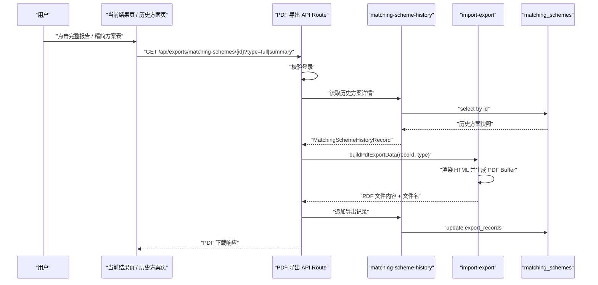

# 方案 PDF 导出 — 技术设计文档

## 1. 设计概要

**功能描述**：在已确认保存的历史方案基础上，新增完整配纸报告 PDF 和精简方案表 PDF 导出能力。当前结果页和历史方案页都通过历史记录 ID 发起导出；服务端读取历史快照生成 PDF，成功后回写导出类型和导出时间。→ AC-001 到 AC-015

**影响范围**：`src/modules/import-export`、`src/server/actions/matching-scheme-history.ts`、`src/app/api/exports/matching-schemes/[schemeId]/route.ts`、`src/app/(main)/matching/_components/box-spec-form.tsx`、`src/app/(main)/history`、`src/db/schema/matching-schemes.ts`、`tests/unit/import-export`、`tests/integration/matching`、`tests/integration/import-export`。本功能不修改面积、强度、成本和推荐公式。→ AC-001 到 AC-015

**关键设计决策**：

- PDF 只从 `matching_schemes` 已保存快照生成，不从页面临时状态生成。→ AC-006, AC-011
- 使用 API Route 返回二进制 PDF，页面用普通下载链接触发；服务端复用登录校验和数据库查询。→ AC-001, AC-002, AC-009
- 完整报告和精简方案表共用同一份导出数据模型，按导出类型控制字段可见性。→ AC-003, AC-004, AC-012, AC-013
- 首版即时生成并下载 PDF，不保存 PDF 文件到对象存储；导出记录只保存导出类型和导出时间。→ AC-005, AC-015
- 同步调整保存前置规则：未达标、不可生产或数据不足的最终方案不能确认保存，因此不会进入 PDF 导出。→ AC-008

---

## 2. 架构概览

PDF 导出采用“页面入口 + API Route + 历史方案仓储 + import-export 纯生成模块”的结构。页面只负责展示按钮和触发下载；API Route 负责登录校验、读取历史记录、校验可导出状态、生成 PDF、回写导出记录；`import-export` 负责把历史快照转成报告数据、渲染 HTML 和调用 Playwright 生成 PDF。



### 模块职责

| 模块 / 文件 | 职责 | 对应 AC |
|-------------|------|---------|
| `src/app/(main)/matching/_components/box-spec-form.tsx` | 保存成功后用 `schemeId` 展示完整报告和精简方案表下载入口 | AC-001, AC-006 |
| `src/app/(main)/history/page.tsx` | 历史列表展示已保存方案和导出入口，后续详情页可展示导出记录 | AC-002, AC-005, AC-015 |
| `src/app/api/exports/matching-schemes/[schemeId]/route.ts` | 接收 PDF 下载请求，校验登录、读取历史、生成 PDF、回写导出记录 | AC-001, AC-002, AC-009, AC-011 |
| `src/modules/import-export/matching-scheme-pdf-types.ts` | 定义导出类型、导出数据模型、导出记录类型 | AC-003, AC-004, AC-013, AC-014 |
| `src/modules/import-export/build-matching-scheme-pdf-data.ts` | 从历史方案快照构造完整报告或精简方案表数据 | AC-003, AC-004, AC-012, AC-013 |
| `src/modules/import-export/render-matching-scheme-pdf-html.ts` | 生成服务端 HTML 模板，保证中文表格完整可读 | AC-003, AC-004, AC-010 |
| `src/modules/import-export/generate-matching-scheme-pdf.ts` | 调用 Playwright/Chromium 生成 PDF Buffer | AC-003, AC-004, AC-009, AC-010 |
| `src/server/actions/matching-scheme-history.ts` | 新增按 ID 读取历史方案、追加导出记录的仓储方法 | AC-005, AC-011, AC-015 |
| `src/server/actions/matching-actions.ts` | 保存时拒绝非 `qualified` 的最终方案 | AC-008 |
| `src/db/schema/matching-schemes.ts` | 复用 `exportRecords` JSONB 字段，无需新增表 | AC-005, AC-015 |

---

## 3. 数据库设计

### 3.1 复用字段

继续复用现有 `matching_schemes.export_records` JSONB 字段。该字段保存每次成功导出的类型和时间。→ AC-005, AC-015

```ts
export type MatchingSchemePdfExportType = "full_report" | "summary_sheet";

export interface MatchingSchemeExportRecord {
  type: MatchingSchemePdfExportType;
  exportedAt: string;
}
```

示例：

```json
[
  { "type": "full_report", "exportedAt": "2026-07-02T10:30:00.000Z" },
  { "type": "summary_sheet", "exportedAt": "2026-07-02T10:35:00.000Z" }
]
```

### 3.2 不新增导出文件表

本次不保存 PDF 文件地址，不做对象存储归档，因此不新增 `export_files` 或 `storage_objects` 表。导出记录只用于确认“何时导出过哪种 PDF”。→ AC-005, AC-015

### 3.3 仓储方法扩展

在 `MatchingSchemeHistoryRepository` 中补充：

```ts
interface MatchingSchemeHistoryRepository {
  findById(id: string): Promise<MatchingSchemeHistoryRecord | null>;
  appendExportRecord(input: {
    schemeId: string;
    record: MatchingSchemeExportRecord;
  }): Promise<MatchingSchemeHistoryRecord>;
}
```

实现要求：

- `findById` 按主键读取完整历史快照。→ AC-002, AC-011
- `appendExportRecord` 使用事务读取当前 `exportRecords`、追加新记录并更新。→ AC-005, AC-015
- 更新导出记录失败时，PDF 不返回成功下载，避免用户已导出但历史不可追溯。→ AC-005, AC-009

---

## 4. 路由与函数契约

### 4.1 PDF 下载 API Route

**位置**：`src/app/api/exports/matching-schemes/[schemeId]/route.ts`

**方法**：`GET`

**查询参数**：

| 参数 | 类型 | 必填 | 说明 | 对应 AC |
|------|------|------|------|---------|
| `type` | `full_report` / `summary_sheet` | 是 | 完整报告或精简方案表 | AC-003, AC-004 |

**成功响应**：

- `Content-Type: application/pdf`
- `Content-Disposition: attachment; filename*=UTF-8''{encodedFileName}`
- Body 为 PDF 二进制内容。→ AC-014

**异常响应**：

| 场景 | 状态 | 响应 | 对应 AC |
|------|------|------|---------|
| 未登录 | 401 | `需要先登录` | AC-001, AC-002 |
| 导出类型非法 | 400 | `导出类型无效` | AC-003, AC-004 |
| 历史方案不存在 | 404 | `方案记录不存在` | AC-011 |
| 历史方案状态不是 `qualified` | 409 | `当前方案不可导出` | AC-008, AC-011 |
| PDF 生成失败 | 500 | `导出失败，请稍后重试` | AC-009 |
| 导出记录写入失败 | 500 | `导出失败，请稍后重试` | AC-005, AC-009 |

### 4.2 导出类型

```ts
export type MatchingSchemePdfExportType = "full_report" | "summary_sheet";

export const matchingSchemePdfExportTypeLabels = {
  full_report: "完整报告",
  summary_sheet: "精简方案表",
} satisfies Record<MatchingSchemePdfExportType, string>;
```

### 4.3 导出数据模型

完整报告和精简方案表共用 `MatchingSchemePdfData`，用 `visibility` 控制展示字段。→ AC-003, AC-004, AC-012, AC-013

```ts
export interface MatchingSchemePdfData {
  type: MatchingSchemePdfExportType;
  title: "配纸方案报告" | "配纸方案表";
  fileName: string;
  savedAt: Date;
  boxSpec: Record<string, string>;
  originalRecommendations: PdfSchemeSummary[];
  finalScheme: PdfSchemeDetail;
  recommendationConclusion: string;
  exportVisibility: {
    showCost: boolean;
    showOriginalRecommendations: boolean;
  };
}
```

规则：

- `full_report`：`showCost = true`，`showOriginalRecommendations = true`。→ AC-003, AC-012
- `summary_sheet`：`showCost = false`，`showOriginalRecommendations = false`。→ AC-004, AC-013

### 4.4 文件名规则

```text
配纸方案-{yyyyMMdd-HHmmss}-完整报告.pdf
配纸方案-{yyyyMMdd-HHmmss}-精简方案表.pdf
```

保存时间来自历史方案 `createdAt`，不是导出时间。这样同一方案多次导出的文件名稳定且可追溯。→ AC-014

---

## 5. 核心逻辑

### 5.1 导出前置校验

API Route 在生成 PDF 前执行：

1. 校验用户已登录。→ AC-001, AC-002
2. 校验 `type` 是允许的导出类型。→ AC-003, AC-004
3. 按 `schemeId` 读取历史方案。→ AC-011
4. 校验 `finalSchemeSnapshot.finalStatus === "qualified"`。→ AC-008, AC-011
5. 生成 PDF。
6. 回写导出记录。
7. 返回下载响应。→ AC-005, AC-009, AC-015

### 5.2 保存前置规则调整

现有保存闭环中，`saveConfirmedMatchingScheme` 会保存 `unqualified`、`not_manufacturable`、`data_incomplete` 并写风险提示；本次需求已确认这些状态不能确认保存。因此保存动作需调整为：

```text
finalStatus = resolveFinalStatus(finalEvaluation)
if finalStatus !== "qualified":
  return VALIDATION_ERROR + "当前方案未达标或不可生产，无法确认保存"
```

该调整会同步满足 PDF 导出的“只导出可保存方案”。→ AC-008, AC-011

受影响测试：

- 原先“未达标/不可生产允许保存”的测试需改为“拒绝保存且不写历史”。
- `recalculateAdjustedScheme` 仍可返回 `unqualified` 或 `not_manufacturable`，用于页面展示原因，但 `canSave` 应改为 `false` 或页面根据 `finalStatus` 禁用保存。→ AC-007, AC-008

### 5.3 完整报告内容

完整报告 HTML 包含：

- 抬头：`配纸方案报告`。→ AC-014
- 基本信息：保存时间、记录编号、是否手动调整、方案状态。→ AC-003
- 输入参数：纸箱尺寸、结构类型、成箱方式、产品类型、重量、排列方式、堆码、生产数量、特殊要求。→ AC-003
- 原始三套推荐对比：经济型、安全型、均衡型的层数、瓦型、纸张组合、强度、达标状态、可生产状态、成本。→ AC-003, AC-012
- 最终确认方案：层数、瓦型、各层原纸、纸厂、克重、强度、成本、达标状态、可生产状态。→ AC-003, AC-012
- 强度校核：空箱抗压、边压、耐破和相关状态。→ AC-003
- 成本：单箱含税成本、各层单价、用纸总价、加工费用、税金。→ AC-003, AC-012
- 推荐结论：保存快照中的选型理由或模板结论。→ AC-003

### 5.4 精简方案表内容

精简方案表 HTML 包含：

- 抬头：`配纸方案表`。→ AC-014
- 基本信息：保存时间、记录编号、方案状态。→ AC-004
- 最终确认方案：层数、瓦型、各层原纸、纸厂、克重。→ AC-004
- 强度：空箱抗压、边压、耐破。→ AC-004
- 状态：达标状态、可生产状态。→ AC-004
- 推荐结论：面向客户沟通的简洁结论。→ AC-004

精简方案表必须过滤以下字段：

- 单箱含税成本
- 各层单价
- 用纸总价
- 加工费用
- 税金
- 其他内部成本明细

→ AC-013

### 5.5 中文 PDF 生成

`render-matching-scheme-pdf-html.ts` 生成完整 HTML 文档，CSS 采用固定页边距、表格自动换行和避免截断的样式：

```css
body {
  font-family: "Microsoft YaHei", "Noto Sans CJK SC", sans-serif;
}

table {
  border-collapse: collapse;
  table-layout: fixed;
  width: 100%;
}

th,
td {
  overflow-wrap: anywhere;
  word-break: break-word;
}

tr {
  break-inside: avoid;
}
```

Playwright 生成参数：

```ts
await page.pdf({
  format: "A4",
  printBackground: true,
  margin: {
    top: "16mm",
    right: "12mm",
    bottom: "16mm",
    left: "12mm",
  },
});
```

实现时优先使用项目已确认的 Playwright/Chromium 方案。如果生产依赖中缺少可运行的 Playwright 包，需要把运行时所需包加入 `dependencies`，不能只依赖测试用的 `devDependencies`。→ AC-009, AC-010

### 5.6 导出记录回写

PDF 生成成功且准备返回下载前，调用：

```ts
appendMatchingSchemeExportRecord({
  schemeId,
  record: {
    type,
    exportedAt: now.toISOString(),
  },
});
```

历史方案页读取 `exportRecords` 后按时间展示：

```text
2026-07-02 18:30 完整报告
2026-07-02 18:35 精简方案表
```

→ AC-005, AC-015

---

## 6. 现有代码改动

| 文件 | 改动内容 | 对应 AC |
|------|----------|---------|
| `src/modules/import-export/README.md` | 补充 PDF 导出模块边界 | AC-003, AC-004 |
| `src/modules/import-export/matching-scheme-pdf-types.ts` | 新增导出类型、数据模型、导出记录类型 | AC-003, AC-004, AC-014 |
| `src/modules/import-export/build-matching-scheme-pdf-data.ts` | 从历史快照生成完整报告或精简方案表数据 | AC-003, AC-004, AC-012, AC-013 |
| `src/modules/import-export/render-matching-scheme-pdf-html.ts` | 生成中文 PDF HTML 模板 | AC-003, AC-004, AC-010 |
| `src/modules/import-export/generate-matching-scheme-pdf.ts` | 使用 Playwright/Chromium 生成 PDF Buffer | AC-009, AC-010 |
| `src/server/actions/matching-scheme-history.ts` | 增加 `findById`、`appendExportRecord` 和导出记录类型转换 | AC-005, AC-011, AC-015 |
| `src/server/actions/matching-actions.ts` | 保存时拒绝 `unqualified`、`not_manufacturable`、`data_incomplete` | AC-008 |
| `src/app/api/exports/matching-schemes/[schemeId]/route.ts` | 新增 PDF 下载路由 | AC-001, AC-002, AC-009, AC-011 |
| `src/app/(main)/matching/_components/box-spec-form.tsx` | 保存成功后展示两个 PDF 下载入口 | AC-001, AC-006 |
| `src/app/(main)/history/page.tsx` | 历史方案列表或详情展示两个 PDF 下载入口和导出记录 | AC-002, AC-005, AC-015 |
| `src/app/(main)/history/history.module.css`、`matching.module.css` | 补充导出按钮和导出记录样式 | AC-001, AC-002, AC-005 |
| `tests/unit/import-export/*` | 覆盖导出数据过滤、文件名、HTML 内容 | AC-003, AC-004, AC-010, AC-013, AC-014 |
| `tests/integration/import-export/*` | 覆盖下载路由、错误场景、导出记录回写 | AC-001, AC-002, AC-005, AC-009, AC-011 |
| `tests/integration/matching/matching-actions.test.ts` | 更新未达标/不可生产不能保存的断言 | AC-008 |

---

## 7. 技术决策

### 7.1 使用 API Route 而不是 Server Action 返回 PDF

**背景**：Server Actions 适合返回结构化结果；PDF 下载需要标准 HTTP 头和二进制响应。

**选项**：

- A: Server Action 返回 Base64，再由客户端创建下载文件。
- B: API Route 直接返回 PDF 二进制和 `Content-Disposition`。

**结论**：选择 B。它符合浏览器下载习惯，也能避免 Base64 带来的体积膨胀。→ AC-001, AC-002, AC-009, AC-014

### 7.2 PDF 即时生成，不保存文件

**背景**：本次需求明确不做文件归档和外部发送，但需要记录导出类型和时间。

**选项**：

- A: 生成 PDF 后上传对象存储并保存文件地址。
- B: 生成 PDF 后直接返回下载，只记录导出事件。

**结论**：选择 B。它满足本次需求且范围最小；对象存储归档可在“导出后的文件归档或外部发送”需求中单独设计。→ AC-005, AC-015

### 7.3 完整报告和精简方案表共用数据模型

**背景**：两种 PDF 大量字段相同，但成本和原始三套推荐的展示规则不同。

**选项**：

- A: 分别实现两套数据构建和模板。
- B: 共用数据构建，模板根据 `type` 控制成本和原始推荐展示。

**结论**：选择 B。可以避免字段口径分叉，尤其是强度、状态、推荐结论等共用内容。→ AC-003, AC-004, AC-012, AC-013

### 7.4 保存规则同步收紧

**背景**：历史保存旧口径允许未达标或不可生产方案保存；PDF 导出需求已确认这些方案不能确认保存。

**结论**：本功能实现时同步调整保存动作和页面保存按钮，只允许 `qualified` 方案确认保存。这样 PDF 导出无需处理“已保存但不可导出”的正常业务分支。→ AC-008, AC-011

---

## 8. 安全与性能

**登录保护**：PDF 下载路由必须检查登录状态，未登录不能读取历史快照或下载文件。→ AC-001, AC-002

**敏感成本保护**：精简方案表的数据构建阶段就过滤成本字段，模板层再根据 `showCost=false` 不渲染成本区域，形成双层保护。→ AC-013

**历史快照可信**：PDF 只从保存后的历史快照生成，避免导出未保存、待重新校核或页面被篡改的数据。→ AC-006, AC-007, AC-011

**错误信息安全**：PDF 生成失败、数据库失败或 Playwright 异常统一返回“导出失败，请稍后重试”，不暴露堆栈、SQL、路径或敏感价格明细。→ AC-009

**性能**：单个 PDF 同步生成；历史方案只保留 50 条，按主键读取快照成本低。PDF 生成过程应设置超时，避免浏览器进程挂起。→ AC-009

**中文排版**：单元测试检查 HTML 包含自动换行和表格样式；集成测试可用长中文字段生成 PDF，确认关键字段仍在文本抽取中可见。→ AC-010

---

## 9. 测试方案

### 9.1 单元测试

新增 `tests/unit/import-export/matching-scheme-pdf-data.test.ts`。

| 场景 | 断言 | 对应 AC |
|------|------|---------|
| 完整报告数据 | 包含输入参数、原始三套推荐、最终方案、强度、成本、结论 | AC-003, AC-012 |
| 精简方案表数据 | 不包含成本字段，不包含原始三套推荐 | AC-004, AC-013 |
| 文件名生成 | 包含“配纸方案”、保存时间和导出类型 | AC-014 |
| 中文 HTML | 表格样式包含换行规则，长文本字段进入 HTML | AC-010 |
| 导出类型非法 | 返回稳定校验错误 | AC-009 |

### 9.2 集成测试

新增 `tests/integration/import-export/matching-scheme-pdf-route.test.ts`。

| 场景 | 断言 | 对应 AC |
|------|------|---------|
| 当前保存后导出完整报告 | 返回 PDF 响应，回写 `full_report` 导出记录 | AC-001, AC-003, AC-005 |
| 历史方案导出精简方案表 | 返回 PDF 响应，回写 `summary_sheet` 导出记录 | AC-002, AC-004, AC-005 |
| 未登录导出 | 返回 401，不生成 PDF | AC-001, AC-002 |
| 历史方案不存在 | 返回 404 | AC-011 |
| 历史方案非 `qualified` | 返回 409，不生成 PDF | AC-008, AC-011 |
| PDF 生成失败 | 返回业务错误，不泄露堆栈 | AC-009 |
| 多次导出 | `exportRecords` 按时间追加多条记录 | AC-015 |

更新 `tests/integration/matching/matching-actions.test.ts`。

- 未达标、不可生产、数据不足的最终方案确认保存失败，历史记录不新增。→ AC-008
- 待重新校核方案仍返回“请先重新校核后再保存”。→ AC-007

更新 `tests/integration/matching/matching-page.test.tsx`。

- 保存成功后显示两个 PDF 下载入口。→ AC-001
- 未保存前不显示导出入口。→ AC-006
- 待重新校核时不显示导出入口。→ AC-007

---

## 10. AC 覆盖矩阵

| AC | 技术覆盖点 |
|----|------------|
| AC-001 | 保存成功后的当前结果页用 `schemeId` 展示两个下载入口 |
| AC-002 | 历史方案页按记录 ID 展示两个下载入口 |
| AC-003 | `full_report` 数据构建包含输入、原始推荐、最终方案、强度、成本、结论 |
| AC-004 | `summary_sheet` 数据构建只保留最终方案、配置、强度、状态、结论 |
| AC-005 | `appendExportRecord` 追加导出类型和导出时间 |
| AC-006 | 未保存前没有 `schemeId`，页面不展示导出入口；路由只按历史 ID 导出 |
| AC-007 | `dirty` 状态禁止保存和导出，重新校核后才可能保存 |
| AC-008 | `saveConfirmedMatchingScheme` 拒绝非 `qualified` 方案，路由也校验历史状态 |
| AC-009 | 路由统一捕获生成失败并返回业务错误 |
| AC-010 | HTML 模板表格换行、长中文可读，测试覆盖长文本 |
| AC-011 | PDF 路由只读取已确认保存的历史方案 |
| AC-012 | 完整报告 `showCost=true` 并渲染成本区域 |
| AC-013 | 精简方案表 `showCost=false`，数据和模板双层过滤成本 |
| AC-014 | 文件抬头和文件名由导出类型、保存时间生成 |
| AC-015 | 历史方案读取 `exportRecords` 并按时间展示多次导出记录 |

---

## 11. 实施顺序建议

1. 先更新保存规则测试和实现，确保未达标/不可生产不能确认保存。→ AC-008
2. 扩展历史方案仓储，支持按 ID 读取和追加导出记录。→ AC-005, AC-011, AC-015
3. 实现 `import-export` 的 PDF 数据构建、文件名和 HTML 渲染单元测试。→ AC-003, AC-004, AC-010, AC-013, AC-014
4. 实现 Playwright PDF 生成和下载 API Route。→ AC-001, AC-002, AC-009
5. 更新当前结果页和历史方案页的导出入口、导出记录展示。→ AC-001, AC-002, AC-005, AC-006, AC-015

---

## 附录：变更记录

| 日期 | 变更内容 | 原因 |
|------|----------|------|
| 2026-07-02 | 初始版本 | 基于《方案 PDF 导出》需求文档生成技术设计，明确历史快照导出、PDF 生成、导出记录和保存规则收紧方案 |
