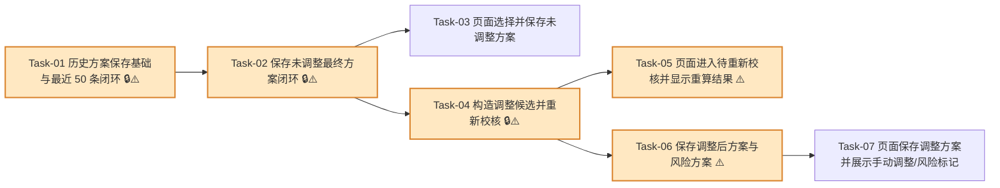

# 方案确认与保存闭环 — 开发任务计划

## 1. 任务概览

**总任务数**：7 个  
**预计总工时**：1125 分钟（约 18.75 小时）  
**开发方法**：TDD — 每个任务按 RED → GREEN → REFACTOR 循环执行

**关键标注**：
- 🔒 阻塞任务：被多个任务依赖，建议优先完成
- ⚠️ 风险任务：业务规则容易写错，执行时需要重点核对 AC

### 合并说明

| 合并前 | 合并后 | 合并原因 |
|--------|--------|----------|
| 原 Task-01 + 原 Task-10 | 新 Task-01 | 历史表、最近历史读取和 50 条清理都属于保存基础能力，放在一个 TDD 循环里能避免重复搭仓储。 |
| 原 Task-02 + 原 Task-03 | 新 Task-02 | 快照生成和未调整方案保存强绑定，合并后可直接验证“选择后确认保存”这一条完整服务端链路。 |
| 原 Task-07 + 原 Task-09 | 新 Task-06 | 调整后保存和风险方案保存都是 `saveConfirmedMatchingScheme` 的分支，合并能减少动作契约反复修改。 |
| 原 Task-08 + 原 Task-09 页面部分 | 新 Task-07 | 页面只关心保存结果展示，手动调整标记和不建议生产提示可以一起验。 |

### 依赖关系图

### 可并行任务组

| 并行组 | 任务 | 说明 |
|--------|------|------|
| A | Task-03、Task-04 | Task-03 接入未调整保存页面；Task-04 做调整候选和重新校核服务端能力，二者都依赖 Task-02，但彼此不阻塞。 |
| B | Task-05、Task-06 | Task-05 做重新校核后的页面状态；Task-06 做保存调整后方案和风险方案，二者都依赖 Task-04，可分别推进页面与服务端分支。 |

---

## 2. 开发任务

> 按垂直切片组织。Task-01 是最薄基础层；后续阶段分别对应“保存未调整方案”“调整并重新校核”“保存调整后方案及风险提示”这些用户可感知行为。
>
> 每个任务按 TDD 循环执行：RED（根据验证标准写测试）→ GREEN（写最小实现通过测试）→ REFACTOR（重构）。测试不是独立任务。

### 阶段一：保存历史的基础闭环

**阶段完成标准**：系统具备保存确认方案、读取最近历史、自动保留最新 50 条的能力。

---

#### [x] Task-01: 历史方案保存基础与最近 50 条闭环 🔒⚠️

**通俗解释**：系统先准备一个专门放“用户确认过的方案”的地方，并保证历史列表只留下最近 50 条。

**做什么**：新增 `matching_schemes` Drizzle schema、导出 schema、生成迁移；实现最小仓储契约，支持插入历史方案、读取最近 50 条历史、在同一事务中清理超过 50 条的旧记录；错误返回使用业务提示，不暴露数据库细节。

**涉及文件**：`src/db/schema/matching-schemes.ts`、`src/db/schema/index.ts`、`src/db/migrations/*`、`src/server/actions/matching-scheme-history.ts`、`tests/integration/matching/matching-scheme-history.test.ts`

**参考**：技术方案 3、4.3、5.6、6、8、9 → AC-002, AC-007, AC-010, AC-012, AC-013

**依赖**：无

**预估工时**：195 分钟

**状态**：已完成（2026-07-02）

**验证标准**（TDD RED 阶段直接转化为测试用例）：
- [x] 迁移执行后，数据库存在 `matching_schemes` 表，字段包含 `box_spec_snapshot`、`original_recommendation_slots_snapshot`、`final_scheme_snapshot`、`price_snapshot`、`parameter_version`、`is_manually_adjusted`、`export_records`、`created_at`。
- [x] 插入一条历史方案，传入 `productionQuantity = 1000`、`finalStatus = "qualified"` → 读取该记录时生产数量和最终状态保持一致。
- [x] 插入历史方案时缺少 `original_recommendation_slots_snapshot` → 数据库或仓储层拒绝写入。
- [x] 已存在 50 条历史记录时保存第 51 条 → 数据库只剩 50 条。
- [x] 保存第 51 条后查询最近历史 → 最新记录在第一条，最旧记录不在结果中。
- [x] 调用 `listRecentMatchingSchemes` → 最多返回 50 条，且按保存时间倒序排列。
- [x] 历史摘要包含保存时间、最终状态、是否手动调整和风险提示。
- [x] 数据库写入失败时 → Server Action 返回 `SAVE_FAILED` 和“方案保存失败，请稍后重试”，响应中不包含 SQL、连接串或堆栈。

---

### 阶段二：用户可以保存未调整的推荐方案

**阶段完成标准**：用户生成三套推荐后，可以选择其中一套作为最终方案并直接确认保存；单纯生成推荐不会进入历史。

---

#### [x] Task-02: 保存未调整最终方案闭环 🔒⚠️

**通俗解释**：用户选中一套推荐方案后，点“确认保存”，系统会把输入、原始三套推荐和最终采用方案一起留到历史里。

**做什么**：新增 `scheme-adjustment` 类型与快照生成能力；实现未调整方案的 `createHistorySnapshot`；新增 `saveConfirmedMatchingScheme` Server Action 的未调整分支；复用登录保护、纸箱输入校验和 `ActionResult`；校验原始推荐槽位数量；保存前服务端基于最终候选重新校核；写入 `matching_schemes`；保证 `generateMatchingScheme` 不写历史。

**涉及文件**：`src/modules/scheme-adjustment/types.ts`、`src/modules/scheme-adjustment/create-history-snapshot.ts`、`src/modules/scheme-adjustment/README.md`、`src/server/actions/matching-actions.ts`、`tests/unit/scheme-adjustment/create-history-snapshot.test.ts`、`tests/integration/matching/matching-actions.test.ts`

**参考**：技术方案 2、4.2、5.3、5.5、6、7、8 → AC-002, AC-009, AC-010, AC-011, AC-013

**依赖**：Task-01

**预估工时**：240 分钟

**状态**：已完成（2026-07-02）

**验证标准**（TDD RED 阶段直接转化为测试用例）：
- [x] 传入三套原始推荐、最终未调整方案、生产数量 `1000` → 快照包含输入参数、生产数量、原始三套推荐、最终确认方案、价格快照、参数版本、参数快照、空导出记录和保存时间来源。
- [x] 传入最终方案包含三层 B 楞、面纸/瓦纸/里纸三层原纸 → `priceSnapshot` 输出 3 条，且每条包含原纸 id、纸号、纸厂、克重、价格、耐破指数和环压指数。
- [x] 未调整方案生成快照 → `isManuallyAdjusted = false`。
- [x] 尝试传入 2 个原始推荐槽位 → 快照生成失败，返回“原始推荐结果不完整，请重新生成方案”。
- [x] 已登录用户传入合法输入、3 个原始推荐槽位、未调整最终候选，`clientState = "recalculated"` → 返回 `ok: true`，包含非空 `schemeId`、`finalStatus = "qualified"`、`isManuallyAdjusted = false`。
- [x] 保存成功后查询历史记录 → 记录包含原始三套推荐结果和一套最终确认方案。
- [x] 调用 `generateMatchingScheme` 只生成推荐，不调用 `saveConfirmedMatchingScheme` → `matching_schemes` 记录数不增加。
- [x] 未登录调用保存 → 返回 `AUTH_REQUIRED`，历史记录数不增加。
- [x] 客户端传入最终方案计算值为含税成本 `0.01`，服务端重新校核得到 `2.13` → 历史快照中保存 `2.13`。

---

#### [x] Task-03: 页面选择并保存未调整方案

**通俗解释**：用户在结果页能点选一套推荐方案，再点“确认保存”看到保存成功。

**做什么**：在 matching 页面推荐区增加最终方案选择状态和确认保存按钮；未调整推荐方案可直接保存；保存成功后展示成功提示；计算值、达标状态、可生产状态和选型理由只展示不可编辑；页面不在生成推荐时自动保存。

**涉及文件**：`src/app/(main)/matching/_components/box-spec-form.tsx`、`src/app/(main)/matching/matching.module.css`、`tests/integration/matching/matching-page.test.tsx`

**参考**：技术方案 5.1、6、8、9.2 → AC-001, AC-002, AC-009, AC-010, AC-011

**依赖**：Task-02

**预估工时**：135 分钟

**状态**：已完成（2026-07-02）

**验证标准**（TDD RED 阶段直接转化为测试用例）：
- [x] 页面收到经济型、安全型、均衡型三套推荐 → 用户点击“经济型”后，页面显示“当前最终方案：经济型”。
- [x] 用户选择未调整方案后点击“确认保存” → 页面调用保存动作并显示“保存成功”。
- [x] 用户只点击“生成方案”不点击“确认保存” → 页面不调用保存动作，最近历史条数不变化。
- [x] 推荐方案中的含税成本、耐破、边压、空箱抗压、是否达标、是否可生产以文本或标签展示 → 页面不存在可编辑输入框用于修改这些字段。
- [x] 保存动作返回 `VALIDATION_ERROR` → 页面显示业务提示，不展示堆栈。

---

### 阶段三：用户可以调整方案并重新校核

**阶段完成标准**：用户调整瓦型、层数、纸厂或克重后，页面立即进入“待重新校核”；点击“重新校核”后才显示新的强度、成本和生产状态。

---

#### [x] Task-04: 构造调整候选并重新校核 🔒⚠️

**通俗解释**：用户改了纸张配置后，系统会用当前原纸资料重新算一遍，而不是沿用旧结果。

**做什么**：新增 `build-adjusted-candidate` 和 `recalculateAdjustedScheme`；按原纸 id 读取当前启用原纸资料；只接受层数、瓦型、层位原纸 id 等允许字段；构造调整后 `MatchingCandidate`；调用 `evaluateCandidate` 得到最终评估；映射 `qualified`、`unqualified`、`not_manufacturable`、`data_incomplete` 状态。

**涉及文件**：`src/modules/scheme-adjustment/build-adjusted-candidate.ts`、`src/modules/scheme-adjustment/types.ts`、`src/modules/master-data/list-recommendable-paper-materials.ts`、`src/server/actions/matching-actions.ts`、`tests/unit/scheme-adjustment/build-adjusted-candidate.test.ts`、`tests/integration/matching/matching-actions.test.ts`

**参考**：技术方案 4.1、5.2、5.3、5.4、6、8 → AC-003, AC-006, AC-009

**依赖**：Task-02

**预估工时**：180 分钟

**状态**：已完成（2026-07-02）

**验证标准**（TDD RED 阶段直接转化为测试用例）：
- [x] 基础候选为三层 B 楞，调整输入改为五层 BC 楞 → 构造出的候选 `layerCount = 5`、`fluteType = "BC"`。
- [x] 调整输入把面纸原纸 id 从 `paper-a` 改为 `paper-b` → 构造出的面纸层使用 `paper-b` 当前资料。
- [x] 调整输入引用不存在的原纸 id → 返回 `DATA_NOT_FOUND` 和“调整后的原纸不存在或已停用”。
- [x] 重新校核输入合法，服务端评估结果为 `eligible` → 返回 `finalStatus = "qualified"`，`canSave = true`。
- [x] 重新校核结果含 `STRENGTH_UNQUALIFIED` 原因 → 返回 `finalStatus = "unqualified"`。
- [x] 重新校核结果含 `NOT_MANUFACTURABLE` 原因 → 返回 `finalStatus = "not_manufacturable"`。
- [x] 客户端提交价格、耐破指数或成本字段 → 服务端忽略这些字段，只使用按原纸 id 读取到的当前资料。

---

#### [x] Task-05: 页面进入待重新校核并显示重算结果 ⚠️

**通俗解释**：用户一改配置，页面会提醒“先重新校核”；点完重新校核后，才显示新的结果。

**做什么**：在页面增加可调控件和状态流转；用户修改瓦型、层数、纸厂或任一层克重后进入 `Dirty` 状态，显示“待重新校核”；确认保存按钮禁用或点击后显示“请先重新校核后再保存”；点击“重新校核”调用 `recalculateAdjustedScheme` 并展示最新最终方案指标和状态。

**涉及文件**：`src/app/(main)/matching/_components/box-spec-form.tsx`、`src/app/(main)/matching/matching.module.css`、`tests/integration/matching/matching-page.test.tsx`

**参考**：技术方案 5.1、5.3、6、9.2 → AC-003, AC-005, AC-008, AC-009

**依赖**：Task-04

**预估工时**：180 分钟

**状态**：已完成（2026-07-02）

**验证标准**（TDD RED 阶段直接转化为测试用例）：
- [x] 用户选择最终方案后修改瓦型 → 页面显示“待重新校核”。
- [x] 页面处于“待重新校核”状态时 → “确认保存”不可用，或点击后显示“请先重新校核后再保存”。
- [x] 用户点击“重新校核”，服务端返回 BCT `900N`、含税成本 `2.45`、`finalStatus = "qualified"` → 页面显示 `900N`、`2.45 元` 和“达标”。
- [x] 重新校核返回 `not_manufacturable` → 页面显示“不可生产”及对应原因，不继续展示旧的达标状态。
- [x] 页面调整控件只允许修改瓦型、层数、纸厂和各层原纸选择 → 不出现可编辑计算值输入框。

---

### 阶段四：用户可以保存调整后方案和风险方案

**阶段完成标准**：用户调整并完成重新校核后，可以保存最终方案；未达标或不可生产的最终方案也能保存留痕，但会醒目标记不建议生产。

---

#### [x] Task-06: 保存调整后方案与风险方案 ⚠️

**通俗解释**：用户调整并重新校核后保存，历史里会同时留下原来推荐了什么、最后采用了什么；如果方案有风险，系统会一并记录提醒。

**做什么**：扩展 `saveConfirmedMatchingScheme` 的调整后保存分支和风险保存分支；服务端识别手动调整；保存前再次重新校核；历史快照保存原始三套推荐、最终调整方案和 `is_manually_adjusted = true`；`clientState = "dirty"` 时拒绝保存；`unqualified`、`not_manufacturable`、`data_incomplete` 保存成功但写入 `warningMessages`。

**涉及文件**：`src/server/actions/matching-actions.ts`、`src/modules/scheme-adjustment/create-history-snapshot.ts`、`src/modules/scheme-adjustment/build-adjusted-candidate.ts`、`tests/unit/scheme-adjustment/create-history-snapshot.test.ts`、`tests/integration/matching/matching-actions.test.ts`

**参考**：技术方案 4.2、5.3、5.4、5.5、5.7、6、7、8、9 → AC-004, AC-005, AC-006, AC-008, AC-009, AC-011, AC-012, AC-013

**依赖**：Task-04

**预估工时**：210 分钟

**状态**：已完成（2026-07-02）

**验证标准**（TDD RED 阶段直接转化为测试用例）：
- [x] 用户调整瓦型并完成重新校核后保存 → 历史记录 `isManuallyAdjusted = true`。
- [x] 用户调整面纸原纸 id 后保存 → 历史快照最终方案使用调整后的纸张，原始推荐快照仍保留调整前推荐结果。
- [x] 保存请求 `clientState = "dirty"` → 返回 `VALIDATION_ERROR` 和“请先重新校核后再保存”，历史记录数不增加。
- [x] 用户修改过层数但页面传 `isManuallyAdjusted = false` → 服务端仍保存 `isManuallyAdjusted = true`。
- [x] 保存调整方案时客户端传入旧计算结果 → 历史最终方案以服务端重新校核结果为准。
- [x] 最终评估含 `STRENGTH_UNQUALIFIED` → 保存成功，返回 `finalStatus = "unqualified"`，`warningMessages` 包含“最终方案未达标，不建议生产”。
- [x] 最终评估含 `NOT_MANUFACTURABLE` → 保存成功，返回 `finalStatus = "not_manufacturable"`，`warningMessages` 包含“最终方案不可生产，不建议生产”。
- [x] 最终评估含 `DATA_MISSING` → 保存成功，返回 `finalStatus = "data_incomplete"`，`warningMessages` 包含“最终方案数据不足，请补全基础数据后再用于生产”。
- [x] 历史快照中的风险方案 → 不得把 `finalStatus` 保存为 `qualified`。

---

#### [x] Task-07: 页面保存调整方案并展示手动调整/风险标记

**通俗解释**：用户保存调整后的方案后，页面会明确告诉他这是一条手动调整过的记录；如果不达标或不可生产，也会提醒不建议生产。

**做什么**：页面在 `Recalculated` 状态下允许确认保存；保存成功后显示“用户已手动调整”；保存结果展示最终方案状态、保存时间、风险提示；保留原始三套推荐作为对比记录的展示入口或数据状态；风险方案保存成功后显示“未达标/不可生产/数据不足”和“不建议生产”。

**涉及文件**：`src/app/(main)/matching/_components/box-spec-form.tsx`、`src/app/(main)/matching/matching.module.css`、`tests/integration/matching/matching-page.test.tsx`

**参考**：技术方案 5.1、5.4、5.7、6、9.2 → AC-004, AC-006, AC-011, AC-012

**依赖**：Task-06

**预估工时**：135 分钟

**状态**：已完成（2026-07-02）

**验证标准**（TDD RED 阶段直接转化为测试用例）：
- [x] 用户调整并重新校核后点击“确认保存”，保存动作返回 `isManuallyAdjusted = true` → 页面显示“用户已手动调整”。
- [x] 保存成功响应包含 `schemeId` 和 `savedAt` → 页面显示保存成功状态，不重复提交。
- [x] 保存调整方案成功后 → 页面仍能看到原始三套推荐结果区域。
- [x] 保存调整方案失败时 → 页面保留当前重新校核结果，并显示失败业务提示。
- [x] 页面保存不可生产方案成功后 → 显示“不可生产”和“不建议生产”。
- [x] 页面保存未达标方案成功后 → 显示“未达标”和“不建议生产”。
- [x] 历史摘要显示保存时间、最终状态、是否手动调整和风险提示。

---

## 3. AC 覆盖总表

| AC 编号 | 验收标准概述 | 承接任务 | 验证方式 |
|---------|--------------|----------|----------|
| AC-001 | 选择一套最终方案 | Task-03 | 页面测试：点击经济型/安全型/均衡型后显示当前最终方案 |
| AC-002 | 未调整方案直接保存 | Task-02, Task-03 | 集成测试：未调整候选保存成功并写入完整快照 |
| AC-003 | 调整后重新校核 | Task-04, Task-05 | 单元测试构造调整候选；页面测试点击重新校核后指标更新 |
| AC-004 | 保存调整后方案并标记手动调整 | Task-06, Task-07 | 集成测试：调整后保存 `isManuallyAdjusted=true`，页面显示手动调整 |
| AC-005 | 待重新校核时禁止保存 | Task-05, Task-06 | 页面和动作测试：Dirty 状态保存返回“请先重新校核后再保存” |
| AC-006 | 未达标或不可生产允许保存但标记风险 | Task-04, Task-06, Task-07 | 集成测试：风险方案保存成功并返回不建议生产提示 |
| AC-007 | 历史超过 50 条自动移出最旧记录 | Task-01 | 集成测试：插入第 51 条后数据库只剩最新 50 条 |
| AC-008 | 调整后不得展示为可保存状态 | Task-05, Task-06 | 页面测试：调整后显示待重新校核且保存不可用 |
| AC-009 | 计算结果不可手动编辑 | Task-02, Task-03, Task-04, Task-05, Task-06 | 页面测试无计算字段输入框；服务端测试篡改计算值仍保存重算结果 |
| AC-010 | 生成推荐不自动保存 | Task-01, Task-02, Task-03 | 集成测试：调用生成动作不增加历史记录 |
| AC-011 | 一次只保存一套最终方案，三套推荐作为对比 | Task-02, Task-06, Task-07 | 快照测试：只有一个最终方案，原始三套推荐作为对比保存 |
| AC-012 | 手动调整状态可追溯 | Task-01, Task-06, Task-07 | 历史摘要测试显示“用户已手动调整” |
| AC-013 | 历史字段完整 | Task-01, Task-02, Task-06 | 快照字段测试覆盖输入、数量、价格、参数、推荐、最终方案、导出记录和保存时间 |

---

## 4. 完成定义

- [x] Task-01 到 Task-07 的验证标准全部通过。
- [ ] AC 覆盖总表中 AC-001 到 AC-013 的验证方式已执行并通过。
- [ ] 数据库迁移在测试数据库中执行通过，`matching_schemes` 表和索引存在。
- [x] 保存动作确认不会在 `generateMatchingScheme` 时自动写入历史。
- [x] 调整后未重新校核的保存请求在页面和服务端都被阻止。
- [x] 历史方案保存时的最终计算值来自服务端重新校核，不来自客户端传入值。
- [x] 历史上限验证通过：保存第 51 条后只保留最新 50 条。
- [x] 页面没有承载面积、强度、成本或设备限制核心公式。
- [x] 测试夹具不包含真实客户、真实订单或未脱敏纸价数据。

---

## 5. Mock 闭环检查

本功能不引入新的外部 Mock 接口。测试中可使用内存仓储、内存原纸资料和函数替身模拟数据库与计算结果；这些替身只服务于 TDD，不需要额外接口对接任务。

---

## 附录：变更记录

| 日期 | 变更内容 | 原因 |
|------|----------|------|
| 2026-07-02 | 初始版本 | 基于《方案确认与保存闭环》和《方案确认与保存闭环_技术方案》拆解 TDD 开发任务 |
| 2026-07-02 | 合并为 7 个任务 | 合并历史 50 条闭环、未调整保存快照、调整后保存和风险提示，减少上下文切换并保留 AC 覆盖 |
