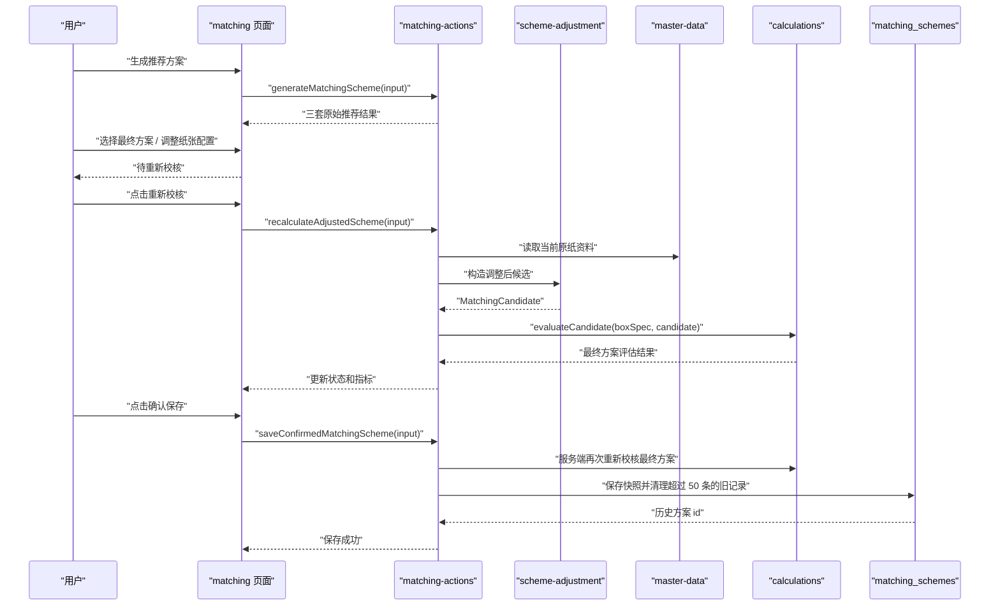
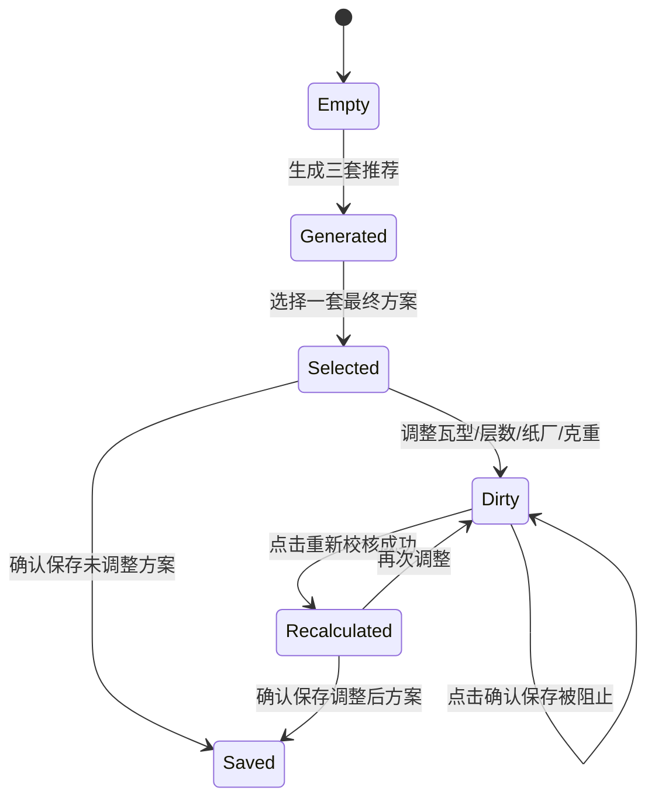

# 方案确认与保存闭环 — 技术设计文档

## 1. 设计概要

**功能描述**：在现有三套推荐方案生成后，新增最终方案选择、手动调整、重新校核和确认保存能力。用户只有点击“确认保存”后才写入历史记录；历史记录保存原始三套推荐结果、最终确认方案、价格快照、参数版本、手动调整标记和保存时间。→ AC-001 到 AC-013

**影响范围**：`src/app/(main)/matching`、`src/server/actions/matching-actions.ts`、`src/modules/scheme-adjustment`、`src/modules/calculations`、`src/modules/recommendation`、`src/db/schema/matching-schemes.ts`、`tests/unit/scheme-adjustment`、`tests/integration/matching`。本功能不新增第三方依赖，不修改面积、强度、成本和设备限制公式。→ AC-001 到 AC-013

**技术难点**：调整后必须防止旧计算结果和新纸张配置混用；保存时要重新生成可信最终结果，不信任客户端传回的计算值；历史记录要同时保存原始三套推荐快照和最终确认方案；保存成功后要自动清理最旧历史记录。→ AC-003, AC-005, AC-007, AC-009, AC-011, AC-013

**外部依赖**：无新增外部服务。复用 PostgreSQL、Drizzle ORM、Next.js Server Actions、现有登录保护、`calculations`、`recommendation` 和 `master-data`。→ AC-003, AC-009, AC-013

---

## 2. 架构概览

本功能采用“页面状态机 + Server Actions 编排 + scheme-adjustment 纯业务模块 + matching_schemes 快照表”的结构。页面负责选择方案、展示待重新校核状态和触发操作；服务端动作负责登录校验、输入校验、读取当前原纸、调用确定性计算、保存历史；`scheme-adjustment` 只负责把用户选择和调整内容转换成可重新校核的候选方案，不访问页面和数据库。



### 模块职责

| 模块 / 文件 | 职责 | 对应 AC |
|-------------|------|---------|
| `src/app/(main)/matching/_components/box-spec-form.tsx` | 管理选择、调整、待重新校核、重新校核和确认保存的页面状态 | AC-001, AC-003, AC-005, AC-008, AC-010 |
| `src/modules/scheme-adjustment/types.ts` | 定义最终方案草稿、调整项、重新校核结果和保存快照类型 | AC-001 到 AC-013 |
| `src/modules/scheme-adjustment/build-adjusted-candidate.ts` | 根据选择的推荐方案和调整项构造 `MatchingCandidate` | AC-003, AC-009 |
| `src/modules/scheme-adjustment/create-history-snapshot.ts` | 从原始推荐、最终评估和当前参数生成历史快照 | AC-002, AC-004, AC-006, AC-011, AC-012, AC-013 |
| `src/server/actions/matching-actions.ts` | 新增重新校核和确认保存 Server Actions，复用登录保护和 `ActionResult` | AC-002 到 AC-013 |
| `src/db/schema/matching-schemes.ts` | 新增历史方案快照表 `matching_schemes` | AC-002, AC-004, AC-007, AC-011, AC-012, AC-013 |
| `src/db/schema/index.ts` | 导出 `matching_schemes` schema | AC-013 |
| `src/modules/master-data/list-recommendable-paper-materials.ts` | 按原纸 id 读取调整后候选所需的当前原纸资料 | AC-003, AC-009 |
| `src/modules/calculations/evaluate-candidate.ts` | 重新校核最终方案，生成可信计算结果和状态 | AC-003, AC-006, AC-009 |
| `tests/unit/scheme-adjustment/*` | 覆盖调整候选构造、手动调整识别、快照生成和风险标记 | AC-003 到 AC-013 |
| `tests/integration/matching/*` | 覆盖服务端动作、页面状态和历史保存行为 | AC-001 到 AC-013 |

---

## 3. 数据库设计

### 新增表

#### `matching_schemes`

**用途**：保存用户确认过的历史方案。该表只保存“确认保存”的方案，不保存单纯生成推荐的临时结果。原始三套推荐、最终确认方案、价格和参数均使用快照，保证历史记录可追溯到保存时的业务口径。→ AC-002, AC-004, AC-010, AC-011, AC-013

| 字段名 | 类型 | 约束 | 说明 |
|--------|------|------|------|
| id | uuid | PK, DEFAULT gen_random_uuid() | 历史方案主键 |
| box_spec_snapshot | jsonb | NOT NULL | 纸箱输入、产品信息、堆码要求等标准化输入快照 |
| production_quantity | integer | NOT NULL | 生产数量，冗余字段便于历史列表展示和筛选 |
| original_recommendation_slots_snapshot | jsonb | NOT NULL | 原始经济型、安全型、均衡型三套推荐结果快照 |
| selected_strategy | varchar(20) | NULL | 用户最初选择的方案类型：`economy`、`safety`、`balanced`；若从参考方案保存则可为空 |
| final_scheme_snapshot | jsonb | NOT NULL | 最终确认方案的候选配置、面积、强度、成本、状态和原因 |
| final_status | varchar(30) | NOT NULL | `qualified`、`unqualified`、`not_manufacturable`、`data_incomplete` |
| is_manually_adjusted | boolean | NOT NULL, DEFAULT false | 是否用户手动调整过瓦型、层数、纸厂或克重 |
| price_snapshot | jsonb | NOT NULL | 最终方案涉及原纸的价格、纸厂、克重和强度指标快照 |
| parameter_version | varchar(100) | NOT NULL | 基础参数版本，例如 `prd-v1-default` 或后续参数版本号 |
| parameter_snapshot | jsonb | NOT NULL | 设备限制、瓦楞系数、厚度、费用系数等参与计算的参数快照 |
| warning_messages | jsonb | NOT NULL, DEFAULT `[]` | 未达标、不可生产、不建议生产等保存时提示 |
| export_records | jsonb | NOT NULL, DEFAULT `[]` | 后续导出记录；本功能保存时初始化为空数组 |
| created_by | varchar(100) | NOT NULL | 保存人，来自当前登录用户 |
| created_at | timestamp with time zone | NOT NULL, DEFAULT now() | 保存时间 |
| updated_at | timestamp with time zone | NOT NULL, DEFAULT now() | 更新时间 |

**索引**：

- `matching_schemes_created_at_idx`：按保存时间倒序读取最新历史方案。→ AC-007
- `matching_schemes_created_by_created_at_idx`：保留按保存人追溯能力，不改变“首版最近 50 条”的全局上限。→ AC-012
- `matching_schemes_final_status_idx`：支持后续按达标、未达标、不可生产筛选。→ AC-006

```sql
CREATE TABLE "matching_schemes" (
  "id" uuid PRIMARY KEY DEFAULT gen_random_uuid() NOT NULL,
  "box_spec_snapshot" jsonb NOT NULL,
  "production_quantity" integer NOT NULL,
  "original_recommendation_slots_snapshot" jsonb NOT NULL,
  "selected_strategy" varchar(20),
  "final_scheme_snapshot" jsonb NOT NULL,
  "final_status" varchar(30) NOT NULL,
  "is_manually_adjusted" boolean DEFAULT false NOT NULL,
  "price_snapshot" jsonb DEFAULT '[]'::jsonb NOT NULL,
  "parameter_version" varchar(100) NOT NULL,
  "parameter_snapshot" jsonb NOT NULL,
  "warning_messages" jsonb DEFAULT '[]'::jsonb NOT NULL,
  "export_records" jsonb DEFAULT '[]'::jsonb NOT NULL,
  "created_by" varchar(100) NOT NULL,
  "created_at" timestamp with time zone DEFAULT now() NOT NULL,
  "updated_at" timestamp with time zone DEFAULT now() NOT NULL
);

CREATE INDEX "matching_schemes_created_at_idx"
  ON "matching_schemes" ("created_at");

CREATE INDEX "matching_schemes_created_by_created_at_idx"
  ON "matching_schemes" ("created_by", "created_at");

CREATE INDEX "matching_schemes_final_status_idx"
  ON "matching_schemes" ("final_status");
```

### 修改现有表

无需修改现有表。→ AC-010, AC-013

**数据迁移**：新增一条 Drizzle 迁移创建 `matching_schemes`。已有历史数据为空，无需回填。→ AC-002, AC-007

### 快照字段说明

使用 JSONB 快照而不是拆成多张明细表，是为了保存“当时看到的结果”和“当时采用的价格/参数口径”，并降低首版建模复杂度。核心查询只需要最近 50 条历史列表，不需要在首版对每一层纸张做复杂统计；后续历史习惯分析需要统计时，可以从快照中抽取或增建派生表。→ AC-002, AC-004, AC-011, AC-013

---

## 4. Server Actions / 函数契约

本项目首版使用 Server Actions，本功能不新增公开 REST API。所有动作都返回现有 `ActionResult<T>`，并复用 `requireAuthenticatedAction`。→ AC-002 到 AC-013

### `recalculateAdjustedScheme`

**描述**：用户调整瓦型、层数、纸厂或克重后，服务端重新校核最终方案。→ AC-003, AC-005, AC-008, AC-009

**位置**：`src/server/actions/matching-actions.ts`

**鉴权**：需要登录。

**Request**：

```ts
export interface RecalculateAdjustedSchemeInput {
  boxSpec: BoxSpecInput;
  selectedStrategy?: RecommendationStrategy | undefined;
  baseCandidate: MatchingCandidate;
  adjustments: SchemeAdjustmentInput;
}
```

`SchemeAdjustmentInput` 只允许提交可调整字段：

```ts
export interface SchemeAdjustmentInput {
  layerCount?: LayerCount | undefined;
  fluteType?: FluteType | undefined;
  layers?: Array<{
    role: CandidateLayerRole;
    flute?: SingleFluteType | undefined;
    paperMaterialId: string;
  }> | undefined;
}
```

**Response（成功）**：

```ts
export interface RecalculateAdjustedSchemeResult {
  finalEvaluation: CandidateEvaluation;
  finalStatus: "qualified" | "unqualified" | "not_manufacturable" | "data_incomplete";
  isManuallyAdjusted: boolean;
  warningMessages: string[];
  canSave: true;
}
```

**异常响应**：

| 场景 | 响应 | 对应 AC |
|------|------|---------|
| 未登录 | `AUTH_REQUIRED` / `需要先登录` | AC-003 |
| 纸箱输入不合法 | `VALIDATION_ERROR` + 字段错误 | AC-003 |
| 调整项缺少原纸 id 或角色非法 | `VALIDATION_ERROR` + “请检查调整后的纸张配置” | AC-003, AC-008 |
| 调整引用的原纸不存在或已停用 | `DATA_NOT_FOUND` + “调整后的原纸不存在或已停用” | AC-003, AC-008 |

设计说明：

- 页面一旦进入“待重新校核”，只能通过该动作拿到新的 `finalEvaluation`。→ AC-003, AC-008
- 服务端根据原纸 id 读取当前原纸资料，再构造候选，不信任客户端传入的价格、克重、强度指标和计算结果。→ AC-009
- 设备不可生产时，返回 `finalStatus = "not_manufacturable"`，并清空旧强度/成本展示或显示不可用原因，避免旧指标残留。→ AC-006, AC-008

### `saveConfirmedMatchingScheme`

**描述**：保存用户确认的一套最终方案，并随同保存原始三套推荐结果和快照。→ AC-002, AC-004, AC-006, AC-007, AC-010, AC-011, AC-012, AC-013

**位置**：`src/server/actions/matching-actions.ts`

**鉴权**：需要登录。

**Request**：

```ts
export interface SaveConfirmedMatchingSchemeInput {
  boxSpec: BoxSpecInput;
  originalRecommendationSlots: [RecommendationSlot, RecommendationSlot, RecommendationSlot];
  selectedStrategy?: RecommendationStrategy | undefined;
  baseCandidate: MatchingCandidate;
  adjustments: SchemeAdjustmentInput;
  clientState: "recalculated" | "dirty";
}
```

**Response（成功）**：

```ts
export interface SaveConfirmedMatchingSchemeResult {
  schemeId: string;
  finalStatus: "qualified" | "unqualified" | "not_manufacturable" | "data_incomplete";
  isManuallyAdjusted: boolean;
  warningMessages: string[];
  savedAt: string;
}
```

**异常响应**：

| 场景 | 响应 | 对应 AC |
|------|------|---------|
| `clientState = "dirty"` | `VALIDATION_ERROR` + “请先重新校核后再保存” | AC-005, AC-008 |
| 纸箱输入不合法 | `VALIDATION_ERROR` + 字段错误 | AC-002, AC-004 |
| 原始推荐槽位不是 3 个 | `VALIDATION_ERROR` + “原始推荐结果不完整，请重新生成方案” | AC-011 |
| 调整引用的原纸不存在或已停用 | `DATA_NOT_FOUND` + “调整后的原纸不存在或已停用” | AC-003 |
| 数据库保存失败 | `SAVE_FAILED` + “方案保存失败，请稍后重试” | AC-002, AC-004 |

设计说明：

- 保存动作会再次调用重新校核流程，最终保存的强度、成本、达标状态和可生产状态均来自服务端最新计算结果，不使用客户端传回的计算值。→ AC-009
- 原始三套推荐结果作为对比快照随同保存，但不参与最终计算。→ AC-004, AC-011
- `clientState = "dirty"` 直接拒绝保存，防止用户调整后未重新校核。→ AC-005, AC-008
- 保存未达标或不可生产方案时返回成功，同时写入 `warningMessages`，页面显示“不建议生产”。→ AC-006
- 插入历史记录和清理超过 50 条旧记录必须在同一事务内完成。→ AC-007

### `listRecentMatchingSchemes`

**描述**：读取最近 50 条历史方案，供历史列表或 matching 页面保存后刷新使用。→ AC-007, AC-012, AC-013

**位置**：`src/server/actions/matching-actions.ts` 或后续拆分到 `history-actions.ts`；首版可先放在 matching actions，编码时如果 history 页面已成形再迁移。

**鉴权**：需要登录。

**Response（成功）**：

```ts
export interface ListRecentMatchingSchemesResult {
  items: Array<{
    id: string;
    createdAt: string;
    createdBy: string;
    finalStatus: string;
    isManuallyAdjusted: boolean;
    boxSpecSummary: string;
    finalSchemeSummary: string;
    warningMessages: string[];
  }>;
}
```

**异常响应**：

| 场景 | 响应 | 对应 AC |
|------|------|---------|
| 未登录 | `AUTH_REQUIRED` / `需要先登录` | AC-007 |
| 数据库读取失败 | `DATA_NOT_FOUND` 或 `QUERY_FAILED` + 业务提示 | AC-007 |

---

## 5. 核心逻辑

### 5.1 页面状态流转 → AC-001, AC-003, AC-005, AC-008, AC-010



状态定义：

| 状态 | 页面行为 | 对应 AC |
|------|----------|---------|
| `Generated` | 展示三套原始推荐结果，等待用户选择 | AC-001 |
| `Selected` | 已选择最终方案，未调整，可保存 | AC-001, AC-002 |
| `Dirty` | 用户调整过配置，显示“待重新校核”，确认保存不可用 | AC-005, AC-008 |
| `Recalculated` | 已重新校核，展示最新最终结果，可保存 | AC-003, AC-004 |
| `Saved` | 保存成功，展示成功提示和历史记录入口 | AC-002, AC-004, AC-010 |

### 5.2 调整候选构造 → AC-003, AC-009

`scheme-adjustment` 从 `baseCandidate` 和 `SchemeAdjustmentInput` 构造新的 `MatchingCandidate`：

1. 复制基础候选的层数、瓦型和层位结构。
2. 应用用户调整的层数和瓦型。
3. 按调整后的层位读取对应原纸资料，重新填充 `CandidatePaperMaterial`。
4. 生成稳定候选 id，例如 `adjusted:${layerCount}:${fluteType}:${paperIds.join("-")}`。
5. 返回给 `evaluateCandidate` 重新计算。

伪代码：

```text
buildAdjustedCandidate(baseCandidate, adjustments, paperMaterials):
  candidate = copy(baseCandidate)
  candidate.layerCount = adjustments.layerCount ?? baseCandidate.layerCount
  candidate.fluteType = adjustments.fluteType ?? baseCandidate.fluteType
  for each adjusted layer:
    paper = paperMaterials.findById(layer.paperMaterialId)
    if missing or inactive: return DATA_NOT_FOUND
    replace candidate layer paper with current paper snapshot
  return candidate
```

该模块不接受客户端传入的价格、克重、耐破指数、环压指数作为可信值。→ AC-009

### 5.3 重新校核 → AC-003, AC-006, AC-009

重新校核流程：

1. 服务端校验登录状态。
2. 校验并标准化 `boxSpec`。
3. 校验调整项是否只包含允许字段。
4. 读取调整涉及的原纸资料。
5. 使用 `buildAdjustedCandidate` 构造候选。
6. 调用 `evaluateCandidate`，复用现有面积、设备、强度和成本口径。
7. 根据评估结果映射最终状态：
   - `eligible` → `qualified`
   - `rejected` 且含 `NOT_MANUFACTURABLE` → `not_manufacturable`
   - `rejected` 且含 `STRENGTH_UNQUALIFIED` → `unqualified`
   - `rejected` 且含 `DATA_MISSING` 或 `PARAMETER_ERROR` → `data_incomplete`
8. 返回最终评估、状态、手动调整标记和风险提示。

### 5.4 手动调整识别 → AC-004, AC-012

判断 `isManuallyAdjusted` 时，不依赖页面传入的布尔值，而由服务端比较原候选和调整后候选：

| 比较项 | 判定方式 |
|--------|----------|
| 层数 | `baseCandidate.layerCount !== adjustedCandidate.layerCount` |
| 瓦型 | `baseCandidate.fluteType !== adjustedCandidate.fluteType` |
| 纸厂/克重/原纸 | 任一层 `paper.id` 不一致 |

只要任一项变化，保存快照中写入 `is_manually_adjusted = true`，历史记录展示“用户已手动调整”。→ AC-004, AC-012

### 5.5 历史快照生成 → AC-002, AC-004, AC-006, AC-011, AC-013

保存前由 `createHistorySnapshot` 生成快照：

```ts
export interface MatchingSchemeHistorySnapshot {
  boxSpecSnapshot: NormalizedBoxSpec;
  productionQuantity: number;
  originalRecommendationSlotsSnapshot: [RecommendationSlot, RecommendationSlot, RecommendationSlot];
  selectedStrategy?: RecommendationStrategy | undefined;
  finalSchemeSnapshot: CandidateEvaluation;
  finalStatus: MatchingSchemeFinalStatus;
  isManuallyAdjusted: boolean;
  priceSnapshot: MatchingSchemePriceSnapshot[];
  parameterVersion: string;
  parameterSnapshot: CalculationParameters;
  warningMessages: string[];
  exportRecords: [];
}
```

价格快照从最终方案各层纸张生成：

```ts
export interface MatchingSchemePriceSnapshot {
  paperMaterialId: string;
  paperCode: string;
  factoryName?: string | undefined;
  name?: string | undefined;
  role: CandidateLayerRole;
  flute?: SingleFluteType | undefined;
  gramWeightGsm?: number | null | undefined;
  priceYuanPerTon?: number | null | undefined;
  burstIndex?: number | null | undefined;
  ringCrushIndex?: number | null | undefined;
}
```

参数版本首版使用 `DEFAULT_CALCULATION_PARAMETERS.version ?? "prd-v1-default"`。如果现有常量暂未包含 `version` 字段，编码时在 `scheme-adjustment` 中集中定义 `DEFAULT_PARAMETER_VERSION = "prd-v1-default"`，不修改公式口径。→ AC-013

### 5.6 保存事务与最近 50 条清理 → AC-007, AC-010

保存动作必须在同一事务中完成：

1. 插入 `matching_schemes` 记录。
2. 查询按 `created_at DESC, id DESC` 排序后的第 51 条及更旧记录。
3. 删除这些旧记录。
4. 返回新历史方案 id。

伪代码：

```text
transaction:
  inserted = insert matching_schemes(snapshot)
  oldIds = select id
           from matching_schemes
           order by created_at desc, id desc
           offset 50
  delete from matching_schemes where id in oldIds
  return inserted.id
```

首版按全局最近 50 条处理，因为 PRD 和需求均描述“最近 50 条历史方案”，且首版不做复杂多用户权限。表中仍保存 `created_by`，为后续按用户或角色扩展留下追溯字段。→ AC-007

### 5.7 风险提示 → AC-006

保存未达标或不可生产方案时，服务端返回成功，但 `warningMessages` 必须包含业务提示：

| 状态 | 提示 |
|------|------|
| `unqualified` | `最终方案未达标，不建议生产` |
| `not_manufacturable` | `最终方案不可生产，不建议生产` |
| `data_incomplete` | `最终方案数据不足，请补全基础数据后再用于生产` |

页面保存成功后继续展示这些提示，历史记录也从 `warning_messages` 展示风险状态。→ AC-006

---

## 6. 现有代码改动

| 模块 / 文件 | 改动内容 | 原因 | 对应 AC |
|-------------|----------|------|---------|
| `src/db/schema/matching-schemes.ts` | 新增 `matchingSchemes` 表定义 | 保存确认后的历史方案快照 | AC-002, AC-004, AC-007, AC-011, AC-013 |
| `src/db/schema/index.ts` | 导出 `matchingSchemes` | 让 Drizzle 迁移识别新表 | AC-013 |
| `src/modules/scheme-adjustment/README.md` | 补充模块边界 | 明确只做调整候选、重新校核辅助和快照生成 | AC-003, AC-009 |
| `src/modules/scheme-adjustment/types.ts` | 新增调整输入、状态、快照和历史摘要类型 | 为页面、服务端动作和测试提供统一契约 | AC-001 到 AC-013 |
| `src/modules/scheme-adjustment/build-adjusted-candidate.ts` | 新增调整候选构造 | 把用户调整转成可计算候选 | AC-003, AC-009 |
| `src/modules/scheme-adjustment/create-history-snapshot.ts` | 新增历史快照生成 | 统一保存内容、价格快照、参数快照和风险提示 | AC-002, AC-004, AC-006, AC-011, AC-013 |
| `src/modules/master-data/list-recommendable-paper-materials.ts` | 增加按 id 读取可用原纸的 repository 方法，或新增同模块小函数 | 重新校核时根据原纸 id 获取可信当前资料 | AC-003, AC-009 |
| `src/server/actions/matching-actions.ts` | 新增 `recalculateAdjustedScheme`、`saveConfirmedMatchingScheme`、`listRecentMatchingSchemes` | 串联页面动作、计算、保存和历史读取 | AC-002 到 AC-013 |
| `src/app/(main)/matching/_components/box-spec-form.tsx` | 增加方案选择、调整控件、待重新校核状态、重新校核按钮和确认保存按钮 | 满足用户可见流程 | AC-001, AC-003, AC-005, AC-008, AC-010 |
| `src/app/(main)/matching/matching.module.css` | 增加最终方案区、状态标签、风险提示和历史保存反馈样式 | 清晰展示状态和风险 | AC-001, AC-006, AC-008, AC-012 |
| `tests/unit/scheme-adjustment/*` | 新增候选调整、手动调整识别、快照和风险提示测试 | 覆盖纯业务逻辑 | AC-003 到 AC-013 |
| `tests/integration/matching/matching-actions.test.ts` | 增加重新校核、禁止脏保存、保存快照和清理 50 条测试 | 覆盖服务端动作 | AC-002 到 AC-013 |
| `tests/integration/matching/matching-page.test.tsx` | 增加选择、调整、待校核、重新校核、保存和风险提示测试 | 覆盖页面交互 | AC-001, AC-003, AC-005, AC-006, AC-008, AC-010, AC-012 |

---

## 7. 技术决策

### 历史方案使用单表 JSONB 快照，而不是多张明细表

**背景**：历史方案的核心价值是追溯当时输入、原始推荐、最终方案、价格和参数口径。首版只要求最近 50 条，不要求按每一层纸张做复杂统计。

**选项**：
- A: 单表 JSONB 快照 — 保存完整上下文，迁移小，和现有导入批次 JSONB 风格一致；代价是复杂统计能力弱。
- B: 拆分历史主表、方案表、层位表、价格表 — 查询和统计更结构化；代价是表多、开发量大，容易提前进入历史分析范围。

**结论**：选择 A。它最贴合“快照追溯”和 MVP 最近 50 条历史的需求；后续历史习惯提取需要统计时，再增加派生表或抽取任务。→ AC-002, AC-004, AC-007, AC-011, AC-013

### 保存时再次服务端重新校核，而不是直接保存页面结果

**背景**：需求要求计算值、是否达标、是否可生产和选型理由不可手动编辑。页面可以隐藏编辑入口，但服务端仍不能信任客户端传回的计算值。

**选项**：
- A: 直接保存页面传回的最终评估结果 — 实现快，但可能保存被篡改或过期的计算值。
- B: 保存时服务端再次根据输入和原纸 id 重新校核 — 结果可信；代价是多一次计算。

**结论**：选择 B。单次计算成本低，且能保证历史记录中的最终方案来自服务端确定性计算。→ AC-005, AC-009, AC-013

### 单纯生成推荐不写历史，也不新增持久草稿表

**背景**：用户已确认只有点击“确认保存”才进入历史记录。可以选择在生成推荐时写临时草稿表，也可以完全使用页面状态承载原始推荐结果。

**选项**：
- A: 新增草稿表保存每次生成结果 — 可严格防篡改原始推荐快照，但会产生大量临时数据和清理任务。
- B: 不保存草稿；确认保存时保存页面持有的原始推荐快照，并由服务端重新计算最终方案 — 范围小，不污染历史。

**结论**：选择 B。原始三套推荐只作为对比记录，最终可生产状态和成本以服务端保存时重新校核为准；如果后续需要严格审计每次生成结果，再进入操作日志或草稿设计。→ AC-010, AC-011, AC-013

### 最近 50 条在保存事务中物理清理，而不是只查询截断

**背景**：需求明确“最旧记录自动移出历史列表”。只在查询时 `limit 50` 会让旧记录仍长期存在。

**选项**：
- A: 查询时只展示最新 50 条 — 实现简单，但不是真正移出。
- B: 每次保存后在事务内删除第 51 条及更旧记录 — 符合需求，历史规模稳定。

**结论**：选择 B。首版数据量小，保存频率不高，事务内清理可控。→ AC-007

---

## 8. 安全与性能

**输入校验**：页面只做即时反馈，服务端动作必须重新校验纸箱输入、调整项、推荐槽位数量和原纸 id。→ AC-003, AC-005, AC-011

**可信计算**：保存时不信任客户端传回的计算值、达标状态、可生产状态和价格指标；服务端重新读取原纸并调用 `evaluateCandidate`。→ AC-009

**敏感数据处理**：历史快照包含纸价，保存和测试不得使用真实客户、真实订单或未脱敏样例；错误响应不暴露数据库错误、SQL、堆栈或连接信息。→ AC-013

**事务一致性**：保存历史和清理超过 50 条旧记录在同一事务内完成；若清理失败，整次保存失败并返回业务提示，避免列表上限失效。→ AC-007

**性能考量**：历史列表只读最新 50 条，使用 `created_at` 索引；重新校核只评估一个最终候选，不重新评估全量候选，单次操作应远低于方案生成耗时。→ AC-003, AC-007

**并发处理**：如果两个保存动作同时发生，各自事务完成后都执行清理；最终保留最新 50 条即可，不要求弹窗确认或锁定用户操作。→ AC-007

---

## 9. 测试方案

### 9.1 单元测试

新增 `tests/unit/scheme-adjustment/`。

| 场景 | 断言 | 对应 AC |
|------|------|---------|
| 从推荐候选构造调整候选 | 层数、瓦型、层位和原纸 id 正确替换 | AC-003 |
| 未调整直接保存 | `isManuallyAdjusted = false` | AC-002 |
| 修改层数/瓦型/纸张 | `isManuallyAdjusted = true` | AC-004, AC-012 |
| 快照生成 | 包含输入、原始推荐、最终方案、价格快照、参数版本、导出记录空数组 | AC-002, AC-013 |
| 未达标最终方案 | 生成“不建议生产”提示 | AC-006 |
| 不可生产最终方案 | 生成“不建议生产”提示 | AC-006 |
| 计算值过滤 | 快照只来自服务端评估结果，不接受外部覆盖字段 | AC-009 |

### 9.2 集成测试

更新 `tests/integration/matching/matching-actions.test.ts`。

| 场景 | 断言 | 对应 AC |
|------|------|---------|
| 重新校核调整后方案 | 返回最新强度、成本和状态 | AC-003 |
| 待重新校核保存 | 返回 `VALIDATION_ERROR` 和“请先重新校核后再保存” | AC-005 |
| 保存未调整方案 | 写入一条历史记录，`isManuallyAdjusted=false` | AC-002, AC-010 |
| 保存调整后方案 | 写入原始三套推荐和最终方案，`isManuallyAdjusted=true` | AC-004, AC-011, AC-012 |
| 保存未达标/不可生产方案 | 动作成功，返回风险提示 | AC-006 |
| 历史超过 50 条 | 保存后只剩最新 50 条 | AC-007 |
| 客户端篡改计算值 | 保存结果仍以服务端重新校核为准 | AC-009 |
| 历史字段完整 | 快照包含需求指定字段 | AC-013 |

更新 `tests/integration/matching/matching-page.test.tsx`。

- 页面展示三套推荐后可选择当前最终方案。→ AC-001
- 调整任一可调字段后展示“待重新校核”，确认保存不可用或被阻止。→ AC-005, AC-008
- 点击重新校核后展示最新最终结果。→ AC-003
- 保存成功后显示成功提示和手动调整标记。→ AC-004, AC-012
- 未达标或不可生产保存成功后展示“不建议生产”。→ AC-006

---

## 10. AC 覆盖总表

| AC 编号 | 验收标准概述 | 实现位置 |
|---------|--------------|----------|
| AC-001 | 选择一套最终方案 | matching 页面状态 `Selected` + 推荐槽位选择控件 |
| AC-002 | 未调整方案直接保存 | `saveConfirmedMatchingScheme` + `matching_schemes` 快照 |
| AC-003 | 调整后重新校核 | `recalculateAdjustedScheme` + `buildAdjustedCandidate` + `evaluateCandidate` |
| AC-004 | 保存调整后方案并标记手动调整 | `createHistorySnapshot` + `is_manually_adjusted` |
| AC-005 | 待重新校核时禁止保存 | 页面 `Dirty` 状态 + 保存动作 `clientState` 校验 |
| AC-006 | 未达标或不可生产允许保存但标记风险 | `final_status` + `warning_messages` + 页面风险提示 |
| AC-007 | 历史记录超过 50 条自动移出最旧记录 | 保存事务中的清理逻辑 + `created_at` 索引 |
| AC-008 | 调整后不得展示为可保存状态 | 页面状态机 `Dirty` + 确认保存按钮禁用/动作拒绝 |
| AC-009 | 计算结果不可手动编辑 | 页面只展示计算字段 + 保存时服务端重新校核 |
| AC-010 | 生成推荐不自动保存 | `generateMatchingScheme` 不写 `matching_schemes` |
| AC-011 | 一次只保存一套最终方案，三套推荐作为对比 | `final_scheme_snapshot` + `original_recommendation_slots_snapshot` |
| AC-012 | 手动调整状态可追溯 | `is_manually_adjusted` + 历史列表展示 |
| AC-013 | 历史记录字段完整 | `matching_schemes` 字段 + `createHistorySnapshot` |

---

## 11. 实施顺序建议

1. 新增 `matching_schemes` schema 和迁移，先用集成测试验证保存与 50 条清理。→ AC-002, AC-007, AC-013
2. 新增 `scheme-adjustment` 类型、候选构造和快照生成单元测试。→ AC-003, AC-004, AC-006, AC-009, AC-012
3. 实现 `recalculateAdjustedScheme`，让页面能拿到可信最终评估。→ AC-003, AC-008, AC-009
4. 实现 `saveConfirmedMatchingScheme`，覆盖未校核拒绝、风险保存、快照字段和历史清理。→ AC-002, AC-004, AC-005, AC-006, AC-007, AC-010, AC-011, AC-013
5. 更新 matching 页面交互，补齐选择、调整、重新校核、确认保存和风险提示。→ AC-001, AC-003, AC-005, AC-006, AC-008, AC-012

---

## 附录：变更记录

| 日期 | 变更内容 | 原因 |
|------|----------|------|
| 2026-07-02 | 初始版本 | 基于《方案确认与保存闭环》需求文档生成技术设计，明确调整、重新校核、保存快照和最近 50 条历史清理方案 |
