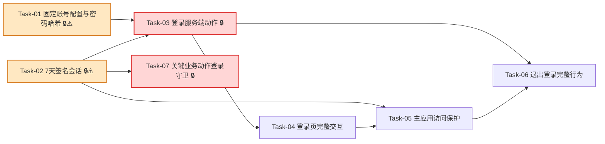

# 简单登录保护 — 开发任务计划

## 1. 任务概览

**总任务数**：7 个
**预计总工时**：450 分钟（约 7.5 小时）
**开发方法**：TDD — 每个任务按 RED → GREEN → REFACTOR 循环执行

**关键标注**：
- 🔒 阻塞任务：被多个任务依赖，建议优先完成
- ⚠️ 风险任务：技术难度高，可能需要额外时间

### 依赖关系图

### 可并行任务组

| 并行组 | 任务 | 说明 |
|--------|------|------|
| 组 1 | Task-01, Task-02 | 固定账号校验和会话签名互不依赖，可并行实现核心纯函数 |
| 组 2 | Task-05, Task-07 | 会话能力完成后，主应用路由保护和服务端动作守卫可并行 |
| 组 3 | Task-04, Task-06 | 登录动作完成后，登录页交互和退出入口可局部并行 |

---

## 2. 开发任务

> 按垂直切片组织。每个阶段对应一个可独立运行和验证的用户行为（加可选的基础设施层）。
>
> 每个任务按 TDD 循环执行：RED（根据验证标准写测试）→ GREEN（写最小实现通过测试）→ REFACTOR（重构）

### 阶段一：建立登录地基

**阶段完成标准**：系统可以安全读取固定账号配置、校验密码哈希，并创建/验证 7 天登录状态。

---

#### [x] Task-01: 固定账号配置与密码哈希 🔒⚠️

**通俗解释**：系统知道哪些账号可以登录，并且不会保存或展示明文密码。

**做什么**：新增 `src/modules/auth/types.ts`、`src/modules/auth/config.ts`、`src/modules/auth/password.ts`，读取 `AUTH_USERS_JSON` 与 `AUTH_SESSION_SECRET`，校验固定账号配置；使用 Node.js `crypto.scrypt` 验证密码哈希；新增 `scripts/hash-password.ts` 生成密码哈希；同步更新 `.env.example`。

**涉及文件**：`src/modules/auth/types.ts`、`src/modules/auth/config.ts`、`src/modules/auth/password.ts`、`scripts/hash-password.ts`、`.env.example`、`tests/unit/auth/auth-config.test.ts`、`tests/unit/auth/password.test.ts`

**参考**：技术方案 3、5、6、7、8 → AC-003, AC-006, AC-007, AC-010, AC-012, AC-015, AC-016

**依赖**：无

**预估工时**：70 分钟

**验证标准**（TDD RED 阶段直接转化为测试用例）：
- [ ] `AUTH_USERS_JSON` 为合法数组且包含 `operator` 用户、`AUTH_SESSION_SECRET` 非空时，读取配置 → 返回 `ok: true`，且用户对象不包含明文密码字段。
- [ ] `AUTH_USERS_JSON` 缺失、为空数组、不是 JSON 或缺少 `passwordHash` 时，读取配置 → 返回 `AUTH_CONFIG_UNAVAILABLE`，message 为“登录服务暂不可用，请联系系统维护人员”。
- [ ] 传入正确密码和 `scrypt$...` 哈希 → 密码校验返回 `true`。
- [ ] 传入错误密码和同一哈希 → 密码校验返回 `false`，不返回“账号不存在”或“密码错误详情”等可枚举信息。
- [ ] `scripts/hash-password.ts` 传入示例密码 `demo-password` → 输出以 `scrypt$` 开头的哈希，输出内容不包含 `demo-password`。
- [ ] `.env.example` 包含 `AUTH_SESSION_SECRET` 和 `AUTH_USERS_JSON` 示例，但不包含真实密钥、真实账号密码或明文密码。
- [ ] auth 类型中不包含 `role`、`tenant` 等复杂权限或多租户字段。

---

#### [x] Task-02: 7天签名会话 🔒⚠️

**通俗解释**：用户登录后，浏览器会记住 7 天；超过时间或被篡改就需要重新登录。

**做什么**：新增 `src/modules/auth/session.ts`，实现会话载荷、HMAC-SHA256 签名、cookie 名称与属性、会话验证、过期判断和清理所需的纯函数。

**涉及文件**：`src/modules/auth/session.ts`、`tests/unit/auth/session.test.ts`

**参考**：技术方案 2、5、6、8 → AC-004, AC-005, AC-008, AC-011, AC-015

**依赖**：无

**预估工时**：80 分钟

**验证标准**（TDD RED 阶段直接转化为测试用例）：
- [ ] 使用用户 `{ username: "operator", displayName: "操作员" }` 和固定时间 `2026-06-29T00:00:00Z` 创建会话 → `expiresAt` 等于 7 天后。
- [ ] 使用相同密钥验证刚创建的会话 → 返回 `ok: true`，data 包含 `username` 和 `displayName`。
- [ ] 修改会话字符串中的任意字符后再验证 → 返回未登录或签名无效结果，不暴露签名密钥。
- [ ] 当前时间小于 `expiresAt` 时验证会话 → 返回已登录。
- [ ] 当前时间大于 `expiresAt` 时验证会话 → 返回 `SESSION_EXPIRED`。
- [ ] 生成 cookie 配置 → `httpOnly = true`、`sameSite = "lax"`、`maxAge = 604800`。
- [ ] 生产环境生成 cookie 配置 → `secure = true`。

---

### 阶段二：用户可以登录进入主应用

**阶段完成标准**：未登录用户看到登录页，输入有效账号密码后可以进入主应用；错误账号密码只看到统一失败提示。

---

#### [x] Task-03: 登录服务端动作 🔒

**通俗解释**：用户提交账号密码后，系统能判断是否允许登录，并给出安全的结果。

**做什么**：新增 `src/server/actions/auth-actions.ts` 中的 `loginWithPassword`，调用 auth 配置、密码校验和会话创建；成功时写入会话 cookie；失败时返回统一 `ActionResult`。

**涉及文件**：`src/server/actions/auth-actions.ts`、`tests/integration/auth/login-action.test.ts`

**参考**：技术方案 4、5、6、8 → AC-003, AC-006, AC-007, AC-010, AC-015

**依赖**：Task-01, Task-02

**预估工时**：65 分钟

**验证标准**（TDD RED 阶段直接转化为测试用例）：
- [ ] 传入 `{ username: "operator", password: "correct-password" }` 且配置有效 → 返回 `ok: true`，data 包含 `username = "operator"` 和 `displayName`，并设置会话 cookie。
- [ ] 传入存在账号但密码错误 → 返回 `INVALID_CREDENTIALS`，message 为“账号或密码错误”。
- [ ] 传入不存在账号和任意密码 → 返回 `INVALID_CREDENTIALS`，message 仍为“账号或密码错误”。
- [ ] 连续三次传入错误账号密码 → 每次都返回同一个错误码和同一句提示，不暴露账号是否存在。
- [ ] 传入空账号或空密码 → 返回 `VALIDATION_ERROR`，message 为“请输入账号和密码”。
- [ ] 登录配置缺失或格式错误 → 返回 `AUTH_CONFIG_UNAVAILABLE`，message 为“登录服务暂不可用，请联系系统维护人员”。
- [ ] 任一失败响应中不包含密码、密码哈希、会话密钥、内部堆栈或环境变量原文。

---

#### [x] Task-04: 登录页完整交互

**通俗解释**：用户打开登录页能填写账号密码；登录成功进系统，登录失败看到清楚但安全的提示。

**做什么**：替换 `src/app/(auth)/login/page.tsx` 占位内容，提供账号、密码输入项和登录按钮；提交时调用 `loginWithPassword`；已登录访问登录页时回到 `/dashboard`；页面不提供注册、找回密码、验证码或账号管理入口。

**涉及文件**：`src/app/(auth)/login/page.tsx`、必要时 `src/app/(auth)/login/_components/login-form.tsx`、`tests/integration/auth/login-page.test.tsx`

**参考**：技术方案 4、5、6、8 → AC-002, AC-003, AC-006, AC-010, AC-011, AC-012, AC-015

**依赖**：Task-03

**预估工时**：75 分钟

**验证标准**（TDD RED 阶段直接转化为测试用例）：
- [ ] 渲染登录页 → 页面包含账号输入项、密码输入项和“登录”按钮。
- [ ] 登录页初始渲染 → 页面不包含“注册”“找回密码”“验证码”“账号管理”等入口文案。
- [ ] 提交空账号或空密码 → 页面展示“请输入账号和密码”。
- [ ] 提交错误账号密码并收到 `INVALID_CREDENTIALS` → 页面展示“账号或密码错误”。
- [ ] 登录配置不可用并收到 `AUTH_CONFIG_UNAVAILABLE` → 页面展示“登录服务暂不可用，请联系系统维护人员”。
- [ ] 已登录用户访问 `/login` → 跳转或引导到 `/dashboard`。
- [ ] 任一错误展示内容不包含密码、哈希、密钥、堆栈、原纸价格或公式参数。

---

#### [x] Task-05: 主应用访问保护

**通俗解释**：没有登录的人打不开工作台；已经登录的人可以继续使用系统。

**做什么**：修改 `src/app/(main)/layout.tsx`，进入主应用前读取并验证会话；未登录跳转 `/login`；过期跳转 `/login?reason=expired`；会话有效时展示主应用布局。

**涉及文件**：`src/app/(main)/layout.tsx`、`tests/integration/auth/main-layout-auth.test.tsx`、`tests/e2e/auth-flow.spec.ts`

**参考**：技术方案 2、5、6、8 → AC-001, AC-004, AC-008

**依赖**：Task-02, Task-04

**预估工时**：60 分钟

**验证标准**（TDD RED 阶段直接转化为测试用例）：
- [ ] 未设置会话 cookie 时访问 `/dashboard` → 被要求先登录，目标为 `/login`。
- [ ] 设置有效会话 cookie 且未超过 7 天时访问 `/dashboard` → 页面展示主应用布局和“工作台”导航。
- [ ] 设置已过期会话 cookie 时访问 `/dashboard` → 被要求重新登录，目标包含 `/login?reason=expired` 或页面展示登录过期提示。
- [ ] 设置签名被篡改的会话 cookie 时访问 `/dashboard` → 被视为未登录，不展示主应用内容。
- [ ] 首页 `/` 仍跳转 `/dashboard`，实际访问保护由主应用布局完成。

---

### 阶段三：用户可以退出和处理过期状态

**阶段完成标准**：用户可以主动退出登录；过期状态能被清理并给出重新登录提示。

---

#### [x] Task-06: 退出登录完整行为

**通俗解释**：用户离开电脑前可以退出，退出后别人不能继续使用他的登录状态。

**做什么**：在 `src/server/actions/auth-actions.ts` 中实现 `logout`；在主应用布局增加退出入口；退出时清理会话 cookie 并回到 `/login`。

**涉及文件**：`src/server/actions/auth-actions.ts`、`src/app/(main)/layout.tsx`、必要时 `src/app/(main)/_components/logout-button.tsx`、`tests/integration/auth/logout-action.test.ts`、`tests/e2e/auth-flow.spec.ts`

**参考**：技术方案 4、5、6、8 → AC-005, AC-015

**依赖**：Task-03, Task-05

**预估工时**：45 分钟

**验证标准**（TDD RED 阶段直接转化为测试用例）：
- [ ] 已登录用户在主应用点击“退出登录” → 会话 cookie 被清除，并回到 `/login`。
- [ ] 退出后再次访问 `/dashboard` → 被要求先登录。
- [ ] 未登录状态调用 `logout` → 返回成功或安全完成，不抛出内部错误。
- [ ] 退出流程中展示给用户的内容不包含内部错误、密钥或堆栈。

---

### 阶段四：后续关键操作可以复用登录检查

**阶段完成标准**：后续生成方案、保存、导入、导出等服务端动作可以在第一步复用统一登录守卫，未登录时直接拒绝执行。

---

#### [x] Task-07: 关键业务动作登录守卫 🔒

**通俗解释**：以后所有重要操作都能先问一句“这个人登录了吗”，没登录就不会继续执行。

**做什么**：新增 `src/server/guards/auth.ts`，实现 `requireAuthenticatedAction`；返回统一 `ActionResult`；覆盖未登录、过期、签名无效、已登录四类场景；在文档或注释中说明后续关键 Server Action 的接入方式。

**涉及文件**：`src/server/guards/auth.ts`、`tests/integration/auth/auth-guard.test.ts`

**参考**：技术方案 4、5、6、8 → AC-009, AC-014, AC-015

**依赖**：Task-02

**预估工时**：55 分钟

**验证标准**（TDD RED 阶段直接转化为测试用例）：
- [ ] 无会话时调用 `requireAuthenticatedAction()` → 返回 `AUTH_REQUIRED`，message 为“需要先登录”。
- [ ] 会话已过期时调用 `requireAuthenticatedAction()` → 返回 `SESSION_EXPIRED`，message 为“登录状态已过期，请重新登录”。
- [ ] 会话签名无效时调用 `requireAuthenticatedAction()` → 返回 `AUTH_REQUIRED`，不暴露签名校验细节。
- [ ] 会话有效时调用 `requireAuthenticatedAction()` → 返回 `ok: true`，data 包含 `username` 和 `displayName`。
- [ ] 模拟一个后续关键动作先调用 guard：guard 失败时业务函数不执行，直接返回登录错误。
- [ ] guard 失败响应中不包含密码、哈希、密钥、内部堆栈、原纸价格或公式参数。

---

## 3. AC 覆盖总表

| AC 编号 | 验收标准概述 | 承接任务 | 验证方式 |
|---------|-------------|---------|---------|
| AC-001 | 未登录访问主应用要求登录 | Task-05 | 未设置会话 cookie 访问 `/dashboard`，断言跳转或展示登录入口 |
| AC-002 | 登录页展示账号、密码和登录按钮 | Task-04 | 渲染登录页，断言三个表单元素存在 |
| AC-003 | 有效账号登录成功 | Task-01, Task-03, Task-04 | 使用有效固定账号提交登录，断言返回成功并进入主应用 |
| AC-004 | 7 天内保持登录 | Task-02, Task-05 | 使用未过期会话访问 `/dashboard`，断言不要求重新登录 |
| AC-005 | 主动退出登录 | Task-02, Task-06 | 已登录后点击退出，断言 cookie 清除且回到登录页 |
| AC-006 | 错误账号或密码统一提示 | Task-01, Task-03, Task-04 | 错误账号和错误密码分别提交，断言同一错误码和提示 |
| AC-007 | 多次失败仍不暴露账号是否存在 | Task-01, Task-03 | 连续失败三次，断言响应不区分账号不存在和密码错误 |
| AC-008 | 登录状态过期要求重新登录 | Task-02, Task-05 | 构造过期会话访问主应用，断言重新登录提示 |
| AC-009 | 未登录关键操作被拒绝 | Task-07 | 无会话调用 guard 包裹的动作，断言业务逻辑不执行 |
| AC-010 | 登录配置不可用安全提示 | Task-01, Task-03, Task-04 | 缺失 `AUTH_USERS_JSON` 或密钥后登录，断言显示登录服务不可用 |
| AC-011 | 已登录访问登录页回到主应用 | Task-02, Task-04 | 有效会话访问 `/login`，断言跳转 `/dashboard` |
| AC-012 | 不提供注册、找回密码等入口 | Task-01, Task-04 | 登录页和 auth 类型检查，断言无注册、找回、验证码、账号管理入口 |
| AC-013 | 多个账号不区分角色权限 | Task-01, Task-05 | 两个有效账号分别登录，断言进入同一主应用且没有角色差异字段 |
| AC-014 | 关键业务动作必须能检查登录 | Task-07 | 模拟关键 Server Action 第一行调用 guard，断言可统一拦截 |
| AC-015 | 登录相关敏感信息不外泄 | Task-01, Task-02, Task-03, Task-04, Task-06, Task-07 | 检查所有失败响应和页面提示，不包含密码、哈希、密钥、堆栈、价格或公式参数 |
| AC-016 | 不扩大到复杂权限、钉钉、多租户、日志 | Task-01, Task-07 | 检查本功能不新增用户表、角色模型、钉钉模块、多租户字段或 audit-log 写入 |

---

## 4. 完成定义

- [x] Task-01 到 Task-07 的验证标准均已按 TDD 执行并通过。
- [x] 未登录访问 `/dashboard` 会被要求先登录。
- [x] 有效固定账号可以从 `/login` 登录并进入 `/dashboard`。
- [x] 7 天内有效会话可以继续访问主应用，超过 7 天必须重新登录。
- [x] 退出登录后无法继续访问主应用。
- [x] `requireAuthenticatedAction` 可拦截未登录、过期和签名无效的关键业务动作。
- [x] 登录页不包含注册、找回密码、验证码、账号管理入口。
- [x] 本功能没有新增用户表、角色权限、钉钉登录、多租户或操作日志能力。
- [x] `.env.example` 包含认证配置示例，且不包含真实密钥或明文密码。
- [x] 所有登录相关错误提示不暴露密码、密码哈希、会话密钥、内部堆栈、原纸价格或公式参数。
- [x] `pnpm typecheck`、`pnpm lint`、`pnpm test` 通过；如实现了端到端用例，`pnpm test:e2e` 中 auth 流程通过。

---

## 附录：变更记录

| 日期 | 变更内容 | 原因 |
|------|---------|------|
| 2026-06-29 | 初始版本 | 根据“简单登录保护”需求文档和技术方案拆分 TDD 开发任务 |
