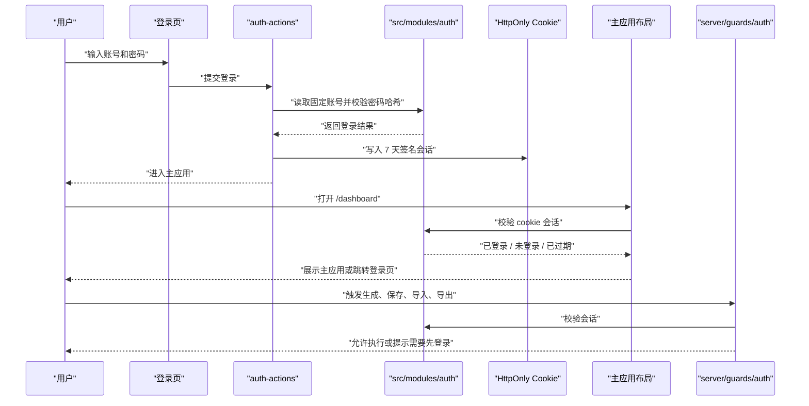
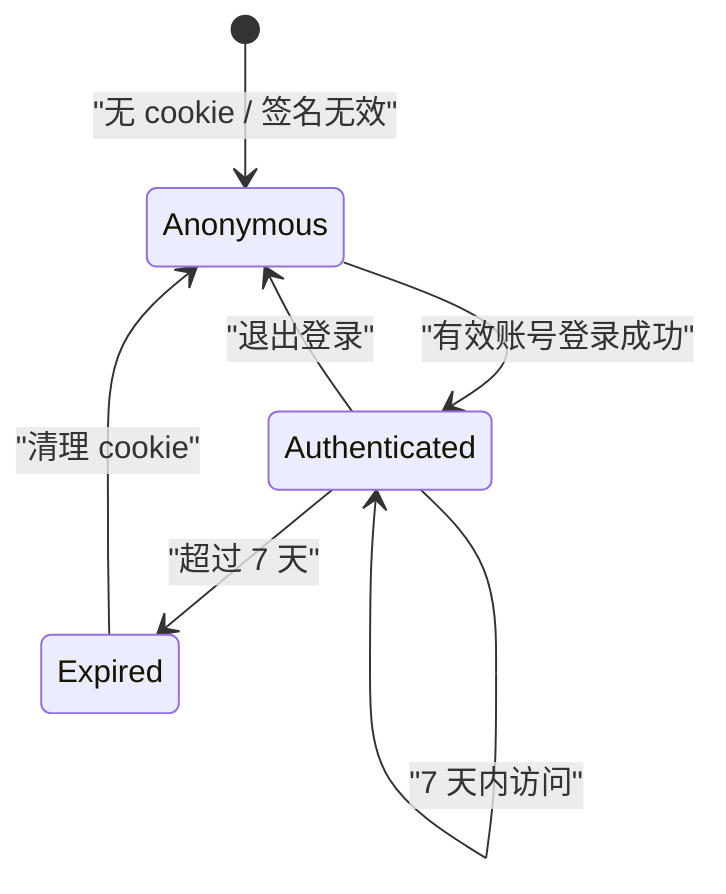

# 简单登录保护 — 技术设计文档

## 1. 设计概要

**功能描述**：实现首版固定账号登录、7 天会话保持、主应用访问保护和服务端动作登录校验。

**影响范围**：`src/modules/auth`、`src/server/actions`、`src/server/guards`、`src/app/(auth)`、`src/app/(main)`、`.env.example`、`scripts`、`tests/unit/auth`、`tests/integration/auth`、`tests/e2e`。

**技术难点**：密码与会话必须只在服务端处理；登录失败、配置缺失和会话过期都要给用户明确提示，但不能暴露账号是否存在、密码、密钥或内部错误。→ AC-006, AC-007, AC-008, AC-010, AC-015

**外部依赖**：无新增第三方依赖。使用 Next.js App Router、Server Actions、`cookies()`、`redirect()` 和 Node.js `crypto`。

---

## 2. 架构概览

本功能采用“环境变量固定账号 + 服务端签名 cookie”的轻量方案。账号配置只存在服务端环境变量中，登录页通过 Server Action 提交账号密码，`auth` 模块验证密码哈希并写入 HttpOnly cookie；主应用布局读取 cookie 并校验会话，未登录或过期则跳转登录页；后续关键业务 Server Action 通过 `src/server/guards/auth.ts` 统一检查登录状态。



### 模块职责

| 模块 | 职责 | 对应 AC |
|------|------|---------|
| `src/modules/auth/config.ts` | 读取并校验 `AUTH_USERS_JSON`、`AUTH_SESSION_SECRET` | AC-003, AC-010, AC-015 |
| `src/modules/auth/password.ts` | 使用 Node.js `crypto.scrypt` 校验密码哈希 | AC-003, AC-006, AC-007, AC-015 |
| `src/modules/auth/session.ts` | 创建、签名、验证、过期判断会话 cookie | AC-004, AC-005, AC-008, AC-015 |
| `src/server/actions/auth-actions.ts` | 登录、退出登录 Server Actions | AC-003, AC-005, AC-006, AC-010 |
| `src/server/guards/auth.ts` | 后续关键业务动作的统一登录检查 | AC-009, AC-014 |
| `src/app/(main)/layout.tsx` | 主应用路由保护 | AC-001, AC-004, AC-008 |
| `src/app/(auth)/login/page.tsx` | 登录页面展示和已登录回跳 | AC-002, AC-011, AC-012 |

---

## 3. 数据库设计

本功能不新增数据库表，也不修改现有表。→ AC-012, AC-013, AC-016

理由：

- 需求明确为“少量固定账号”，且不做账号自助管理、注册、找回密码或角色权限。→ AC-012, AC-013
- 使用服务端环境变量可以满足首版内部固定账号需求，并避免提前设计用户表、角色表和账号管理页面。→ AC-016
- 后续如果进入复杂权限或钉钉登录阶段，再单独启动需求澄清和技术设计，不在本功能中提前扩表。→ AC-016

### 环境变量

新增服务端环境变量：

| 变量名 | 示例 | 说明 | 对应 AC |
|--------|------|------|---------|
| `AUTH_SESSION_SECRET` | `change-me-in-production` | 会话签名密钥，生产环境必须配置为高强度随机值 | AC-004, AC-015 |
| `AUTH_USERS_JSON` | `[{"username":"operator","displayName":"操作员","passwordHash":"scrypt$..."}]` | 固定账号列表，只能放密码哈希，不能放明文密码 | AC-003, AC-006, AC-010, AC-012, AC-015 |

`AUTH_USERS_JSON` 结构：

```json
[
  {
    "username": "operator",
    "displayName": "操作员",
    "passwordHash": "scrypt$16384$8$1$saltBase64Url$hashBase64Url"
  }
]
```

密码哈希由 `scripts/hash-password.ts` 生成。该脚本只输出哈希文本，不保存明文密码。→ AC-015

---

## 4. API 设计

本功能遵循项目技术栈，优先使用 Server Actions，不新增公开 REST API。

### `loginWithPassword`

**描述**：校验固定账号密码，成功后写入 7 天会话 cookie。→ AC-003, AC-006, AC-007, AC-010, AC-015

**鉴权**：无需登录。

**位置**：`src/server/actions/auth-actions.ts`

**Request**：

```ts
interface LoginInput {
  username: string;
  password: string;
}
```

**Response（成功）**：

```ts
type ActionResult<LoginResult> = {
  ok: true;
  data: {
    username: string;
    displayName: string;
  };
};
```

**异常响应**：

| 场景 | 响应 | 对应 AC |
|------|------|---------|
| 账号或密码错误 | `{ ok: false, error: { code: "INVALID_CREDENTIALS", message: "账号或密码错误" } }` | AC-006, AC-007 |
| 登录配置缺失或格式错误 | `{ ok: false, error: { code: "AUTH_CONFIG_UNAVAILABLE", message: "登录服务暂不可用，请联系系统维护人员" } }` | AC-010, AC-015 |
| 输入为空 | `{ ok: false, error: { code: "VALIDATION_ERROR", message: "请输入账号和密码" } }` | AC-002, AC-006 |

### `logout`

**描述**：清除会话 cookie，并让用户回到登录页。→ AC-005

**鉴权**：无需登录；已登录和未登录都可以安全执行。

**位置**：`src/server/actions/auth-actions.ts`

**Response（成功）**：

```ts
type ActionResult<{ redirectedTo: "/login" }> = {
  ok: true;
  data: { redirectedTo: "/login" };
};
```

**异常响应**：清除 cookie 是幂等动作，不向用户展示内部错误；异常时也不输出堆栈或密钥。→ AC-015

### `requireAuthenticatedAction`

**描述**：供后续生成方案、保存、导入、导出等 Server Action 调用，统一阻止未登录操作。→ AC-009, AC-014

**鉴权**：要求已登录。

**位置**：`src/server/guards/auth.ts`

**成功结果**：

```ts
type AuthGuardResult = {
  ok: true;
  data: {
    username: string;
    displayName: string;
  };
};
```

**异常响应**：

| 场景 | 响应 | 对应 AC |
|------|------|---------|
| 未登录 | `{ ok: false, error: { code: "AUTH_REQUIRED", message: "需要先登录" } }` | AC-009, AC-014 |
| 会话过期 | `{ ok: false, error: { code: "SESSION_EXPIRED", message: "登录状态已过期，请重新登录" } }` | AC-008, AC-009 |
| 会话签名无效 | `{ ok: false, error: { code: "AUTH_REQUIRED", message: "需要先登录" } }` | AC-009, AC-015 |

---

## 5. 核心逻辑

### 固定账号读取与校验 → AC-003, AC-006, AC-007, AC-010, AC-012, AC-015

**触发条件**：用户提交登录。

**处理流程**：
1. 从服务端环境变量读取 `AUTH_USERS_JSON` 和 `AUTH_SESSION_SECRET`。
2. 如果配置缺失、JSON 无法解析、账号列表为空或密码哈希格式错误，返回 `AUTH_CONFIG_UNAVAILABLE`。
3. 对输入账号做 trim，不做大小写自动转换。
4. 如果账号不存在或密码不匹配，统一返回 `INVALID_CREDENTIALS`。
5. 如果密码匹配，返回账号展示信息，不返回密码哈希。

**伪代码**：

```text
function authenticate(username, password):
  config = loadAuthConfig()
  if config invalid:
    return AUTH_CONFIG_UNAVAILABLE

  user = find exact username
  if user missing:
    return INVALID_CREDENTIALS

  if verifyScryptHash(password, user.passwordHash) is false:
    return INVALID_CREDENTIALS

  return authenticated user
```

### 会话创建与验证 → AC-004, AC-005, AC-008, AC-011, AC-015

**触发条件**：登录成功、访问主应用、访问登录页、退出登录、执行关键业务动作。

**处理流程**：
1. 登录成功后生成会话载荷：`username`、`displayName`、`issuedAt`、`expiresAt`。
2. 使用 `AUTH_SESSION_SECRET` 对载荷做 HMAC-SHA256 签名。
3. 写入 cookie：`httpOnly: true`、`sameSite: "lax"`、生产环境 `secure: true`、`maxAge: 604800`。
4. 读取会话时校验签名，签名错误视为未登录。
5. 当前时间超过 `expiresAt` 时视为登录过期，并清理 cookie。
6. 退出登录时清理 cookie。

**状态流转**：



### 主应用路由保护 → AC-001, AC-004, AC-008

**触发条件**：用户访问 `src/app/(main)` 下任意页面。

**处理流程**：
1. `src/app/(main)/layout.tsx` 作为 Server Component 调用 `getCurrentSession()`。
2. 没有有效会话时跳转 `/login`。
3. 会话过期时清理 cookie，并跳转 `/login?reason=expired`。
4. 会话有效时展示主应用布局和子页面。

### 登录页行为 → AC-002, AC-003, AC-006, AC-007, AC-010, AC-011, AC-012

**触发条件**：用户访问 `/login`。

**处理流程**：
1. 页面加载时读取当前会话。
2. 已登录用户访问登录页时跳转 `/dashboard`。
3. 未登录用户看到账号、密码输入项和登录按钮。
4. 表单提交时调用 `loginWithPassword`。
5. 登录失败时只展示统一业务提示，不展示配置详情或内部错误。
6. 页面不展示注册、找回密码、验证码或账号管理入口。

### 服务端动作保护 → AC-009, AC-014

**触发条件**：后续生成方案、保存、导入、导出等关键业务动作执行前。

**处理流程**：
1. 每个关键 Server Action 的第一步调用 `requireAuthenticatedAction()`。
2. 如果返回失败，直接返回统一 `ActionResult`，不继续执行业务逻辑。
3. 如果返回成功，把登录用户上下文作为后续审计或历史扩展的输入，但本功能不写操作日志。

---

## 6. 现有代码改动

| 模块 / 文件 | 改动内容 | 原因 | 对应 AC |
|-------------|---------|------|---------|
| `src/modules/auth/types.ts` | 新增登录账号、会话、认证结果类型 | 统一 auth 模块内部契约 | AC-003, AC-004, AC-009 |
| `src/modules/auth/config.ts` | 读取并校验固定账号环境变量 | 支持少量固定账号和配置异常提示 | AC-003, AC-010, AC-012, AC-015 |
| `src/modules/auth/password.ts` | 使用 `crypto.scrypt` 验证密码哈希 | 避免明文密码和新增依赖 | AC-003, AC-006, AC-015 |
| `src/modules/auth/session.ts` | 创建、签名、验证和清除 7 天会话 | 支持登录保持、过期和退出 | AC-004, AC-005, AC-008, AC-015 |
| `src/server/actions/auth-actions.ts` | 新增登录和退出 Server Actions | 连接登录页和 auth 模块 | AC-003, AC-005, AC-006, AC-010 |
| `src/server/guards/auth.ts` | 新增服务端动作登录检查 | 后续关键业务动作统一复用 | AC-009, AC-014 |
| `src/app/(auth)/login/page.tsx` | 替换占位页面为登录表单，已登录回跳 | 提供登录入口 | AC-002, AC-003, AC-006, AC-011, AC-012 |
| `src/app/(main)/layout.tsx` | 进入主应用前检查会话；增加退出入口 | 保护主应用并支持退出 | AC-001, AC-004, AC-005, AC-008 |
| `src/app/page.tsx` | 保持跳转 `/dashboard`，由主应用布局负责保护 | 不重复实现路由保护 | AC-001 |
| `.env.example` | 新增 `AUTH_SESSION_SECRET`、`AUTH_USERS_JSON` 示例 | 明确固定账号配置入口，不写真实密钥 | AC-010, AC-015 |
| `scripts/hash-password.ts` | 新增本地生成 scrypt 密码哈希的脚本 | 维护固定账号时不写明文密码 | AC-015 |
| `tests/unit/auth/*.test.ts` | 覆盖配置解析、密码校验、会话签名和过期 | 保护核心认证逻辑 | AC-003, AC-004, AC-006, AC-008, AC-010, AC-015 |
| `tests/integration/auth/*.test.ts` | 覆盖 Server Action 和 guard 的返回结果 | 验证统一错误提示与登录检查 | AC-005, AC-007, AC-009, AC-014 |
| `tests/e2e/auth-flow.spec.ts` | 覆盖未登录跳转、登录、保持登录、退出 | 验证用户可见主流程 | AC-001, AC-002, AC-003, AC-004, AC-005, AC-011 |

---

## 7. 技术决策

### 固定账号存环境变量，而不是新增用户表

**背景**：需求只要求少量固定账号，不做注册、找回密码、账号管理或角色权限。项目虽然已有数据库基础，但账号表会自然引出用户管理、密码重置、角色等后续问题。

**选项**：
- A: 环境变量固定账号 — 实现轻、部署简单、符合首版边界；账号调整需要维护环境变量并重新部署。
- B: 数据库用户表 — 更适合长期账号管理；但会扩大本功能范围，需要额外 schema、seed、管理策略和更多异常处理。

**结论**：选择 A。它最贴合“简单登录保护”，且不提前进入复杂权限或账号管理。→ AC-012, AC-013, AC-016

### 使用自有签名 cookie，而不是引入认证库

**背景**：首版只需要固定账号登录和 7 天会话，不需要 OAuth、钉钉登录、权限策略或多租户。

**选项**：
- A: 自有 HMAC 签名 cookie — 无新增依赖，逻辑可测试，足够覆盖当前 AC。
- B: 引入 NextAuth/Auth.js 等认证库 — 未来扩展丰富，但当前需求下配置和心智成本更高，也可能带来数据库适配问题。

**结论**：选择 A。等进入钉钉登录或复杂权限阶段，再重新评估认证库或统一身份方案。→ AC-004, AC-005, AC-008, AC-016

### 使用 scrypt 密码哈希，而不是明文或普通摘要

**背景**：固定账号如果直接保存明文密码，会违反安全红线；普通 SHA-256 摘要不适合密码存储。

**选项**：
- A: Node.js `crypto.scrypt` — 无新增依赖，适合密码哈希，能配合随机盐。
- B: 明文密码或普通摘要 — 实现最简单，但安全性不足。
- C: bcrypt/argon2 依赖 — 安全成熟，但需要新增依赖和可能的原生构建成本。

**结论**：选择 A。它在不新增依赖的前提下提供足够的首版密码保护。→ AC-003, AC-006, AC-015

---

## 8. 安全与性能

**输入校验**：登录时账号和密码必须非空；账号做 trim；密码不写入日志、不回显、不进入 URL。→ AC-002, AC-006, AC-015

**敏感数据处理**：密码只以 scrypt 哈希配置；会话 cookie 使用 HttpOnly；生产环境启用 Secure；所有登录异常只返回业务提示，不返回堆栈、密钥、密码哈希或配置内容。→ AC-006, AC-007, AC-010, AC-015

**会话策略**：登录有效期固定为 7 天，cookie `maxAge` 与会话载荷 `expiresAt` 双重约束；过期会话必须重新登录。→ AC-004, AC-008

**性能考量**：固定账号数量少，账号查找为内存数组遍历即可；scrypt 只在登录时执行，不影响已登录页面访问。→ AC-003, AC-004

**范围控制**：不写用户表、不写操作日志、不引入角色权限、不引入钉钉登录，避免首版认证范围外扩。→ AC-012, AC-013, AC-016

---

## 9. AC 覆盖总表

| AC 编号 | 验收标准概述 | 实现位置 |
|---------|-------------|---------|
| AC-001 | 未登录访问主应用要求登录 | `src/app/(main)/layout.tsx` 路由保护 |
| AC-002 | 登录页展示账号、密码和按钮 | `src/app/(auth)/login/page.tsx` |
| AC-003 | 有效账号登录成功 | `loginWithPassword` + `src/modules/auth/config.ts` + `password.ts` |
| AC-004 | 7 天内保持登录 | `src/modules/auth/session.ts` + cookie `maxAge` |
| AC-005 | 主动退出登录 | `logout` Server Action + 主应用退出入口 |
| AC-006 | 错误账号或密码统一提示 | `loginWithPassword` 异常响应 |
| AC-007 | 多次失败仍不暴露账号是否存在 | `authenticate` 统一 `INVALID_CREDENTIALS` |
| AC-008 | 登录状态过期要求重新登录 | `getCurrentSession` 过期判断 + 主应用布局跳转 |
| AC-009 | 未登录关键操作被拒绝 | `src/server/guards/auth.ts` |
| AC-010 | 登录配置不可用安全提示 | `src/modules/auth/config.ts` + `loginWithPassword` |
| AC-011 | 已登录访问登录页回到主应用 | `src/app/(auth)/login/page.tsx` 会话检查 |
| AC-012 | 不提供注册、找回密码等入口 | 登录页和环境变量固定账号方案 |
| AC-013 | 多个账号不区分角色权限 | `AuthUser` 不包含 role；主应用统一入口 |
| AC-014 | 关键业务动作必须能检查登录 | `requireAuthenticatedAction` guard |
| AC-015 | 登录相关敏感信息不外泄 | 统一错误消息、哈希密码、HttpOnly cookie、`.env.example` 示例 |
| AC-016 | 不扩大到复杂权限、钉钉、多租户、日志 | 无数据库用户表、无角色模型、无钉钉模块、无 audit-log 改动 |

---

## 附录：变更记录

| 日期 | 变更内容 | 原因 |
|------|---------|------|
| 2026-06-29 | 初始版本 | 根据“简单登录保护”需求文档产出可执行技术方案 |
