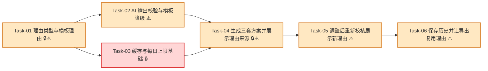

# AI 选型理由与模板降级 — 开发任务计划

## 1. 任务概览

**总任务数**：6 个  
**预计总工时**：1110 分钟（约 18.5 小时）  
**开发方法**：TDD — 每个任务按 RED → GREEN → REFACTOR 循环执行

**关键标注**：
- 🔒 阻塞任务：被多个任务依赖，建议优先完成
- ⚠️ 风险任务：业务规则容易写错，执行时需要重点核对 AC

### 合并说明

| 合并前 | 合并后 | 合并原因 |
|--------|--------|----------|
| 原 Task-04 + 原 Task-05 | 新 Task-04 | “服务端附加理由”和“页面展示理由”属于同一个用户行为：用户生成三套方案后能看到理由和来源。合并后是完整垂直切片。 |
| 原 Task-08 | 分散并入 Task-04、Task-05、Task-06、完成定义和验证计划 | 原 Task-08 主要是回归、安全边界和依赖方向检查，不是独立用户行为。拆入具体任务后更符合 TDD 任务规划规则。 |

### 依赖关系图



### 可并行任务组

| 并行组 | 任务 | 说明 |
|--------|------|------|
| A | Task-02、Task-03 | 二者都依赖 Task-01；Task-02 处理文案校验，Task-03 处理缓存和限额，彼此不阻塞。 |

### 切片说明

| 阶段 | 用户可感知行为 | 覆盖重点 |
|------|----------------|----------|
| 阶段一 | 系统能生成结构化模板理由 | 模板兜底、风险提示、事实提取 |
| 阶段二 | AI 可用时显示 AI 理由，不可用时自动模板降级 | AI 成功、失败、超时、上限、冲突校验 |
| 阶段三 | 用户生成三套方案后看到理由和来源 | 推荐槽位、服务端编排、页面展示 |
| 阶段四 | 用户调整并重新校核后看到新理由 | 调整后理由、旧理由清空 |
| 阶段五 | 保存和导出复用已生成理由 | 历史快照、PDF 复用、安全边界 |

---

## 2. 开发任务

> 按垂直切片组织。Task-01 到 Task-03 是最薄基础层；Task-04 到 Task-06 分别打通“生成方案看理由”“调整后看新理由”“保存导出复用理由”的用户行为。
>
> 每个任务按 TDD 循环执行：RED（根据验证标准写测试）→ GREEN（写最小实现通过测试）→ REFACTOR（重构）。测试不是独立任务。

### 阶段一：系统具备可靠模板理由

**阶段完成标准**：即使 AI 完全不可用，用户也能看到包含成本、强度、可生产状态和风险提示的选型理由。

---

#### [x] Task-01: 理由类型与模板理由 🔒⚠️

**通俗解释**：先让系统学会用固定格式解释方案，确保没有 AI 时也能说清楚成本、强度、能不能生产和风险。

**做什么**：新增 `src/modules/ai-reasoning/types.ts`、`template-reason.ts`、`extract-reason-facts.ts`；定义 `SelectionReason`、`SelectionReasonFacts`、来源和降级原因；从 `RecommendationSlot` 或 `CandidateEvaluation` 提取只读事实；生成固定四段模板理由；更新 `src/modules/ai-reasoning/README.md` 的模块边界。

**涉及文件**：`src/modules/ai-reasoning/types.ts`、`src/modules/ai-reasoning/template-reason.ts`、`src/modules/ai-reasoning/extract-reason-facts.ts`、`src/modules/ai-reasoning/README.md`、`tests/unit/ai-reasoning/template-reason.test.ts`

**参考**：技术方案 2、4.1、5.3、8、11 → AC-004, AC-006, AC-007, AC-009, AC-011, AC-012

**依赖**：无

**预估工时**：150 分钟

**验证标准**：
- [ ] 传入 `finalStatus = "qualified"`、含税成本 `2.35`、BCT `900`、边压 `4.12`、耐破 `780` → 模板理由包含“成本”“强度”“可生产状态”“风险提示”四段。
- [ ] 传入 `finalStatus = "qualified"` 且无风险原因 → 风险提示段包含“当前未发现强度或设备风险”，且不包含“不建议生产”。
- [ ] 传入 `finalStatus = "unqualified"`、风险原因“边压不足” → 模板理由包含“边压不足”，且不出现“已达标”。
- [ ] 传入 `finalStatus = "not_manufacturable"`、风险原因“超过设备最大宽度” → 模板理由包含“不可生产”和“超过设备最大宽度”，且不出现“可生产”。
- [ ] 传入 `finalStatus = "data_incomplete"` 且缺少成本结果 → 模板理由包含“暂无完整成本数据”和“数据不足”。
- [ ] 传入缺少强度结果的事实 → 模板理由包含“暂无完整强度数据”，不得输出 `0 N` 或编造数值。
- [ ] 从 rejected `CandidateEvaluation` 提取事实，reasons 包含 `STRENGTH_UNQUALIFIED` → `SelectionReasonFacts.riskMessages` 包含该原因文案。
- [ ] 从 `RecommendationSlot.status = "reference"` 提取事实 → `isOfficialRecommendation = false`。
- [ ] 检查 `src/modules/ai-reasoning` 源码 → 不导入 `@/app`，不导入 `@/server/actions`，不导入 `@/modules/calculations` 之外的计算写入逻辑。

---

### 阶段二：AI 可用时生成 AI 理由，不可用时模板降级

**阶段完成标准**：AI Provider 成功时返回“AI 生成”；失败、超时、达到每日上限、输出冲突或未配置时，用户仍看到“模板生成”理由，方案生成不被阻断。

---

#### [x] Task-02: AI 输出校验与模板降级 ⚠️

**通俗解释**：AI 说错话时，系统会拦住它，改用稳妥的模板解释，不让用户被误导。

**做什么**：新增 `validate-ai-reason.ts` 和 `generate-selection-reason.ts` 的基础编排；定义 `AiReasoningProvider` 接口；实现 Provider 成功、失败、超时、未配置、校验失败时的统一返回；AI 文案和服务端事实冲突时降级模板。

**涉及文件**：`src/modules/ai-reasoning/validate-ai-reason.ts`、`src/modules/ai-reasoning/generate-selection-reason.ts`、`src/modules/ai-reasoning/types.ts`、`tests/unit/ai-reasoning/validate-ai-reason.test.ts`、`tests/unit/ai-reasoning/generate-selection-reason.test.ts`

**参考**：技术方案 4.4、4.5、5.1、5.4、8、11 → AC-002, AC-004, AC-005, AC-006, AC-007, AC-008, AC-010, AC-011

**依赖**：Task-01

**预估工时**：165 分钟

**验证标准**：
- [ ] 注入 fake Provider 返回“该经济型方案成本较低，强度满足要求，可生产”且事实为达标可生产 → `source = "ai"`，`sourceLabel = "AI 生成"`。
- [ ] 不传 Provider → 返回 `source = "template"`，`fallbackReason = "provider_not_configured"`，且不抛异常。
- [ ] Provider 抛出异常 → 返回模板理由，`fallbackReason = "provider_failed"`。
- [ ] Provider 在 `timeoutMs = 10` 时未返回 → 返回模板理由，`fallbackReason = "provider_timeout"`。
- [ ] 事实为 `unqualified`，AI 文案包含“已达标” → 返回模板理由，`fallbackReason = "validation_failed"`。
- [ ] 事实为 `not_manufacturable`，AI 文案包含“可生产” → 返回模板理由，`fallbackReason = "validation_failed"`。
- [ ] 事实为 `data_incomplete`，AI 文案包含“数据完整” → 返回模板理由，`fallbackReason = "validation_failed"`。
- [ ] 事实为 `isOfficialRecommendation = false`，AI 文案包含“正式推荐” → 返回模板理由，`fallbackReason = "validation_failed"`。
- [ ] AI 文案校验失败后 → 返回的模板理由仍包含成本、强度、可生产状态和风险提示。

---

#### [x] Task-03: 缓存与每日上限基础 🔒

**通俗解释**：同样的方案不用反复问 AI；每天 AI 用到上限后，系统自动改用模板说明。

**做什么**：新增 `src/db/schema/ai-reasoning.ts`、迁移、`cache.ts` 和仓储；实现 `ai_reasoning_cache`、`ai_reasoning_daily_usages`；实现缓存 key 生成、缓存读写、过期判断、每日用量增加和上限判断；同步 `.env.example` 的 AI 相关服务端环境变量。

**涉及文件**：`src/db/schema/ai-reasoning.ts`、`src/db/schema/index.ts`、`src/db/migrations/*`、`src/modules/ai-reasoning/cache.ts`、`.env.example`、`tests/unit/ai-reasoning/cache.test.ts`、`tests/integration/matching/ai-reasoning-cache.test.ts`

**参考**：技术方案 3.1、3.2、5.5、5.6、9、10.3、11 → AC-003, AC-005, AC-009, AC-010

**依赖**：Task-01

**预估工时**：180 分钟

**验证标准**：
- [ ] 迁移执行后，数据库存在 `ai_reasoning_cache` 表，字段包含 `cache_key`、`reason_text`、`facts_snapshot`、`created_at`、`expires_at`。
- [ ] 迁移执行后，数据库存在 `ai_reasoning_daily_usages` 表，字段包含 `usage_date`、`request_count`、`created_at`、`updated_at`。
- [ ] 同一 `SelectionReasonFacts` 连续生成两次 cache key → 返回完全相同的字符串。
- [ ] 事实中的含税成本从 `2.35` 改为 `2.36` → cache key 变化。
- [ ] 事实中的 `finalStatus` 从 `qualified` 改为 `unqualified` → cache key 变化。
- [ ] 缓存中存在未过期 reason → 读取缓存返回该 reason。
- [ ] 缓存 `expiresAt` 早于当前时间 → 读取缓存视为未命中。
- [ ] 当日 `request_count = 99`，每日上限 `100` → 允许本次调用并更新为 `100`。
- [ ] 当日 `request_count = 100`，每日上限 `100` → 不允许调用，返回达到上限状态。
- [ ] 缓存命中时 → 不增加当日 `request_count`。
- [ ] `.env.example` 包含 `AI_PROVIDER_API_KEY`、`AI_PROVIDER_BASE_URL`、`AI_REASONING_MODEL`、`AI_REASONING_TIMEOUT_MS`、`AI_REASONING_DAILY_LIMIT`，且不包含真实密钥。

---

### 阶段三：用户生成三套方案后看到理由和来源

**阶段完成标准**：用户点击生成方案后，经济型、安全型、均衡型每个方案位置都展示选型理由，并标明“AI 生成”或“模板生成”。

---

#### [x] Task-04: 生成三套方案并展示理由来源 🔒⚠️

**通俗解释**：用户生成方案后，三套方案会自带解释，并且能直接在页面上看到这些解释来自 AI 还是模板。

**做什么**：扩展 `RecommendationSlot` 增加 `selectionReason`；实现 `attachSelectionReasonsToSlots`；在 `generateMatchingScheme` 中推荐结果生成后附加理由；接入可注入 Provider、Repository 和 `createSelectionReasonFn`；不可用槽位不调用 AI，直接模板说明原因；更新 matching 页面推荐槽位展示，在方案卡片中展示 `selectionReason.sourceLabel` 和 `selectionReason.text`；来源标签使用现有标签样式扩展；保证推荐排序结果和计算结果不被理由影响。

**涉及文件**：`src/modules/recommendation/types.ts`、`src/modules/ai-reasoning/generate-selection-reason.ts`、`src/server/actions/matching-actions.ts`、`src/app/(main)/matching/_components/box-spec-form.tsx`、`src/app/(main)/matching/matching.module.css`、`tests/integration/matching/matching-actions.test.ts`、`tests/integration/matching/matching-page.test.tsx`

**参考**：技术方案 4.2、4.5、5.1、6.1、7、8、10.2、11 → AC-001, AC-002, AC-004, AC-005, AC-006, AC-007, AC-009, AC-010, AC-011, AC-012

**依赖**：Task-02、Task-03

**预估工时**：300 分钟

**验证标准**：
- [ ] `generateMatchingScheme` 返回 3 个推荐槽位 → 每个槽位都包含 `selectionReason.sourceLabel` 和非空 `selectionReason.text`。
- [ ] 注入成功 fake Provider → 三个有候选槽位的理由来源为“AI 生成”。
- [ ] 注入抛错 Provider → 三个槽位仍返回，理由来源为“模板生成”，动作返回 `ok: true`。
- [ ] 注入超时 Provider → 三个槽位仍返回，理由来源为“模板生成”。
- [ ] 设置每日上限已达到 → 不调用 Provider，槽位理由来源为“模板生成”。
- [ ] 槽位状态为 `unavailable` 且没有 `evaluation` → 不调用 Provider，仍生成模板理由说明不可用原因。
- [ ] 生成理由前后的 `RecommendationSlot.strategy`、`status`、`isOfficialRecommendation`、`evaluation.cost`、`evaluation.strength` 完全一致。
- [ ] 推荐选择函数返回顺序为经济型、安全型、均衡型 → 附加理由后顺序保持不变。
- [ ] 基础数据缺失时 → `generateMatchingScheme` 返回 `VALIDATION_ERROR`，不调用 AI 理由生成。
- [ ] 未登录时 → `generateMatchingScheme` 返回 `AUTH_REQUIRED`，不调用 AI 理由生成。
- [ ] 页面收到经济型槽位 `selectionReason.sourceLabel = "AI 生成"` → 经济型卡片显示“AI 生成”。
- [ ] 页面收到安全型槽位 `selectionReason.sourceLabel = "模板生成"` → 安全型卡片显示“模板生成”。
- [ ] 页面收到理由正文“成本较低，强度满足要求” → 对应方案卡片显示该正文。
- [ ] 页面收到模板理由且 `fallbackReason = "provider_failed"` → 页面不显示 `provider_failed`、堆栈或 Provider 原始错误。
- [ ] 页面收到未达标槽位，理由正文包含“边压不足” → 页面显示“边压不足”，且不显示“已达标”。
- [ ] 页面收到不可生产槽位，理由正文包含“超过设备最大宽度” → 页面显示“超过设备最大宽度”，且不显示“可生产”。
- [ ] 同一组候选，Provider 返回不同文案 → 推荐槽位的策略、顺序、成本、强度、达标状态和可生产状态不变化。
- [ ] `src/modules/recommendation/select-matching-recommendations.ts` 源码检查 → 不读取 `selectionReason` 来排序。
- [ ] 页面源码检查 → 不读取任何 `AI_PROVIDER_API_KEY` 或服务端密钥变量。
- [ ] 页面推荐卡片中来源标签和正文不会挤压或覆盖成本、强度和状态信息。

---

### 阶段四：用户调整后重新校核能看到新理由

**阶段完成标准**：用户调整方案后，旧理由不再作为当前理由展示；完成重新校核后，页面展示基于调整后结果的新理由。

---

#### [x] Task-05: 调整后重新校核展示新理由 ⚠️

**通俗解释**：用户改过方案再重新校核后，解释会跟着新结果变化，不会拿旧方案的话来解释新方案。

**做什么**：扩展 `RecalculateAdjustedSchemeResult` 增加 `selectionReason`；在 `recalculateAdjustedScheme` 完成服务端重新校核后生成理由；页面进入 dirty 状态时清空旧 `recalculatedResult`；重新校核结果区展示新理由来源和正文；保存前如果再次调整，必须重新生成理由；补充调整后风险文案和 AI 冲突降级回归。

**涉及文件**：`src/modules/scheme-adjustment/types.ts`、`src/server/actions/matching-actions.ts`、`src/app/(main)/matching/_components/box-spec-form.tsx`、`tests/integration/matching/matching-actions.test.ts`、`tests/integration/matching/matching-page.test.tsx`

**参考**：技术方案 4.3、5.2、6.2、6.3、7、10.2、11 → AC-003, AC-006, AC-007, AC-009, AC-010, AC-011, AC-012

**依赖**：Task-04

**预估工时**：165 分钟

**验证标准**：
- [ ] `recalculateAdjustedScheme` 返回 `finalEvaluation.cost.taxIncludedCostYuan = 2.45` → `selectionReason.text` 基于 `2.45` 生成，而不是调整前成本。
- [ ] 调整后评估为 `qualified` 且 Provider 成功 → 重新校核结果 `selectionReason.sourceLabel = "AI 生成"`。
- [ ] 调整后评估为 `unqualified`，原因“耐破不足” → 重新校核结果理由包含“耐破不足”，且不出现“已达标”。
- [ ] 调整后评估为 `not_manufacturable`，原因“超过设备最大宽度” → 重新校核结果理由包含“不可生产”和“超过设备最大宽度”。
- [ ] Provider 失败时重新校核动作仍返回 `ok: true`，`selectionReason.sourceLabel = "模板生成"`。
- [ ] Provider 返回“可生产”，但事实为不可生产 → 页面最终展示模板理由和不可生产原因。
- [ ] Provider 返回“已达标”，但事实为未达标 → 页面最终展示模板理由和未达标原因。
- [ ] 页面已展示一次重新校核理由后，用户再次修改瓦型 → 页面显示“待重新校核”，并不再显示旧的重新校核理由作为当前结果。
- [ ] 页面再次点击“重新校核”后 → 展示新的 `selectionReason.text`。
- [ ] 保存动作对调整后方案再次重新校核时 → 使用服务端最新事实生成最终快照理由。

---

### 阶段五：保存和导出复用已生成理由

**阶段完成标准**：用户确认保存后，历史快照包含最终方案理由和来源；导出报告使用保存的理由，不为导出单独二次调用 AI。

---

#### [x] Task-06: 保存历史并让导出复用理由 ⚠️

**通俗解释**：保存后的方案以后再打开或导出，看到的解释和当时确认的解释一致，不会重新生成一段不一样的话。

**做什么**：扩展 `createHistorySnapshot`，把最终方案 `selectionReason` 写入 `finalSchemeSnapshot`；原始三套推荐槽位保留各自 `selectionReason`；更新历史读取和 PDF 数据构建逻辑，优先读取快照理由；旧快照缺少理由时只用模板补齐，不调用 AI；确保导出完整报告和精简方案表都复用历史快照理由；补充依赖方向、环境变量和敏感信息检查。

**涉及文件**：`src/modules/scheme-adjustment/create-history-snapshot.ts`、`src/modules/scheme-adjustment/types.ts`、`src/server/actions/matching-actions.ts`、`src/server/actions/matching-scheme-history.ts`、`src/modules/import-export/*pdf*`、`tests/unit/scheme-adjustment/create-history-snapshot.test.ts`、`tests/integration/import-export/matching-scheme-pdf-route.test.ts`、`.env.example`

**参考**：技术方案 3.3、5.7、6.3、8、9、10.2、11 → AC-003, AC-009, AC-010, AC-011

**依赖**：Task-05

**预估工时**：150 分钟

**验证标准**：
- [ ] 保存未调整方案，所选推荐槽位理由为“AI 生成” → `finalSchemeSnapshot.selectionReason.sourceLabel = "AI 生成"`。
- [ ] 保存调整后方案，重新校核理由为“模板生成” → `finalSchemeSnapshot.selectionReason.sourceLabel = "模板生成"`。
- [ ] 原始三套推荐槽位分别带有理由 → `originalRecommendationSlotsSnapshot` 中三套理由都被保存。
- [ ] 历史记录读取后 → 最终方案快照仍包含保存时的理由正文和来源。
- [ ] 导出完整报告 PDF 数据时，历史快照有 `selectionReason.text = "保存时的理由"` → PDF 数据使用“保存时的理由”。
- [ ] 导出精简方案表 PDF 数据时，历史快照有 `selectionReason.sourceLabel = "AI 生成"` → PDF 数据保留来源或可展示来源。
- [ ] 旧历史快照没有 `selectionReason` → 导出数据使用模板理由补齐，且不调用 Provider。
- [ ] 导出过程中 Provider fake 函数设置为抛错 → 导出仍成功，因为导出不二次调用 AI。
- [ ] `src/modules/calculations` 源码检查 → 不导入 `ai-reasoning`。
- [ ] `.env.example` 只包含变量名和占位说明，不包含真实 Key、Token、私钥。
- [ ] 测试夹具和快照中不包含真实客户、真实订单或未脱敏纸价数据。

---

## 3. AC 覆盖总表

| AC 编号 | 验收标准概述 | 承接任务 | 验证方式 |
|---------|--------------|----------|----------|
| AC-001 | 每套方案展示理由来源 | Task-04 | 服务端返回三套 `selectionReason`；页面显示来源标签 |
| AC-002 | AI 理由正常展示 | Task-02, Task-04 | fake Provider 成功时返回并展示“AI 生成” |
| AC-003 | 调整后展示新理由 | Task-05, Task-06 | 重新校核返回新理由；保存快照写入最终理由 |
| AC-004 | AI 失败时模板降级 | Task-01, Task-02, Task-04 | Provider 抛错时方案仍返回，显示“模板生成” |
| AC-005 | AI 超时或达到上限时模板降级 | Task-02, Task-03, Task-04 | 超时和每日上限测试返回模板理由 |
| AC-006 | 未达标理由明确风险 | Task-01, Task-02, Task-04, Task-05 | 未达标事实包含强度风险，冲突 AI 被降级 |
| AC-007 | 不可生产理由明确风险 | Task-01, Task-02, Task-04, Task-05 | 不可生产事实包含设备风险，冲突 AI 被降级 |
| AC-008 | AI 理由与结果冲突时自动降级 | Task-02, Task-04, Task-05 | 校验失败返回 `validation_failed` 模板理由 |
| AC-009 | 理由只基于已计算结果 | Task-01, Task-03, Task-04, Task-05, Task-06 | facts 只从服务端评估提取；缓存 key 基于计算事实 |
| AC-010 | AI 不可用不阻断方案生成 | Task-02, Task-04, Task-06 | AI 异常方案仍返回；导出不二次调用 AI |
| AC-011 | 理由不得改变计算和状态 | Task-01, Task-02, Task-04, Task-06 | 推荐排序和计算状态不读取理由字段 |
| AC-012 | 模板理由内容完整 | Task-01, Task-02, Task-04, Task-05 | 模板固定四段结构，缺数据不编造 |

---

## 4. 完成定义

- [ ] Task-01 到 Task-06 的验证标准全部通过。
- [ ] AC-001 到 AC-012 均能追溯到至少一个任务和至少一条验证标准。
- [ ] `ai-reasoning` 模块不参与面积、强度、成本、设备限制计算。
- [ ] 推荐排序在 AI 文案变化前后保持一致。
- [ ] AI 失败、超时、达到每日上限、输出冲突时，方案生成和重新校核不被阻断。
- [ ] 页面可见“AI 生成 / 模板生成”来源标签。
- [ ] 历史保存和 PDF 导出复用已保存理由，不为导出二次调用 AI。
- [ ] `.env.example` 已补充 AI 服务端变量，且未写入真实密钥。
- [ ] 测试夹具不包含真实客户、真实订单或未脱敏纸价数据。
- [ ] `src/modules/calculations` 不依赖 `ai-reasoning`，`recommendation` 不读取理由字段参与排序。

---

## 5. 验证计划

| 检查项 | 关联任务 | 关联 AC |
|--------|----------|---------|
| 运行 AI 模块单元测试，覆盖模板四段、冲突校验、失败降级、缓存 key | Task-01, Task-02, Task-03 | AC-004 到 AC-012 |
| 运行 AI 缓存集成测试，覆盖缓存命中、过期和每日上限 | Task-03 | AC-005, AC-010 |
| 运行 matching actions 集成测试，确认生成三套方案时附加理由且 AI 异常不阻断 | Task-04 | AC-001, AC-002, AC-004, AC-005, AC-010, AC-011 |
| 运行 matching page 集成测试，确认来源标签、正文、未达标/不可生产风险可见 | Task-04, Task-05 | AC-001, AC-003, AC-006, AC-007, AC-012 |
| 运行 PDF 导出集成测试，确认导出复用历史快照理由且不二次调用 AI | Task-06 | AC-010, AC-011 |
| 检查依赖方向和环境变量，确认 AI 不反写计算、推荐、状态，也不暴露密钥 | Task-04, Task-05, Task-06 | AC-009, AC-011 |

建议命令：

```bash
pnpm vitest run tests/unit/ai-reasoning tests/integration/matching tests/integration/import-export/matching-scheme-pdf-route.test.ts
pnpm typecheck
pnpm lint
```

---

## 6. Mock 闭环检查

本功能涉及外部 AI Provider，但项目当前仍未确认真实 AI 大模型接口信息。因此任务规划采用以下闭环：

- 开发阶段使用 fake Provider 作为 TDD 输入，验证 AI 成功、失败、超时和冲突降级。对应 Task-02、Task-04、Task-05。
- 生产路径支持 Provider 未配置时自动模板降级。对应 Task-02、Task-04。
- 真实 Provider 接口信息确认后，只需要新增或替换 `AiReasoningProvider` 适配器；现有 `createSelectionReason`、缓存、限额、校验、页面展示和导出复用不需要重写。
- 不在本轮任务中编造第三方 API 路径、请求体或模型名称。

---

## 附录：变更记录

| 日期 | 变更内容 | 原因 |
|------|---------|------|
| 2026-07-03 | 初始版本 | 基于《AI 选型理由与模板降级》和《AI 选型理由与模板降级_技术方案》拆解 TDD 开发任务 |
| 2026-07-03 | 合并为 6 个任务 | 合并生成理由服务端与页面展示切片，并将安全回归检查并入具体任务和完成定义 |
