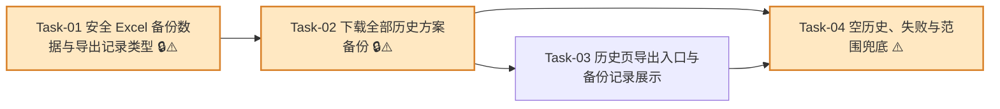

# 导出备份能力 — 开发任务计划

## 1. 任务概览

**总任务数**：4 个  
**预计总工时**：600 分钟（约 10 小时）  
**开发方法**：TDD — 每个任务按 RED → GREEN → REFACTOR 循环执行

**关键标注**：
- 🔒 阻塞任务：被多个任务依赖，建议优先完成
- ⚠️ 风险任务：业务规则容易写错，执行时需要重点核对 AC

### 切片说明

| 阶段 | 用户可感知结果 | 说明 |
|------|----------------|------|
| 阶段一：生成安全备份内容 | 系统能把历史方案整理成不含成本和原纸价格的 Excel 内容 | 先锁住字段白名单和导出记录类型，避免后续路由和页面基于不安全数据开发。 |
| 阶段二：下载全部方案备份 | 用户能通过接口下载当前全部历史方案备份 | 打通登录校验、历史读取、Excel 下载和备份导出记录回写。 |
| 阶段三：历史页操作与追溯 | 用户在历史页能点击导出，也能看到备份导出时间 | 把下载能力接到页面，并展示 `all_backup` 记录。 |
| 阶段四：异常与范围兜底 | 空历史、失败和越界场景都有明确保护 | 防止生成空文件、泄露敏感字段或扩展到非本次范围。 |

### 依赖关系图



### 可并行任务组

| 并行组 | 任务 | 说明 |
|--------|------|------|
| A | Task-03、Task-04 的部分测试补充 | 两者都依赖 Task-02 主链路。Task-03 侧重页面入口，Task-04 侧重错误和范围兜底，可在主接口稳定后并行推进。 |

---

## 2. 开发任务

> 每个任务按 TDD 循环执行：RED（根据验证标准写测试）→ GREEN（写最小实现通过测试）→ REFACTOR（重构）。测试不是独立任务。

### 阶段一：生成安全备份内容

**阶段完成标准**：系统能把已保存历史方案转换为 Excel 备份内容，且备份数据不包含内部成本和原纸价格快照。

---

#### [x] Task-01: 安全 Excel 备份数据与导出记录类型 🔒⚠️

**通俗解释**：先把备份文件里“能放什么、不能放什么”定牢，保证导出的 Excel 从源头不带成本和原纸价格。

**做什么**：新增通用导出记录类型，扩展 `all_backup`；让 PDF 导出继续使用 `full_report`、`summary_sheet`；实现 `build-matching-scheme-backup-workbook.ts`，按白名单从历史方案生成 Excel 工作簿，包含备份说明、方案总览、原始推荐方案、最终确认方案、导出记录五个 Sheet；禁止输出成本字段、`priceSnapshot` 和 `priceYuanPerTon`。

**涉及文件**：`src/modules/import-export/matching-scheme-export-types.ts`、`src/modules/import-export/matching-scheme-pdf-types.ts`、`src/modules/import-export/build-matching-scheme-backup-workbook.ts`、`tests/unit/import-export/matching-scheme-backup-workbook.test.ts`、`tests/unit/import-export/matching-scheme-pdf-data.test.ts`

**参考**：技术方案 3.1、4.2、4.3、5、6.2、8.3、10.1 → AC-001, AC-002, AC-003, AC-007, AC-008

**依赖**：无

**预估工时**：180 分钟

**状态**：已完成（2026-07-03）

**验证标准**（TDD RED 阶段直接转化为测试用例）：
- [x] 给定一条历史方案记录，调用备份工作簿构建函数 → 返回 `.xlsx` Buffer，且工作簿包含 `备份说明`、`方案总览`、`原始推荐方案`、`最终确认方案`、`导出记录` 五个 Sheet。
- [x] 给定历史方案 `id = "scheme-1"`、保存时间 `2026-07-03T08:00:00.000Z`、生产数量 `1000` → `方案总览` Sheet 中存在记录编号、保存时间、纸箱尺寸、生产数量、最终状态、是否手动调整、基础参数版本。
- [x] 给定历史方案包含经济型、安全型、均衡型三套原始推荐 → `原始推荐方案` Sheet 为该历史方案输出三行，推荐类型分别为经济型、安全型、均衡型。
- [x] 给定最终确认方案包含三层 B 楞和面纸/瓦纸/里纸 → `最终确认方案` Sheet 展示层数、瓦型、各层原纸代码、纸名、纸厂、克重、空箱抗压、边压、耐破、达标状态、可生产状态。
- [x] 给定历史方案已有 `full_report` 和 `summary_sheet` 导出记录 → `导出记录` Sheet 展示“完整报告”和“精简方案表”及对应导出时间。
- [x] 给定导出时间 `2026-07-03T09:20:00.000Z` → 文件名为或包含 `配纸方案备份-20260703-092000.xlsx`。
- [x] 将工作簿内容转成文本检查 → 不包含“单箱含税成本”“各层单价”“用纸总价”“加工费用”“税金”“原纸价格快照”。
- [x] 将工作簿内容转成文本检查 → 不包含 `taxIncludedCostYuan`、`layerUnitPrices`、`paperCostYuan`、`processingFeeYuan`、`taxYuan`、`priceSnapshot`、`priceYuanPerTon`。
- [x] 给定候选纸张对象里含 `priceYuanPerTon = 3000` → 导出后的 Sheet 只展示纸号、纸名、纸厂、克重，不展示 `3000` 作为原纸价格。
- [x] `matchingSchemeExportTypeLabels.all_backup` 的展示文案为“全部方案备份导出”。
- [x] 现有 PDF 导出类型校验仍只接受 `full_report`、`summary_sheet`，不把 `all_backup` 当成 PDF 类型。

---

### 阶段二：下载全部方案备份

**阶段完成标准**：用户登录后可以下载当前系统实际保留的全部历史配纸方案备份；成功后所有相关历史方案都记录本次备份导出时间。

---

#### [x] Task-02: 下载全部历史方案备份 🔒⚠️

**通俗解释**：用户点一次导出，系统会拿当前历史列表里的全部方案生成 Excel，并给每条方案记上一笔备份导出时间。

**做什么**：扩展历史方案仓储，新增 `appendExportRecordToMany`；新增 `GET /api/exports/matching-schemes/backup` Route；路由完成登录校验、读取最近 50 条历史方案、生成 Excel、批量追加 `all_backup` 导出记录和返回下载响应；不新增数据库表，不写对象存储。

**涉及文件**：`src/server/actions/matching-scheme-history.ts`、`src/app/api/exports/matching-schemes/backup/route.ts`、`tests/integration/matching/matching-scheme-history.test.ts`、`tests/integration/import-export/matching-scheme-backup-route.test.ts`

**参考**：技术方案 3.4、4.1、6.1、6.3、8.1、8.2、8.4、9、10.2 → AC-001, AC-004, AC-005, AC-006, AC-007, AC-008, AC-009, AC-010

**依赖**：Task-01

**预估工时**：210 分钟

**状态**：已完成（2026-07-03）

**验证标准**（TDD RED 阶段直接转化为测试用例）：
- [x] 仓储中存在 2 条历史方案，调用 `appendExportRecordToMany(["scheme-1", "scheme-2"], { type: "all_backup", exportedAt })` → 两条记录的 `exportRecords` 都新增同一条 `all_backup` 记录。
- [x] 批量追加导出记录时其中一个 id 不存在或更新失败 → 事务回滚，所有相关记录都不新增 `all_backup`。
- [x] 已登录用户请求 `GET /api/exports/matching-schemes/backup`，仓储返回 2 条历史方案 → 响应状态为 200。
- [x] 成功响应的 `Content-Type` 为 `application/vnd.openxmlformats-officedocument.spreadsheetml.sheet`。
- [x] 成功响应的 `Content-Disposition` 文件名包含 `配纸方案备份` 和导出时间。
- [x] 成功响应的文件内容读取后包含两条历史方案的记录编号。
- [x] 成功导出后，2 条历史方案都追加 `{ type: "all_backup", exportedAt: "2026-07-03T09:20:00.000Z" }`。
- [x] 仓储中存在 60 条记录但 `listRecent` 按上限返回 50 条 → 路由只导出这 50 条，并只为这 50 条追加 `all_backup`。
- [x] 未登录用户请求备份 Route → 返回 401 和“需要先登录”，不生成 Excel，不追加导出记录。
- [x] 当前页面存在未保存临时方案但未进入历史仓储 → 请求备份 Route 后，Excel 不包含该临时方案的任何字段。
- [x] 检查代码变更 → 没有新增原纸资料导出、公式/参数导出、筛选导出、单条方案导出或恢复导入接口。

---

### 阶段三：历史页操作与追溯

**阶段完成标准**：用户在历史方案列表能看到“导出全部配纸方案”入口；导出成功后，历史方案导出记录能显示“全部方案备份导出”和时间。

---

#### [x] Task-03: 历史页导出入口与备份记录展示

**通俗解释**：用户不用记下载地址，在历史方案页面就能导出全部备份，也能看到之前什么时候做过备份。

**做什么**：在历史方案页非空状态下展示“导出全部配纸方案”入口，链接到备份 Route；历史为空时不展示入口；导出记录展示逻辑识别 `all_backup` 并显示“全部方案备份导出”；补充样式，保持页面信息清晰可扫。

**涉及文件**：`src/app/(main)/history/page.tsx`、`src/app/(main)/history/history.module.css`、`tests/integration/matching/history-page.test.tsx`

**参考**：技术方案 2、7、10.2 → AC-001, AC-004, AC-008

**依赖**：Task-02

**预估工时**：90 分钟

**状态**：已完成（2026-07-03）

**验证标准**（TDD RED 阶段直接转化为测试用例）：
- [x] 历史方案页读取到 1 条历史方案 → 页面显示“导出全部配纸方案”入口。
- [x] “导出全部配纸方案”入口的 `href` 为 `/api/exports/matching-schemes/backup`。
- [x] 历史方案页读取到 0 条历史方案 → 页面显示“暂无历史方案”，且不显示“导出全部配纸方案”入口。
- [x] 历史方案读取失败 → 页面显示“历史方案暂时无法读取，请稍后重试”，且不显示导出入口。
- [x] 某历史方案 `exportRecords` 包含 `{ type: "all_backup", exportedAt: "2026-07-03T09:20:00.000Z" }` → 页面显示“全部方案备份导出 2026年7月3日 17:20”。
- [x] 同一历史方案同时包含 `full_report`、`summary_sheet`、`all_backup` → 页面分别展示“完整报告”“精简方案表”“全部方案备份导出”三类记录。
- [x] 导出入口使用清晰文字，不只依赖颜色或图标表达。

---

### 阶段四：异常与范围兜底

**阶段完成标准**：没有历史方案时不会生成空文件；导出失败时不会污染历史记录；备份导出不会泄露成本和原纸价格，也不会越界成其他备份能力。

---

#### [x] Task-04: 空历史、失败与范围兜底 ⚠️

**通俗解释**：没有东西可导出时，系统会明确告诉用户；导出失败时不会留下半截记录；备份文件也不会偷偷带出敏感成本。

**做什么**：补齐空历史、Excel 生成失败、导出记录回写失败、数据库连接失败等异常测试；统一错误响应；强化敏感字段回归测试；增加范围防护测试，确认本次没有原纸、参数、恢复导入、筛选或单条备份入口。

**涉及文件**：`src/app/api/exports/matching-schemes/backup/route.ts`、`src/modules/import-export/build-matching-scheme-backup-workbook.ts`、`tests/integration/import-export/matching-scheme-backup-route.test.ts`、`tests/unit/import-export/matching-scheme-backup-workbook.test.ts`

**参考**：技术方案 4.1、5.5、6.4、6.5、9、10、11 → AC-003, AC-004, AC-005, AC-009, AC-010

**依赖**：Task-02，可与 Task-03 的页面测试补充并行

**预估工时**：120 分钟

**状态**：已完成（2026-07-03）

**验证标准**（TDD RED 阶段直接转化为测试用例）：
- [x] 已登录用户请求备份 Route，仓储返回空数组 → 返回 409，body.message 为“暂无可导出的配纸方案”。
- [x] 历史为空时请求备份 Route → 不调用 Excel 生成函数，不追加任何导出记录。
- [x] Excel 生成函数抛出包含本地路径、SQL 或内部字段名的错误 → Route 返回 500 和“导出失败，请稍后重试”，响应不包含路径、SQL、堆栈或敏感字段。
- [x] 导出记录回写失败 → Route 返回 500，不返回 Excel 文件内容。
- [x] 导出记录回写失败 → 历史记录不新增 `all_backup`。
- [x] 数据库连接缺失或不可用 → Route 返回 500 和“导出失败，请稍后重试”，不暴露连接串。
- [x] 备份工作簿使用包含完整成本对象和 `priceSnapshot` 的历史记录生成 → 所有 Sheet 文本均不包含成本字段、价格字段和原纸价格快照字段。
- [x] 备份 Route 请求不接受筛选参数；即使 URL 带 `?status=qualified`，导出范围仍为当前实际保留的全部历史方案。
- [x] 项目路由检查 → 不存在 `/api/exports/paper-materials/backup`、`/api/exports/formula-parameters/backup`、恢复导入 Route 或单条备份 Route。

---

## 3. AC 覆盖总表

| AC 编号 | 验收标准概述 | 承接任务 | 验证方式 |
|---------|--------------|----------|----------|
| AC-001 | 导出当前全部已保存历史方案 | Task-01, Task-02, Task-03 | 工作簿包含全部历史记录；Route 返回 Excel；历史页显示入口 |
| AC-002 | Excel 包含业务留底信息 | Task-01 | 五个 Sheet 覆盖输入、推荐、最终方案、强度、状态、参数版本、保存时间、导出记录 |
| AC-003 | 不包含内部成本和原纸价格 | Task-01, Task-04 | 工作簿数据和 Excel 文本敏感字段断言 |
| AC-004 | 无历史方案时不生成空文件 | Task-02, Task-03, Task-04 | Route 返回 409；页面不显示导出入口；不调用 Excel 生成 |
| AC-005 | 导出失败不影响历史内容 | Task-02, Task-04 | Excel 生成失败、回写失败、数据库失败时不追加记录 |
| AC-006 | 导出范围为当前实际保留的全部历史方案 | Task-01, Task-02 | `listRecent(50)` 返回多少导出多少，不分页、不筛选 |
| AC-007 | 文件名包含配纸方案备份和导出时间 | Task-01, Task-02 | 文件名规则单元测试和 Route 响应头测试 |
| AC-008 | 成功后记录全部方案备份导出时间 | Task-01, Task-02, Task-03 | `all_backup` 类型追加到相关历史方案并在页面展示 |
| AC-009 | 不导出未保存临时方案 | Task-02, Task-04 | Route 只读取历史仓储，不接收临时方案输入 |
| AC-010 | 不扩大到其他备份范围 | Task-02, Task-04 | 路由和代码范围检查，不存在原纸/参数/恢复/筛选/单条备份能力 |

---

## 4. 验证计划

| 检查项 | 关联任务 | 关联 AC |
|--------|----------|---------|
| 运行备份工作簿单元测试，确认五个 Sheet、文件名和字段白名单正确 | Task-01 | AC-001, AC-002, AC-007 |
| 运行备份工作簿敏感字段测试，确认成本和原纸价格不会进入 Excel | Task-01, Task-04 | AC-003 |
| 运行 PDF 导出数据单元测试，确认抽出通用导出类型后 PDF 仍只接受完整报告和精简方案表 | Task-01 | AC-008 |
| 运行历史方案仓储集成测试，确认批量追加 `all_backup` 使用事务并能回滚 | Task-02 | AC-005, AC-008 |
| 运行备份 Route 集成测试，确认成功下载、文件名、Content-Type 和导出记录回写 | Task-02 | AC-001, AC-006, AC-007, AC-008 |
| 运行备份 Route 异常测试，确认空历史、未登录、Excel 失败、回写失败不会生成错误结果 | Task-02, Task-04 | AC-004, AC-005 |
| 运行历史页集成测试，确认非空时展示导出入口、空历史时不展示、`all_backup` 记录可见 | Task-03 | AC-001, AC-004, AC-008 |
| 运行范围兜底测试，确认没有新增原纸、参数、恢复、筛选或单条备份入口 | Task-04 | AC-010 |

建议命令：

```bash
pnpm vitest run tests/unit/import-export tests/integration/import-export tests/integration/matching
```

---

## 5. Mock 闭环检查

本功能不引入新的外部 Mock 接口。测试中可使用内存历史方案仓储、固定历史快照和模拟 Excel 生成失败函数；这些替身只服务于 TDD，不需要额外接口对接任务。

需要注意：本功能使用项目已有 `exceljs` 依赖，不新增下载、存储或恢复导入服务。如果实现时临时使用文件系统写入测试文件，应改为内存 Buffer 验证，避免把测试输出当成真实备份归档。

---

## 附录：变更记录

| 日期 | 变更内容 | 原因 |
|------|----------|------|
| 2026-07-03 | 初始版本 | 基于《导出备份能力》和《导出备份能力_技术方案》拆解 TDD 开发任务 |
