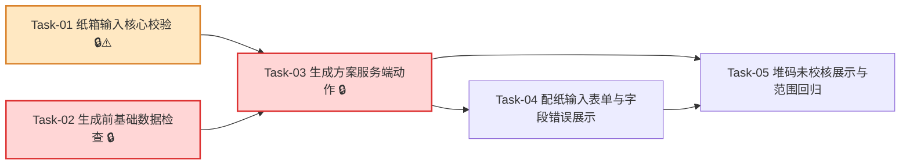

# 纸箱输入校验 — 开发任务计划

## 1. 任务概览

**总任务数**：5 个  
**预计总工时**：450 分钟（约 7.5 小时）  
**开发方法**：TDD — 每个任务按 RED → GREEN → REFACTOR 循环执行

**关键标注**：
- 🔒 阻塞任务：被多个任务依赖，建议优先完成
- ⚠️ 风险任务：技术难度高，可能需要额外时间

### 依赖关系图

### 可并行任务组

| 并行组 | 任务 | 说明 |
|--------|------|------|
| 组 1 | Task-01, Task-02 | 纯输入校验和基础数据就绪检查互不依赖，可并行开发。 |
| 组 2 | Task-04, Task-05 | 服务端动作稳定后，表单交互和堆码结果展示可局部并行。 |

---

## 2. 开发任务

> 按垂直切片组织。每个阶段对应一个可独立验证的用户行为；纯业务校验作为最薄基础层，因为后续服务端动作和页面都依赖它。
>
> 每个任务按 TDD 循环执行：RED（根据验证标准写测试）→ GREEN（写最小实现通过测试）→ REFACTOR（重构）。测试不是独立任务。

### 阶段一：系统能判断纸箱输入是否合格

**阶段完成标准**：调用方传入纸箱输入后，系统能返回标准化输入，或一次性返回字段级错误；堆码层数未填写时返回“承重未校核”状态，填写时返回“承重参与判断”状态。

---

#### [x] Task-01: 纸箱输入核心校验 🔒⚠️

**通俗解释**：系统能看懂用户填的纸箱信息，知道哪些能用、哪些不合格，并指出具体错在哪个字段。

**做什么**：新增 `src/modules/box-spec/types.ts`、`src/modules/box-spec/constants.ts`、`src/modules/box-spec/validate-box-spec.ts`；实现 `validateBoxSpecInput`、`isStackingRequired`；更新 `src/modules/box-spec/README.md`，明确本模块只做输入校验，不做面积、强度、成本和推荐。

**涉及文件**：`src/modules/box-spec/types.ts`、`src/modules/box-spec/constants.ts`、`src/modules/box-spec/validate-box-spec.ts`、`src/modules/box-spec/README.md`、`tests/unit/box-spec/validate-box-spec.test.ts`

**参考**：技术方案 2、3、4、5、6、7、8、9 → AC-001, AC-002, AC-003, AC-004, AC-005, AC-006, AC-007, AC-008, AC-009, AC-012, AC-013, AC-014, AC-015, AC-016, AC-017, AC-018, AC-019, AC-020

**依赖**：无

**预估工时**：120 分钟

**验证标准**（TDD RED 阶段直接转化为测试用例）：
- [x] 传入 `{ lengthMm: 500, widthMm: 300, heightMm: 250, structureType: "0201", formingMethod: "glue", productType: "食品", productWeightKg: 10, arrangement: "single_row", productionQuantity: 1000 }` 且不填 `stackingLayers` → 返回 `ok: true`，`stackingRequirement.status = "not_required"`，`displayText = "未填写堆码层数，承重未校核"`。
- [x] 传入上述合法输入且 `stackingLayers: 5` → 返回 `ok: true`，`stackingRequirement.status = "required"`，`stackingLayers = 5`，`isStackingRequired(result.data) = true`。
- [x] 传入边界值 `lengthMm: 100`、`widthMm: 100`、`heightMm: 100`、`productWeightKg: 0.5`、`stackingLayers: 1`、`productionQuantity: 1` → 返回 `ok: true`。
- [x] 传入边界值 `lengthMm: 2000`、`widthMm: 1500`、`heightMm: 1500`、`productWeightKg: 100`、`stackingLayers: 30` → 返回 `ok: true`。
- [x] `lengthMm` 为空字符串，其他字段合法 → 返回 `ok: false`，`fieldErrors` 包含 `{ field: "lengthMm", message: "纸箱长度不能为空" }`。
- [x] `widthMm` 为空字符串，其他字段合法 → 返回 `fieldErrors` 包含 `field = "widthMm"`。
- [x] `heightMm` 为空字符串，其他字段合法 → 返回 `fieldErrors` 包含 `field = "heightMm"`。
- [x] `structureType` 为空字符串 → 返回 `fieldErrors` 包含 `field = "structureType"`。
- [x] `formingMethod` 为空字符串 → 返回 `fieldErrors` 包含 `field = "formingMethod"`。
- [x] `productType` 为空字符串 → 返回 `fieldErrors` 包含 `field = "productType"`。
- [x] `arrangement` 为空字符串 → 返回 `fieldErrors` 包含 `field = "arrangement"`。
- [x] `productionQuantity` 为空字符串 → 返回 `fieldErrors` 包含 `field = "productionQuantity"`。
- [x] `lengthMm: 99` → 返回 `fieldErrors` 包含“纸箱长度允许范围为 100-2000mm”。
- [x] `lengthMm: 2001` → 返回 `fieldErrors` 包含“纸箱长度允许范围为 100-2000mm”。
- [x] `widthMm: 99` 或 `widthMm: 1501` → 返回 `fieldErrors` 包含“纸箱宽度允许范围为 100-1500mm”。
- [x] `heightMm: 99` 或 `heightMm: 1501` → 返回 `fieldErrors` 包含“纸箱高度允许范围为 100-1500mm”。
- [x] `productWeightKg: 0.4` 或 `productWeightKg: 100.1` → 返回 `fieldErrors` 包含“内装物重量允许范围为 0.5-100kg”。
- [x] `productionQuantity: 0` 或负数 → 返回 `fieldErrors` 包含“生产数量必须大于 0”。
- [x] `productionQuantity: 10.5` → 返回 `fieldErrors` 包含“生产数量必须为整数”。
- [x] `stackingLayers` 不填 → 不返回堆码层数字段错误。
- [x] `stackingLayers: 0` 或 `stackingLayers: 31` → 返回 `fieldErrors` 包含“堆码层数允许范围为 1-30 层”。
- [x] `stackingLayers: 3.5` → 返回 `fieldErrors` 包含“堆码层数必须为整数”。
- [x] `lengthMm: 300`、`widthMm: 500` → 返回 `fieldErrors` 包含“纸箱长度必须大于或等于宽度”。
- [x] `lengthMm: 501`、`widthMm: 100` → 返回 `fieldErrors` 包含“纸箱长宽比例必须在 1.0-5.0 之间”。
- [x] `lengthMm: 500`、`widthMm: 100` → 返回 `ok: true`，长宽比例边界 5.0 被接受。
- [x] `BoxSpecInput` 类型和页面输入示例中不存在 `stackingHeight`、`stackingTotalHeight` 或堆码总高度字段。
- [x] `src/modules/box-spec/README.md` 说明：本模块不计算面积、强度、成本、推荐，不保留堆码总高度。

---

### 阶段二：用户点击生成时，系统能先检查基础数据是否具备

**阶段完成标准**：输入合法后，系统能继续检查纸厂、箱板纸、瓦纸和基础参数是否具备；缺少任意前置数据时，用户会被提示先维护数据。

---

#### [x] Task-02: 生成前基础数据检查 🔒

**通俗解释**：即使纸箱信息填对了，如果系统里还没有纸厂、原纸或基础参数，也会先提醒用户去维护数据。

**做什么**：新增基础数据就绪检查契约：`MatchingReadiness`、`MatchingReadinessRepository`；实现默认 Drizzle 仓储，检查启用纸厂、启用且完整的箱板纸、启用且完整的瓦纸和基础参数状态；新增 `src/modules/formulas/read-formula-parameter-status.ts` 的只读能力，不编辑参数、不改变公式口径。

**涉及文件**：`src/server/actions/matching-actions.ts`、`src/modules/formulas/read-formula-parameter-status.ts`、`tests/integration/matching/matching-actions.test.ts`

**参考**：技术方案 2、4、5、6、7、8、9 → AC-011, AC-020

**依赖**：无

**预估工时**：80 分钟

**验证标准**（TDD RED 阶段直接转化为测试用例）：
- [x] 注入 `readinessRepository` 返回 `{ hasPaperFactories: true, hasLinerPaper: true, hasCorrugatingPaper: true, hasFormulaParameters: true }` → 基础数据检查通过。
- [x] 注入 `readinessRepository` 返回 `hasPaperFactories: false`，其他为 true → 返回 `VALIDATION_ERROR`，message 为“请先维护纸厂、箱板纸、瓦纸和基础参数”，`details.fieldErrors[0].field = "baseData"`。
- [x] 注入 `readinessRepository` 返回 `hasLinerPaper: false` → 返回同一基础数据维护提示。
- [x] 注入 `readinessRepository` 返回 `hasCorrugatingPaper: false` → 返回同一基础数据维护提示。
- [x] 注入 `readinessRepository` 返回 `hasFormulaParameters: false` → 返回同一基础数据维护提示。
- [x] 默认仓储查询纸厂时，只把 `isActive = true` 的纸厂计入 `hasPaperFactories`。
- [x] 默认仓储查询箱板纸和瓦纸时，只把 `isActive = true` 且 `completenessStatus = "complete"` 的原纸计入就绪状态。
- [x] `read-formula-parameter-status.ts` 只提供“是否有可用基础参数”的读取结果，不新增公式编辑、参数编辑或公式计算函数。
- [x] 本任务不新增数据库表、不新增迁移文件、不新增真实业务样例。

---

### 阶段三：用户点击生成时，输入错误会被服务端稳定拦截

**阶段完成标准**：配纸页面提交到服务端后，系统先检查登录，再校验纸箱输入，再检查基础数据；任一失败都返回稳定的业务错误结构。

---

#### [x] Task-03: 生成方案服务端动作 🔒

**通俗解释**：用户点击“生成方案”后，系统会在后台重新检查一遍输入，防止错误数据进入后面的计算。

**做什么**：新增 `src/server/actions/matching-actions.ts` 的 `generateMatchingScheme`；复用 `requireAuthenticatedAction`、`validateBoxSpecInput` 和 `MatchingReadinessRepository`；成功时先返回标准化输入、`stackingIncluded`、`stackingDisplayText`，为后续面积/强度/成本/推荐接入保留稳定入口。

**涉及文件**：`src/server/actions/matching-actions.ts`、`tests/integration/matching/matching-actions.test.ts`

**参考**：技术方案 2、4、5、6、7、8、9 → AC-001, AC-002, AC-003, AC-005, AC-006, AC-007, AC-008, AC-009, AC-011, AC-018, AC-019

**依赖**：Task-01, Task-02

**预估工时**：90 分钟

**验证标准**（TDD RED 阶段直接转化为测试用例）：
- [x] 未登录调用 `generateMatchingScheme(validInput)` → 返回 `AUTH_REQUIRED`，不调用输入校验后的业务流程。
- [x] 已登录且输入合法、基础数据完整，未填写 `stackingLayers` → 返回 `ok: true`，`data.stackingIncluded = false`，`data.stackingDisplayText = "未填写堆码层数，承重未校核"`。
- [x] 已登录且输入合法、基础数据完整，填写 `stackingLayers: 6` → 返回 `ok: true`，`data.stackingIncluded = true`，`data.boxSpec.stackingRequirement.stackingLayers = 6`。
- [x] 已登录但 `lengthMm` 为空 → 返回 `VALIDATION_ERROR`，message 为“请检查纸箱输入”，`details.fieldErrors` 包含 `field = "lengthMm"`。
- [x] 已登录但 `lengthMm: 300`、`widthMm: 500` → 返回 `VALIDATION_ERROR`，`details.fieldErrors` 包含“纸箱长度必须大于或等于宽度”。
- [x] 已登录但 `stackingLayers: 31` → 返回 `VALIDATION_ERROR`，`details.fieldErrors` 包含“堆码层数允许范围为 1-30 层”。
- [x] 已登录且输入合法但基础数据缺失 → 返回 `VALIDATION_ERROR`，message 为“请先维护纸厂、箱板纸、瓦纸和基础参数”。
- [x] 输入非法时，不调用 `readinessRepository.getMatchingReadiness()`，避免无意义数据查询。
- [x] 基础数据缺失时，不返回内部数据库错误、SQL、堆栈或连接信息。
- [x] `generateMatchingScheme` 返回类型使用项目统一 `ActionResult`。

---

### 阶段四：用户可以在页面填写纸箱信息并看到字段错误

**阶段完成标准**：用户打开单次配纸页面后，可以填写本次范围内的纸箱输入；页面不出现堆码总高度；提交后字段错误能定位到表单项。

---

#### [x] Task-04: 配纸输入表单与字段错误展示

**通俗解释**：用户能在页面上填纸箱信息；填错时，页面会把错误提示放到对应输入框旁边。

**做什么**：将 `src/app/(main)/matching/page.tsx` 从占位页升级为输入表单入口；新增 `src/app/(main)/matching/_components/box-spec-form.tsx`；使用 Ant Design 表单展示纸箱参数、产品信息、生产数量和可选堆码层数；提交时调用 `generateMatchingScheme`；把 `details.fieldErrors` 显示到对应表单字段。

**涉及文件**：`src/app/(main)/matching/page.tsx`、`src/app/(main)/matching/_components/box-spec-form.tsx`、必要时 `src/app/(main)/matching/matching.module.css`、`tests/integration/matching/matching-page.test.tsx`

**参考**：技术方案 2、5、6、8、9 → AC-001, AC-002, AC-004, AC-005, AC-006, AC-007, AC-008, AC-009, AC-017, AC-018

**依赖**：Task-03

**预估工时**：105 分钟

**验证标准**（TDD RED 阶段直接转化为测试用例）：
- [x] 渲染 `/matching` 页面 → 页面包含纸箱长度、纸箱宽度、纸箱高度、纸箱结构类型、成箱方式、产品类型、内装物重量、排列方式、生产数量、堆码层数输入项。
- [x] 渲染 `/matching` 页面 → 页面不包含“堆码总高度”输入项，也不存在名为 `stackingHeight` 或 `stackingTotalHeight` 的表单字段。
- [x] 堆码层数输入项不是必填；不填写堆码层数且其他必填字段合法时，点击生成方案会调用 `generateMatchingScheme`。
- [x] 页面提交后收到 `fieldErrors: [{ field: "lengthMm", message: "纸箱长度不能为空" }]` → 纸箱长度输入项显示“纸箱长度不能为空”。
- [x] 页面提交后收到 `fieldErrors: [{ field: "widthMm", message: "纸箱宽度允许范围为 100-1500mm" }]` → 纸箱宽度输入项显示对应提示。
- [x] 页面提交后收到 `fieldErrors: [{ field: "stackingLayers", message: "堆码层数允许范围为 1-30 层" }]` → 堆码层数输入项显示对应提示。
- [x] 页面提交后收到 `fieldErrors: [{ field: "baseData", message: "请先维护纸厂、箱板纸、瓦纸和基础参数" }]` → 页面显示基础数据维护提示，不定位到不存在的输入框。
- [x] 页面字段使用业务单位文案：长度/宽度/高度为 mm，内装物重量为 kg，生产数量为个，堆码层数为层。
- [x] 页面组件中不实现尺寸范围、长宽比例或堆码范围的核心判断；这些规则来自 `box-spec` 或服务端返回。

---

### 阶段五：用户能看清堆码是否参与本次判断，且功能不越界

**阶段完成标准**：未填写堆码层数时，系统保留“承重未校核”状态，不会出现承重达标/不达标；填写堆码层数时，系统把承重参与状态传给后续流程。本功能不引入范围外能力。

---

#### [x] Task-05: 堆码未校核展示与范围回归

**通俗解释**：系统仍知道这次方案有没有把堆码承重算进去；没有填写堆码时，系统不会乱说达标或不达标。

**做什么**：服务端返回 `stackingDisplayText` 和 `stackingIncluded` 供后续流程判断；页面生成结果摘要不展示堆码承重状态，不显示承重达标或不达标标签；补充范围回归检查，确认不新增堆码总高度、摇盖专项、戳穿、吸潮、批量配纸或新依赖。

**涉及文件**：`src/app/(main)/matching/page.tsx`、`src/app/(main)/matching/_components/box-spec-form.tsx`、`src/modules/box-spec/README.md`、`tests/integration/matching/matching-page.test.tsx`、`tests/unit/box-spec/validate-box-spec.test.ts`

**参考**：技术方案 2、3、5、6、7、8、9 → AC-003, AC-004, AC-010, AC-017, AC-018, AC-019, AC-020

**依赖**：Task-03, Task-04

**预估工时**：55 分钟

**验证标准**（TDD RED 阶段直接转化为测试用例）：
- [x] 页面提交成功且服务端返回 `stackingIncluded = false`、`stackingDisplayText = "未填写堆码层数，承重未校核"` → 页面不显示堆码承重摘要。
- [x] 页面提交成功且 `stackingIncluded = false` → 页面不显示“承重达标”“承重不达标”“堆码达标”“堆码不达标”等结论。
- [x] 页面提交成功且服务端返回 `stackingIncluded = true`、`boxSpec.stackingRequirement.stackingLayers = 5` → 页面不显示堆码承重摘要，状态继续传给后续流程。
- [x] `validateBoxSpecInput(validInputWithoutStacking)` → 输出 `stackingRequirement.status = "not_required"`，供后续推荐排序排除承重因素。
- [x] `validateBoxSpecInput(validInputWithStacking)` → 输出 `stackingRequirement.status = "required"`，供后续强度/推荐模块标记承重不达标。
- [x] 检查 `src/app/(main)/matching` 源码 → 不存在堆码总高度输入字段。
- [x] 检查本次变更文件列表 → 不新增摇盖类型选择、摇盖专项校验、戳穿强度、吸潮变形、批量配纸相关文件。
- [x] 检查 `package.json` 和锁文件 → 本功能不新增第三方依赖。
- [x] 检查页面和模块源码 → 不包含面积、强度、成本或推荐公式实现。

---

## 3. AC 覆盖总表

| AC 编号 | 验收标准概述 | 承接任务 | 验证方式 |
|---------|--------------|----------|----------|
| AC-001 | 完整合法输入可生成方案 | Task-01, Task-03, Task-04 | 合法输入调用 `validateBoxSpecInput` 和 `generateMatchingScheme` 返回成功；页面可提交 |
| AC-002 | 未填写堆码层数也可生成方案 | Task-01, Task-03, Task-04 | 不填 `stackingLayers` 时返回成功，`stackingIncluded = false` |
| AC-003 | 填写堆码层数后纳入承重判断 | Task-01, Task-03, Task-05 | 填 `stackingLayers: 5` 后返回 `required` 和 `stackingIncluded = true` |
| AC-004 | 未填写堆码层数时承重未校核 | Task-01, Task-04, Task-05 | 标准化输出保留“承重未校核”，页面不显示达标/不达标 |
| AC-005 | 必填字段为空 | Task-01, Task-03, Task-04 | 空必填字段返回 `fieldErrors`，页面定位到对应字段 |
| AC-006 | 数值字段超出允许范围 | Task-01, Task-03, Task-04 | 超出范围的尺寸、重量、数量返回字段级范围提示 |
| AC-007 | 纸箱长度小于宽度 | Task-01, Task-03, Task-04 | `lengthMm < widthMm` 返回“纸箱长度必须大于或等于宽度” |
| AC-008 | 长宽比例不合理 | Task-01, Task-03, Task-04 | `L/W > 5.0` 或 `< 1.0` 返回比例错误 |
| AC-009 | 堆码层数超出允许范围 | Task-01, Task-03, Task-04 | `stackingLayers: 31` 返回堆码范围错误 |
| AC-010 | 填写堆码层数后承重不达标 | Task-01, Task-05 | 本功能输出 `required` 状态；后续强度/推荐模块据此标记承重不达标 |
| AC-011 | 基础数据缺失 | Task-02, Task-03, Task-04 | 基础数据缺失时 `generateMatchingScheme` 返回维护提示 |
| AC-012 | 边界值按合法输入处理 | Task-01 | 100/2000mm、0.5/100kg、1/30层等边界输入返回成功 |
| AC-013 | 纸箱尺寸范围 | Task-01 | 尺寸范围常量和校验测试覆盖长度、宽度、高度 |
| AC-014 | 内装物重量范围 | Task-01 | 0.5-100kg 范围测试覆盖 |
| AC-015 | 堆码层数范围 | Task-01 | 1-30 层范围测试覆盖 |
| AC-016 | 生产数量要求 | Task-01 | 生产数量为正整数，0、负数、小数均返回错误 |
| AC-017 | 堆码总高度不保留 | Task-01, Task-04, Task-05 | 类型、页面和源码检查均不包含堆码总高度 |
| AC-018 | 未填写堆码层数不参与承重判断 | Task-01, Task-03, Task-05 | `not_required` 状态保留，页面不显示承重结论，后续排序不应纳入承重 |
| AC-019 | 填写堆码层数必须参与承重判断 | Task-01, Task-03, Task-05 | `required` 状态，后续强度/推荐必须读取该状态 |
| AC-020 | 本功能不扩大范围 | Task-01, Task-02, Task-05 | 不新增 DB 表、依赖、摇盖专项、戳穿、吸潮、批量配纸或核心计算 |

---

## 4. Mock 与接口闭环

本功能不使用运行时 Mock 接口。

`readinessRepository` 是测试注入点，不是产品运行时 Mock。默认实现必须读取现有纸厂、原纸和基础参数状态；测试中注入假仓储只用于覆盖基础数据完整/缺失场景。→ Task-02, Task-03, AC-011

---

## 5. 完成定义

- [x] Task-01 到 Task-05 的验证标准均已按 TDD 执行并通过。
- [x] `pnpm vitest run tests/unit/box-spec/validate-box-spec.test.ts` 通过，覆盖尺寸、重量、生产数量、堆码层数、边界值和尺寸合理性。
- [x] `pnpm vitest run tests/integration/matching/matching-actions.test.ts tests/unit/formulas/read-formula-parameter-status.test.ts` 通过，覆盖生成前基础数据检查和基础参数只读状态。
- [x] `pnpm vitest run tests/integration/matching/matching-actions.test.ts` 通过，覆盖服务端动作登录检查、字段错误和基础数据缺失。
- [x] `pnpm vitest run tests/integration/matching/matching-page.test.tsx` 通过，覆盖页面字段、错误展示、无堆码总高度和不显示承重结论。
- [x] `pnpm typecheck` 通过，确认 `BoxSpecInput`、`NormalizedBoxSpec`、`MatchingReadinessRepository` 等类型在 strict 配置下可用。
- [x] `pnpm lint` 通过，确认导入顺序、命名和未使用变量符合规范。
- [x] 检查页面代码没有承载面积、强度、成本或推荐公式。
- [x] 检查本功能未新增数据库表、迁移、真实业务样例、真实敏感数据或第三方依赖。

---

## 附录：变更记录

| 日期 | 变更内容 | 原因 |
|------|----------|------|
| 2026-07-01 | 初始版本 | 根据“纸箱输入校验”需求文档和技术方案拆分 TDD 开发任务 |
