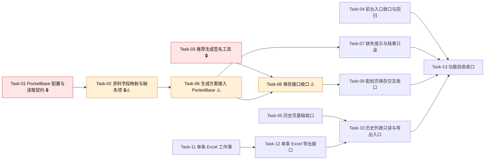

# 配纸工具纯配纸重构 — 开发任务计划

## 1. 任务概览

**总任务数**：13 个
**预计总工时**：1980 分钟（约 33 小时）
**开发方法**：TDD — 每个任务按 RED → GREEN → REFACTOR 循环执行

**关键标注**：
- 🔒 阻塞任务：被多个任务依赖，建议优先完成
- ⚠️ 风险任务：技术难度高，可能需要额外时间

### 依赖关系图

### 可并行任务组

| 并行组 | 任务 | 说明 |
|--------|------|------|
| A | Task-01, Task-03, Task-04, Task-05, Task-11 | 资料源、签名、入口、历史页、Excel 工作簿互不依赖 |
| B | Task-07, Task-09, Task-12 | 缺失提示 UI、保存交互、Excel 接口在各自前置完成后可并行 |
| 收口 | Task-13 | Task-13 依赖 Task-04、Task-07、Task-09、Task-10、Task-12 完成后执行，不作为并行任务 |

---

## 2. 开发任务

> 按垂直切片组织。每个阶段对应一个可独立运行和验证的用户行为（加可选的基础设施层）。
>
> 每个任务按 TDD 循环执行：RED（根据验证标准写测试）→ GREEN（写最小实现通过测试）→ REFACTOR（重构）

### 基础设施：服务端能安全读取配纸资料并校验保存来源

**阶段完成标准**：后续生成方案和确认保存有统一资料来源、缺失项结构和推荐来源校验能力。

---

#### Task-01: PocketBase 配置与只读读取契约 🔒

**通俗解释**：系统知道去哪里读取后端资料库，并且不会把连接信息暴露给用户浏览器。

**做什么**：新增 PocketBase 服务端配置读取和基础 fetch 客户端，不引入新依赖；配置缺失时返回业务错误；同步 `.env.example` 占位。

**涉及文件**：`src/modules/master-data/pocketbase-config.ts`、`src/modules/master-data/pocketbase-client.ts`、`.env.example`、`tests/unit/master-data/pocketbase-config.test.ts`

**参考**：技术方案 5.1、8 → AC-008, AC-009, AC-017

**依赖**：无

**预估工时**：90 分钟

**验证标准**：
- [ ] 输入包含 `POCKETBASE_URL="https://pb.example.com"`、集合名和只读凭证时，配置读取返回 `ok: true`，且 URL 末尾多余 `/` 被规范化。
- [ ] 输入缺少 `POCKETBASE_URL` 时，返回 `ok: false`，`error.code = "VALIDATION_ERROR"`，`message` 不包含真实环境变量值。
- [ ] 输入缺少纸张集合名时，返回 `ok: false`，错误详情能指出缺少 `POCKETBASE_PAPER_MATERIALS_COLLECTION`。
- [ ] `.env.example` 包含 PocketBase 相关空占位，且没有真实地址、账号、密码或 Token。

---

#### Task-02: PocketBase 原纸和参数资料映射与缺失项归一化 🔒⚠️

**通俗解释**：后端资料库里哪张纸、哪个参数缺东西，系统能说清楚缺什么。

**做什么**：新增 PocketBase 资料读取适配，实现 `ListRecommendablePaperMaterialsRepository`；新增 `MatchingDataMissingItem` 结构和缺失项收集函数；不完整资料不进入正式推荐。

**涉及文件**：`src/modules/master-data/pocketbase-recommendable-paper-materials.ts`、`src/modules/master-data/pocketbase-matching-readiness.ts`、`src/modules/master-data/list-recommendable-paper-materials.ts`、`tests/unit/master-data/pocketbase-readiness.test.ts`

**参考**：技术方案 5.1、6、8 → AC-002, AC-008, AC-009, AC-017

**依赖**：Task-01

**预估工时**：180 分钟

**验证标准**：
- [ ] PocketBase 返回一条启用且字段完整的箱板纸记录时，映射结果包含 `paperKind="linerboard"`、`gramWeightGsm`、`priceYuanPerTon`、`burstIndex`、`ringCrushIndex`、`applicableFlutes`。
- [ ] PocketBase 返回一条启用瓦纸但缺少 `priceYuanPerTon` 和 `ringCrushIndex` 时，缺失清单包含两条 `scope="paper_material"`，且 message 分别指出纸价和横向环压指数缺失。
- [ ] PocketBase 返回基础参数缺少瓦楞系数时，缺失清单包含 `scope="formula_parameter"`、`field="corrugationFactor"`。
- [ ] PocketBase 返回停用原纸时，该原纸不进入推荐材料列表，且不作为缺失资料阻断生成。
- [ ] 字段类型异常（如克重为非数字字符串）时，缺失清单指出具体字段异常，不抛出原始异常。

---

#### Task-03: 推荐生成签名工具 🔒

**通俗解释**：用户保存的方案必须能证明是刚刚由系统生成的，而不是手工拼出来的。

**做什么**：新增生成签名与校验工具，签名内容包含规范化纸箱输入、推荐槽位策略和候选指纹；使用服务端密钥或会话密钥派生，不暴露签名原料。

**涉及文件**：`src/modules/recommendation/generation-token.ts`、`src/server/actions/matching-actions.ts`、`tests/unit/recommendation/generation-token.test.ts`

**参考**：技术方案 5.2、5.3、7、8 → AC-014, AC-015

**依赖**：无

**预估工时**：120 分钟

**验证标准**：
- [ ] 同一规范化纸箱输入和同一组三套推荐槽位生成的 token，两次校验均返回有效。
- [ ] 修改 `selectedStrategy` 对应候选指纹后，token 校验返回无效。
- [ ] 修改纸箱长度从 `300` 到 `301` 后，旧 token 校验返回无效。
- [ ] token 为空字符串时，校验返回 `ok: false`，错误文案为“请重新生成方案后保存”。

---

### 进入纯配纸工具

**阶段完成标准**：用户进入系统后，只能看到配纸和历史方案相关入口，看不到数据维护、历史订单、历史习惯或备份导出入口。

---

#### Task-04: 前台入口收口与回归

**通俗解释**：用户打开工具后，只看到配纸和历史方案两个主要入口，找不到资料维护入口。

**做什么**：更新主布局文案和导航，移除“数据管理”，增加或保留“历史方案”；补充前台入口回归测试，覆盖主导航、配纸页、历史页，确认没有链接到数据维护或备份导出。

**涉及文件**：`src/app/(main)/layout.tsx`、`tests/integration/auth/main-layout-auth.test.tsx`、`tests/integration/matching/matching-page.test.tsx`、`tests/integration/matching/history-page.test.tsx`

**参考**：技术方案 5.4、6、10 → AC-001, AC-007, AC-013

**依赖**：无

**预估工时**：120 分钟

**验证标准**：
- [ ] 渲染主布局时，页面出现“配纸”和“历史方案”链接。
- [ ] 渲染主布局时，页面不出现“数据管理”链接和“数据管理 · 需登录”文案。
- [ ] 品牌副标题不包含“数据管理”。
- [ ] 主导航、配纸页、历史页均不出现“纸厂”“原纸”“纸价”“基础参数”“导入建库”“原纸代码映射”“导出备份”。
- [ ] 查询页面所有链接时，不存在 href 指向 `/master-data` 或 `/api/exports/matching-schemes/backup`。

---

#### Task-05: 历史页基础收口

**通俗解释**：历史页只看已保存的配纸方案，不再夹带导入订单、习惯摘要或备份资料的功能。

**做什么**：移除 `HistoricalOrderImportPanel`、历史习惯摘要区、全部方案备份导出链接；历史页标题和说明只描述最近 50 条确认方案；调整不再适用的历史订单页面测试期望。

**涉及文件**：`src/app/(main)/history/page.tsx`、`src/app/(main)/history/history.module.css`、`tests/integration/matching/history-page.test.tsx`、`tests/integration/historical-orders/habit-summary-page.test.tsx`、`tests/integration/historical-orders/historical-order-import-page.test.tsx`

**参考**：技术方案 5.4、6 → AC-004, AC-007, AC-011, AC-013

**依赖**：无

**预估工时**：120 分钟

**验证标准**：
- [ ] 历史页有 1 条历史方案时，页面显示“历史方案”和当前条数。
- [ ] 历史页不显示“历史配纸习惯摘要”。
- [ ] 历史页不显示历史订单导入上传入口。
- [ ] 历史页不显示“导出全部配纸方案”链接。
- [ ] 旧历史订单页面相关测试不再期待历史页承载订单导入或习惯摘要。

---

### 生成方案并看到缺失资料

**阶段完成标准**：用户填写纸箱参数后，资料完整时能生成三套方案；资料不完整时能看到具体缺少哪张纸或哪类参数。

---

#### Task-06: 生成方案默认使用 PocketBase 资料源 ⚠️

**通俗解释**：用户点生成方案时，系统从后端资料库读取纸张和参数来计算。

**做什么**：调整 `generateMatchingScheme` 的默认仓储上下文，使用 PocketBase readiness 和推荐材料仓储；保留测试注入仓储能力；历史习惯上下文默认不可用，不再参与本轮推荐。

**涉及文件**：`src/server/actions/matching-actions.ts`、`src/server/actions/matching-readiness.ts`、`tests/integration/matching/matching-actions.test.ts`

**参考**：技术方案 4、5.2、6 → AC-002, AC-008, AC-009, AC-014, AC-017

**依赖**：Task-02

**预估工时**：180 分钟

**验证标准**：
- [ ] 注入完整 PocketBase 仓储数据，调用 `generateMatchingScheme(validBoxSpec)` 返回 `ok: true`，且 `recommendationSlots.length = 3`。
- [ ] 注入缺少箱板纸纸价的数据，调用生成返回 `ok: false`，`error.details.missingItems[0].scope = "paper_material"`。
- [ ] 注入缺少基础参数的数据，调用生成返回 `ok: false`，`error.details.missingItems` 包含 `scope="formula_parameter"`。
- [ ] 未提供历史习惯数据时，生成结果不因历史习惯缺失失败。
- [ ] 返回成功结果包含非空 `generationToken`。

---

#### Task-07: 配纸页缺失提示与结果只读

**通俗解释**：如果不能生成方案，页面会告诉用户具体去后端补哪项资料；如果能生成，结果只能查看不能编辑。

**做什么**：更新配纸页错误展示逻辑，识别 `error.details.missingItems` 并分组展示；补充结果区域只读测试，确认成本、强度、达标、可生产、推荐理由都是展示元素，不是输入控件。

**涉及文件**：`src/app/(main)/matching/_components/box-spec-form.tsx`、`src/app/(main)/matching/matching.module.css`、`tests/integration/matching/matching-page.test.tsx`

**参考**：技术方案 4、5.1、5.4、10 → AC-002, AC-008, AC-009, AC-017, AC-018

**依赖**：Task-06

**预估工时**：150 分钟

**验证标准**：
- [ ] Server Action 返回两条原纸缺失项时，页面显示两条具体缺失文案。
- [ ] Server Action 返回基础参数缺失项时，页面显示参数类别文案，例如“瓦楞系数缺失”。
- [ ] 缺失资料提示区域不包含“新增”“编辑”“导入”“维护”等前台操作入口。
- [ ] 生成方案成功后，页面显示成本、耐破、边压、空箱抗压、达标状态、可生产状态和推荐理由。
- [ ] 方案结果区域不存在可编辑的成本、强度或推荐理由输入框。

---

### 确认保存系统推荐方案

**阶段完成标准**：用户只能从三套系统推荐中选择一套保存；不能手动调整，也不能绕过推荐来源校验。

---

#### Task-08: 保存接口只接受系统推荐槽位 ⚠️

**通俗解释**：系统只保存用户从三套推荐里点选的那一套。

**做什么**：调整 `SaveConfirmedMatchingSchemeInput`，删除 `baseCandidate`、`adjustments`、`clientState`；保存时用 `selectedStrategy` 和 `generationToken` 定位推荐槽位并重新校验候选。

**涉及文件**：`src/server/actions/matching-actions.ts`、`src/modules/scheme-adjustment/create-history-snapshot.ts`、`tests/integration/matching/matching-actions.test.ts`、`tests/integration/matching/matching-scheme-history.test.ts`

**参考**：技术方案 4、5.3、6、7 → AC-003, AC-014, AC-015

**依赖**：Task-03, Task-06

**预估工时**：210 分钟

**验证标准**：
- [ ] 传入有效 `selectedStrategy="economy"`、原始三槽位和有效 token，保存返回 `ok: true`，`isManuallyAdjusted = false`。
- [ ] 传入不存在的 `selectedStrategy`，保存返回 `ok: false`，message 为“请选择一套方案”或等价业务文案。
- [ ] 传入被篡改候选的三槽位和旧 token，保存返回 `ok: false`，message 为“请重新生成方案后保存”。
- [ ] 选中槽位状态不是正式推荐或最终重新计算不达标时，保存返回 `ok: false`，message 为“当前方案未达标或不可生产，无法确认保存”。
- [ ] 保存成功后数据库历史记录只新增一条最终方案。

---

#### Task-09: 配纸页确认保存交互收口

**通俗解释**：用户选一套推荐后点保存，保存成功后能看到记录编号，而且不会再看到改纸张或重新校核的入口。

**做什么**：移除配纸页手动调整控件、重新校核按钮、待重新校核状态和调整后保存逻辑；更新保存调用参数，使用 `selectedStrategy` 和 `generationToken`；保存成功后保留记录编号、保存时间和导出入口。

**涉及文件**：`src/app/(main)/matching/_components/box-spec-form.tsx`、`src/app/(main)/matching/matching.module.css`、`tests/integration/matching/matching-page.test.tsx`

**参考**：技术方案 5.3、5.4、6 → AC-003, AC-010, AC-014, AC-015, AC-018

**依赖**：Task-08

**预估工时**：210 分钟

**验证标准**：
- [ ] 生成方案成功后，页面不出现“重新校核”按钮和“待重新校核”文案。
- [ ] 生成方案成功后，页面不出现瓦型、层数、纸厂、面纸、里纸、芯纸或瓦纸克重的调整控件。
- [ ] 用户生成三套方案后选择经济型并点击确认保存，保存 action 收到 `selectedStrategy="economy"` 和非空 `generationToken`。
- [ ] 保存成功后页面显示记录编号和保存时间，且不显示“用户已手动调整”。
- [ ] 未选择方案时点击确认保存，页面显示请选择方案的提示。

---

### 查看历史方案并导出单条文件

**阶段完成标准**：用户能在历史页查看已保存方案，只能执行查看、PDF 导出和 Excel 导出，不可删除、编辑或重新生成。

---

#### Task-10: 历史列表只读与单条导出入口

**通俗解释**：历史记录只能查看和导出，不能改、删或重新算；卡片上直接提供 PDF 和 Excel。

**做什么**：整理历史页卡片操作，保留 PDF 导出链接，接入单条 Excel 导出链接；导出记录展示支持 `scheme_excel` 标签；不展示删除、编辑、重新生成、全部备份。

**涉及文件**：`src/app/(main)/history/page.tsx`、`src/app/(main)/history/history.module.css`、`src/modules/import-export/matching-scheme-export-types.ts`、`tests/integration/matching/history-page.test.tsx`

**参考**：技术方案 5.4、5.5、6 → AC-004, AC-005, AC-006, AC-011, AC-016

**依赖**：Task-05, Task-12

**预估工时**：150 分钟

**验证标准**：
- [ ] 历史页有一条达标记录时，页面显示完整报告 PDF、精简方案表 PDF 和 Excel 导出链接。
- [ ] Excel 链接 href 指向 `/api/exports/matching-schemes/{schemeId}/excel`。
- [ ] 导出记录中 `type="scheme_excel"` 显示为“Excel”或等价业务标签。
- [ ] 历史页不显示“删除”“编辑”“重新生成”“导出全部配纸方案”。
- [ ] 历史页空列表时显示“暂无历史方案”。

---

#### Task-11: 单条历史方案 Excel 工作簿

**通俗解释**：每条历史方案都能整理成一个 Excel 文件。

**做什么**：新增单条方案 Excel 构建器，复用 ExcelJS，输出方案总览、原始三套推荐、最终确认方案、导出记录四个 sheet。

**涉及文件**：`src/modules/import-export/build-matching-scheme-workbook.ts`、`tests/unit/import-export/matching-scheme-workbook.test.ts`

**参考**：技术方案 5.5、6 → AC-006, AC-016

**依赖**：无

**预估工时**：150 分钟

**验证标准**：
- [ ] 输入一条历史方案记录，生成的 workbook 文件名以 `.xlsx` 结尾。
- [ ] workbook 包含 `方案总览`、`原始三套推荐`、`最终确认方案`、`导出记录` 四个 sheet。
- [ ] `方案总览` 包含记录编号、保存时间、纸箱尺寸、生产数量和最终状态。
- [ ] `最终确认方案` 包含层数、瓦型、纸张组合、强度和达标/可生产状态。
- [ ] workbook 不以 CSV 字符串形式返回。

---

#### Task-12: 单条历史方案 Excel 导出接口

**通俗解释**：用户点击导出 Excel 后，浏览器会下载当前这条方案的 Excel 文件。

**做什么**：新增 `/api/exports/matching-schemes/[schemeId]/excel` route，读取单条历史方案，生成 Excel，成功后追加 `scheme_excel` 导出记录，失败不修改记录。

**涉及文件**：`src/app/api/exports/matching-schemes/[schemeId]/excel/route.ts`、`src/modules/import-export/matching-scheme-export-types.ts`、`src/server/actions/matching-scheme-history.ts`、`tests/integration/import-export/matching-scheme-excel-route.test.ts`

**参考**：技术方案 4、5.5、6 → AC-006, AC-012, AC-016

**依赖**：Task-11

**预估工时**：150 分钟

**验证标准**：
- [ ] 已登录且方案存在时，GET Excel route 返回 200，`Content-Type` 为 Excel MIME。
- [ ] 成功导出后，历史记录追加一条 `type="scheme_excel"` 的导出记录。
- [ ] 方案不存在时返回 404，body.message 为“方案记录不存在”。
- [ ] workbook 构建函数抛错时返回 500，body.message 为“导出失败，请稍后重试”，且不追加导出记录。

---

### 功能验收收口

**阶段完成标准**：所有重构行为串起来后，工具表现为纯配纸工作台。

---

#### Task-13: 重构验收回归与旧能力隔离

**通俗解释**：最后确认整个工具已经变成纯配纸工具，没有旧功能悄悄露出来，PDF 和 Excel 导出都能按预期工作。

**做什么**：补充跨页面回归测试，覆盖完整主流程、旧入口隔离、PDF 导出失败提示；清理或调整不再适用的旧测试期望。

**涉及文件**：`tests/integration/matching/matching-page.test.tsx`、`tests/integration/matching/history-page.test.tsx`、`tests/integration/auth/protected-layout.test.tsx`、`tests/integration/import-export/matching-scheme-pdf-route.test.ts`、相关不再适用的 master-data/historical-orders 页面测试

**参考**：技术方案 4、9、10 → AC-001 至 AC-018

**依赖**：Task-04, Task-07, Task-09, Task-10, Task-12

**预估工时**：150 分钟

**验证标准**：
- [ ] 从配纸页生成方案、选择一套、确认保存、进入历史页查看，该流程全部成功。
- [ ] 主应用前台不出现数据维护、历史订单、历史习惯、全部备份导出的入口。
- [ ] 方案生成资料缺失时，页面显示具体缺失项，并且不出现前台补录入口。
- [ ] 保存后的历史方案提供 PDF 和 Excel 导出，不提供删除、编辑、重新生成。
- [ ] PDF 生成函数抛错时返回 500，body.message 为“导出失败，请稍后重试”，且不追加导出记录。
- [ ] `pnpm typecheck`、`pnpm lint`、相关 Vitest 测试通过。

---

## 3. AC 覆盖总表

| AC 编号 | 验收标准概述 | 承接任务 | 验证方式 |
|---------|-------------|---------|---------|
| AC-001 | 进入工具只展示配纸、历史和导出相关功能 | Task-04, Task-13 | 主布局和跨页面测试确认无数据维护入口 |
| AC-002 | 资料完整时生成三套方案 | Task-06, Task-07, Task-13 | `generateMatchingScheme` 集成测试和页面结果只读测试 |
| AC-003 | 选择并确认保存最终方案 | Task-08, Task-09, Task-13 | 保存 action 测试和配纸页保存交互测试 |
| AC-004 | 查看历史方案 | Task-05, Task-10, Task-13 | 历史页列表和卡片展示测试 |
| AC-005 | 导出 PDF | Task-10, Task-13 | PDF route 成功和历史页 PDF 链接测试 |
| AC-006 | 导出 Excel | Task-10, Task-11, Task-12 | 单条 workbook、Excel route、历史页链接测试 |
| AC-007 | 数据维护入口全部移除 | Task-04, Task-05, Task-13 | 前台链接和文案回归测试 |
| AC-008 | 原纸资料缺失时提示具体项 | Task-02, Task-06, Task-07 | PocketBase readiness 单元测试和配纸页缺失提示测试 |
| AC-009 | 基础参数缺失时提示具体类别 | Task-02, Task-06, Task-07 | 参数缺失单元测试和配纸页缺失提示测试 |
| AC-010 | 不支持手动调整方案 | Task-09, Task-13 | 配纸页无调整控件、保存输入无 adjustments |
| AC-011 | 历史方案不可删除编辑或重新生成 | Task-05, Task-10 | 历史页操作区测试 |
| AC-012 | 导出失败提示 | Task-12, Task-13 | Excel/PDF route 失败测试，确认不追加导出记录 |
| AC-013 | 前台只保留配纸能力 | Task-04, Task-13 | 主导航和跨页面入口回归测试 |
| AC-014 | 最终方案必须来自系统推荐 | Task-03, Task-08, Task-09 | token 篡改测试、保存 action 校验测试 |
| AC-015 | 一次只保存一套最终方案 | Task-08, Task-09 | 保存 action 只写入一条历史记录 |
| AC-016 | 表格导出必须为 Excel | Task-10, Task-11, Task-12 | Excel MIME、xlsx 文件名、非 CSV 工作簿测试 |
| AC-017 | 缺失资料提示不可笼统 | Task-02, Task-06, Task-07 | missingItems 结构化断言和页面具体文案断言 |
| AC-018 | 计算结果不可手动编辑 | Task-07, Task-09, Task-13 | 结果区域无可编辑控件，保存快照来自服务端计算 |

---

## 4. 完成定义

- [ ] Task-01 至 Task-13 的验证标准对应测试全部通过。
- [ ] AC-001 至 AC-018 的承接任务均完成，AC 覆盖总表中的验证方式均执行通过。
- [ ] 使用 `pnpm typecheck` 验证类型无误。
- [ ] 使用 `pnpm lint` 验证代码规范无误。
- [ ] 运行相关测试：`pnpm test -- tests/unit/master-data/list-recommendable-paper-materials.test.ts tests/unit/recommendation/generation-token.test.ts tests/unit/import-export/matching-scheme-workbook.test.ts tests/integration/matching/matching-actions.test.ts tests/integration/matching/matching-page.test.tsx tests/integration/matching/history-page.test.tsx tests/integration/import-export/matching-scheme-excel-route.test.ts tests/integration/import-export/matching-scheme-pdf-route.test.ts`。
- [ ] `.env.example` 只保留脱敏 `DATABASE_URL` 示例，不包含真实地址、账号、密码、Token 或业务敏感数据，也不再包含仓库后台 API 配置。
- [ ] 前台页面人工检查不出现数据维护、历史订单导入、历史习惯摘要、全部方案备份、手动调整、重新校核入口。

---

## 5. 增量变更

| 日期 | 变更 | 任务规划 |
|------|------|----------|
| 2026-07-24 | CR-001：接入原纸管理后台，仅使用 `in_stock` 库存，车间余料暂不参与 | `配纸工具纯配纸重构_变更任务_CR-001.md`（Task-14 至 Task-17） |
| 2026-09-07 | CR-002：资料源切回 PostgreSQL/Drizzle，停止使用仓库后台 API | `配纸工具纯配纸重构_变更任务_CR-002.md`（Task-18 至 Task-20） |
| 2026-09-07 | CR-003：直接使用 `paper_warehouse` 在库卷纸，恢复公司强度标准和等级规则 | `配纸工具纯配纸重构_变更任务_CR-003.md`（Task-21 至 Task-24） |
