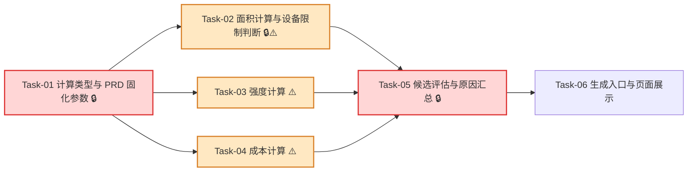

# 配纸确定性计算 — 开发任务计划

## 1. 任务概览

**总任务数**：6 个  
**预计总工时**：840 分钟（约 14 小时）  
**开发方法**：TDD — 每个任务按 RED → GREEN → REFACTOR 循环执行

**关键标注**：
- 🔒 阻塞任务：被多个任务依赖，建议优先完成
- ⚠️ 风险任务：技术难度高，可能需要额外时间

### 依赖关系图

### 可并行任务组

| 并行组 | 任务 | 说明 |
|--------|------|------|
| 组 1 | Task-02, Task-03, Task-04 | 三者都依赖 Task-01，但面积/设备、强度、成本彼此独立，可并行开发。 |
| 组 2 | Task-03, Task-04 | 强度和成本没有直接依赖，适合拆给不同开发者或分两个连续 TDD 小循环。 |

---

## 2. 开发任务

> 按垂直切片组织。公式类型和 PRD 常量是最薄基础层；后续每个阶段都对应用户可感知的行为：设备不可生产被拦下、强度不达标仍可看成本、推荐不足能看原因。
>
> 每个任务按 TDD 循环执行：RED（根据验证标准写测试）→ GREEN（写最小实现通过测试）→ REFACTOR（重构）。测试不是独立任务。

### 阶段一：系统具备统一的计算口径

**阶段完成标准**：开发者可以用统一类型表达候选纸张组合、公式参数、计算结果和不推荐原因；所有 PRD 固化参数集中在一个位置，不散落在页面或服务端动作里。

---

#### Task-01: 计算类型与 PRD 固化参数 🔒

**通俗解释**：系统先把“纸张组合长什么样、哪些原因会被淘汰、公式参数是多少”说清楚，后面的计算才不会各写各的。

**做什么**：新增 `src/modules/calculations/types.ts` 和 `src/modules/calculations/default-parameters.ts`；定义层数、瓦型、候选层位、候选纸张、面积/设备/强度/成本结果、不推荐原因、原因汇总、计算参数；把 PRD 第 8.2-8.10 的设备限制、瓦楞系数、纸板厚度、层数最低强度、加工费用系数、原纸利用率规则、垫板费用默认值集中为常量；更新 `calculations/README.md`，明确不访问数据库、不做推荐排序、不调用 AI。

**涉及文件**：`src/modules/calculations/types.ts`、`src/modules/calculations/default-parameters.ts`、`src/modules/calculations/README.md`、`tests/unit/calculations/default-parameters.test.ts`

**参考**：技术方案 2、3、4、5.2、6、7、9 → AC-001, AC-013, AC-014, AC-015, AC-016, AC-017, AC-020, AC-021, AC-022

**依赖**：无

**预估工时**：90 分钟

**状态**：已完成（2026-07-01）

**验证标准**（TDD RED 阶段直接转化为测试用例）：
- [x] 读取默认设备参数 → 返回纸板机器最大长 `1800`、最大宽 `1710`、最小长 `500`、最小宽 `360`。
- [x] 读取默认印刷开槽机参数 → 返回最大进纸总长 `2400`、最大进纸总宽 `1580`，并有明确字段表示不允许换方向。
- [x] 读取瓦楞伸长系数 → A=1.49、B=1.33、C=1.431、E=1.329。
- [x] 读取纸板厚度 → A=4.5、B=2.5、C=3.7、E=1.1、BC=6.2、BA=7.0、BE=3.6、AC=8.2、BAC=10.7。
- [x] 读取层数最低强度 → 三层 BCT 400N / ECT 4.0kN/m，五层 BCT 800N / ECT 7.0kN/m，七层 BCT 1200N / ECT 10.0kN/m。
- [x] 读取加工费用系数 → 三层 1.1、五层 1.36、七层 2.12。
- [x] 读取默认垫板费用 → `padFeeYuan = 0`，且该字段属于 `CalculationParameters`。
- [x] `RejectionReasonType` 仅允许 `DATA_MISSING`、`PARAMETER_ERROR`、`NOT_MANUFACTURABLE`、`STRENGTH_UNQUALIFIED`。
- [x] 检查 `src/modules/calculations` 源码 → 不导入 `@/db`、`@/server`、`@/app`、`ai-reasoning`。
- [x] 检查本任务变更 → 不新增数据库迁移，不修改 `package.json` 或锁文件。

---

### 阶段二：用户生成后，设备做不了的候选会被直接排除

**阶段完成标准**：给定纸箱输入和候选层数/瓦型后，系统能先算出纸板面积和展开尺寸，再判断设备是否可生产；不可生产候选只返回设备原因，不继续强度和成本。

---

#### Task-02: 面积计算与设备限制判断 🔒⚠️

**通俗解释**：系统能算出纸板展开尺寸，并立刻判断这台设备能不能生产，做不了就直接说明原因。

**做什么**：新增 `calculate-area.ts` 和 `check-device-limits.ts`；实现三层、五层、七层普箱面积公式，七层支持一片和两片成箱尺寸；实现 PRD 第 8.3 的纸板机器、印刷开槽机、印刷面、开槽间隔和箱高限制判断；在设备失败分支中为后续候选评估提供短路依据。

**涉及文件**：`src/modules/calculations/calculate-area.ts`、`src/modules/calculations/check-device-limits.ts`、`src/modules/calculations/types.ts`、`tests/unit/calculations/calculate-area.test.ts`、`tests/unit/calculations/check-device-limits.test.ts`

**参考**：技术方案 4、5.1、5.3、5.4、6、7、9 → AC-001, AC-007, AC-008, AC-011, AC-013, AC-014, AC-018, AC-022

**依赖**：Task-01

**预估工时**：240 分钟

**状态**：已完成（2026-07-01）

**验证标准**（TDD RED 阶段直接转化为测试用例）：
- [x] 输入三层普箱内径 `L=500,W=300,H=250, formingMethod="glue", fluteType="B"` → 按 `500×300×250` 直接计算，搭舌 `35`。
- [x] 上述三层 B 瓦 → 摇盖为 `(300+8)/2=154`，总宽为 `154*2+256=564`。
- [x] 上述三层 B 瓦 → 总长为 `35+(500+4)+(300+7)+(500+7)+(300+4)=1657`。
- [x] 上述三层 B 瓦 → 面积为 `1657*564/1000000=0.9345m²`，测试使用 `0.0001` 容差。
- [x] 输入三层 C 瓦同尺寸 → 摇盖为 `(300+10)/2=155`，总宽为 `155*2+256=566`。
- [x] 输入五层普箱内径 `L=500,W=300,H=250, formingMethod="staple"` → 按 `500×300×250` 直接计算，搭舌 `45`，摇盖 `(300+12)/2=156`。
- [x] 输入五层 BC 粘箱内径 `L=425,W=335,H=155` → 面积为 `1584*509/1000000=0.8063m²`。
- [x] 输入七层普箱内径 `L=700,W=400,H=300` → 按 `700×400×300` 直接计算，搭舌固定 `45`，摇盖 `(400+16)/2=208`。
- [x] 七层一片成箱未超宽时 → `formingPieces = 1`。
- [x] 构造七层一片总宽超过纸板机器最大宽的输入 → 返回两片成箱尺寸，`formingPieces = 2`。
- [x] 输入三层或五层一片总宽超过设备宽度 → 面积计算仍返回一片尺寸，不自行改成两片。
- [x] 传入纸板长 `1800`、宽 `1710` → 设备判断通过。
- [x] 传入纸板长 `1801` → 返回 `isManufacturable=false`，原因包含“纸板长超过 1800mm”。
- [x] 传入纸板宽 `1711` → 返回原因包含“纸板宽超过 1710mm”。
- [x] 传入纸板长 `499` 或宽 `359` → 返回最小纸板尺寸不满足原因。
- [x] 传入进纸总长 `2401` 或总宽 `1581` → 返回印刷开槽机最大进纸尺寸不满足原因，且不尝试调换方向。
- [x] 传入进纸总长 `599` 或总宽 `359` → 返回印刷开槽机最小进纸尺寸不满足原因。
- [x] 传入印刷面超过 `2360×1200mm` → 返回最大印刷面不满足原因。
- [x] 传入箱高 `851` → 返回箱高超过 850mm 原因。
- [x] 同一候选同时超过纸板宽和箱高 → `reasons` 同时包含两条原因。
- [x] 面积和设备函数不读取数据库、不读取页面状态、不做强度、成本或推荐排序。

---

### 阶段三：用户能看到可生产候选的强度和成本差距

**阶段完成标准**：设备可生产的候选会继续计算强度和成本；强度不达标时不进入推荐，但用户能看到面积、强度、成本和具体不达标指标。

---

#### Task-03: 强度计算 ⚠️

**通俗解释**：系统能告诉用户这套纸够不够硬、哪里不够硬。

**做什么**：新增 `src/modules/calculations/calculate-strength.ts`；按 PRD 第 8.4-8.7 计算耐破、边压、空箱抗压；按三/五/七层最低强度阈值判断是否达标；输出具体不达标原因；堆码层数不新增公式。

**涉及文件**：`src/modules/calculations/calculate-strength.ts`、`src/modules/calculations/types.ts`、`tests/unit/calculations/calculate-strength.test.ts`

**参考**：技术方案 4、5.5、6、7、9 → AC-001, AC-003, AC-012, AC-015, AC-017, AC-019, AC-020, AC-022

**依赖**：Task-01

**预估工时**：135 分钟

**状态**：已完成（2026-07-01）

**验证标准**（TDD RED 阶段直接转化为测试用例）：
- [x] 候选包含面纸、里纸和瓦纸，面纸耐破指数 `2.0`、克重 `150` → 单层耐破按 `2.0*150=300` 参与汇总。
- [x] 瓦纸耐破指数存在时 → 瓦楞层不计入耐破汇总。
- [x] 平纸横向环压指数 `8`、克重 `150` → 单层环压为 `1200`。
- [x] A 瓦横向环压指数 `6`、克重 `120` → 瓦楞层环压为 `6*120*1.49=1072.8`，按整数规则取值。
- [x] 边压内部结果以 N/m 保存，展示字段 `edgeCrushKnPerM = edgeCrushNPerM / 1000`。
- [x] 空箱抗压按 `5.874 × 边压强度 × sqrt(纸板厚度 × 纸箱周长 ÷ 1000000)` 计算，结果按整数取值。
- [x] 三层候选 BCT `399`、ECT `4.1` → 返回 `isQualified=false`，原因包含“空箱抗压不足”。
- [x] 三层候选 BCT `401`、ECT `3.9` → 返回原因包含“边压不足”。
- [x] 三层候选 BCT `400`、ECT `4.0` → 返回 `isQualified=true`。
- [x] 五层候选使用阈值 BCT `800`、ECT `7.0`；七层候选使用阈值 BCT `1200`、ECT `10.0`。
- [x] 多个强度指标不达标 → `reasons` 同时包含所有不达标指标。
- [x] 用户填写 `stackingLayers` 时 → 函数不生成新的堆码抗压目标，不新增堆码不足原因。

---

#### Task-04: 成本计算 ⚠️

**通俗解释**：系统能算出这套纸大概要花多少钱，让强度不足的方案也有成本参考。

**做什么**：新增 `src/modules/calculations/calculate-cost.ts`；实现原纸利用率、平纸层单价、瓦楞层单价、用纸总价、加工费用、税金和含税成本；默认垫板费用为参数 `padFeeYuan=0` 并显式返回。

**涉及文件**：`src/modules/calculations/calculate-cost.ts`、`src/modules/calculations/types.ts`、`tests/unit/calculations/calculate-cost.test.ts`

**参考**：技术方案 4、5.6、6、7、8、9 → AC-001, AC-003, AC-016, AC-019, AC-021, AC-022

**依赖**：Task-01

**预估工时**：120 分钟

**状态**：已完成（2026-07-01）

**验证标准**（TDD RED 阶段直接转化为测试用例）：
- [x] 生产数量 `100` → 原纸利用率为 `0.8`。
- [x] 生产数量 `200` → 原纸利用率为 `0.81`。
- [x] 生产数量 `2000` → 原纸利用率为 `0.9`。
- [x] 生产数量 `7000` → 原纸利用率为 `0.95`，不超过上限。
- [x] 平纸层纸价 `3000 元/吨`、克重 `150` → 单层单价为 `3000*150/1000000=0.45`。
- [x] B 瓦纸价 `2800 元/吨`、克重 `120` → 单层单价为 `2800*120*1.33/1000000`。
- [x] 面积 `0.8905`、利用率 `0.8`、各层单价合计 `1.2` → 用纸总价为 `1.2*0.8905/0.8`。
- [x] 三层面积 `0.8905`、利用率 `0.8` → 加工费用为 `1.1*0.9*0.8905/0.8`。
- [x] 默认参数未传垫板费用 → `padFeeYuan=0`。
- [x] 垫板费用、加工费用、用纸总价给定后 → 税金按 `(垫板费用 + 加工费用 + 用纸总价) * 1.05 * 0.015` 计算。
- [x] 含税成本 = 垫板费用 + 加工费用 + 税金 + 用纸总价。
- [x] 测试断言金额使用 `0.0001` 容差，不用浮点数直接相等比较。

---

### 阶段四：用户能看到推荐不足原因

**阶段完成标准**：系统可以评估单个或多个候选，推荐区只接收达标且可生产候选；推荐不足或为空时，用户能看到按原因汇总的数量，并能展开查看每个候选的全部原因。

---

#### Task-05: 候选评估与原因汇总 🔒

**通俗解释**：系统能把候选分成“可推荐”和“不可推荐”，并告诉用户不可推荐大多卡在哪里。

**做什么**：实现 `src/modules/calculations/evaluate-candidate.ts` 和 `src/modules/calculations/evaluate-matching-candidates.ts`；按顺序执行数据/参数检查、面积计算、设备判断、强度计算、成本计算、推荐准入；设备不可生产时短路；强度不达标时保留已算结果；批量评估时生成 `eligibleCandidates`、`rejectedCandidates`、`rejectedSummary`；同一候选多个原因全部保留并计入汇总。

**涉及文件**：`src/modules/calculations/evaluate-candidate.ts`、`src/modules/calculations/evaluate-matching-candidates.ts`、`src/modules/calculations/types.ts`、`tests/unit/calculations/evaluate-candidate.test.ts`、`tests/unit/calculations/evaluate-matching-candidates.test.ts`

**参考**：技术方案 4、5.1、5.2、5.7、6、7、9 → AC-001, AC-002, AC-003, AC-004, AC-005, AC-007, AC-008, AC-009, AC-010, AC-011, AC-012, AC-017, AC-018, AC-019, AC-020, AC-022

**依赖**：Task-02, Task-03, Task-04

**预估工时**：165 分钟

**状态**：已完成（2026-07-01）

**验证标准**（TDD RED 阶段直接转化为测试用例）：
- [x] 候选缺少某层 `priceYuanPerTon` → 返回 `status="rejected"`，原因类型为 `DATA_MISSING`，不包含 `area`、`strength`、`cost`。
- [x] 候选缺少瓦楞系数对应参数 → 返回 `PARAMETER_ERROR`，不继续后续计算。
- [x] 候选设备不可生产 → 返回 `NOT_MANUFACTURABLE`，包含 `area` 和 `device`，不包含 `strength`、`cost`。
- [x] 候选设备不可生产时，用测试替身监控 `calculateStrength` 和 `calculateCost` → 二者不会被调用。
- [x] 候选设备可生产但 BCT 不足 → 返回 `STRENGTH_UNQUALIFIED`，包含 `area`、`device`、`strength`、`cost`。
- [x] 候选设备可生产但边压和耐破都不足 → `reasons` 同时包含边压不足和耐破不足。
- [x] 候选数据完整、设备可生产、强度达标 → 返回 `status="eligible"`，包含 `area`、`device`、`strength`、`cost`，`reasons` 为空。
- [x] 已填写堆码层数的输入 → 单候选评估不新增堆码抗压公式，也不新增堆码原因。
- [x] 输入 1 个达标可生产候选、1 个设备不可生产候选、1 个强度不达标候选 → `eligibleCandidates.length=1`，`rejectedCandidates.length=2`。
- [x] 设备不可生产候选和强度不达标候选 → 都不出现在 `eligibleCandidates`。
- [x] 一个候选同时有设备宽度超限和箱高超限 → `rejectedCandidates[0].reasons.length=2`。
- [x] 汇总结果中 `NOT_MANUFACTURABLE.count` 等于设备原因条数。
- [x] 汇总结果中 `STRENGTH_UNQUALIFIED.count` 等于强度原因条数。
- [x] 所有候选都被拒绝 → `eligibleCandidates=[]`，`rejectedSummary` 非空。
- [x] 没有被拒绝候选 → `rejectedCandidates=[]`，`rejectedSummary=[]`。
- [x] `rejectedCandidates` 中每个候选保留层数、瓦型和纸张组合摘要所需字段。

---

#### Task-06: 生成入口与页面展示

**通俗解释**：用户点击生成后，页面能看到推荐方案；如果推荐不够，也能展开看每个候选为什么被淘汰。

**做什么**：扩展 `src/server/actions/matching-actions.ts`，在现有登录、输入校验、基础数据检查之后读取可用原纸资料，构造或接收候选组合，调用 `evaluateMatchingCandidates`；返回 `recommendations`、`rejectedSummary`、`rejectedCandidates`。同时扩展 `src/app/(main)/matching` 页面和组件，展示推荐区、推荐为空提示和不推荐原因汇总；`rejectedCandidates` 作为服务端结构化结果保留，不在生成结果页渲染不可推荐候选明细。推荐排序仍不在本任务中实现，推荐区只允许使用 `eligibleCandidates`。

**涉及文件**：`src/server/actions/matching-actions.ts`、`src/modules/master-data/list-recommendable-paper-materials.ts`、`src/app/(main)/matching/page.tsx`、`src/app/(main)/matching/_components/*`、`src/app/(main)/matching/matching.module.css`、`tests/integration/matching/matching-actions.test.ts`、`tests/integration/matching/matching-page.test.tsx`

**参考**：技术方案 2、3、4、5.7、6、8、9 → AC-001, AC-002, AC-003, AC-004, AC-005, AC-006, AC-009, AC-010, AC-011, AC-012, AC-017, AC-018, AC-019, AC-022

**依赖**：Task-05

**预估工时**：210 分钟

**验证标准**（TDD RED 阶段直接转化为测试用例）：
- [x] 已登录、输入合法、基础数据完整，并注入 1 个达标候选 → `generateMatchingScheme` 返回 `ok=true`，`recommendations` 只来自达标候选。
- [x] 注入 1 个设备不可生产候选 → 返回 `rejectedSummary` 包含 `NOT_MANUFACTURABLE`，`recommendations` 不包含该候选。
- [x] 注入 1 个强度不达标候选 → 返回 `rejectedCandidates[0].strength` 和 `cost`，`recommendations` 不包含该候选。
- [x] 注入所有候选都不满足推荐条件 → 返回 `recommendations=[]`，`rejectedSummary.length > 0`。
- [x] 基础数据缺失时 → 不调用候选评估函数，保持现有基础数据维护提示。
- [x] 输入校验失败时 → 不调用原纸读取和候选评估函数。
- [x] `generateMatchingScheme` 返回结构继续使用 `ActionResult`，错误结构不泄露数据库错误、SQL 或堆栈。
- [x] 本任务不实现经济型/安全型/均衡型排序评分；测试只断言未达标/不可生产不进入推荐输入或推荐结果。
- [x] 服务端返回 1 个推荐方案 → 页面推荐区展示该方案的层数、瓦型、面积、强度和成本摘要，并在生成结果摘要展示计算面积。
- [x] 服务端返回 `recommendations=[]` → 页面显示“当前没有达标且可生产的推荐方案”。
- [x] 服务端返回 `rejectedSummary=[{ type:"NOT_MANUFACTURABLE", label:"设备不可生产", count:2 }]` → 页面显示“设备不可生产 2”。
- [x] 服务端返回多个汇总类型 → 页面同时显示数据不足、参数异常、设备不可生产、强度不达标的数量。
- [x] 页面收到 `rejectedCandidates` → 不展示“不可推荐候选明细”区域。
- [x] 设备不可生产候选 → 仍不进入推荐，且 `rejectedSummary` 包含设备不可生产数量。
- [x] 强度不达标候选 → 仍不进入推荐，且 `rejectedSummary` 包含强度不达标数量。
- [x] 一个候选有多个原因 → 页面逐条展示全部原因，不只展示第一条。
- [x] 页面展示错误或明细时不出现堆栈、SQL、内部文件路径。
- [x] 页面组件中不实现面积、强度、成本公式，只展示服务端返回结果。

---

## 3. AC 覆盖总表

| AC 编号 | 验收标准概述 | 承接任务 | 验证方式 |
|---------|--------------|----------|----------|
| AC-001 | 完整数据下完成确定性计算 | Task-02, Task-03, Task-04, Task-05, Task-06 | 合法输入和完整候选经服务端返回面积、设备、强度、成本结果 |
| AC-002 | 推荐区只展示达标且可生产方案 | Task-05, Task-06 | 未达标/不可生产候选不进入 `eligibleCandidates` 和页面推荐区 |
| AC-003 | 强度不达标候选仍保留已计算结果 | Task-03, Task-04, Task-05, Task-06 | 强度不达标结果包含面积、强度、成本，并保留具体指标 |
| AC-004 | 推荐不足时展示汇总原因 | Task-05, Task-06 | `rejectedSummary` 生成并在页面按类型显示数量 |
| AC-005 | 生成结果页不展示候选明细 | Task-05, Task-06 | 页面不展示“不可推荐候选明细”，只展示汇总 |
| AC-006 | 整体基础数据缺失 | Task-06 | 基础数据缺失时保持现有维护提示，并不进入候选评估 |
| AC-007 | 单个候选缺少必要数据 | Task-05 | 缺价格/克重/强度/参数时返回数据或参数原因，不继续计算 |
| AC-008 | 设备不可生产候选不继续计算 | Task-02, Task-05, Task-06 | 设备失败候选不含强度和成本，页面不展示候选明细 |
| AC-009 | 多个不推荐原因全部展示 | Task-02, Task-03, Task-05, Task-06 | 单候选多个原因保留在 `reasons[]` 并逐条展示 |
| AC-010 | 所有候选都不满足推荐条件 | Task-05, Task-06 | 推荐区为空且展示不推荐原因汇总和明细 |
| AC-011 | 设备限制说明具体超限项 | Task-02, Task-06 | 设备限制测试覆盖纸板、进纸、印刷面、开槽、箱高原因 |
| AC-012 | 强度不达标说明具体指标 | Task-03, Task-05, Task-06 | BCT/ECT/耐破不足分别输出原因并展示 |
| AC-013 | 面积公式按 PRD 固化 | Task-01, Task-02 | 三/五/七层典型样例和边界样例通过 |
| AC-014 | 设备限制按 PRD 固化 | Task-01, Task-02 | 设备最大/最小和方向绑定规则通过 |
| AC-015 | 强度公式按 PRD 固化 | Task-01, Task-03 | 耐破、边压、BCT、单位换算测试通过 |
| AC-016 | 成本公式按 PRD 固化 | Task-01, Task-04 | 利用率、单价、加工费、税金、含税成本测试通过 |
| AC-017 | 未达标或不可生产不得进入推荐 | Task-05, Task-06 | `eligibleCandidates` 只包含达标且可生产候选 |
| AC-018 | 设备不可生产停止后续计算 | Task-02, Task-05, Task-06 | 设备失败时不调用强度/成本且页面不展示后续结果 |
| AC-019 | 强度不达标继续展示结果 | Task-03, Task-04, Task-05, Task-06 | 强度失败时保留面积、强度、成本 |
| AC-020 | 堆码层数不新增公式 | Task-01, Task-03, Task-05 | 填写堆码层数时不新增堆码抗压目标或堆码不足原因 |
| AC-021 | 样例差异不自动改公式 | Task-01, Task-04 | 默认参数以 PRD 常量为准，测试不读取 Excel 反推公式 |
| AC-022 | 本功能不扩大范围 | Task-01, Task-06 | 不新增 DB 表/依赖，不实现排序、AI、摇盖专项、批量配纸 |
| AC-023 | 生成结果摘要显示计算面积 | Task-06 | 页面显示“计算面积”和面积值，不显示堆码承重摘要 |

---

## 4. Mock 与接口闭环

本功能不使用运行时 Mock 接口。

允许在测试中注入候选列表、原纸读取仓储或候选评估函数，用于覆盖设备不可生产、强度不达标、推荐为空等场景。这些都是测试替身，不进入产品运行路径。默认运行路径必须通过现有 `matching-actions`、`master-data` 读取和 `calculations` 纯函数完成。→ Task-06, AC-001, AC-002, AC-017

---

## 5. 完成定义

- [x] Task-01 到 Task-06 的验证标准均已按 TDD 执行并通过。
- [x] `pnpm vitest run tests/unit/calculations` 通过，覆盖面积、设备、强度、成本、单候选评估和批量原因汇总。→ Task-01 到 Task-05, AC-001 到 AC-022
- [x] `pnpm vitest run tests/integration/matching/matching-actions.test.ts` 通过，覆盖生成方案入口、基础数据缺失、推荐准入和不推荐原因返回。→ Task-06, AC-001, AC-002, AC-004, AC-006, AC-010, AC-017
- [x] `pnpm vitest run tests/integration/matching/matching-page.test.tsx` 通过，覆盖推荐区、不推荐汇总、隐藏不可推荐候选明细。→ Task-06, AC-002 到 AC-005, AC-009 到 AC-012, AC-018, AC-019
- [x] `pnpm typecheck` 通过，确认计算类型、服务端返回类型和页面展示类型在 strict 配置下可用。→ Task-01, Task-06
- [x] `pnpm lint` 通过，确认导入顺序、命名、未使用变量符合规范。→ Task-01 到 Task-06
- [x] 检查 `src/modules/calculations` 不依赖 `src/app`、`src/server`、`src/db` 或 `ai-reasoning`。→ Task-01, AC-022
- [x] 检查页面代码不承载面积、强度、成本公式，只展示服务端结果。→ Task-06, AC-022
- [x] 检查本功能未新增数据库表、迁移、真实业务样例、真实敏感数据或第三方依赖。→ Task-01, Task-06, AC-021, AC-022

---

## 附录：变更记录

- 2026-07-01：完成 Task-06 生成入口与页面展示，接入服务端候选生成/评估结果，页面展示推荐区和不推荐原因汇总，并完成相关测试、类型检查、lint 与浏览器验收。
- 2026-07-04：CR-001 调整生成结果页展示口径，隐藏不可推荐候选明细，只保留不推荐原因汇总。
- 2026-07-04：CR-002 调整生成结果摘要，取消堆码承重显示，改为显示计算面积。
- 2026-07-04：CR-003 调整纸箱尺寸输入口径，用户输入 L/W/H 直接作为内径参与面积计算。
- 2026-07-07：CR-004 按质量标准表“基础表”新增原纸等级强度标准映射，支持通过纸种、等级和克重推导耐破指数与横向环压指数。
- 2026-07-07：CR-005 调整原纸缺失资料展示规则：缺纸价只排除该纸，不阻断生成；缺强度标准时说明纸种、克重、基础表覆盖范围和影响指标。
- 2026-07-07：CR-006 调整强度标准缺失阻断规则：超过强度标准表克重范围的原纸只排除该纸，不进入缺失资料清单，也不阻断其它可用原纸生成方案。

| 日期 | 变更内容 | 原因 |
|------|----------|------|
| 2026-07-01 | 初始版本 | 根据“配纸确定性计算”需求文档和技术方案拆分 TDD 开发任务 |
| 2026-07-01 | 合并为 6 个任务 | 将面积与设备、候选评估与汇总、生成入口与页面展示合并，降低任务切换成本 |
