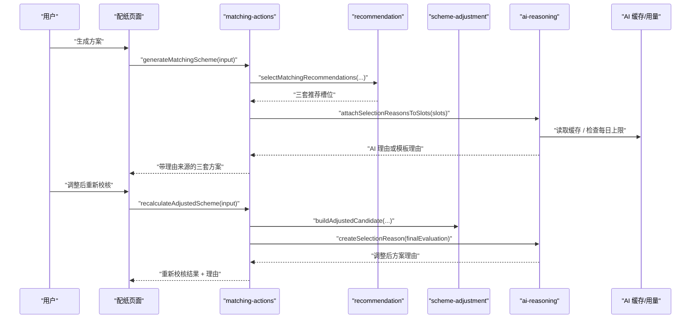
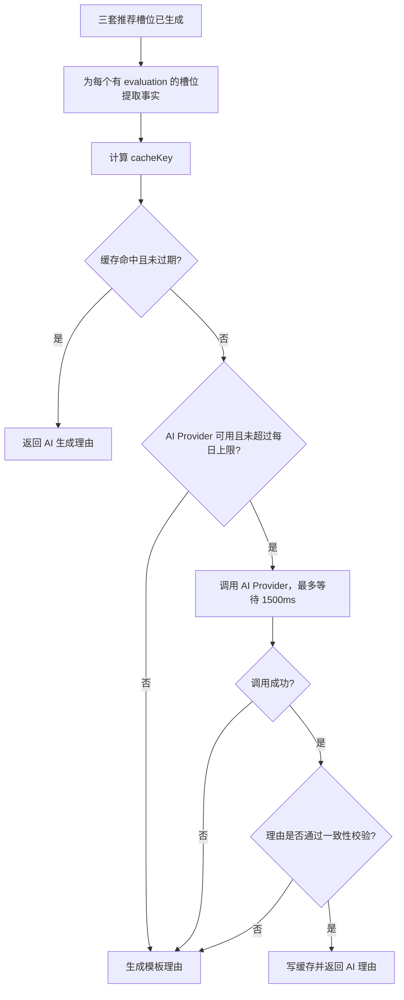

# AI 选型理由与模板降级 — 技术设计文档

## 1. 设计概要

**功能描述**：在现有推荐方案生成和调整后重新校核流程之后，新增 `ai-reasoning` 业务模块，为经济型、安全型、均衡型三套方案，以及用户手动调整并重新校核后的最终方案生成选型理由。AI 只消费服务端已计算出的成本、强度、达标状态、可生产状态和推荐类型；失败、超时、达到每日调用上限或内容冲突时，统一降级为结构化模板理由。→ AC-001 到 AC-012

**影响范围**：`src/modules/ai-reasoning`、`src/modules/recommendation/types.ts`、`src/modules/scheme-adjustment/types.ts`、`src/modules/scheme-adjustment/create-history-snapshot.ts`、`src/server/actions/matching-actions.ts`、`src/db/schema`、`src/app/(main)/matching/_components/box-spec-form.tsx`、`src/modules/import-export`、`tests/unit/ai-reasoning`、`tests/integration/matching`、`tests/integration/import-export`。本功能不修改面积、强度、成本、设备限制和推荐排序。→ AC-009, AC-010, AC-011

**关键设计决策**：

- AI 理由生成放在服务端动作编排层，接在 `selectMatchingRecommendations` 和 `evaluateCandidate` 之后，不进入 `calculations` 或 `recommendation` 的排序逻辑。→ AC-009, AC-011
- 推荐槽位新增 `selectionReason` 字段，调整后重新校核结果也新增 `selectionReason` 字段；页面只负责展示来源和内容。→ AC-001, AC-002, AC-003
- 模板理由是确定性纯函数，始终能覆盖成本、强度、可生产状态和风险提示，是所有异常场景的兜底出口。→ AC-004, AC-005, AC-006, AC-007, AC-012
- 新增 AI 缓存和每日用量表，避免重复调用并支持每日上限；没有配置 AI Key 时直接模板降级。→ AC-004, AC-005, AC-010
- AI 输出必须经过结果一致性校验；如果和服务端计算状态冲突，丢弃 AI 理由并改用模板理由。→ AC-008, AC-011

---

## 2. 架构概览



### 模块职责

| 模块 / 文件 | 职责 | 对应 AC |
|-------------|------|---------|
| `src/modules/ai-reasoning/types.ts` | 定义理由来源、模板降级原因、理由结构、AI Provider 输入输出 | AC-001 到 AC-012 |
| `src/modules/ai-reasoning/template-reason.ts` | 基于计算结果生成结构化模板理由 | AC-004, AC-005, AC-006, AC-007, AC-012 |
| `src/modules/ai-reasoning/generate-selection-reason.ts` | 编排缓存、限额、AI 调用、超时、校验和模板降级 | AC-002, AC-004, AC-005, AC-008, AC-010 |
| `src/modules/ai-reasoning/validate-ai-reason.ts` | 校验 AI 文案是否与达标/可生产/风险状态冲突 | AC-006, AC-007, AC-008, AC-011 |
| `src/modules/ai-reasoning/cache.ts` | 生成缓存 key、读写 AI 理由缓存、记录每日用量 | AC-004, AC-005, AC-010 |
| `src/modules/recommendation/types.ts` | `RecommendationSlot` 增加 `selectionReason` | AC-001, AC-002, AC-004 |
| `src/modules/scheme-adjustment/types.ts` | `RecalculateAdjustedSchemeResult` 增加 `selectionReason` | AC-003 |
| `src/modules/scheme-adjustment/create-history-snapshot.ts` | 保存最终方案理由和来源到历史快照 | AC-003, AC-010 |
| `src/server/actions/matching-actions.ts` | 在生成方案、重新校核、保存前编排理由生成 | AC-001 到 AC-012 |
| `src/db/schema/ai-reasoning.ts` | 新增 AI 缓存和每日用量表 | AC-004, AC-005, AC-010 |
| `src/app/(main)/matching/_components/box-spec-form.tsx` | 展示理由内容和“AI 生成 / 模板生成”来源标识 | AC-001 到 AC-007 |
| `src/modules/import-export/*pdf*` | 导出报告复用历史快照中的理由，不二次生成 AI | AC-010, AC-011 |

---

## 3. 数据库设计

### 3.1 新增表：`ai_reasoning_cache`

**用途**：缓存同一输入、同一方案结果下的 AI 理由，减少重复调用。缓存命中仍展示为“AI 生成”，因为内容来源是 AI，只是复用了历史结果。→ AC-002, AC-010

| 字段名 | 类型 | 约束 | 说明 |
|--------|------|------|------|
| id | uuid | PK, DEFAULT gen_random_uuid() | 主键 |
| cache_key | varchar(128) | NOT NULL, UNIQUE | 由推荐类型、方案配置、成本、强度、状态和风险原因生成的稳定摘要 |
| reason_text | text | NOT NULL | 已校验通过的 AI 理由正文 |
| model_name | varchar(100) | NULL | AI Provider 返回或配置的模型名称 |
| facts_snapshot | jsonb | NOT NULL | 生成理由时使用的事实快照，便于排查 |
| created_at | timestamp with time zone | NOT NULL, DEFAULT now() | 创建时间 |
| expires_at | timestamp with time zone | NOT NULL | 过期时间，默认创建后 30 天 |

索引：

- `ai_reasoning_cache_key_unique`：按 `cache_key` 查找缓存。→ AC-010
- `ai_reasoning_cache_expires_at_idx`：后续清理过期缓存。→ AC-010

### 3.2 新增表：`ai_reasoning_daily_usages`

**用途**：记录每日 AI 实际调用次数，用于每日上限判断。模板理由、缓存命中和 AI 校验失败后的降级不增加调用次数；只有真正发起 Provider 调用才增加。→ AC-005, AC-010

| 字段名 | 类型 | 约束 | 说明 |
|--------|------|------|------|
| id | uuid | PK, DEFAULT gen_random_uuid() | 主键 |
| usage_date | varchar(10) | NOT NULL, UNIQUE | 日期，格式 `YYYY-MM-DD` |
| request_count | integer | NOT NULL, DEFAULT 0 | 当日已调用次数 |
| created_at | timestamp with time zone | NOT NULL, DEFAULT now() | 创建时间 |
| updated_at | timestamp with time zone | NOT NULL, DEFAULT now() | 更新时间 |

索引：

- `ai_reasoning_daily_usages_date_unique`：按日期查找和更新每日用量。→ AC-005

### 3.3 修改现有快照结构

不修改 `matching_schemes` 表字段；该表已有 `final_scheme_snapshot` 和 `original_recommendation_slots_snapshot` JSONB，可以随快照保存理由对象。→ AC-003, AC-010

新增快照内容：

- `RecommendationSlot.selectionReason` 保存三套原始推荐的理由和来源。→ AC-001, AC-002
- `finalSchemeSnapshot.selectionReason` 保存最终确认方案的理由和来源。→ AC-003

这样导出完整报告或精简方案表时，从历史快照读取已保存理由，不单独二次生成 AI。→ AC-010, AC-011

---

## 4. 类型与函数契约

### 4.1 理由类型

**位置**：`src/modules/ai-reasoning/types.ts`

```ts
export type SelectionReasonSource = "ai" | "template";

export type SelectionReasonFallbackReason =
  | "provider_not_configured"
  | "provider_failed"
  | "provider_timeout"
  | "daily_limit_reached"
  | "validation_failed";

export interface SelectionReason {
  source: SelectionReasonSource;
  sourceLabel: "AI 生成" | "模板生成";
  text: string;
  fallbackReason?: SelectionReasonFallbackReason | undefined;
  generatedAt: string;
}

export interface SelectionReasonFacts {
  strategy: "economy" | "safety" | "balanced" | "adjusted";
  strategyLabel: "经济型" | "安全型" | "均衡型" | "调整后方案";
  isOfficialRecommendation: boolean;
  finalStatus: "qualified" | "unqualified" | "not_manufacturable" | "data_incomplete";
  layerCount: number;
  fluteType: string;
  paperSummary: string[];
  cost?: {
    taxIncludedCostYuan: number;
  } | undefined;
  strength?: {
    bctN: number;
    edgeCrushKnPerM: number;
    burstStrength: number;
  } | undefined;
  riskMessages: string[];
  statusMessages: string[];
}
```

说明：

- `sourceLabel` 是页面展示字段，避免页面自己翻译来源。→ AC-001
- `fallbackReason` 只在模板降级时记录，可用于测试和排查，页面只需展示“模板生成”。→ AC-004, AC-005
- `SelectionReasonFacts` 只包含已计算事实，不包含用户可编辑内容或 AI 可反写字段。→ AC-009, AC-011

### 4.2 推荐槽位扩展

**位置**：`src/modules/recommendation/types.ts`

```ts
import type { SelectionReason } from "@/modules/ai-reasoning/types";

export interface RecommendationSlot {
  // 现有字段保留
  selectionReason?: SelectionReason | undefined;
}
```

说明：

- `selectionReason` 是推荐结果的展示增强字段，不参与 `selectMatchingRecommendations` 排序。→ AC-001, AC-011
- `recommendation` 模块不生成 AI 理由，只接受服务端动作装饰后的槽位。→ AC-009

### 4.3 调整后结果扩展

**位置**：`src/modules/scheme-adjustment/types.ts`

```ts
import type { SelectionReason } from "@/modules/ai-reasoning/types";

export interface RecalculateAdjustedSchemeResult {
  finalEvaluation: CandidateEvaluation;
  finalStatus: MatchingSchemeFinalStatus;
  isManuallyAdjusted: boolean;
  warningMessages: string[];
  canSave: boolean;
  selectionReason: SelectionReason;
}
```

说明：调整后理由只在重新校核成功后生成；页面进入“待重新校核”时不沿用旧理由。→ AC-003

### 4.4 AI Provider 契约

**位置**：`src/modules/ai-reasoning/generate-selection-reason.ts`

```ts
export interface AiReasoningProvider {
  generateSelectionReason(input: {
    facts: SelectionReasonFacts;
    timeoutMs: number;
  }): Promise<{
    text: string;
    modelName?: string | undefined;
  }>;
}
```

说明：

- Provider 只接收 `SelectionReasonFacts`，不接收数据库连接、页面状态或可写对象。→ AC-009, AC-011
- 首版使用服务端环境变量配置 Provider；未配置时直接模板降级。→ AC-004, AC-010
- 不新增客户端可见环境变量，AI Key 只能在服务端读取。→ AC-010

### 4.5 理由生成入口

```ts
export async function createSelectionReason(input: {
  facts: SelectionReasonFacts;
  provider?: AiReasoningProvider | undefined;
  repository: AiReasoningRepository;
  options?: Partial<AiReasoningOptions> | undefined;
  now?: Date | undefined;
}): Promise<SelectionReason>;

export async function attachSelectionReasonsToSlots(input: {
  slots: [RecommendationSlot, RecommendationSlot, RecommendationSlot];
  repository: AiReasoningRepository;
  provider?: AiReasoningProvider | undefined;
  options?: Partial<AiReasoningOptions> | undefined;
  now?: Date | undefined;
}): Promise<[RecommendationSlot, RecommendationSlot, RecommendationSlot]>;
```

默认参数：

| 参数 | 默认值 | 说明 |
|------|--------|------|
| `timeoutMs` | `1500` | 单条 AI 理由最大等待时间，超时模板降级 |
| `dailyLimit` | `100` | 每日实际 Provider 调用上限 |
| `cacheTtlDays` | `30` | AI 理由缓存 30 天 |

---

## 5. 核心逻辑设计

### 5.1 生成方案理由流程



关键点：

- 三套方案生成不等待不可控的长时间 AI 调用，单条理由超时即降级。→ AC-004, AC-005, AC-010
- 每个槽位独立降级；某一套 AI 失败不影响其他方案。→ AC-004, AC-010
- 无 `evaluation` 的不可用槽位不调用 AI，直接用模板理由说明不可用原因。→ AC-004, AC-012

### 5.2 调整后理由流程

调整后理由只在 `recalculateAdjustedScheme` 中生成。→ AC-003

1. 服务端完成调整候选构造。
2. 服务端调用 `evaluateCandidate` 得到最新成本、强度、达标状态和可生产状态。
3. 从最新 `finalEvaluation` 提取 `SelectionReasonFacts`。
4. 调用 `createSelectionReason`。
5. 返回 `selectionReason` 给页面。

如果用户再次修改方案，页面清空 `recalculatedResult` 并显示“待重新校核”，因此不会继续展示调整前理由。→ AC-003

### 5.3 模板理由生成

**位置**：`src/modules/ai-reasoning/template-reason.ts`

模板理由采用固定四段结构，确保内容完整。→ AC-012

```text
成本：该方案含税成本为 X 元，适合作为经济/安全/均衡判断的参考。
强度：空箱抗压 X N，边压 X kN/m，耐破 X。
可生产状态：该方案当前为达标/未达标/不可生产/数据不足。
风险提示：列出未达标、不可生产或数据不足原因；无风险时说明当前未发现强度或设备风险。
```

规则：

- `finalStatus = qualified` 时，不写“不建议生产”。→ AC-002, AC-012
- `finalStatus = unqualified` 时，必须列出强度不足原因。→ AC-006
- `finalStatus = not_manufacturable` 时，必须列出设备限制原因。→ AC-007
- `finalStatus = data_incomplete` 时，必须提示基础数据或计算数据不足。→ AC-012
- 如果 `cost` 或 `strength` 缺失，对应段落写“暂无完整成本/强度数据”，不得编造数字。→ AC-009

### 5.4 AI 理由一致性校验

**位置**：`src/modules/ai-reasoning/validate-ai-reason.ts`

校验只做确定性规则，不做二次 AI 判断。→ AC-008, AC-011

| 服务端事实 | AI 文案不得出现 | AI 文案必须包含 |
|------------|----------------|----------------|
| `finalStatus = unqualified` | “已达标”“满足强度要求”“可作为达标方案” | 至少一个 `riskMessages` 中的强度不足关键词 |
| `finalStatus = not_manufacturable` | “可生产”“满足设备限制”“生产无障碍” | 至少一个设备限制风险关键词 |
| `finalStatus = data_incomplete` | “数据完整”“结果可靠” | “数据不足”或具体缺失原因 |
| `isOfficialRecommendation = false` | “正式推荐”“推荐达标方案” | “仅供参考”或风险说明 |

如果任一规则失败，返回 `validation_failed`，并使用模板理由。→ AC-008

### 5.5 缓存 key

缓存 key 只基于已计算事实和推荐类型，不包含用户姓名、真实客户信息或原始输入长文本。→ AC-009, AC-010

组成：

```text
strategy
layerCount
fluteType
paper ids + paper codes
taxIncludedCostYuan
bctN / edgeCrushKnPerM / burstStrength
finalStatus
riskMessages
```

这些字段序列化后用 SHA-256 生成 `cache_key`。当原纸、成本、强度或状态变化时，缓存自动失效为不同 key。→ AC-003, AC-009

### 5.6 每日调用上限

默认每日上限为 100 次，可通过服务端环境变量 `AI_REASONING_DAILY_LIMIT` 覆盖。→ AC-005

处理规则：

1. 缓存命中不增加每日用量。
2. Provider 未配置不增加每日用量。
3. 达到上限时不调用 AI，直接模板降级，`fallbackReason = "daily_limit_reached"`。
4. Provider 调用前在事务中增加当日 `request_count`，避免并发超量。
5. 调用失败或校验失败不回退计数，因为已经产生一次真实调用成本。

### 5.7 历史保存与导出复用

保存历史方案时：

- 原始三套 `RecommendationSlot` 已包含 `selectionReason`，随 `originalRecommendationSlotsSnapshot` 写入。→ AC-001, AC-010
- 最终方案 `finalSchemeSnapshot.selectionReason` 使用当前最终理由。→ AC-003

导出 PDF 时：

- 完整报告和精简方案表从历史快照读取理由。
- 如果旧历史记录没有 `selectionReason`，导出时使用模板理由即时补齐展示，但不调用 AI。→ AC-010, AC-011

---

## 6. 服务端动作设计

### 6.1 `generateMatchingScheme` 调整

当前位置：`src/server/actions/matching-actions.ts`

新增依赖注入项，保持测试可控：

```ts
interface MatchingActionOptions {
  aiReasoningRepository?: AiReasoningRepository | undefined;
  aiReasoningProvider?: AiReasoningProvider | undefined;
  createSelectionReasonFn?:
    | ((input: CreateSelectionReasonInput) => Promise<SelectionReason>)
    | undefined;
}
```

流程调整：

1. 原有登录校验、输入校验、基础数据检查不变。→ AC-010
2. 原有候选生成、确定性计算、推荐策略不变。→ AC-009, AC-011
3. 拿到 `recommendationResult.slots` 后调用 `attachSelectionReasonsToSlots`。→ AC-001
4. 返回带 `selectionReason` 的 `recommendationSlots`。→ AC-001, AC-002, AC-004

### 6.2 `recalculateAdjustedScheme` 调整

流程调整：

1. 原有重新校核流程不变。
2. 用 `finalEvaluation` 和 `finalStatus` 提取事实。
3. 调用 `createSelectionReason`，生成调整后方案理由。
4. 返回 `selectionReason`。→ AC-003

### 6.3 `saveConfirmedMatchingScheme` 调整

保存前规则：

- 未调整方案保存时，使用所选推荐槽位已有 `selectionReason`。
- 调整后方案保存时，服务端再次重新校核，并重新生成最终方案理由，避免保存过期理由。→ AC-003, AC-009
- 保存仍不信任客户端传回的成本、强度、达标状态或可生产状态。→ AC-011

说明：当前代码中 `saveConfirmedMatchingScheme` 对未达标或不可生产方案会阻止保存；本技术方案不改变该既有行为，只保证一旦进入保存流程，快照理由来自服务端事实。→ AC-010, AC-011

---

## 7. 页面展示设计

`box-spec-form.tsx` 在推荐槽位和重新校核结果中展示 `selectionReason`。→ AC-001, AC-003

展示内容：

- 来源标签：`selectionReason.sourceLabel`，即“AI 生成”或“模板生成”。→ AC-001, AC-002, AC-004, AC-005
- 理由正文：`selectionReason.text`。→ AC-002, AC-012
- 模板降级时不展示技术错误堆栈，只展示业务可理解的模板理由。→ AC-004, AC-005

UI 放置：

- 推荐方案卡片中放在历史参考之后、风险原因之前。
- 重新校核结果中放在指标列表之后、风险提示之前。
- 来源标签使用现有状态标签样式扩展，不引入新 UI 库。

---

## 8. 错误处理与安全

| 场景 | 处理 | 对应 AC |
|------|------|---------|
| 未配置 AI Provider | 直接模板降级，`provider_not_configured` | AC-004, AC-010 |
| AI 调用超时 | 1500ms 后模板降级，`provider_timeout` | AC-005, AC-010 |
| AI 调用失败 | 捕获异常，模板降级，页面不显示堆栈 | AC-004, AC-010 |
| 达到每日调用上限 | 不调用 AI，模板降级，`daily_limit_reached` | AC-005 |
| AI 文案与状态冲突 | 丢弃 AI 文案，模板降级，`validation_failed` | AC-008 |
| 成本或强度数据缺失 | 模板写“暂无完整数据”，不得编造数字 | AC-009, AC-012 |

安全约束：

- AI Key 只读取服务端环境变量，不新增 `NEXT_PUBLIC_` 变量。→ AC-010
- 发送给 AI 的内容只包含计算结果和方案配置，不包含真实客户、订单、纸价之外的敏感上下文。→ AC-009
- AI 文案只作为展示字段，不写回计算结果、推荐排序或状态。→ AC-011
- 错误响应遵守现有 `ActionResult`，不暴露 Provider 原始错误。→ AC-004

---

## 9. 环境变量

新增服务端环境变量，并同步 `.env.example`。不写入真实密钥。→ AC-010

| 变量 | 必填 | 默认值 | 说明 |
|------|------|--------|------|
| `AI_PROVIDER_API_KEY` | 否 | 无 | 未配置时使用模板理由 |
| `AI_PROVIDER_BASE_URL` | 否 | 无 | AI Provider 服务端地址 |
| `AI_REASONING_MODEL` | 否 | 无 | Provider 模型名，仅服务端使用 |
| `AI_REASONING_TIMEOUT_MS` | 否 | `1500` | 单条理由调用超时 |
| `AI_REASONING_DAILY_LIMIT` | 否 | `100` | 每日 AI 调用上限 |

---

## 10. 测试方案

### 10.1 单元测试

新增 `tests/unit/ai-reasoning/`。

| 测试文件 | 场景 | 对应 AC |
|----------|------|---------|
| `template-reason.test.ts` | 模板理由包含成本、强度、可生产状态和风险提示 | AC-004, AC-006, AC-007, AC-012 |
| `validate-ai-reason.test.ts` | 未达标、不可生产、数据不足、参考方案冲突文案会被拒绝 | AC-006, AC-007, AC-008, AC-011 |
| `generate-selection-reason.test.ts` | AI 成功返回 AI 来源；失败/超时/上限/校验失败返回模板来源 | AC-002, AC-004, AC-005, AC-008, AC-010 |
| `cache.test.ts` | 同一事实命中缓存，事实变化生成不同 key | AC-003, AC-009, AC-010 |

### 10.2 集成测试

更新 `tests/integration/matching/matching-actions.test.ts`：

- `generateMatchingScheme` 返回三套带 `selectionReason` 的槽位。→ AC-001
- AI Provider 成功时，槽位来源为“AI 生成”。→ AC-002
- Provider 抛错、超时、达到上限时，槽位来源为“模板生成”，方案仍正常返回。→ AC-004, AC-005, AC-010
- AI 理由与未达标或不可生产状态冲突时自动降级。→ AC-006, AC-007, AC-008
- `recalculateAdjustedScheme` 返回基于调整后结果的 `selectionReason`。→ AC-003

更新 `tests/integration/matching/matching-page.test.tsx`：

- 页面展示“AI 生成 / 模板生成”来源标识。→ AC-001, AC-002, AC-004
- 调整后重新校核完成后，页面展示新的理由，不展示旧理由。→ AC-003
- 未达标或不可生产原因与理由同时可见。→ AC-006, AC-007

更新 `tests/integration/import-export/matching-scheme-pdf-route.test.ts`：

- PDF 数据复用历史快照中的理由。→ AC-010
- 旧历史快照缺少理由时，导出只使用模板补齐，不调用 AI。→ AC-010, AC-011

### 10.3 数据库测试

新增或更新 `tests/integration/matching/ai-reasoning-cache.test.ts`：

- 缓存命中不增加每日用量。→ AC-010
- 达到每日上限后直接模板降级。→ AC-005
- 缓存 key 随成本、强度、状态或风险原因变化。→ AC-003, AC-009

---

## 11. AC 覆盖矩阵

| AC | 技术覆盖点 |
|----|------------|
| AC-001 | `RecommendationSlot.selectionReason.sourceLabel`，页面展示来源标识 |
| AC-002 | AI Provider 成功后返回 `source = "ai"`、`sourceLabel = "AI 生成"` |
| AC-003 | `recalculateAdjustedScheme` 基于最新 `finalEvaluation` 生成 `selectionReason`，页面 dirty 状态清空旧结果 |
| AC-004 | Provider 未配置/失败时 `createTemplateSelectionReason` 降级，不阻断 `generateMatchingScheme` |
| AC-005 | `ai_reasoning_daily_usages` 上限和 1500ms 超时触发模板降级 |
| AC-006 | 模板和校验规则要求未达标理由包含强度风险，不得描述为达标 |
| AC-007 | 模板和校验规则要求不可生产理由包含设备风险，不得描述为可生产 |
| AC-008 | `validateAiSelectionReason` 失败后返回 `fallbackReason = "validation_failed"` 的模板理由 |
| AC-009 | `SelectionReasonFacts` 只由服务端计算结果提取，不接收 AI 或客户端反写字段 |
| AC-010 | AI 异常全部在 `ai-reasoning` 内降级，服务端动作继续返回方案；历史和导出复用已保存理由 |
| AC-011 | AI 理由作为展示字段挂载，不进入 `calculations`、不进入推荐排序、不更新状态字段 |
| AC-012 | `template-reason.ts` 固定四段结构：成本、强度、可生产状态、风险提示 |

---

## 12. 实施顺序建议

1. 新增 `src/modules/ai-reasoning` 类型、模板理由和校验单元测试。→ AC-006, AC-007, AC-008, AC-012
2. 新增 AI 缓存和每日用量 schema、迁移及 repository。→ AC-005, AC-010
3. 实现 `createSelectionReason` 和 `attachSelectionReasonsToSlots`，覆盖成功、失败、超时、上限和缓存。→ AC-002, AC-004, AC-005, AC-010
4. 扩展推荐槽位、重新校核结果和历史快照类型。→ AC-001, AC-003
5. 接入 `matching-actions.ts`，保证方案生成、重新校核和保存都使用服务端理由。→ AC-001 到 AC-011
6. 更新页面展示来源标签和理由正文。→ AC-001, AC-002, AC-003, AC-004
7. 更新 PDF 数据构建，导出复用历史快照理由。→ AC-010, AC-011
8. 补齐集成测试和数据库测试。→ AC-001 到 AC-012

---

## 附录：变更记录

| 日期 | 变更内容 | 原因 |
|------|---------|------|
| 2026-07-03 | 初始版本 | 根据《AI 选型理由与模板降级》需求文档生成技术方案，明确服务端 AI 理由、模板降级、缓存限额、冲突校验和 AC 覆盖 |
