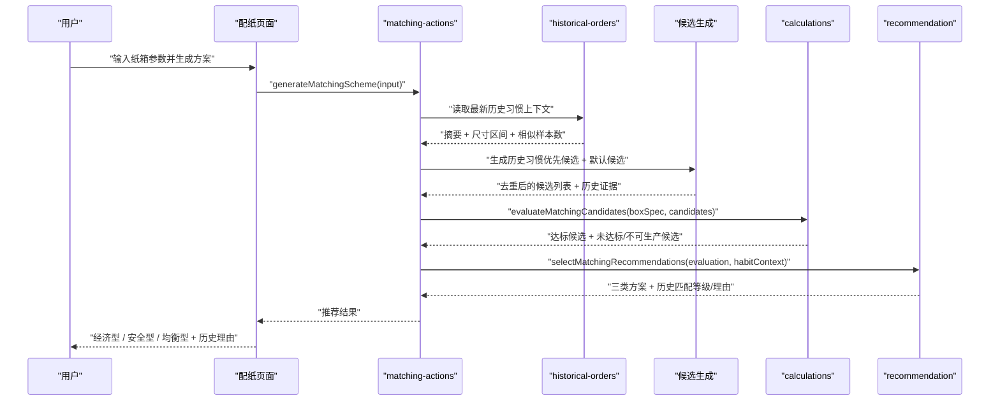
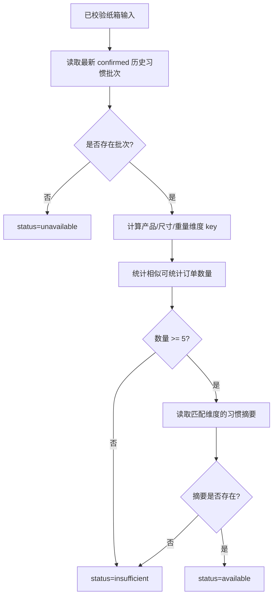

# 历史习惯优先推荐与理由展示 — 技术设计文档

## 1. 设计概要

**功能描述**：在“历史订单建库与习惯提取”已经生成历史配纸习惯摘要后，推荐流程读取最新已确认习惯版本，根据当前纸箱的产品类型、尺寸区间和重量区间匹配历史习惯，优先生成和选择符合公司历史规律的候选方案；所有候选仍通过现有面积、强度、成本和设备限制校核，最终输出经济型、安全型、均衡型三类方案，并展示历史匹配等级和理由。→ AC-001 到 AC-019

**影响范围**：`src/modules/historical-orders`、`src/modules/recommendation`、`src/server/actions/matching-actions.ts`、`src/app/(main)/matching`、`src/db/schema/historical-orders.ts`、`tests/unit/recommendation`、`tests/unit/historical-orders`、`tests/integration/matching`。本功能不新增第三方依赖，不修改面积、强度、成本和设备限制公式。→ AC-003, AC-014, AC-015, AC-016

**关键设计决策**：

- 使用最新已确认历史订单导入批次作为当前“历史习惯版本”，避免多批次摘要混用导致推荐口径不一致。→ AC-001, AC-012, AC-017
- `historical-orders` 只提供习惯摘要、尺寸区间和相似样本数量，不直接参与推荐排序。→ AC-001, AC-014, AC-019
- `recommendation` 保持纯函数模块，不访问数据库；由 `matching-actions` 读取历史习惯后作为参数传入。→ AC-003, AC-014
- 历史习惯先影响候选生成和候选排序；再统一经过 `evaluateMatchingCandidates` 校核，未达标或不可生产候选不得成为正式达标推荐。→ AC-004, AC-009, AC-010, AC-014, AC-015
- 页面只在存在习惯匹配证据时展示“公司配纸习惯”和 `高匹配 / 中匹配 / 低匹配`，样本不足时不在生成结果中展示历史参考提示，不展示裸分数。→ AC-007, AC-008, AC-012, AC-018

---

## 2. 架构概览



### 模块职责

| 模块 / 文件 | 职责 | 对应 AC |
|-------------|------|---------|
| `src/modules/historical-orders/recommendation-context.ts` | 根据当前纸箱参数读取最新已确认习惯版本，返回匹配摘要、尺寸区间、相似样本数 | AC-001, AC-003, AC-012, AC-017 |
| `src/modules/recommendation/historical-habit-candidates.ts` | 将历史常用层数、瓦型、纸厂、克重组合转为候选生成提示，并生成可校核候选 | AC-004, AC-009, AC-010, AC-011 |
| `src/modules/recommendation/historical-habit-matching.ts` | 为候选计算历史匹配等级、证据和理由 | AC-007, AC-008, AC-017, AC-018 |
| `src/modules/recommendation/scoring.ts` | 在现有经济型、安全型、均衡型排序中加入历史习惯排序上下文 | AC-005, AC-006, AC-014 |
| `src/modules/recommendation/select-matching-recommendations.ts` | 继续输出固定三槽位，并把历史匹配信息挂到槽位上 | AC-005, AC-006, AC-007, AC-013 |
| `src/server/actions/matching-actions.ts` | 编排读取历史习惯、生成候选、计算校核、推荐选择和返回页面结果 | AC-003, AC-004, AC-012, AC-015 |
| `src/app/(main)/matching` | 展示公司配纸习惯匹配等级、理由和历史冲突说明；样本不足时不展示历史参考提示 | AC-007, AC-008, AC-009, AC-010, AC-011, AC-012 |
| `src/db/schema/historical-orders.ts` | 复用历史订单和摘要表，补充必要查询索引 | AC-001, AC-002, AC-012 |

---

## 3. 数据设计

### 3.1 复用现有表

本功能复用已存在的历史订单相关表，不新增业务表。→ AC-001, AC-002

| 表 | 用途 |
|----|------|
| `historical_order_import_batches` | 找到最新已确认历史习惯版本，并读取该批次确认后的尺寸区间口径 |
| `historical_orders` | 统计当前输入对应的相似历史订单数量，用于判断是否少于 5 条 |
| `historical_order_habit_summaries` | 读取产品、尺寸、重量维度下的常用层数、瓦型、纸厂和克重组合 |

### 3.2 索引调整

为避免推荐时读取历史习惯变慢，建议补充两个索引。→ AC-003, AC-012

```ts
// src/db/schema/historical-orders.ts
index("historical_orders_batch_statistical_idx").on(
  table.importBatchId,
  table.isStatistical,
);

index("historical_order_habit_summaries_batch_dimension_idx").on(
  table.importBatchId,
  table.dimensionType,
  table.dimensionKey,
  table.orderCount,
);
```

说明：

- 不改变现有字段，不迁移历史业务数据。
- `historical_order_habit_summaries.importBatchId` 当前允许为空；读取推荐上下文时只使用有批次来源的摘要。
- 若没有已确认批次或没有可用摘要，推荐流程正常回退现有逻辑，不在生成结果中显示“历史参考”提示。→ AC-012

### 3.3 当前习惯版本

当前习惯版本定义为：

```text
status = confirmed 的 historical_order_import_batches 中 confirmedAt 最新的一批
```

原因：

- 历史订单导入是批次化动作，最新确认批次代表用户最近认可的统计口径。
- 尺寸区间由批次确认，跨批次混用会造成“小箱/中箱/大箱”边界不一致。
- 后续如果需要多版本切换，可在新需求中增加“习惯版本管理”，本次不做。→ AC-019

---

## 4. 函数与契约

### 4.1 历史习惯推荐上下文

**位置**：`src/modules/historical-orders/recommendation-context.ts`

```ts
import type { NormalizedBoxSpec } from "@/modules/box-spec/types";
import type { HistoricalOrderHabitSummaryItem } from "@/modules/historical-orders/list-habit-summaries";
import type { HistoricalOrderSizeBucketConfig } from "@/modules/historical-orders/import-preview";

export interface HistoricalHabitRecommendationContext {
  status: "available" | "insufficient" | "unavailable";
  importBatchId?: string;
  sizeBucketConfig?: HistoricalOrderSizeBucketConfig;
  matchedDimensionKeys: {
    productKey: string;
    sizeBucketKey?: "小箱" | "中箱" | "大箱";
    weightBucketKey: "≤20kg" | "20-30kg" | "≥30kg";
  };
  similarOrderCount: number;
  summaries: HistoricalOrderHabitSummaryItem[];
  messages: string[];
}

export interface HistoricalHabitRecommendationRepository {
  findLatestConfirmedHabitBatch(): Promise<
    | {
        importBatchId: string;
        sizeBucketConfig: HistoricalOrderSizeBucketConfig;
      }
    | undefined
  >;
  listHabitSummariesForRecommendation(input: {
    importBatchId: string;
    dimensionKeys: HistoricalHabitRecommendationContext["matchedDimensionKeys"];
  }): Promise<HistoricalOrderHabitSummaryItem[]>;
  countSimilarStatisticalOrders(input: {
    importBatchId: string;
    boxSpec: NormalizedBoxSpec;
    sizeBucketConfig: HistoricalOrderSizeBucketConfig;
  }): Promise<number>;
}

export async function getHistoricalHabitRecommendationContext(input: {
  repository: HistoricalHabitRecommendationRepository;
  boxSpec: NormalizedBoxSpec;
}): Promise<HistoricalHabitRecommendationContext>;
```

规则：

- `productKey` 使用 `boxSpec.productType`。→ AC-001
- `sizeBucketKey` 使用最新确认批次的 `sizeBucketConfig` 按体积计算。→ AC-001, AC-012
- `weightBucketKey` 复用 `getHistoricalOrderWeightBucket(boxSpec.productWeightKg)`。→ AC-001
- `similarOrderCount < 5` 时返回 `status = "insufficient"`。→ AC-012
- 无确认批次、无摘要或读取失败时返回 `status = "unavailable"`，不阻断方案生成。→ AC-012

### 4.2 推荐槽位历史信息

**位置**：`src/modules/recommendation/types.ts`

```ts
export type HistoricalHabitMatchLevel =
  | "high"
  | "medium"
  | "low"
  | "insufficient";

export interface HistoricalHabitEvidence {
  dimensionType: "product" | "size_bucket" | "weight_bucket";
  dimensionKey: string;
  matchedFields: Array<"layer_count" | "flute" | "factory" | "gram_weight">;
  orderCount: number;
  frequency: number;
}

export interface RecommendationHistoricalHabitInfo {
  level: HistoricalHabitMatchLevel;
  label: "高匹配" | "中匹配" | "低匹配" | "暂无足够历史参考";
  reasons: string[];
  evidences: HistoricalHabitEvidence[];
}

export interface RecommendationSlot {
  // 保留现有字段
  historicalHabit?: RecommendationHistoricalHabitInfo | undefined;
}
```

说明：

- `historicalHabit` 只作为展示和排序证据，不参与计算结果改写。→ AC-014, AC-015
- 不包含裸分数字段，页面只展示 `label` 和 `reasons`。→ AC-018
- `reasons` 必须由 `evidences` 和摘要数据生成，不允许写无依据文案。→ AC-017

### 4.3 推荐选择入口扩展

**位置**：`src/modules/recommendation/select-matching-recommendations.ts`

```ts
export function selectMatchingRecommendations(input: {
  evaluation: EvaluateMatchingCandidatesResult;
  parameters: CalculationParameters;
  options?: Partial<RecommendationOptions>;
  historicalHabitContext?: HistoricalHabitSelectionContext | undefined;
}): SelectMatchingRecommendationsResult;
```

`HistoricalHabitSelectionContext` 来自服务端动作整理后的纯数据，包含：

- 当前历史习惯状态。
- 候选指纹到历史匹配信息的映射。
- 历史习惯候选被拒绝后的冲突说明。

`recommendation` 模块不接收仓储对象，不访问数据库。→ AC-003, AC-014

---

## 5. 核心逻辑设计

### 5.1 历史习惯上下文读取



相似订单计数规则：→ AC-012

- 仅统计最新确认批次下 `isStatistical = true` 的历史订单。
- 产品维度：`productCategory ?? productName` 与 `boxSpec.productType` 一致。
- 尺寸维度：按该批次确认的尺寸区间计算后，与当前纸箱尺寸区间一致。
- 重量维度：按 `≤20kg`、`20-30kg`、`≥30kg` 与当前内装物重量区间一致。

如果三维同时匹配过严导致样本不足，系统不放宽条件猜测，而是回退现有推荐逻辑并提示“暂无足够历史参考”。→ AC-012, AC-017

### 5.2 历史习惯候选生成

**位置**：`src/modules/recommendation/historical-habit-candidates.ts`

处理流程：→ AC-004, AC-009, AC-010, AC-011

1. 将 `historical_order_habit_summaries` 按 `orderCount` 和 `frequency` 排序。
2. 取匹配维度下的常用组合，转换为候选生成提示：
   - `layerCount`
   - `flute`
   - `factoryNames`
   - `gramWeights`
3. 在当前可用原纸中优先筛选纸厂和克重匹配的纸张。
4. 根据层数和瓦型生成候选：
   - 三层：面纸 + 瓦纸 + 里纸。
   - 五层：面纸 + 瓦纸 + 芯纸 + 瓦纸 + 里纸。
   - 七层：面纸 + 瓦纸 + 芯纸 + 瓦纸 + 芯纸 + 瓦纸 + 里纸。
5. 历史习惯候选与默认候选按业务指纹去重，历史习惯候选排在前面。
6. 无法由当前原纸生成的历史常用组合，记录为“历史常用组合当前不可用”。→ AC-011

瓦型拆分规则：

| 瓦型 | 瓦纸层 |
|------|--------|
| A / B / C / E | 单个瓦纸层 |
| AB / BA | A + B |
| AC | A + C |
| BC | B + C |
| BE | B + E |
| BAC | B + A + C |

说明：

- 候选生成只构造可校核候选，不直接判断达标。→ AC-015
- 历史习惯候选生成失败不阻断默认推荐。→ AC-011, AC-012
- 如果当前计算模块或默认候选生成尚未完整覆盖五层、七层，历史习惯候选生成应同步补齐对应层数的 `MatchingCandidate` 结构，但不修改计算公式。→ AC-004, AC-015

### 5.3 候选校核与冲突说明

历史习惯候选和默认候选统一进入 `evaluateMatchingCandidates`。→ AC-009, AC-010, AC-014, AC-015

校核后分三类处理：

| 场景 | 处理 | 对应 AC |
|------|------|---------|
| 历史候选达标且可生产 | 可作为正式推荐来源，并展示匹配等级和理由 | AC-005, AC-007, AC-008 |
| 历史候选强度不达标 | 不作为达标推荐；记录“历史常用组合未直接采用，因为当前强度不达标” | AC-009, AC-014 |
| 历史候选不可生产 | 不作为可生产推荐；记录“历史常用组合未直接采用，因为当前设备限制不满足” | AC-010, AC-014 |
| 历史候选当前原纸不可用 | 不生成该候选；记录“历史常用组合当前不可用” | AC-011 |
| 没有任何达标可生产方案 | 沿用现有参考方案逻辑，不因历史习惯改变状态 | AC-013 |

冲突说明挂到 `SelectMatchingRecommendationsResult.globalMessages` 或对应槽位 `messages`：

```text
相似历史订单常用五层 BC 瓦，但该组合本次边压不足，已改为推荐达标的相近方案。
```

说明内容必须由 rejected candidate reasons 或“当前原纸不可用”记录生成。→ AC-017

### 5.4 历史匹配等级

**位置**：`src/modules/recommendation/historical-habit-matching.ts`

匹配等级只用于展示和排序，不展示裸分。→ AC-007, AC-018

| 等级 | 判定规则 |
|------|----------|
| 高匹配 | 同时匹配历史摘要中的层数、瓦型，并至少匹配纸厂或克重组合之一；且证据来自至少一个 `orderCount >= 5` 的摘要 |
| 中匹配 | 匹配层数和瓦型，或匹配层数/瓦型之一且同时匹配纸厂或克重组合 |
| 低匹配 | 有足够历史参考，但只匹配到单个弱特征，或候选是历史冲突后的相近方案 |
| 暂无足够历史参考 | 历史上下文不可用，或相似历史订单少于 5 条 |

理由生成示例：→ AC-008, AC-017

```text
高匹配：相似产品和重量区间中，五层 BC 瓦出现 18 次，占比 62%；纸厂和克重组合也与历史常用组合一致。
```

如果没有足够历史参考：

```text
暂无足够历史参考：相似历史订单少于 5 条，本次按现有推荐逻辑生成方案。
```

### 5.5 三类方案排序

保留经济型、安全型、均衡型三类槽位。→ AC-005, AC-006

排序策略：

| 方案 | 历史习惯参与方式 | 保留的原有定位 |
|------|------------------|----------------|
| 经济型 | 优先在历史匹配候选中选择含税成本最低者；没有历史匹配达标候选时回退所有达标候选 | 低成本优先 |
| 安全型 | 优先在历史匹配候选中选择抗压富余率最高且不超过 200% 者；没有历史匹配达标候选时回退所有达标候选 | 高强度富余优先 |
| 均衡型 | 在成本、安全和历史匹配等级之间综合排序 | 兼顾历史习惯、成本和安全 |

均衡型建议权重：

```text
历史习惯 40%
成本 30%
安全 30%
```

原因：

- 本功能核心目标是“按公司历史规律生成方案”。
- 但均衡型仍不能忽略成本和安全表现。
- 经济型和安全型保留各自定位，只在候选范围和同类排序上优先历史习惯。→ AC-006

所有正式推荐仍必须来自 `eligibleCandidates`。→ AC-014

### 5.6 回退逻辑

以下情况回退现有推荐逻辑：→ AC-012, AC-013

- 没有最新已确认历史习惯批次。
- 最新批次没有可用摘要。
- 相似历史订单少于 5 条。
- 历史习惯候选全部无法由当前原纸生成。
- 历史习惯候选全部不达标或不可生产。

回退时：

- 三类方案仍由现有推荐逻辑生成。
- 每个槽位展示“暂无足够历史参考”或历史冲突说明。
- 未达标、不可生产状态按现有规则展示，不被历史习惯改写。→ AC-013, AC-014

---

## 6. 服务端动作设计

### 6.1 `generateMatchingScheme` 编排调整

**位置**：`src/server/actions/matching-actions.ts`

新增可注入选项，便于测试：

```ts
interface MatchingActionOptions {
  historicalHabitRepository?: HistoricalHabitRecommendationRepository | undefined;
  getHistoricalHabitContextFn?:
    | ((input: {
        repository: HistoricalHabitRecommendationRepository;
        boxSpec: NormalizedBoxSpec;
      }) => Promise<HistoricalHabitRecommendationContext>)
    | undefined;
  createCandidates?: ((materials: RecommendablePaperMaterial[]) => MatchingCandidate[]) | undefined;
}
```

生成流程调整：

1. 登录校验和输入校验保持不变。
2. 基础数据就绪检查保持不变。
3. 读取可推荐原纸保持不变。
4. 读取历史习惯上下文；失败时不阻断推荐，只返回 `unavailable` 上下文。→ AC-012
5. 根据历史习惯生成优先候选，并与默认候选合并去重。→ AC-004
6. 统一调用 `evaluateMatchingCandidates`。→ AC-015
7. 调用扩展后的 `selectMatchingRecommendations`。→ AC-005, AC-006, AC-007
8. 返回 `recommendationSlots` 和历史习惯全局提示。→ AC-008, AC-009, AC-010, AC-011

### 6.2 返回契约扩展

```ts
export interface GenerateMatchingSchemeResult {
  boxSpec: NormalizedBoxSpec;
  stackingIncluded: boolean;
  stackingDisplayText: string;
  recommendationSlots: [RecommendationSlot, RecommendationSlot, RecommendationSlot];
  recommendationMessages: string[];
  rejectedSummary: RejectedCandidateSummary[];
  rejectedCandidates: RejectedCandidateEvaluation[];
  historicalHabitStatus: "available" | "insufficient" | "unavailable";
}
```

说明：

- 页面主要从每个 slot 的 `historicalHabit` 展示等级和理由。→ AC-007, AC-008
- `historicalHabitStatus` 用于顶部提示“暂无足够历史参考”。→ AC-012
- 不返回历史成本、历史价格或裸分。→ AC-016, AC-018

---

## 7. 页面展示设计

### 7.1 历史习惯摘要查看

历史习惯摘要查看继续复用历史订单页面已有 `listHistoricalOrderHabitSummaries` 能力。→ AC-001, AC-002

页面展示：

- 产品名称或类别维度。
- 尺寸区间维度。
- 重量区间维度。
- 常用层数、瓦型、纸厂、克重组合。
- 出现次数和占比，按频率从高到低。→ AC-002

### 7.2 推荐结果展示

每个推荐槽位新增历史习惯展示区。→ AC-007, AC-008

展示内容：

- 匹配标签：高匹配 / 中匹配 / 低匹配 / 暂无足够历史参考。
- 1-3 条历史理由。
- 历史常用组合未直接采用的原因。

不展示内容：

- 不展示裸分。
- 不展示历史价格、历史成本。
- 不展示客户信息或客户偏好。→ AC-016, AC-018, AC-019

---

## 8. 错误处理与安全

- 历史习惯读取失败不阻断配纸生成，回退现有推荐逻辑。→ AC-012
- 历史习惯候选必须统一经过当前计算和设备校核。→ AC-015
- 所有推荐状态仍以 `CandidateEvaluation.status` 为准，历史习惯不得改写达标、不可生产或成本结果。→ AC-014
- 历史理由只能由习惯摘要、相似订单数量和 rejected reasons 生成。→ AC-017
- 不读取或输出历史价格、历史成本、客户字段。→ AC-016, AC-019
- 测试数据必须脱敏，不复制真实订单或纸价。→ AC-019

---

## 9. 测试方案

### 9.1 单元测试

| 测试文件 | 场景 | 对应 AC |
|----------|------|---------|
| `tests/unit/historical-orders/recommendation-context.test.ts` | 无确认批次、样本不足、正常返回摘要和尺寸/重量维度 | AC-001, AC-012 |
| `tests/unit/recommendation/historical-habit-candidates.test.ts` | 按历史层数、瓦型、纸厂、克重生成候选；当前原纸不可用时记录原因 | AC-004, AC-011 |
| `tests/unit/recommendation/historical-habit-matching.test.ts` | 高/中/低/暂无参考等级判定和理由生成 | AC-007, AC-008, AC-017, AC-018 |
| `tests/unit/recommendation/select-matching-recommendations.test.ts` | 历史匹配候选优先进入三类方案；不达标历史候选不进入正式推荐 | AC-005, AC-006, AC-009, AC-014 |
| `tests/unit/recommendation/scoring.test.ts` | 均衡型历史/成本/安全权重，经济型和安全型保留定位 | AC-006 |

### 9.2 集成测试

| 测试文件 | 场景 | 对应 AC |
|----------|------|---------|
| `tests/integration/matching/historical-habit-recommendation.test.ts` | 有足够历史摘要时，`generateMatchingScheme` 返回历史匹配等级和理由 | AC-003, AC-007, AC-008 |
| `tests/integration/matching/historical-habit-fallback.test.ts` | 历史不足、无摘要、读取失败时回退现有推荐逻辑 | AC-012 |
| `tests/integration/matching/historical-habit-hard-rules.test.ts` | 历史常用组合强度不足、设备不可生产、当前原纸不可用时显示原因 | AC-009, AC-010, AC-011, AC-014, AC-015 |
| `tests/integration/matching/historical-habit-scope.test.ts` | 返回结果不包含裸分、历史成本、客户偏好字段 | AC-016, AC-018, AC-019 |

---

## 10. AC 覆盖矩阵

| AC | 技术覆盖点 |
|----|------------|
| AC-001 | 历史订单页面复用摘要查询；推荐上下文读取最新确认批次摘要 |
| AC-002 | 摘要表按 `orderCount` / `frequency` 排序展示 |
| AC-003 | `generateMatchingScheme` 默认读取历史习惯上下文，无需用户每次确认 |
| AC-004 | `historical-habit-candidates.ts` 根据常用层数、瓦型、纸厂、克重生成优先候选 |
| AC-005 | `selectMatchingRecommendations` 保留经济型、安全型、均衡型三槽位 |
| AC-006 | 经济型/安全型保留原定位，均衡型加入历史习惯权重 |
| AC-007 | `RecommendationSlot.historicalHabit.label` 展示匹配等级 |
| AC-008 | `historicalHabit.reasons` 展示来自摘要的历史理由 |
| AC-009 | 历史候选强度不达标时进入 rejected，展示未直接采用原因 |
| AC-010 | 历史候选不可生产时进入 rejected，展示设备限制原因 |
| AC-011 | 当前原纸无法生成历史组合时记录“当前不可用”说明 |
| AC-012 | `similarOrderCount < 5` 或无摘要时回退现有推荐并显示暂无参考 |
| AC-013 | 没有达标可生产候选时沿用现有参考方案逻辑 |
| AC-014 | 正式推荐只来自 `eligibleCandidates`，历史习惯不得改写硬规则 |
| AC-015 | 历史候选统一进入 `evaluateMatchingCandidates` 重新校核 |
| AC-016 | 推荐上下文和返回契约不包含历史价格/历史成本结论 |
| AC-017 | 理由生成只读取摘要证据和 rejected reasons |
| AC-018 | 类型契约只提供等级 label，不提供裸分展示字段 |
| AC-019 | 不新增客户表、客户字段、成本趋势或批量配纸能力 |

---

## 11. 实施顺序建议

1. 补充历史习惯推荐上下文读取：最新确认批次、尺寸/重量分桶、相似样本计数和摘要查询。→ AC-001, AC-012
2. 补充历史习惯候选生成和不可用原因记录。→ AC-004, AC-011
3. 扩展推荐类型和历史匹配等级/理由生成。→ AC-007, AC-008, AC-017, AC-018
4. 扩展三类方案排序，把历史习惯上下文接入 `selectMatchingRecommendations`。→ AC-005, AC-006, AC-014
5. 调整 `matching-actions` 编排和页面展示。→ AC-003, AC-009, AC-010, AC-012, AC-013
6. 补充单元测试和集成测试，重点覆盖硬规则不被历史习惯覆盖。→ AC-014, AC-015, AC-016, AC-019

---

## 12. CR-002 技术补充：公司配纸原则

### 12.1 输入契约

产品类型由自由输入调整为受控下拉值，但继续复用 `productType` 字段。推荐值包括食品、日化、电子、五金、服装、普通产品、贵重物品、其他。产品类型为贵重物品时，推荐候选面纸优先使用优等品。

特殊要求由自由文本升级为结构化对象，系统只读取结构化字段参与规则判断：

```ts
interface BoxSpecialRequirements {
  dieCutting: boolean;
  punctureStrengthRequired: boolean;
  notes?: string | undefined;
}
```

旧文本只作为 `notes` 兼容和展示，不参与规则判断。

### 12.2 公司配纸原则

公司配纸原则在默认候选和历史习惯候选合并后统一应用，不能改写面积、强度、成本和设备限制结果。

| 规则 | 类型 | 处理 |
|------|------|------|
| 瓦纸克重高于面纸或里纸 | 硬过滤 | 候选不作为正式推荐。 |
| 瓦纸克重比面里纸低 20%-40% | 软排序 | 同类候选优先。 |
| 未要求戳穿强度时芯纸低克重 | 软排序 | 同类候选优先低克重芯纸。 |
| 要求戳穿强度时芯纸允许提高 | 软排序 | 不因芯纸克重较高降低优先级。 |
| 模切三层面里纸低于 190g | 硬过滤 | 候选不作为正式推荐。 |
| 模切五层面里纸低于 200g | 硬过滤 | 候选不作为正式推荐。 |
| 贵重物品面纸优等品 | 软排序 | 有优等品箱板纸时优先使用。 |

### 12.3 接入位置

- `box-spec` 负责输入类型和服务端校验。
- `matching-actions` 负责把规范化输入传入候选生成和推荐选择。
- `recommendation` 负责公司配纸原则的候选过滤、排序和说明生成。
- `calculations` 仍只负责确定性计算，不依赖公司配纸原则模块。

### 12.4 测试补充

- 产品类型下拉值校验。
- 特殊要求结构化校验。
- 瓦纸克重高于面里纸不进入正式推荐。
- 模切三层和五层最低面里纸克重。
- 贵重物品优等品面纸优先。
- 戳穿强度要求影响芯纸克重排序。
- 历史习惯候选同样遵守公司配纸原则。

---

## 附录：变更记录

| 日期 | 变更内容 | 原因 |
|------|---------|------|
| 2026-07-03 | 初始版本 | 根据“历史习惯优先推荐与理由展示”需求文档生成技术方案 |
| 2026-07-07 | CR-002：公司配纸原则接入推荐 | 将产品类型、特殊要求和公司配纸原则结构化接入候选生成与排序 |
