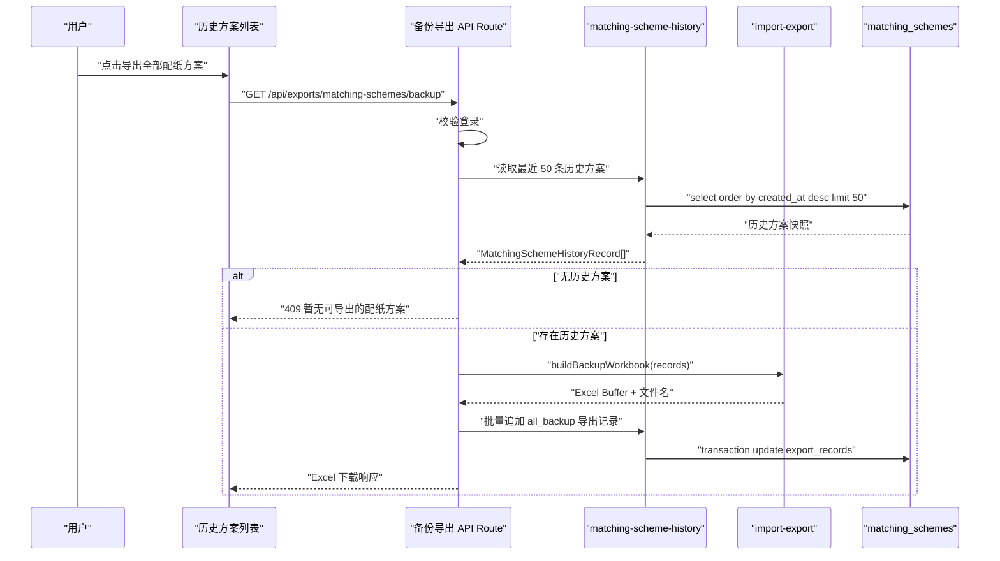

# 导出备份能力 — 技术设计文档

## 1. 设计概要

**功能描述**：在历史方案列表新增“导出全部配纸方案”能力。用户触发后，服务端读取当前实际保留的全部已保存历史方案，构建不含内部成本和原纸价格快照的 Excel 备份文件，下载成功前回写“全部方案备份导出”和导出时间。→ AC-001 到 AC-010

**影响范围**：`src/modules/import-export`、`src/server/actions/matching-scheme-history.ts`、`src/app/api/exports/matching-schemes/backup/route.ts`、`src/app/(main)/history/page.tsx`、`src/app/(main)/history/history.module.css`、`tests/unit/import-export`、`tests/integration/import-export`、`tests/integration/matching`。本功能不修改面积、强度、成本和推荐公式。→ AC-001 到 AC-010

**关键设计决策**：

- 只从 `matching_schemes` 已保存历史快照导出，不读取页面临时试算状态。→ AC-001, AC-006, AC-009
- 复用 `matching_schemes.export_records` JSONB 字段记录导出事件，不新增导出记录表。→ AC-008
- 将导出记录类型扩展为通用 `matching_scheme_export` 类型，新增 `all_backup`，避免 PDF 专用类型继续承担全部导出记录。→ AC-008
- Excel 使用项目已安装的 `exceljs` 服务端生成，不引入新依赖。→ AC-001, AC-007
- 在导出数据构建阶段剔除成本字段和 `priceSnapshot`，Excel 生成层不再接触原始价格快照。→ AC-003
- 本功能只做全部历史方案备份，不做单条、筛选、原纸、参数或恢复导入。→ AC-010

---

## 2. 架构概览

全量备份导出采用“历史页入口 + API Route + 历史方案仓储 + import-export Excel 生成模块”的结构。页面只负责提供下载入口；API Route 负责登录校验、读取历史、空数据判断、生成 Excel、回写导出记录和返回文件；`import-export` 负责把历史快照转换为安全的备份行，并生成工作簿。



### 模块职责

| 模块 / 文件 | 职责 | 对应 AC |
|-------------|------|---------|
| `src/app/(main)/history/page.tsx` | 在历史方案非空时展示“导出全部配纸方案”入口，继续展示导出记录 | AC-001, AC-004, AC-008 |
| `src/app/api/exports/matching-schemes/backup/route.ts` | 接收 Excel 下载请求，校验登录、读取历史、生成 Excel、回写备份导出记录 | AC-001, AC-004, AC-005, AC-007, AC-008 |
| `src/modules/import-export/matching-scheme-export-types.ts` | 定义通用导出记录类型、导出类型标签和文件名规则 | AC-007, AC-008 |
| `src/modules/import-export/build-matching-scheme-backup-workbook.ts` | 从历史方案构建脱敏后的 Excel 工作簿 | AC-001, AC-002, AC-003, AC-006 |
| `src/server/actions/matching-scheme-history.ts` | 读取最近历史方案，批量追加导出记录 | AC-001, AC-005, AC-006, AC-008 |
| `src/app/(main)/history/history.module.css` | 补充全量导出入口和导出记录样式 | AC-001, AC-008 |

---

## 3. 数据库设计

### 3.1 复用 `export_records`

继续复用 `matching_schemes.export_records` JSONB 字段。该字段已用于 PDF 导出记录，本次扩展为通用方案导出记录。→ AC-008

新增通用类型文件：

```ts
export type MatchingSchemeExportType = "full_report" | "summary_sheet" | "all_backup";

export const matchingSchemeExportTypeLabels = {
  full_report: "完整报告",
  summary_sheet: "精简方案表",
  all_backup: "全部方案备份导出",
} satisfies Record<MatchingSchemeExportType, string>;

export interface MatchingSchemeExportRecord {
  type: MatchingSchemeExportType;
  exportedAt: string;
}
```

现有 `matching-scheme-pdf-types.ts` 只保留 PDF 数据模型；PDF 导出类型可以继续定义为：

```ts
export type MatchingSchemePdfExportType = Extract<
  MatchingSchemeExportType,
  "full_report" | "summary_sheet"
>;
```

### 3.2 导出记录示例

```json
[
  { "type": "full_report", "exportedAt": "2026-07-02T10:30:00.000Z" },
  { "type": "summary_sheet", "exportedAt": "2026-07-02T10:35:00.000Z" },
  { "type": "all_backup", "exportedAt": "2026-07-03T09:20:00.000Z" }
]
```

### 3.3 不新增表和字段

本次不保存 Excel 文件地址，不做对象存储归档，不做恢复导入，因此不新增 `export_files`、`backup_files` 或恢复批次表。→ AC-010

### 3.4 仓储方法扩展

在 `MatchingSchemeHistoryRepository` 中新增批量追加导出记录方法：

```ts
interface MatchingSchemeHistoryRepository {
  appendExportRecordToMany(
    ids: string[],
    exportRecord: MatchingSchemeExportRecord,
  ): Promise<MatchingSchemeHistoryRecord[]>;
}
```

实现要求：

- 在一个事务内完成所有本次导出方案的记录追加。→ AC-008
- 若任一记录更新失败，整体回滚并返回导出失败，不返回 Excel 文件。→ AC-005
- 单次最多处理 50 条，数据量固定，不需要分页任务。→ AC-006
- 归一化历史 JSONB 时要接受 `full_report`、`summary_sheet`、`all_backup` 三种类型。→ AC-008

---

## 4. 路由与函数契约

### 4.1 全量备份下载 API Route

**位置**：`src/app/api/exports/matching-schemes/backup/route.ts`

**方法**：`GET`

**参数**：无。导出范围固定为当前系统实际保留的全部历史方案。→ AC-006

**成功响应**：

- `Content-Type: application/vnd.openxmlformats-officedocument.spreadsheetml.sheet`
- `Content-Disposition: attachment; filename*=UTF-8''{encodedFileName}`
- Body 为 Excel 二进制内容。→ AC-001, AC-007

**异常响应**：

| 场景 | 状态 | 响应 | 对应 AC |
|------|------|------|---------|
| 未登录 | 401 | `需要先登录` | AC-001 |
| 历史方案为空 | 409 | `暂无可导出的配纸方案` | AC-004 |
| 数据库连接不可用 | 500 | `导出失败，请稍后重试` | AC-005 |
| Excel 生成失败 | 500 | `导出失败，请稍后重试` | AC-005 |
| 导出记录回写失败 | 500 | `导出失败，请稍后重试` | AC-005, AC-008 |

### 4.2 文件名规则

文件名使用导出时间，不使用某条方案的保存时间：

```text
配纸方案备份-{yyyyMMdd-HHmmss}.xlsx
```

示例：

```text
配纸方案备份-20260703-092000.xlsx
```

→ AC-007

### 4.3 Excel 数据模型

导出模块内部使用脱敏后的行模型，不把原始 `priceSnapshot` 传给工作簿生成函数。→ AC-003

```ts
export interface MatchingSchemeBackupWorkbookData {
  fileName: string;
  exportedAt: Date;
  records: MatchingSchemeBackupRecord[];
}

export interface MatchingSchemeBackupRecord {
  schemeId: string;
  savedAt: Date;
  parameterVersion: string;
  isManuallyAdjusted: boolean;
  boxSpec: Record<string, string>;
  originalRecommendations: MatchingSchemeBackupRecommendation[];
  finalScheme: MatchingSchemeBackupScheme;
  exportRecords: MatchingSchemeExportRecord[];
}
```

---

## 5. Excel 工作簿设计

### 5.1 Sheet 结构

为了让备份既能人工查看，也方便后续人工复核，工作簿包含五个 Sheet。→ AC-002

| Sheet | 内容 | 对应 AC |
|-------|------|---------|
| `备份说明` | 导出时间、导出数量、范围说明、敏感字段说明 | AC-001, AC-003, AC-006 |
| `方案总览` | 每条历史方案一行，展示输入摘要、最终状态和保存信息 | AC-001, AC-002 |
| `原始推荐方案` | 每条历史方案的经济型、安全型、均衡型推荐配置和强度状态 | AC-002 |
| `最终确认方案` | 每条历史方案的最终方案配置、强度、达标/可生产状态 | AC-002 |
| `导出记录` | 每条历史方案已有导出记录，包含本次备份导出记录 | AC-002, AC-008 |

### 5.2 `方案总览` 字段

| 字段 | 来源 | 说明 | 对应 AC |
|------|------|------|---------|
| 记录编号 | `record.id` | 历史方案 ID | AC-001 |
| 保存时间 | `record.createdAt` | 方案确认保存时间 | AC-002 |
| 纸箱尺寸 | `boxSpecSnapshot` | 长 x 宽 x 高 mm | AC-002 |
| 结构类型 | `boxSpecSnapshot.structureType` | 纸箱结构 | AC-002 |
| 成箱方式 | `boxSpecSnapshot.formingMethod` | 粘箱 / 钉箱等 | AC-002 |
| 产品类型 | `boxSpecSnapshot.productType` | 产品类别 | AC-002 |
| 内装物重量 | `boxSpecSnapshot.productWeightKg` | kg | AC-002 |
| 堆码要求 | `boxSpecSnapshot.stackingRequirement` | 展示文本或层数 | AC-002 |
| 生产数量 | `boxSpecSnapshot.productionQuantity` | 个 | AC-002 |
| 最终状态 | `finalSchemeSnapshot.finalStatus` | 达标 / 未达标 / 不可生产 / 数据不足 | AC-002 |
| 是否手动调整 | `isManuallyAdjusted` | 是 / 否 | AC-002 |
| 基础参数版本 | `parameterVersion` | 如 `prd-v1-default` | AC-002 |

### 5.3 `原始推荐方案` 字段

每个历史方案最多输出三行推荐方案。→ AC-002

| 字段 | 说明 |
|------|------|
| 记录编号 | 历史方案 ID |
| 推荐类型 | 经济型 / 安全型 / 均衡型 |
| 推荐状态 | 推荐 / 重复 / 不可用 / 参考 |
| 层数 | 3 / 5 / 7 |
| 瓦型 | A / B / C / E / BC 等 |
| 纸张组合 | 各层原纸代码 |
| 空箱抗压 | N |
| 边压 | kN/m |
| 耐破 | 数值 |
| 达标状态 | 达标 / 未达标 |
| 可生产状态 | 可生产 / 不可生产 |
| 选型理由 | 推荐理由或风险说明 |

### 5.4 `最终确认方案` 字段

| 字段 | 说明 | 对应 AC |
|------|------|---------|
| 记录编号 | 历史方案 ID | AC-002 |
| 层数 | 最终确认方案层数 | AC-002 |
| 瓦型 | 最终确认方案瓦型 | AC-002 |
| 面纸 / 里纸 / 瓦纸 / 芯纸 | 展示原纸代码、纸名、纸厂、克重 | AC-002 |
| 空箱抗压 | N | AC-002 |
| 边压 | kN/m | AC-002 |
| 耐破 | 数值 | AC-002 |
| 达标状态 | 达标 / 未达标 | AC-002 |
| 可生产状态 | 可生产 / 不可生产 | AC-002 |
| 风险提示 | 历史方案保存时的提示 | AC-002 |

### 5.5 明确禁止字段

以下字段不得出现在任何 Sheet 标题、单元格值或工作簿元数据中。→ AC-003

- `单箱含税成本`
- `各层单价`
- `用纸总价`
- `加工费用`
- `税金`
- `taxIncludedCostYuan`
- `layerUnitPrices`
- `paperCostYuan`
- `processingFeeYuan`
- `taxYuan`
- `priceSnapshot`
- `priceYuanPerTon`
- `原纸价格快照`

---

## 6. 核心逻辑

### 6.1 Route 主流程

```text
1. requireAuthenticatedAction()
2. createRepositoryContext()
3. listRecentMatchingSchemeHistory(limit = 50)
4. 若记录为空，返回 409 “暂无可导出的配纸方案”
5. buildMatchingSchemeBackupWorkbookData(records, now)
6. generateMatchingSchemeBackupWorkbook(data)
7. appendExportRecordToMany(records.map(id), { type: "all_backup", exportedAt: now })
8. 返回 Excel 下载响应
```

对应 AC：AC-001, AC-004, AC-005, AC-006, AC-007, AC-008。

### 6.2 数据脱敏策略

Excel 备份不直接序列化历史快照，而是通过白名单字段构建导出行。→ AC-003

实现原则：

- 只读取 `boxSpecSnapshot`、`originalRecommendationSlotsSnapshot`、`finalSchemeSnapshot`、`parameterVersion`、`isManuallyAdjusted`、`exportRecords` 和 `createdAt`。
- 不读取 `priceSnapshot`。
- 读取 `finalSchemeSnapshot.cost` 时仅用于忽略，不输出任何成本字段。
- 读取 `candidate.layers[].paper` 时只输出 `paperCode`、`name`、`factoryName`、`gramWeightGsm`、`role`、`flute`，不输出 `priceYuanPerTon`。
- 单元测试对生成的数据和 Excel 文本做敏感词断言。

### 6.3 导出记录回写

成功生成 Excel Buffer 后，批量追加导出记录：

```ts
await repository.appendExportRecordToMany(
  records.map((record) => record.id),
  {
    type: "all_backup",
    exportedAt: now.toISOString(),
  },
);
```

路由必须在回写成功后才返回文件。若回写失败，返回 `EXPORT_FAILED` 对应业务提示，不返回 Excel 文件，避免用户拿到文件但系统没有追溯记录。→ AC-005, AC-008

### 6.4 空历史处理

历史记录为空时直接返回业务错误，不调用 ExcelJS，也不创建空文件。→ AC-004

```ts
if (records.length === 0) {
  return jsonResponse("暂无可导出的配纸方案", 409);
}
```

### 6.5 不导出临时方案

路由只读取 `matching_schemes` 表中的已保存历史记录；当前页面未保存的临时试算方案没有历史 ID，也不会进入查询结果。→ AC-009

---

## 7. 现有代码改动

| 文件 | 改动内容 | 对应 AC |
|------|----------|---------|
| `src/modules/import-export/matching-scheme-export-types.ts` | 新增通用导出类型、标签、记录类型，包含 `all_backup` | AC-008 |
| `src/modules/import-export/matching-scheme-pdf-types.ts` | PDF 类型改为复用通用导出类型中的 `full_report`、`summary_sheet` | AC-008 |
| `src/modules/import-export/build-matching-scheme-backup-workbook.ts` | 新增 Excel 备份数据构建和工作簿生成逻辑 | AC-001, AC-002, AC-003, AC-006, AC-007 |
| `src/server/actions/matching-scheme-history.ts` | 新增批量追加导出记录方法，扩展导出记录归一化 | AC-005, AC-008 |
| `src/app/api/exports/matching-schemes/backup/route.ts` | 新增全量备份下载路由 | AC-001, AC-004, AC-005, AC-007, AC-008 |
| `src/app/(main)/history/page.tsx` | 历史方案非空时展示“导出全部配纸方案”入口，导出记录识别 `all_backup` 标签 | AC-001, AC-004, AC-008 |
| `src/app/(main)/history/history.module.css` | 补充导出入口样式 | AC-001 |
| `tests/unit/import-export/matching-scheme-backup-workbook.test.ts` | 覆盖 Excel 数据、敏感字段过滤和文件名 | AC-001, AC-002, AC-003, AC-007 |
| `tests/integration/import-export/matching-scheme-backup-route.test.ts` | 覆盖路由成功、空历史、失败、回写记录、未登录 | AC-001, AC-004, AC-005, AC-008 |
| `tests/integration/matching/history-page.test.tsx` | 覆盖历史页入口和 `all_backup` 导出记录展示 | AC-001, AC-008 |

---

## 8. 技术决策

### 8.1 新增全量 Route，而不是复用单条 PDF Route

**背景**：现有 PDF Route 路径为 `/api/exports/matching-schemes/[schemeId]`，语义是单条历史方案导出；备份导出固定为全部历史方案。

**选项**：

- A: 在单条 PDF Route 增加特殊 `schemeId=all`。
- B: 新增 `/api/exports/matching-schemes/backup`。

**结论**：选择 B。路径语义清楚，不会把单条导出和全量备份混在一个动态参数里。→ AC-001, AC-010

### 8.2 导出记录继续存在 `export_records`

**背景**：需求只要求记录备份导出时间，不要求查询独立导出任务、文件地址或恢复状态。

**选项**：

- A: 新增导出记录表。
- B: 复用 `matching_schemes.export_records` 并扩展类型。

**结论**：选择 B。历史方案最多 50 条，JSONB 数组足够支撑展示；改动小且延续现有 PDF 导出记录模式。→ AC-008

### 8.3 使用白名单导出，而不是黑名单删除

**背景**：历史快照中包含成本、原纸价格和后续可能新增的敏感字段。

**选项**：

- A: 复制完整快照后删除成本和价格字段。
- B: 只按白名单字段构建 Excel 行。

**结论**：选择 B。更安全，后续新增敏感字段时不会被默认导出。→ AC-003

### 8.4 Excel 即时生成，不保存文件

**背景**：本次不做文件归档、外部发送或恢复导入。

**结论**：即时生成并下载 Excel，只记录导出事件，不写对象存储。→ AC-005, AC-010

---

## 9. 安全与性能

**登录保护**：全量备份 Route 必须调用 `requireAuthenticatedAction`，未登录不能读取历史方案或下载 Excel。→ AC-001

**敏感信息保护**：导出采用白名单字段，工作簿测试必须确认成本字段和原纸价格快照不会出现在任何 Sheet。→ AC-003

**错误信息安全**：数据库、ExcelJS 或回写失败统一返回“导出失败，请稍后重试”，不暴露堆栈、SQL、文件路径或价格字段。→ AC-005

**一致性**：Excel Buffer 生成成功后再批量回写导出记录，回写成功后才返回文件；回写失败时不返回文件。→ AC-005, AC-008

**性能**：历史方案最多 50 条，单次 Excel 同步生成可控，不需要后台任务或分页导出。→ AC-006

**数据范围**：只读取 `matching_schemes` 表，天然排除未保存临时方案。→ AC-009

---

## 10. 测试方案

### 10.1 单元测试

新增 `tests/unit/import-export/matching-scheme-backup-workbook.test.ts`。

| 场景 | 断言 | 对应 AC |
|------|------|---------|
| 构建全部历史方案备份数据 | 每条记录进入工作簿，包含输入、推荐、最终方案、强度、状态、参数版本、保存时间、导出记录 | AC-001, AC-002 |
| 敏感字段过滤 | 序列化后的工作簿数据和 Excel 文本不包含成本字段、`priceSnapshot`、`priceYuanPerTon` | AC-003 |
| 文件名生成 | 包含“配纸方案备份”和导出时间 | AC-007 |
| 推荐方案 Sheet | 经济型、安全型、均衡型按历史快照输出 | AC-002 |
| 最终方案 Sheet | 最终方案纸张组合、强度、状态正确输出 | AC-002 |

### 10.2 集成测试

新增 `tests/integration/import-export/matching-scheme-backup-route.test.ts`。

| 场景 | 断言 | 对应 AC |
|------|------|---------|
| 已登录且有历史方案 | 返回 Excel 响应，文件名正确，所有历史方案追加 `all_backup` 记录 | AC-001, AC-007, AC-008 |
| 无历史方案 | 返回 409，不生成文件，提示暂无可导出的配纸方案 | AC-004 |
| Excel 生成失败 | 返回 500，不追加导出记录 | AC-005 |
| 导出记录回写失败 | 返回 500，不返回 Excel 文件 | AC-005, AC-008 |
| 未登录 | 返回 401，不读取或生成文件 | AC-001 |
| 当前存在未保存方案 | 测试路由仅使用仓储历史记录，不接收临时方案输入 | AC-009 |

更新 `tests/integration/matching/history-page.test.tsx`：

- 历史方案非空时展示“导出全部配纸方案”链接。→ AC-001
- 历史方案为空时不展示导出链接，并显示空状态。→ AC-004
- `all_backup` 导出记录展示为“全部方案备份导出 {时间}”。→ AC-008

---

## 11. AC 覆盖矩阵

| AC | 技术覆盖点 |
|----|------------|
| AC-001 | 历史页展示全量导出入口；Route 读取 `listRecent(50)` 并返回 Excel |
| AC-002 | Excel 包含 `备份说明`、`方案总览`、`原始推荐方案`、`最终确认方案`、`导出记录` Sheet |
| AC-003 | 白名单构建导出数据，禁止输出成本字段、`priceSnapshot` 和 `priceYuanPerTon` |
| AC-004 | 历史为空时 Route 返回 409 和“暂无可导出的配纸方案”，不调用 ExcelJS |
| AC-005 | Route 捕获生成和回写失败，统一返回导出失败，且不修改历史内容 |
| AC-006 | 仓储按现有历史上限读取当前实际保留记录，最多 50 条 |
| AC-007 | 文件名由导出时间生成：`配纸方案备份-{yyyyMMdd-HHmmss}.xlsx` |
| AC-008 | 扩展导出记录类型为 `all_backup`，批量追加到相关历史方案并在历史页展示 |
| AC-009 | Route 只读取 `matching_schemes` 已保存记录，不接收页面临时方案 |
| AC-010 | 技术方案不新增单条、筛选、原纸、参数或恢复导入接口 |

---

## 12. 实施顺序建议

1. 抽出通用导出记录类型，扩展 `all_backup`，并保持 PDF 导出现有测试通过。→ AC-008
2. 实现 `build-matching-scheme-backup-workbook.ts` 和单元测试，先锁住字段白名单和敏感字段过滤。→ AC-002, AC-003, AC-007
3. 扩展历史方案仓储，支持批量追加导出记录并补集成测试。→ AC-005, AC-008
4. 新增全量备份 API Route，覆盖成功、空历史、失败和未登录。→ AC-001, AC-004, AC-005
5. 更新历史方案页面入口和导出记录展示。→ AC-001, AC-004, AC-008

---

## 附录：变更记录

| 日期 | 变更内容 | 原因 |
|------|----------|------|
| 2026-07-03 | 初始版本 | 基于《导出备份能力》需求文档生成技术设计，确认只导出全部已保存配纸方案，且不包含内部成本和原纸价格快照 |
