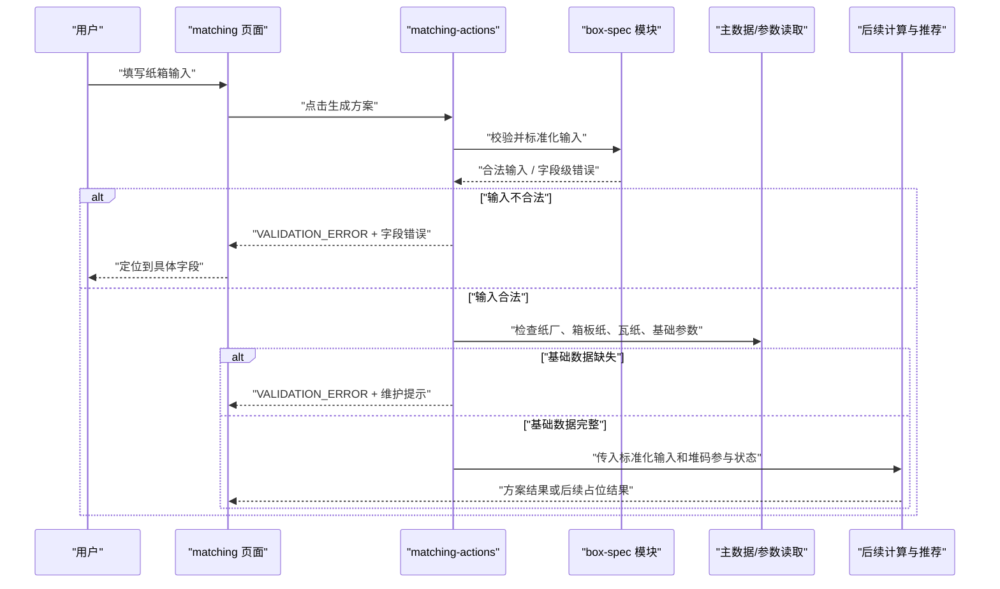
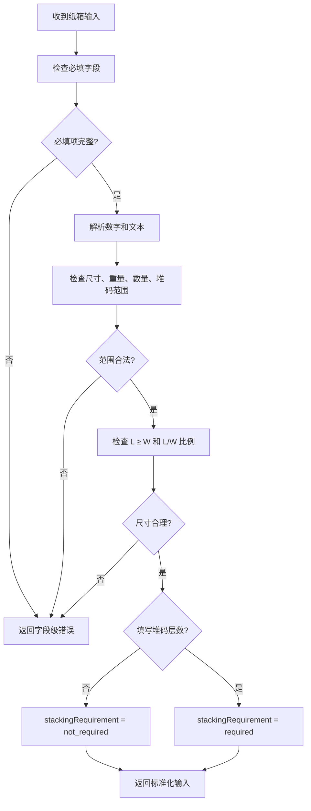

# 纸箱输入校验 — 技术设计文档

## 1. 设计概要

**功能描述**：新增 `box-spec` 纸箱输入校验能力，覆盖纸箱尺寸、结构类型、成箱方式、产品信息、生产数量和可选堆码层数。输入合法时返回标准化后的纸箱输入；输入不合法时返回字段级错误；未填写堆码层数时生成方案不受阻，承重/堆码状态为未校核；填写堆码层数时才把承重因素交给后续计算和推荐。→ AC-001 到 AC-020

**影响范围**：`src/modules/box-spec`、`src/server/actions/matching-actions.ts`、`src/app/(main)/matching`、`tests/unit/box-spec`、`tests/integration/matching`。本功能不新增数据库表，不引入第三方依赖，不实现面积、强度、成本或推荐公式。→ AC-001, AC-002, AC-003, AC-004, AC-011, AC-020

**技术难点**：堆码层数是可选项，但它不是普通可选字段：未填写时不能拦截生成，也不能显示承重达标/不达标；填写后必须进入后续承重计算和推荐判断。同时，尺寸、重量、生产数量等字段需要给出可定位到字段的错误，边界值必须按合法输入处理。→ AC-004, AC-005, AC-006, AC-009, AC-012, AC-018, AC-019

**外部依赖**：无新增依赖。使用 TypeScript 纯函数、现有 `ActionResult`、Next.js Server Actions、Ant Design 表单和 Vitest/React Testing Library 即可。→ AC-020

---

> **CR-001 阶段覆盖说明**：本阶段仅调整页面输入与暂停提交；原有输入契约、服务端校验和生成流程仍为历史实现，并未因页面变更而重新设计。原方案中页面可提交及产品信息必填的描述不作为本阶段页面验收标准。详见“页面表单行为”下的 CR-001 补充。

## 2. 架构概览

本功能采用“纯业务校验模块 + 服务端动作二次校验 + 页面表单展示”的结构。`box-spec` 只负责输入字段、范围、尺寸合理性和堆码参与状态，不读取数据库、不依赖页面、不做推荐；服务端动作负责登录检查、基础数据完整性检查和后续生成方案编排；页面负责录入和展示字段错误。



### 模块职责

| 模块 / 文件 | 职责 | 对应 AC |
|-------------|------|---------|
| `src/modules/box-spec/types.ts` | 定义纸箱输入、标准化结果、字段错误、堆码参与状态、选项枚举 | AC-001 到 AC-004, AC-017, AC-018, AC-019 |
| `src/modules/box-spec/constants.ts` | 定义尺寸、重量、堆码层数、生产数量等校验边界 | AC-006, AC-009, AC-012 到 AC-016 |
| `src/modules/box-spec/validate-box-spec.ts` | 纯函数校验必填、范围、整数、尺寸合理性和堆码可选规则 | AC-001 到 AC-010, AC-012 到 AC-019 |
| `src/modules/box-spec/README.md` | 更新模块边界，说明不做面积、强度、成本、推荐和存储 | AC-020 |
| `src/modules/formulas/read-formula-parameter-status.ts` | 提供基础参数是否可用的最小读取契约，不修改公式口径 | AC-011, AC-020 |
| `src/server/actions/matching-actions.ts` | 登录后执行服务端二次校验、基础数据完整性检查，并把合法输入交给后续流程 | AC-001, AC-005, AC-006, AC-011, AC-018, AC-019 |
| `src/app/(main)/matching/page.tsx` 与页面内组件 | 展示输入表单、去掉堆码总高度、提交后显示字段错误或未校核状态 | AC-001 到 AC-005, AC-017, AC-018 |
| `tests/unit/box-spec/validate-box-spec.test.ts` | 覆盖纯校验规则、边界值、堆码参与状态和字段错误 | AC-001 到 AC-020 |
| `tests/integration/matching/matching-actions.test.ts` | 覆盖服务端动作鉴权、基础数据缺失和字段错误传递 | AC-005, AC-011, AC-018, AC-019 |

---

## 3. 数据模型与存储

本功能不新增数据库表，也不修改现有表。→ AC-020

理由：

- 纸箱输入是“生成方案”的当次输入，首版校验阶段只需要标准化并传给后续计算；历史保存会在“历史方案保存”功能中设计输入快照。→ AC-001, AC-020
- 堆码层数是否填写只影响当次承重是否参与判断，不需要单独存储配置。→ AC-002, AC-003, AC-018, AC-019
- 基础数据完整性依赖现有纸厂、原纸和基础参数数据，不应为校验功能新增表。→ AC-011

### 纸箱输入契约

`box-spec` 对外接收页面或服务端提交的原始输入，字段使用业务单位命名，避免单位歧义。

```ts
export interface BoxSpecInput {
  lengthMm: number | string | undefined;
  widthMm: number | string | undefined;
  heightMm: number | string | undefined;
  structureType: string | undefined;
  formingMethod: BoxFormingMethod | string | undefined;
  productType: string | undefined;
  productWeightKg: number | string | undefined;
  arrangement: ProductArrangement | string | undefined;
  specialRequirements?: string | undefined;
  productionQuantity: number | string | undefined;
  stackingLayers?: number | string | undefined;
}
```

| 字段 | 标准化类型 | 规则 | 对应 AC |
|------|------------|------|---------|
| `lengthMm` | `number` | 必填，整数，100-2000mm，包含边界 | AC-001, AC-005, AC-006, AC-012, AC-013 |
| `widthMm` | `number` | 必填，整数，100-1500mm，包含边界 | AC-001, AC-005, AC-006, AC-012, AC-013 |
| `heightMm` | `number` | 必填，整数，100-1500mm，包含边界 | AC-001, AC-005, AC-006, AC-012, AC-013 |
| `structureType` | `string` | 必填，来自页面下拉选项 | AC-001, AC-005 |
| `formingMethod` | `"glue" \| "staple"` | 必填，粘箱 / 钉箱 | AC-001, AC-005 |
| `productType` | `string` | 必填，去除前后空白后不能为空 | AC-001, AC-005 |
| `productWeightKg` | `number` | 必填，0.5-100kg，包含边界，允许一位或多位小数 | AC-001, AC-005, AC-006, AC-012, AC-014 |
| `arrangement` | `"single_row" \| "double_row" \| "staggered"` | 必填，单排 / 双排 / 交错排列 | AC-001, AC-005 |
| `specialRequirements` | `string \| undefined` | 选填，不参与拦截 | AC-001 |
| `productionQuantity` | `number` | 必填，整数，必须大于 0 | AC-001, AC-005, AC-006, AC-016 |
| `stackingLayers` | `number \| undefined` | 选填；填写时为整数，1-30 层，包含边界 | AC-002, AC-003, AC-009, AC-012, AC-015, AC-018, AC-019 |

### 标准化输出

```ts
export type StackingRequirementStatus = "not_required" | "required";

export interface NormalizedBoxSpec {
  lengthMm: number;
  widthMm: number;
  heightMm: number;
  structureType: string;
  formingMethod: BoxFormingMethod;
  productType: string;
  productWeightKg: number;
  arrangement: ProductArrangement;
  specialRequirements?: string | undefined;
  productionQuantity: number;
  stackingRequirement:
    | {
        status: "not_required";
        stackingLayers?: undefined;
        displayText: "未填写堆码层数，承重未校核";
      }
    | {
        status: "required";
        stackingLayers: number;
        displayText: string;
      };
}
```

`stackingRequirement.status` 是后续计算和推荐判断是否纳入承重的唯一入口：

- `not_required`：后续流程不得把承重作为达标判断或排序因素，结果显示未校核。→ AC-004, AC-018
- `required`：后续流程必须把承重纳入计算、达标判断和推荐结果。→ AC-003, AC-010, AC-019

### 字段错误结构

```ts
export interface BoxSpecFieldError {
  field: keyof BoxSpecInput | "baseData";
  message: string;
}

export type BoxSpecValidationResult =
  | { ok: true; data: NormalizedBoxSpec }
  | {
      ok: false;
      error: {
        code: "VALIDATION_ERROR";
        message: string;
        fieldErrors: BoxSpecFieldError[];
      };
    };
```

字段错误必须保留字段名和用户可见提示，服务端动作再转为项目统一 `ActionResult` 的 `error.details.fieldErrors`，供页面把错误定位到具体表单项。→ AC-005, AC-006, AC-007, AC-008, AC-009

---

## 4. API / 函数契约

本功能优先使用模块纯函数和内部 Server Action，不新增公开 REST API。→ AC-020

### `validateBoxSpecInput`

**描述**：校验并标准化单次配纸输入。→ AC-001 到 AC-010, AC-012 到 AC-019

**位置**：`src/modules/box-spec/validate-box-spec.ts`

**输入**：

```ts
export interface ValidateBoxSpecInputOptions {
  supportedStructureTypes?: readonly string[];
  supportedFormingMethods?: readonly BoxFormingMethod[];
  supportedArrangements?: readonly ProductArrangement[];
}

export function validateBoxSpecInput(
  input: BoxSpecInput,
  options?: ValidateBoxSpecInputOptions,
): BoxSpecValidationResult;
```

**输出**：

- 成功：`{ ok: true, data: NormalizedBoxSpec }`
- 失败：`{ ok: false, error: { code: "VALIDATION_ERROR", message, fieldErrors } }`

### `isStackingRequired`

**描述**：给后续计算和推荐模块使用，判断承重是否参与本次方案。→ AC-003, AC-004, AC-018, AC-019

**位置**：`src/modules/box-spec/validate-box-spec.ts`

```ts
export function isStackingRequired(input: NormalizedBoxSpec): boolean {
  return input.stackingRequirement.status === "required";
}
```

### `generateMatchingScheme`

**描述**：配纸页面点击生成方案时调用的 Server Action。当前阶段先负责登录检查、输入校验和基础数据完整性检查；后续面积、强度、成本、推荐功能接入时复用同一个动作。→ AC-001, AC-002, AC-003, AC-005, AC-011, AC-018, AC-019

**位置**：`src/server/actions/matching-actions.ts`

**输入**：

```ts
export interface GenerateMatchingSchemeInput extends BoxSpecInput {}
```

**输出**：

```ts
export interface GenerateMatchingSchemeValidationResult {
  boxSpec: NormalizedBoxSpec;
  stackingIncluded: boolean;
  stackingDisplayText: string;
}
```

当前“纸箱输入校验”阶段可以先返回校验后的 `boxSpec` 和堆码状态；后续推荐阶段再把返回数据扩展为真实方案列表。扩展时必须保持校验失败的错误结构稳定。→ AC-001, AC-002, AC-003, AC-004

**异常响应**：

| 场景 | 响应 | 对应 AC |
|------|------|---------|
| 未登录 | 复用 `requireAuthenticatedAction` 的 `AUTH_REQUIRED` | AC-001 |
| 输入字段错误 | `{ ok: false, error: { code: "VALIDATION_ERROR", message: "请检查纸箱输入", details: { fieldErrors } } }` | AC-005 到 AC-009 |
| 基础数据缺失 | `{ ok: false, error: { code: "VALIDATION_ERROR", message: "请先维护纸厂、箱板纸、瓦纸和基础参数", details: { fieldErrors: [{ field: "baseData", message }] } } }` | AC-011 |

### 基础数据完整性检查

**描述**：生成方案前确认至少有纸厂、箱板纸、瓦纸和基础参数。→ AC-011

**设计**：

- `matching-actions` 使用 `MatchingReadinessRepository` 统一读取生成前置数据状态。
- 默认 Drizzle 仓储从 `paper_factories` 检查启用纸厂，从 `paper_materials` 检查启用且完整的箱板纸和瓦纸。
- 基础参数状态由 `src/modules/formulas/read-formula-parameter-status.ts` 提供最小契约，只返回是否存在可用基础参数，不在本功能中编辑参数或改变公式口径。
- 测试通过注入式 `readinessRepository` 覆盖完整、缺纸厂、缺箱板纸、缺瓦纸、缺基础参数等场景。

```ts
export interface MatchingReadiness {
  hasPaperFactories: boolean;
  hasLinerPaper: boolean;
  hasCorrugatingPaper: boolean;
  hasFormulaParameters: boolean;
}

export interface MatchingReadinessRepository {
  getMatchingReadiness(): Promise<MatchingReadiness>;
}
```

该接口只检查“是否具备生成前置数据”，不承担主数据维护或参数维护。→ AC-011, AC-020

---

## 5. 核心逻辑

### 输入校验流程 → AC-001 到 AC-010, AC-012 到 AC-019



处理顺序：

1. 检查必填字段：纸箱长度、宽度、高度、结构类型、成箱方式、产品类型、内装物重量、排列方式、生产数量。→ AC-001, AC-005
2. 对数字字段做解析；空字符串视为未填写，非数字视为字段错误。→ AC-005, AC-006
3. 对尺寸和生产数量要求整数；内装物重量允许小数。→ AC-006, AC-013, AC-014, AC-016
4. 检查尺寸范围：长度 100-2000mm，宽度 100-1500mm，高度 100-1500mm，全部包含边界。→ AC-012, AC-013
5. 检查重量范围：0.5-100kg，包含边界。→ AC-012, AC-014
6. 检查生产数量：整数且大于 0。→ AC-016
7. 如果填写堆码层数，检查整数且 1-30 层，包含边界。→ AC-003, AC-009, AC-012, AC-015, AC-019
8. 如果未填写堆码层数，不返回错误，设置承重未校核状态。→ AC-002, AC-004, AC-018
9. 检查尺寸合理性：`lengthMm >= widthMm`，且 `lengthMm / widthMm` 在 1.0-5.0 之间，包含边界。→ AC-007, AC-008
10. 返回标准化输入，供后续面积、强度、成本和推荐使用。→ AC-001, AC-003, AC-018, AC-019

### 堆码参与状态 → AC-002, AC-003, AC-004, AC-010, AC-018, AC-019

堆码规则由 `stackingRequirement.status` 表达，不用布尔散落在各模块中。

| 输入情况 | 校验结果 | 后续计算 / 推荐行为 | 结果展示 | 对应 AC |
|----------|----------|---------------------|----------|---------|
| 未填写堆码层数 | `not_required` | 承重不参与计算、达标判断和推荐排序 | “未填写堆码层数，承重未校核” | AC-002, AC-004, AC-018 |
| 填写 1-30 层 | `required` | 承重必须参与计算、达标判断和推荐结果 | 展示承重校核结果 | AC-003, AC-019 |
| 填写小于 1 或大于 30 | 校验失败 | 不进入生成方案 | 字段错误 | AC-009 |
| 填写后承重不达标 | 校验通过，后续强度/推荐标记不达标 | 正常展示方案，不把不达标方案伪装成达标 | 标记承重不达标及原因 | AC-010 |

### 字段级错误聚合 → AC-005 到 AC-009

`validateBoxSpecInput` 一次返回所有已发现字段错误，避免用户一项一项试错。错误示例：

| 字段 | 场景 | message | 对应 AC |
|------|------|---------|---------|
| `lengthMm` | 空 | `纸箱长度不能为空` | AC-005 |
| `lengthMm` | 99 | `纸箱长度允许范围为 100-2000mm` | AC-006 |
| `widthMm` | 1600 | `纸箱宽度允许范围为 100-1500mm` | AC-006 |
| `productWeightKg` | 0.4 | `内装物重量允许范围为 0.5-100kg` | AC-006 |
| `lengthMm` | 小于宽度 | `纸箱长度必须大于或等于宽度` | AC-007 |
| `widthMm` | L/W 超出范围 | `纸箱长宽比例必须在 1.0-5.0 之间` | AC-008 |
| `stackingLayers` | 31 | `堆码层数允许范围为 1-30 层` | AC-009 |
| `productionQuantity` | 0 | `生产数量必须大于 0` | AC-016 |

### 基础数据完整性 → AC-011

服务端动作在输入校验通过后检查基础数据：

1. 是否至少有一个启用纸厂。
2. 是否至少有一条启用且完整的箱板纸。
3. 是否至少有一条启用且完整的瓦纸。
4. 是否存在当前可用的基础参数。

任何一项缺失都阻止生成方案，并返回维护提示。该检查不放在 `box-spec`，原因是 `box-spec` 必须保持纯输入校验，不依赖数据库或参数模块。→ AC-011, AC-020

### 页面表单行为 → AC-001 到 AC-005, AC-017, AC-018

- 使用 Ant Design 表单展示纸箱参数、产品信息、订单信息和可选堆码层数。
- 不渲染堆码总高度字段。→ AC-017
- 堆码层数不是必填项；未填写时提交按钮可用。→ AC-002
- 服务端返回 `fieldErrors` 后，页面把错误设置到对应表单项。→ AC-005 到 AC-009
- 生成结果区域不展示堆码承重摘要；如果收到 `stackingRequirement.status === "not_required"`，只保留承重未校核状态供后续流程判断，不显示达标或不达标标签。→ AC-004, AC-018

---

#### CR-001：页面输入与提交边界（AC-021 至 AC-025）

- 复用 `box-spec-form.tsx` 现有表单与选择控件，页面保存尺寸类型、纸箱层数；默认分别为内径、三层。长宽高标签随尺寸类型更新，数值不自动转换。
- 页面不渲染产品类型、内装物重量、排列方式；同时不渲染纸箱结构类型和堆码层数输入；保留纸箱层数选择。
- 暂停生成按钮并在页面解释原因；表单提交处理也应阻止调用生成动作，避免回车或其他提交方式绕过。
- 当前不改变 `BoxSpecInput`、服务端校验、数据库或计算接口；不传递假造的内装物数据，不声称后端已支持外径或层数选择。
- 先前页面改动是未验证的工作区变更；需要检查后按增量任务验证，不视为已完成。
- 后续外径转换及仅选定层数的方案生成需单独设计、接入和验证，不在此阶段修改核心计算。

#### CR-002：物理指标可选输入（AC-026、AC-027）

复用现有表单和控件，在页面保存开关和各输入的临时状态，收起时保留值；按重量与堆码、强度要求分组，窄屏适配。空纸箱重量和内装物重量暂以 kg 展示，堆码层数以层、边压以 kN/m、空箱抗压以 N 展示；耐破单位未确定，不作假设。仅做前端展示和输入，不接入服务端、指标校验或计算；继续防止提交。

## 6. 现有代码改动

| 模块 / 文件 | 改动内容 | 原因 | 对应 AC |
|-------------|----------|------|---------|
| `src/modules/box-spec/types.ts` | 新增纸箱输入、标准化输入、堆码状态、字段错误类型 | 为页面、服务端动作和后续计算提供统一契约 | AC-001 到 AC-004, AC-017 到 AC-019 |
| `src/modules/box-spec/constants.ts` | 新增尺寸、重量、堆码层数、生产数量和选项常量 | 避免范围数字散落在页面或服务端动作中 | AC-006, AC-009, AC-012 到 AC-016 |
| `src/modules/box-spec/validate-box-spec.ts` | 新增 `validateBoxSpecInput`、`isStackingRequired` | 集中实现输入校验和堆码参与规则 | AC-001 到 AC-019 |
| `src/modules/box-spec/README.md` | 更新模块边界和使用说明 | 明确不做堆码总高度、面积、强度、成本和推荐 | AC-017, AC-020 |
| `src/modules/formulas/read-formula-parameter-status.ts` | 新增只读函数 `hasActiveFormulaParameters` | 让生成方案前能判断基础参数是否可用，不编辑公式参数 | AC-011, AC-020 |
| `src/server/actions/matching-actions.ts` | 新增 `generateMatchingScheme`，调用登录检查、输入校验、基础数据完整性检查 | 提供配纸页面提交入口，并保证服务端二次校验 | AC-001, AC-005, AC-011, AC-018, AC-019 |
| `src/app/(main)/matching/page.tsx` | 从占位页升级为配纸输入表单入口 | 让用户能输入字段、提交生成并看到字段错误 | AC-001 到 AC-005, AC-017, AC-018 |
| `src/app/(main)/matching/_components/box-spec-form.tsx` | 新增页面级表单组件 | 页面层只做交互和展示，不写核心校验规则 | AC-001 到 AC-005, AC-017 |
| `tests/unit/box-spec/validate-box-spec.test.ts` | 新增纯函数测试，覆盖所有范围、边界和堆码状态 | 输入校验属于 P0 业务规则，应可直接 TDD | AC-001 到 AC-020 |
| `tests/integration/matching/matching-actions.test.ts` | 新增服务端动作测试，覆盖基础数据缺失和字段错误结构 | 验证页面提交入口能正确返回用户可见错误 | AC-005, AC-011, AC-018, AC-019 |
| `tests/integration/matching/matching-page.test.tsx` | 新增页面表单测试，确认无堆码总高度字段和字段错误展示 | 验证用户可见交互符合需求 | AC-004, AC-005, AC-017, AC-018 |

---

## 7. 技术决策

### 使用纯函数校验，而不是在页面或 Server Action 中散写规则

**背景**：同一份输入规则需要在页面、服务端动作、后续计算和测试中保持一致。项目规范也要求核心业务逻辑放在 `src/modules`，页面只做展示和交互。

**选项**：

- A: 在 Ant Design 表单里写全部校验规则 — 即时反馈方便，但服务端和后续计算仍要重复实现。
- B: 在 Server Action 中写全部校验规则 — 能保证服务端安全，但页面和测试复用困难。
- C: 在 `box-spec` 中实现纯函数，页面和服务端都复用 — 规则集中、可测试、符合模块边界。

**结论**：选择 C。页面可以用同一批常量做基础提示，但最终以 `validateBoxSpecInput` 为准。→ AC-001 到 AC-019

### 不新增数据库表

**背景**：需求只要求校验当前输入，不要求保存输入历史。历史方案保存会在后续独立功能中处理。

**选项**：

- A: 新增纸箱输入表 — 可为历史保存提前铺路，但会扩大本功能范围。
- B: 不新增表，只返回标准化输入 — 聚焦校验，后续历史方案保存再设计快照。

**结论**：选择 B。保持本功能小而清楚，不提前绑定历史方案存储结构。→ AC-020

### 堆码状态使用联合类型表达

**背景**：未填写堆码层数时，不是“承重不达标”，而是“承重未校核”；填写后才有达标/不达标。

**选项**：

- A: 使用 `stackingLayers?: number`，让后续模块自己判断 — 容易出现某个模块把未填写误判为 0 层或不达标。
- B: 使用 `stackingRequirement.status` 联合类型 — 状态明确，TypeScript 能约束后续处理。

**结论**：选择 B。后续计算和推荐模块必须读取该状态，避免业务口径漂移。→ AC-004, AC-010, AC-018, AC-019

### 基础数据完整性放在服务端动作，而不是 `box-spec`

**背景**：基础数据检查需要读取纸厂、原纸和参数；`box-spec` 应该是纯输入校验模块。

**选项**：

- A: `box-spec` 直接读取数据库检查基础数据 — 一步到位，但破坏模块边界，也让单元测试变重。
- B: `box-spec` 只校验输入，`matching-actions` 在编排层检查基础数据 — 职责清楚，符合项目依赖方向。

**结论**：选择 B。`box-spec` 仍是纯业务模块，服务端动作负责连接认证、数据和后续生成流程。→ AC-011, AC-020

### 不引入 Zod 等新依赖

**背景**：当前项目没有表单 schema 校验库，开发规范要求不为少量代码引入大包。

**选项**：

- A: 引入 Zod — schema 表达更集中，但增加依赖和学习成本。
- B: 使用 TypeScript 纯函数 — 足够覆盖当前规则，无新增依赖。

**结论**：选择 B。若后续表单和导入校验规模明显扩大，再单独评估统一 schema 校验库。→ AC-020

---

## 8. 安全与性能

**服务端二次校验**：页面校验只用于即时反馈，`generateMatchingScheme` 必须调用 `validateBoxSpecInput`，避免用户绕过前端提交非法输入。→ AC-005 到 AC-009

**错误信息**：返回业务语言和字段名，不展示堆栈、数据库错误或内部路径。基础数据缺失统一提示维护数据，不暴露底层查询细节。→ AC-005, AC-006, AC-011

**输入处理**：文本字段只做 trim，不使用 `dangerouslySetInnerHTML` 展示用户输入；数字字段转换后必须是有限数字。→ AC-005, AC-006

**性能考量**：输入校验是常量级纯函数；基础数据完整性检查只需要少量 count 或 exists 查询。不会影响单次方案生成 5 秒目标。→ AC-001, AC-011

**真实数据保护**：测试使用虚构尺寸、重量和数量，不引入真实客户、纸价、订单或供应商数据。→ AC-020

---

## 9. AC 覆盖总表

| AC 编号 | 验收标准概述 | 实现位置 |
|---------|--------------|----------|
| AC-001 | 完整合法输入可生成方案 | `validateBoxSpecInput` 成功分支、`generateMatchingScheme` |
| AC-002 | 未填写堆码层数也可生成方案 | `stackingRequirement.status = "not_required"` |
| AC-003 | 填写堆码层数后纳入承重判断 | `stackingRequirement.status = "required"`、`isStackingRequired` |
| AC-004 | 未填写堆码层数时承重未校核 | 标准化输出 `displayText`，页面不展示承重结论 |
| AC-005 | 必填字段为空 | `validateRequiredText` / `validateRequiredNumber` 字段错误 |
| AC-006 | 数值字段超出允许范围 | 尺寸、重量、数量范围校验 |
| AC-007 | 纸箱长度小于宽度 | 尺寸合理性校验 `lengthMm >= widthMm` |
| AC-008 | 长宽比例不合理 | 尺寸合理性校验 `lengthMm / widthMm` |
| AC-009 | 堆码层数超出允许范围 | `stackingLayers` 可选字段范围校验 |
| AC-010 | 填写堆码层数后承重不达标 | 后续强度/推荐读取 `required` 状态并标记承重不达标 |
| AC-011 | 基础数据缺失 | `matching-actions` 基础数据完整性检查 |
| AC-012 | 边界值按合法输入处理 | 范围比较使用 `>=` / `<=` |
| AC-013 | 纸箱尺寸范围 | `BOX_SPEC_LIMITS.lengthMm/widthMm/heightMm` |
| AC-014 | 内装物重量范围 | `BOX_SPEC_LIMITS.productWeightKg` |
| AC-015 | 堆码层数范围 | `BOX_SPEC_LIMITS.stackingLayers` |
| AC-016 | 生产数量要求 | `productionQuantity` 整数且 `> 0` |
| AC-017 | 堆码总高度不保留 | `BoxSpecInput`、页面表单和测试均不包含堆码总高度 |
| AC-018 | 未填写堆码层数不参与承重判断 | `not_required` 状态、后续模块不纳入排序和达标 |
| AC-019 | 填写堆码层数必须参与承重判断 | `required` 状态、后续模块必须纳入承重 |
| AC-020 | 本功能不扩大范围 | 不新增 DB 表、不新增依赖、不实现摇盖专项/戳穿/吸潮/批量配纸 |

---

## 附录：变更记录

| 日期 | 变更内容 | 原因 |
|------|----------|------|
| 2026-07-01 | 初始版本 | 根据“纸箱输入校验”需求文档产出可执行技术方案 |

### CR-001：纸箱输入页面调整（2026-11-07）
**变更类型**：扩展
**变更原因**：先完成前端输入，后续重新设计计算和指标校验。
**变更内容**：补充尺寸类型和纸箱层数交互，移除三项页面输入，暂停页面生成并覆盖表单提交路径。

### CR-001 补充：简化当前输入页面（2026-11-07）
**变更类型**：微调
**变更原因**：用户确认进一步精简输入。
**变更内容**：移除纸箱结构类型和堆码层数的页面输入，不更改后端计算契约。

### CR-002：物理指标要求输入界面（2026-11-07）
**变更类型**：扩展
**变更原因**：按需展示指标输入。
**变更内容**：增加可收起的六项前端输入，暂不连接后端和计算。

### CR-003：按瓦型生成面积（2026-11-09）
**变更类型**：扩展
**变更原因**：先提供面积展示。
**变更内容**：页面调用 calculations 的面积计算，换算外径后输出各瓦型单箱面积，不调用原纸、成本或强度推荐流程；BE 和七层加放按已确认口径。
