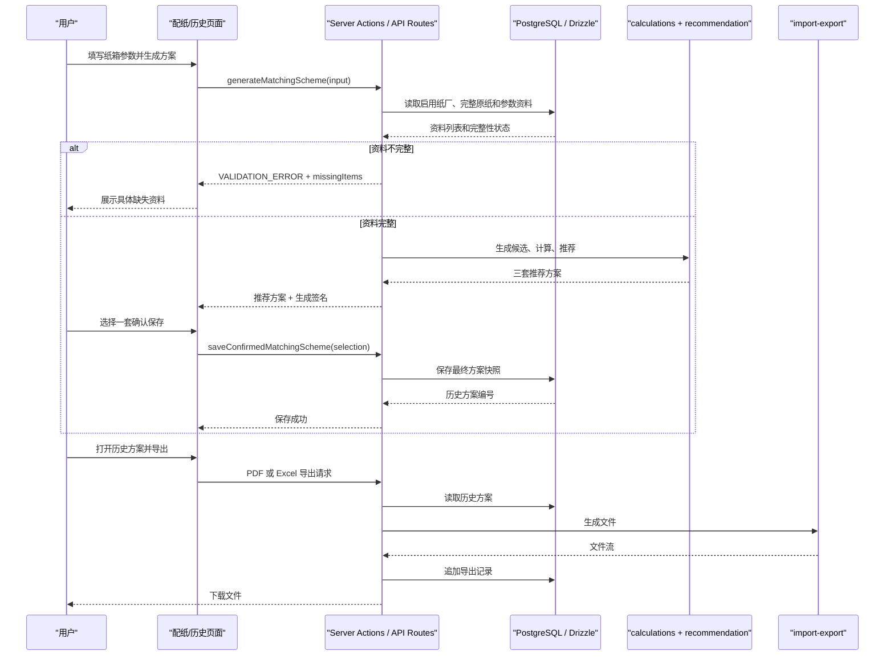
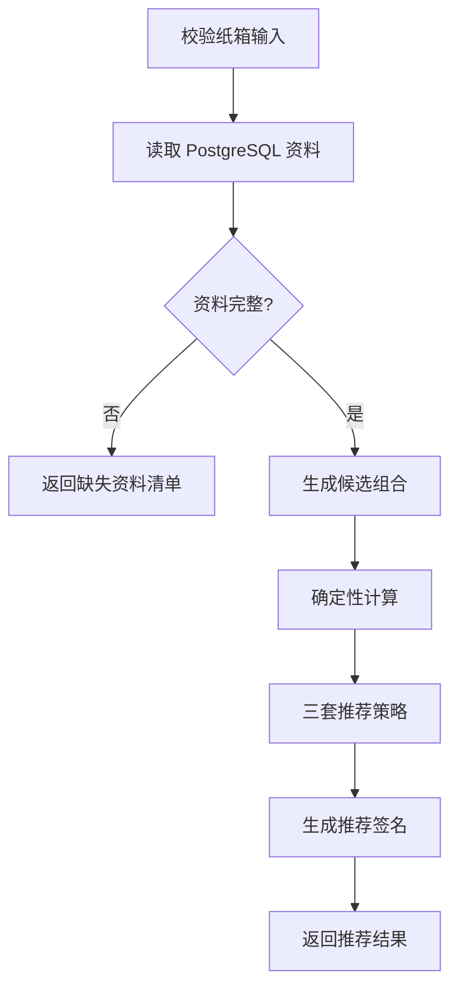
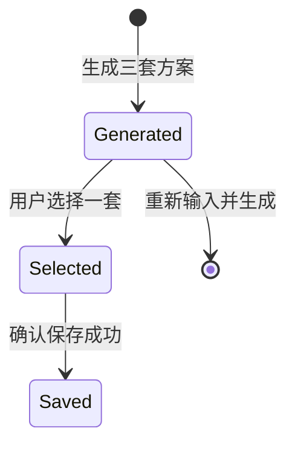

# 配纸工具纯配纸重构 — 技术设计文档

## 1. 设计概要

**功能描述**：将现有工具收口为纯配纸工作台，只保留配纸输入、三套方案生成、确认保存、历史查看、PDF 导出和单条方案 Excel 导出；前台数据维护、历史习惯维护、手动调整与重新校核全部移除。

**影响范围**：`src/app/(main)` 页面导航、`matching` 配纸页、`history` 历史页、`server/actions/matching-actions.ts`、`server/actions/matching-readiness.ts`、`modules/master-data` 资料读取、`modules/scheme-adjustment` 调用边界、`modules/import-export` 导出能力、相关集成测试。

**技术难点**：
- 配纸资料源改为直接读取 PostgreSQL `paper_warehouse` 时，必须保留当前纯配纸页面、资料完整性校验和推荐契约，不改变确定性计算。
- 现有保存流程支持手动调整、脏状态和重新校核，本次需要收口为“只能保存系统生成的推荐方案”。
- 现有历史页混入历史订单导入、历史习惯摘要、全部方案备份导出，本次需要收口为历史方案查看和单条导出。

**外部依赖**：PostgreSQL 数据库服务。CR-003 起，配纸资料直接只读 `paper_warehouse.paper_paperroll`；配纸专用表与历史方案保存在同一数据库的新表中，流程不再依赖 PocketBase 或原纸管理后台 API。

---

## 2. 架构概览

本次不新增项目顶层模块。配纸生成由 `src/server/actions/matching-actions.ts` 创建 PostgreSQL/Drizzle 客户端，通过 `WarehouseDatabaseMatchingSourceDataRepository` 只读 `paper_paperroll`，再复用现有资料映射、确定性强度标准、`calculations` 与 `recommendation`。历史方案继续保存在同一数据库的 `matching_schemes` 表中。→ AC-002, AC-003, AC-004, AC-008, AC-009, AC-014, AC-015, AC-019, AC-025



模块职责：

| 模块 | 设计职责 | 对应 AC |
|------|----------|---------|
| `src/app/(main)/layout.tsx` | 主导航只保留“配纸”和“历史方案”，移除“数据管理”入口 | AC-001, AC-007, AC-013 |
| `src/app/(main)/matching` | 保留输入、生成、选择、保存；移除调整控件和重新校核入口 | AC-002, AC-003, AC-010, AC-018 |
| `src/app/(main)/history` | 只展示已保存方案、详情、PDF/Excel 单条导出；移除历史订单和习惯模块 | AC-004, AC-005, AC-006, AC-011 |
| `src/modules/master-data` | 直接读取并聚合 `paper_warehouse` 在库卷纸，恢复公司强度标准和等级映射 | AC-008, AC-009, AC-017, AC-019, AC-020, AC-021, AC-025 |
| `src/server/actions/matching-actions.ts` | 生成方案前检查资料完整性；保存时只接受系统推荐槽位 | AC-002, AC-003, AC-014, AC-015 |
| `src/modules/import-export` | 新增单条历史方案 Excel 工作簿构建；保留 PDF 导出 | AC-005, AC-006, AC-012, AC-016 |

---

## 3. 数据库设计

### 新增表

无需新增表。历史方案继续使用现有 `matching_schemes` 表。→ AC-003, AC-004, AC-005, AC-006

### 修改现有表

无需修改表结构。

现有 `matching_schemes.export_records` 是 JSONB 数组，可直接记录新的单条 Excel 导出类型；现有 `is_manually_adjusted` 字段保留兼容旧记录，新保存记录固定为 `false`。→ AC-006, AC-010, AC-016

### 类型变更

#### `MatchingSchemeExportType`

**变更内容**：在 `src/modules/import-export/matching-scheme-export-types.ts` 中新增单条方案 Excel 类型，历史兼容保留 `all_backup`，但前台不再展示全部备份导出入口。→ AC-006, AC-011, AC-016

```ts
export type MatchingSchemeExportType =
  | "full_report"
  | "summary_sheet"
  | "scheme_excel"
  | "all_backup";
```

**数据迁移**：无需迁移。旧记录中的 `all_backup` 继续可展示为历史导出记录；新前台不再产生 `all_backup`。

---

## 4. API 设计

项目当前主流程使用 Server Actions 和少量 API Route，本次沿用这个风格。

### `generateMatchingScheme(input)`

**描述**：校验纸箱输入、读取 PostgreSQL 资料、检查资料完整性，资料完整时生成三套推荐方案。→ AC-002, AC-008, AC-009, AC-017, AC-019

**鉴权**：保持现有页面访问保护；服务端动作按现有登录策略执行。

**Request**：
```ts
type GenerateMatchingSchemeInput = BoxSpecInput;
```

**Response（成功）**：
```ts
interface GenerateMatchingSchemeResult {
  boxSpec: NormalizedBoxSpec;
  stackingIncluded: boolean;
  stackingDisplayText: string;
  recommendationSlots: [RecommendationSlot, RecommendationSlot, RecommendationSlot];
  recommendationMessages: string[];
  rejectedSummary: RejectedCandidateSummary[];
  rejectedCandidates: RejectedCandidateEvaluation[];
  generationToken: string;
}
```

**异常响应**：

| 场景 | 响应 | 对应 AC |
|------|------|---------|
| 纸箱输入校验失败 | `ActionResult` 返回 `VALIDATION_ERROR` 和字段错误 | AC-002 |
| `DATABASE_URL` 缺失或 PostgreSQL 不可访问 | 返回业务化错误，不暴露完整连接串、密码或堆栈 | AC-008, AC-009, AC-017, AC-023, AC-024 |
| 原纸资料缺失 | 返回 `VALIDATION_ERROR`，`details.missingItems` 包含原纸代码、资料项和提示文案 | AC-008, AC-017 |
| 参数资料缺失 | 返回 `VALIDATION_ERROR`，`details.missingItems` 包含参数类别和提示文案 | AC-009, AC-017 |

### `saveConfirmedMatchingScheme(input)`

**描述**：保存用户从三套系统推荐中选择的一套最终方案；不再接收调整数据、脏状态或重新校核状态。→ AC-003, AC-014, AC-015

**鉴权**：保持现有保存人识别逻辑。

**Request**：
```ts
interface SaveConfirmedMatchingSchemeInput {
  boxSpec: BoxSpecInput;
  originalRecommendationSlots: RecommendationSlot[];
  selectedStrategy: RecommendationStrategy;
  generationToken: string;
}
```

**Response（成功）**：
```ts
interface SaveConfirmedMatchingSchemeResult {
  schemeId: string;
  finalStatus: "qualified";
  isManuallyAdjusted: false;
  warningMessages: string[];
  savedAt: string;
}
```

**异常响应**：

| 场景 | 响应 | 对应 AC |
|------|------|---------|
| 未选择推荐槽位 | `VALIDATION_ERROR`，提示请选择一套方案 | AC-003 |
| 选择的槽位不是系统推荐方案 | `VALIDATION_ERROR`，提示只能保存系统生成的推荐方案 | AC-014 |
| 生成签名无效或过期 | `VALIDATION_ERROR`，提示请重新生成方案后保存 | AC-014 |
| 选中方案未达标或不可生产 | `VALIDATION_ERROR`，沿用当前“当前方案未达标或不可生产，无法确认保存” | AC-014 |

### `GET /api/exports/matching-schemes/[schemeId]?type=full_report|summary_sheet`

**描述**：保留现有单条历史方案 PDF 导出接口。→ AC-005

**鉴权**：`requireAuthenticatedAction`。

**异常响应**：

| 场景 | 状态码 | 响应 | 对应 AC |
|------|--------|------|---------|
| 未登录 | 401 | 登录错误文案 | AC-005 |
| 方案不存在 | 404 | `方案记录不存在` | AC-005 |
| 方案不可导出 | 409 | `当前方案不可导出` | AC-005 |
| PDF 生成失败 | 500 | `导出失败，请稍后重试` | AC-012 |

### `GET /api/exports/matching-schemes/[schemeId]/excel`

**描述**：新增单条历史方案 Excel 导出接口。该接口导出当前历史方案的输入、原始三套推荐、最终确认方案和导出记录；不是全部方案备份。→ AC-006, AC-016

**鉴权**：`requireAuthenticatedAction`。

**Response（成功）**：
- `Content-Type`: `application/vnd.openxmlformats-officedocument.spreadsheetml.sheet`
- `Content-Disposition`: `attachment; filename*=UTF-8''配纸方案-{schemeId短码}-{时间}.xlsx`

**异常响应**：

| 场景 | 状态码 | 响应 | 对应 AC |
|------|--------|------|---------|
| 未登录 | 401 | 登录错误文案 | AC-006 |
| 方案不存在 | 404 | `方案记录不存在` | AC-006 |
| Excel 生成失败 | 500 | `导出失败，请稍后重试` | AC-012 |

---

## 5. 核心逻辑

### 5.1 `paper_warehouse` PostgreSQL 资料源 → AC-002, AC-008, AC-009, AC-017, AC-019, AC-020, AC-021, AC-025

**触发条件**：用户点击生成方案。

**处理流程**：
1. 从服务端环境变量读取指向 `paper_warehouse` 的 `DATABASE_URL`，通过 `createDatabaseClient` 创建 PostgreSQL/Drizzle 客户端。
2. `WarehouseDatabaseMatchingSourceDataRepository` 只读查询 `paper_paperroll.status="in_stock"`。
3. 以非空 `material_code` 聚合卷纸重量；吨价按有效卷重加权并从元/公斤换算为元/吨。
4. 纸种从物料类别和规格确定性识别；等级按“进口/金太阳 → 优等品，H级/AA级 → 一等品，其余 → 合格品”判定，优等品优先。
5. 通过恢复的 `resolvePaperStrengthStandard` 按纸种、等级和克重推导耐破指数与横向环压指数。
6. 数据库记录映射为既有 `RecommendablePaperMaterial` 后进入候选生成；页面和计算模块不感知数据库实现。
7. 单张无法完整映射的仓库原纸保持不完整并退出候选，但不阻断其他完整原纸；只有完整箱板纸或完整瓦纸整类缺失时才返回结构化缺失清单。数据库配置或连接失败时返回脱敏业务错误，不回退仓库后台 API。

缺失项结构：

```ts
interface MatchingDataMissingItem {
  scope: "paper_material" | "formula_parameter";
  code?: string | undefined;
  name?: string | undefined;
  field: string;
  message: string;
}
```

**伪代码**：
```ts
const client = createDatabaseClient(databaseUrl); // DATABASE_URL 指向 paper_warehouse
const source = new WarehouseDatabaseMatchingSourceDataRepository(client.db);
const readiness = await checkMatchingReadinessFromRepository({
  repository: new MatchingSourceReadinessRepository(source),
});

if (!readiness.ok) return readiness;
return listRecommendablePaperMaterialsFromRepository({
  repository: new MatchingSourcePaperMaterialRepository(source),
});
```

### 5.2 生成方案收口 → AC-002, AC-014

**触发条件**：资料完整且纸箱输入合法。

**处理流程**：
1. `generateMatchingScheme` 默认使用 `paper_warehouse` 只读资料源和现有 readiness 契约。
2. 保留 `evaluateMatchingCandidates`、`selectMatchingRecommendations` 和 AI/模板理由逻辑。
3. 移除历史习惯参与推荐的读取链路，默认使用 unavailable context，避免历史订单和习惯维护继续影响纯配纸工具。
4. 为三套推荐槽位生成 `generationToken`，签名内容包括规范化纸箱输入、三个推荐槽位的策略和候选指纹。
5. 前端保存时必须带回 `generationToken`。



### 5.3 保存最终方案收口 → AC-003, AC-010, AC-014, AC-015, AC-018

**触发条件**：用户选择一套推荐并点击确认保存。

**处理流程**：
1. 删除或停止导出 `recalculateAdjustedScheme` 给页面调用。
2. `SaveConfirmedMatchingSchemeInput` 删除 `baseCandidate`、`adjustments`、`clientState`。
3. 服务端通过 `selectedStrategy` 从 `originalRecommendationSlots` 中找到对应槽位。
4. 校验 `generationToken`，确保所选槽位来自本次系统生成结果。
5. 对选中候选重新执行 `evaluateCandidate`，确认仍为 `qualified`。
6. 调用 `createHistorySnapshot` 保存快照，`isManuallyAdjusted` 固定为 `false`。
7. 返回保存成功信息。

**状态流转**：



不再存在 `Dirty`、`Recalculated`、`Adjusted` 状态。

### 5.4 页面入口收口 → AC-001, AC-007, AC-010, AC-011, AC-013

**触发条件**：用户浏览主应用。

**处理流程**：
1. `src/app/(main)/layout.tsx` 品牌副标题改为“单次配纸”，底部导航只保留“配纸”和“历史方案”。
2. `/master-data`、`/settings`、历史订单导入入口不再从任何前台导航或页面出现。
3. 历史页移除 `HistoricalOrderImportPanel`、`HistoricalOrderHabitSummarySection`、全部方案备份导出链接。
4. 配纸页移除手动调整控件、重新校核按钮、调整状态显示和“用户已手动调整”文案。
5. 历史方案卡片只展示查看详情、PDF 导出和 Excel 导出。

### 5.5 单条历史方案 Excel 导出 → AC-006, AC-012, AC-016

**触发条件**：用户从历史方案详情点击导出 Excel。

**处理流程**：
1. 新增 `build-matching-scheme-workbook.ts`，复用现有 ExcelJS。
2. 输入为单条 `MatchingSchemeHistoryRecord`，输出 `fileName` 和 `Buffer`。
3. 工作簿包含：
   - `方案总览`
   - `原始三套推荐`
   - `最终确认方案`
   - `导出记录`
4. 导出成功后追加 `exportRecords`：
   - `type: "scheme_excel"`
   - `exportedAt: ISO string`
5. 导出失败不修改历史方案。

---

## 6. 现有代码改动

| 模块 / 文件 | 改动内容 | 原因 | 对应 AC |
|-------------|---------|------|---------|
| `src/app/(main)/layout.tsx` | 移除“数据管理”导航，新增或保留“历史方案”入口，品牌副标题改为纯配纸口径 | 前台只保留配纸相关能力 | AC-001, AC-007, AC-013 |
| `src/app/(main)/matching/_components/box-spec-form.tsx` | 移除手动调整 UI、重新校核 UI、`clientState`、调整状态和调整后保存逻辑 | 不支持手动调整和重新校核 | AC-003, AC-010, AC-018 |
| `src/server/actions/matching-actions.ts` | 删除页面可用的重新校核路径；保存输入改为 selectedStrategy + generationToken；默认资料源使用 `paper_warehouse` 只读适配器 | 只能保存系统生成推荐方案并统一数据源 | AC-002, AC-003, AC-014, AC-015, AC-019 |
| `src/server/actions/matching-readiness.ts` | 增加缺失项结构，错误文案改为“资料不完整，请到后端资料库补齐”类业务提示 | 缺资料时显示具体项 | AC-008, AC-009, AC-017 |
| `src/modules/master-data/matching-source.ts`、`paper-strength-standards.ts` | 恢复资料映射与公司强度标准 | 仓库卷纸需转换成既有推荐材料契约 | AC-008, AC-020, AC-021, AC-025 |
| `src/modules/master-data/warehouse-database-matching-source.ts` | 新增 `paper_paperroll` 只读查询、在库过滤和物料聚合 | 不经 API 直接使用 `paper_warehouse` 数据 | AC-019, AC-020, AC-021 |
| `src/modules/master-data/warehouse-api-*.ts`、`configured-matching-source.ts` | 移除仓库后台配置和读取适配器 | 配纸流程不再使用仓库后台 API | AC-019, AC-023, AC-024 |
| `src/modules/scheme-adjustment/*` | 不删除模块，停止从页面和保存主流程调用；测试可保留作为历史兼容 | 小范围改动，避免破坏旧快照类型 | AC-010, AC-018 |
| `src/app/(main)/history/page.tsx` | 移除历史订单导入、历史习惯摘要、全部备份导出；历史卡片只保留查看和单条导出 | 历史页只服务已保存方案 | AC-004, AC-011 |
| `src/app/api/exports/matching-schemes/backup/route.ts` | 前台不再链接；可保留接口为内部兼容或返回 410，编码阶段二选一但不得前台可见 | 移除导出备份能力 | AC-007, AC-011, AC-013 |
| `src/app/api/exports/matching-schemes/[schemeId]/excel/route.ts` | 新增单条方案 Excel 导出接口 | 表格导出为 Excel | AC-006, AC-012, AC-016 |
| `src/modules/import-export/matching-scheme-export-types.ts` | 新增 `scheme_excel` 类型和标签 | 记录单条 Excel 导出 | AC-006, AC-016 |
| `src/modules/import-export/build-matching-scheme-workbook.ts` | 新增单条历史方案 Excel 构建器 | 避免复用“全部备份”语义 | AC-006, AC-016 |
| `.env.example` | `DATABASE_URL` 脱敏示例使用 `paper_warehouse`，不包含仓库 API 或 Token 配置 | 服务端直接连接 PostgreSQL | AC-019, AC-023, AC-024 |
| `tests/integration/matching/*` | 更新生成、保存、页面交互测试，覆盖无调整流程和缺失资料提示 | 行为变化需要测试 | AC-002, AC-003, AC-008, AC-010, AC-014 |
| `tests/integration/master-data/*` | 前台数据维护页面测试移除或改为不可达/无入口测试 | 数据维护前台移除 | AC-007, AC-013 |
| `tests/integration/import-export/*` | 新增单条 Excel 导出测试，保留 PDF 导出失败测试 | 导出范围变化 | AC-005, AC-006, AC-012, AC-016 |

---

## 7. 技术决策

### 配纸资料统一使用 `paper_warehouse`

**背景**：实际原纸库存保存在 PostgreSQL `paper_warehouse.paper_paperroll`；用户确认不经仓库后台 API，直接使用该数据库，并给出等级判定规则。

**选项**：
- A: 保留仓库 API 并增加回退。优点是兼容旧部署；代价是资料源不唯一，失败时容易误用不同口径。
- B: 生成和历史统一使用 `paper_warehouse`。生成时只读既有 Django 卷纸表，历史方案使用同库新建的配纸专用表；优点是单一连接且不需要 API Token，代价是必须维持字段适配层。

**结论**：选择 B。`DATABASE_URL` 指向 `paper_warehouse`；仓库 API 适配器和配置退出运行链路。适配器只执行 SELECT，不修改仓库原表。页面仍只接收业务结果和缺失项提示。→ AC-008, AC-009, AC-017, AC-019, AC-023, AC-025

### 历史方案与主数据共用数据库

**背景**：基础资料和历史方案现在统一回到项目 PostgreSQL 数据库。

**选项**：
- A: 主数据与历史方案使用不同服务。优点是可独立部署；代价是配置和故障面增加。
- B: 主数据与历史方案共用现有 PostgreSQL。优点是连接和数据口径统一，不需要迁移 `matching_schemes`。

**结论**：选择 B。只切换读取仓储，不修改表结构或历史快照结构。→ AC-003, AC-004, AC-005, AC-006, AC-019

### 保存方案的可信性

**背景**：旧保存接口允许传入候选和调整内容。新需求要求最终方案必须来自系统推荐。

**选项**：
- A: 只在前端隐藏调整入口。优点是改动少；代价是服务端仍可能接受非推荐候选。
- B: 保存时校验生成签名和所选推荐槽位。优点是能从服务端保证“来自系统推荐”；代价是需要新增签名工具和测试。

**结论**：选择 B。生成方案时返回签名，保存时验证签名和推荐槽位，避免只靠 UI 约束。→ AC-014, AC-015

### Excel 导出范围

**背景**：现有代码已有“全部方案备份导出”，但本次需求明确历史方案只支持查看和导出，不支持导出备份。

**选项**：
- A: 复用全部备份导出。优点是已有代码；代价是语义不符，会导出多条记录并产生备份能力入口。
- B: 新增单条历史方案 Excel 导出。优点是完全贴合需求；代价是新增一个工作簿构建器。

**结论**：选择 B。全部备份导出不再前台可见，单条方案 Excel 才是本次表格导出。→ AC-006, AC-011, AC-016

---

## 8. 安全与性能

**输入校验**：纸箱输入继续使用 `validateBoxSpecInput`；保存时除输入校验外，还要校验 `generationToken`、`selectedStrategy` 和推荐槽位状态。→ AC-002, AC-014, AC-015

**敏感数据处理**：`DATABASE_URL` 只能存在服务端环境变量；不得使用 `NEXT_PUBLIC_` 前缀；错误提示不得显示完整连接串、账号、密码、SQL 或堆栈。→ AC-008, AC-009, AC-017, AC-023, AC-024

**性能考量**：单次生成目标仍为 5 秒内。查询只读取 `status="in_stock"` 所需字段，在服务端按物料编码聚合；一次生成缓存同一读取结果并在结束时关闭连接。→ AC-002

**兼容策略**：`matching_schemes.is_manually_adjusted` 字段保留；旧历史记录如果显示“用户已手动调整”，前台可以继续展示旧快照事实，但新保存记录固定为“未手动调整”或不展示调整状态。→ AC-010, AC-018

---

## 9. 测试策略

| 测试位置 | 覆盖内容 | 对应 AC |
|----------|----------|---------|
| `tests/integration/matching/matching-page.test.tsx` | 页面不出现调整入口、重新校核入口和数据维护入口 | AC-001, AC-007, AC-010, AC-013 |
| `tests/integration/matching/matching-actions.test.ts` | 资料完整生成三套方案；资料缺失返回具体 missingItems；保存拒绝无效签名 | AC-002, AC-008, AC-009, AC-014, AC-017 |
| `tests/integration/matching/matching-scheme-history.test.ts` | 确认保存一套方案，`isManuallyAdjusted` 为 false，最近 50 条逻辑保留 | AC-003, AC-004, AC-015 |
| `tests/integration/matching/history-page.test.tsx` | 历史页不显示历史订单导入、历史习惯摘要、全部备份导出；显示单条 PDF/Excel 导出 | AC-004, AC-005, AC-006, AC-011 |
| `tests/integration/import-export/matching-scheme-excel-route.test.ts` | 单条历史方案 Excel 导出成功、失败不追加导出记录、文件类型正确 | AC-006, AC-012, AC-016 |
| `tests/unit/master-data/paper-strength-standards.test.ts` | 公司强度标准范围和等级映射 | AC-021, AC-025 |
| `tests/unit/master-data/warehouse-database-matching-source.test.ts` | 在库过滤、物料聚合、加权吨价和直接数据库读取契约 | AC-008, AC-017, AC-019, AC-020, AC-021 |
| `tests/unit/import-export/matching-scheme-workbook.test.ts` | 单条 Excel 工作簿 sheet 和关键字段 | AC-006, AC-016 |

---

## 10. AC 覆盖总表

| AC 编号 | 验收标准概述 | 实现位置 |
|---------|-------------|---------|
| AC-001 | 页面只展示配纸、历史和导出相关功能 | `layout.tsx` 导航收口、`matching`/`history` 页面删减 |
| AC-002 | 资料完整时生成三套方案 | `generateMatchingScheme` + `paper_warehouse` 只读适配器 + 现有计算推荐模块 |
| AC-003 | 选择并确认保存最终方案 | `saveConfirmedMatchingScheme` 新输入契约 + 历史保存 |
| AC-004 | 查看历史方案 | `history/page.tsx` 使用历史记录仓储展示详情 |
| AC-005 | 导出 PDF | 现有 `/api/exports/matching-schemes/[schemeId]` PDF route |
| AC-006 | 导出 Excel | 新增 `/api/exports/matching-schemes/[schemeId]/excel` + 单条工作簿 |
| AC-007 | 数据维护入口全部移除 | 主导航、历史页、数据管理入口移除；相关页面不可从前台进入 |
| AC-008 | 原纸资料缺失提示具体项 | 仓库资料映射 readiness missingItems: `paper_material` |
| AC-009 | 基础参数缺失提示具体类别 | Drizzle readiness missingItems: `formula_parameter` |
| AC-010 | 不支持手动调整方案 | 配纸页面移除调整控件；服务端保存输入删除 adjustments |
| AC-011 | 历史方案不可删除编辑或重新生成 | 历史页操作只保留查看、PDF、Excel |
| AC-012 | 导出失败提示 | PDF route 和 Excel route 统一返回业务错误，失败不改历史 |
| AC-013 | 前台只保留配纸能力 | `layout.tsx`、`history/page.tsx`、前台路由入口收口 |
| AC-014 | 最终方案必须来自系统推荐 | generationToken + selectedStrategy 校验 + 重新 evaluate |
| AC-015 | 一次只保存一套最终方案 | `saveConfirmedMatchingScheme` 只接受一个 selectedStrategy |
| AC-016 | 表格导出必须为 Excel | Excel route Content-Type + `scheme_excel` export record |
| AC-017 | 缺失资料提示不可笼统 | missingItems 结构化展示，不返回单句“资料不完整” |
| AC-018 | 计算结果不可手动编辑 | 页面只读展示结果；服务端只保存系统计算快照 |

---

## 附录：变更记录

| 日期 | 变更内容 | 原因 |
|------|---------|------|
| 2026-07-07 | 初始版本 | 基于纯配纸重构需求生成可编码技术方案 |
| 2026-07-24 | CR-001：新增原纸管理后台适配器，仅汇总 `in_stock` 卷纸并使用服务端 Token | 用户提供实际原纸后台并确认车间余料暂不参与 |
| 2026-09-07 | CR-002：默认资料源切回 PostgreSQL/Drizzle，移除仓库后台运行依赖 | 用户确认恢复原有数据库资料链 |
| 2026-09-07 | CR-003：直接读取 `paper_warehouse` 在库卷纸，恢复公司强度标准和等级规则 | 用户指定使用该数据库，并确认进口/金太阳、H级/AA级及其余原纸的等级口径 |

---

## 附录：CR-001 原纸管理后台接入设计

> 状态：已被 CR-002 替代，仅保留为历史决策记录；当前运行链路不得再选择或调用仓库后台 API。

### 资料源边界

新增 `WarehouseApiMatchingSourceDataRepository` 实现现有
`MatchingSourceDataRepository`。该适配器只负责把原纸后台卷纸转换为既有
`MatchingSourceData`；`mapSourcePaperMaterials`、强度标准、候选生成和推荐排序继续复用，
不得把 HTTP、Token 或库存状态判断放入计算模块。→ AC-019 至 AC-024

### 服务端配置

| 环境变量 | 用途 | 约束 |
|----------|------|------|
| `WAREHOUSE_API_BASE_URL` | 原纸后台根地址 | 服务端使用，不使用 `NEXT_PUBLIC_` 前缀 |
| `WAREHOUSE_API_TOKEN` | DRF Token | 服务端使用，不写入仓库和日志 |

当 `WAREHOUSE_API_BASE_URL` 已配置时，默认优先使用原纸后台；未配置时保留原有
PocketBase/JSON 兼容路径。地址已配置但 Token 缺失或无效时必须返回安全业务错误，
不得静默回退到本地库存。→ AC-023, AC-024

### 只读 API 契约

```http
GET {WAREHOUSE_API_BASE_URL}/api/paper-rolls/?status=in_stock&page_size=100&page={N}
Authorization: Token {WAREHOUSE_API_TOKEN}
Accept: application/json
```

适配器按 DRF 分页响应的 `next` 或总数读取全部页；请求只允许 `GET`，不得调用入库、出库、
盘点、退料或资料写入接口。即使接口异常返回了其他状态记录，映射前仍执行本地
`status === "in_stock"` 防御性过滤。→ AC-019, AC-020

### 聚合与字段映射

以非空 `material_code` 作为稳定物料键；缺少物料编码的卷纸不跨卷合并，并作为资料缺失项
处理。每个物料只汇总 `in_stock` 卷纸：

```text
stockWeightKg = Σ weight_kg
priceYuanPerTon =
  Σ(unit_price_yuan_per_kg × weight_kg) / Σ(weight_kg) × 1000
```

价格计算只接受有限且大于零的重量与非负单价。任一物料没有可计算价格时，输出缺失价格；
部分卷缺少价格时，以具备有效价格和重量的卷进行加权，并保留可追踪的缺失提示，避免错误地
把零值当实际价格。字段映射如下：

| 原纸后台字段 | 配纸资料字段 | 规则 |
|--------------|--------------|------|
| `material_code` | `id`, `paperCode` | 物料稳定标识 |
| `paper_code` / `specification` | `name`, `paperKind`, `grade` | 由确定性别名规则识别，无法识别则缺失 |
| `gram_weight` | `gramWeightGsm` | 同一物料必须一致且大于零 |
| `supplier` / `supplier_code` | `factoryName` | 供应商名称优先，代码兜底 |
| `unit_price_yuan_per_kg`, `weight_kg` | `priceYuanPerTon` | 按卷重加权后乘 1000 |
| 确定性强度标准 | `burstIndex`, `ringCrushIndex` | 复用 `resolvePaperStrengthStandard` |
| 纸种规则 | `applicableFlutes` | 箱板纸不作为瓦纸；瓦纸沿用确定性适用瓦型规则 |

后台当前未提供独立的纸种、等级和适用瓦型字段，因此识别规则必须集中在适配器映射函数并
有单元测试；无法确定时不得猜测，必须排除并返回具体缺失项。→ AC-021, AC-022

### 错误与安全

- 401/403：返回“原纸后台认证失败，请配置有效的只读访问令牌”。
- 连接失败或 5xx：返回“原纸后台暂时不可用，请稍后重试”。
- 配置缺失：返回“原纸后台访问令牌未配置”。
- 错误对象和日志不得包含 Token、完整请求头、原始响应正文或堆栈。
- 客户端只调用本项目 Server Action；不直接请求原纸后台。→ AC-023, AC-024

---

## 附录：CR-002 PostgreSQL 资料源恢复设计

> 状态：已被 CR-003 替代，仅保留为历史决策记录；当前生成链路直接读取 `paper_warehouse.paper_paperroll`。

### 默认仓储上下文

`createMatchingRepositoryContext` 在未注入测试仓储时读取 `DATABASE_URL`，创建一个
PostgreSQL/Drizzle 客户端，并将同一 `db` 实例交给
`createDrizzleMatchingReadinessRepository` 与
`createDrizzleListRecommendablePaperMaterialsRepository`。Server Action 结束时关闭连接。

### 停用外部资料源

删除仓库后台适配器在 `generateMatchingScheme` 中的选择入口，并移除
`WAREHOUSE_API_BASE_URL`、`WAREHOUSE_API_TOKEN` 示例配置。数据库缺失或连接失败时返回
脱敏数据库业务错误，不调用仓库后台 API，也不以外部卷纸记录推导主数据。

### 不变边界

`calculations`、`recommendation`、生成签名、AI 选型理由和历史方案快照逻辑不变。原纸是否
可推荐继续由数据库中的 `is_active`、`completeness_status` 及既有完整性检查决定。

---

## 附录：CR-003 `paper_warehouse` 直接读取设计

### 查询边界

`DATABASE_URL` 指向 `paper_warehouse`。`WarehouseDatabaseMatchingSourceDataRepository` 只执行
参数固定的 SELECT，读取 `paper_paperroll` 中 `status="in_stock"` 的物料编码、规格、供应商、
克重、卷重、公斤价和物料类别；不写入、不更新、不删除 Django 仓库表，也不调用仓库 API。

### 聚合与等级判定

同一 `material_code` 的在库卷纸聚合为一条候选原纸。库存重量求和；有效价格按
`Σ(公斤价×卷重)/Σ卷重×1000` 换算为吨价。等级按以下优先级判定：

1. 物料类别或规格包含“进口”或“金太阳” → 优等品。
2. 否则包含“H级”或“AA级”（英文字母不区分大小写） → 一等品。
3. 其余 → 合格品。

等级和克重交给恢复的 `resolvePaperStrengthStandard`，继续使用既有质量标准表常量推导耐破
指数与横向环压指数。超过标准覆盖范围、缺价格或纸种无法识别的物料只排除自身，不改变
公司公式，也不让 AI 参与数据判断。

### 同库配纸专用表

既有 Drizzle 迁移在 `paper_warehouse` 中创建 `matching_schemes`、AI 理由缓存和配纸主数据等
独立表，表名不与 Django 仓库表冲突。历史方案继续写入配纸专用表；仓库卷纸表保持只读。
