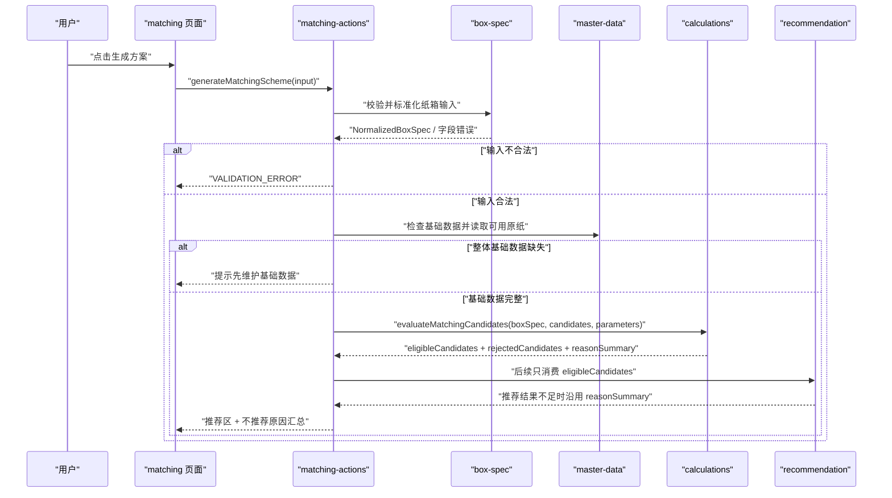
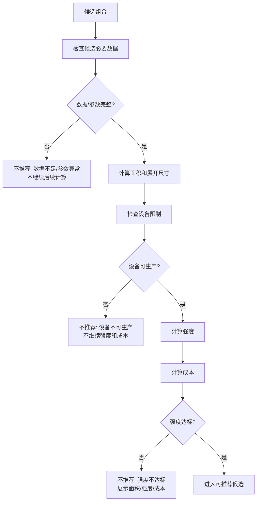

# 配纸确定性计算 — 技术设计文档

## 1. 设计概要

**功能描述**：在现有配纸输入校验和基础数据就绪检查之后，新增确定性计算能力，按 PRD 第 8.2-8.10 固化口径计算面积、设备限制、强度和成本；输出可推荐候选、不推荐候选和原因汇总；生成结果页只展示不推荐原因汇总和计算面积，不展示不可推荐候选明细或堆码承重摘要。→ AC-001 到 AC-023

**影响范围**：`src/modules/calculations`、`src/modules/formulas`、`src/modules/master-data`、`src/modules/recommendation`、`src/server/actions/matching-actions.ts`、`src/app/(main)/matching`、`tests/unit/calculations`、`tests/integration/matching`。本功能不新增数据库表，不新增第三方依赖，不实现经济型/安全型/均衡型排序策略。→ AC-001, AC-002, AC-017, AC-022

**技术难点**：公式口径多且单位容易混淆；设备不可生产时要提前停止后续计算；强度不达标时又要继续保留已算结果；不推荐原因需要既能汇总，又能在数据结构中保留每个候选的全部原因，同时避免生成结果页过度展示明细。→ AC-003, AC-004, AC-005, AC-008, AC-009, AC-011, AC-012, AC-018, AC-019

**外部依赖**：无新增依赖。复用 TypeScript 纯函数、现有主数据读取能力、现有 `ActionResult`、Next.js Server Actions 和 Vitest。→ AC-022

---

## 2. 架构概览

本功能采用“服务端动作编排 + calculations 纯函数 + recommendation 后续消费”的结构。`calculations` 不访问数据库、不依赖页面、不调用 AI；它只接收标准化纸箱输入、候选纸张组合和 PRD 固化参数，返回客观计算结果与不推荐原因。`matching-actions` 负责登录、输入校验、基础数据就绪检查和读取可用原纸；`recommendation` 后续只从 `eligibleCandidates` 中做经济型、安全型、均衡型排序。



### 模块职责

| 模块 / 文件 | 职责 | 对应 AC |
|-------------|------|---------|
| `src/modules/calculations/types.ts` | 定义候选组合、层位、计算结果、不推荐原因、原因汇总等类型 | AC-001 到 AC-022 |
| `src/modules/calculations/default-parameters.ts` | 固化 PRD 第 8.2-8.10 的设备、瓦楞系数、厚度、层数阈值、费用系数 | AC-013 到 AC-016, AC-020, AC-021 |
| `src/modules/calculations/calculate-area.ts` | 计算三层、五层、七层面积和七层两片成箱尺寸 | AC-001, AC-013 |
| `src/modules/calculations/check-device-limits.ts` | 判断纸板机器、印刷开槽机、印刷面、开槽间隔和箱高限制 | AC-007, AC-008, AC-011, AC-014, AC-018 |
| `src/modules/calculations/calculate-strength.ts` | 计算耐破、边压、空箱抗压和强度达标状态 | AC-001, AC-003, AC-012, AC-015, AC-019, AC-020 |
| `src/modules/calculations/calculate-cost.ts` | 计算原纸单价、原纸利用率、用纸总价、加工费用、税金和含税成本 | AC-001, AC-003, AC-016, AC-019 |
| `src/modules/calculations/evaluate-candidate.ts` | 按“数据检查 → 面积/设备 → 强度/成本 → 推荐准入”评估单个候选 | AC-002, AC-003, AC-007 到 AC-012, AC-017 到 AC-019 |
| `src/modules/calculations/evaluate-matching-candidates.ts` | 批量评估候选，输出可推荐候选、不推荐候选结构和原因汇总 | AC-004, AC-005, AC-009, AC-010, AC-017 |
| `src/modules/master-data/list-recommendable-paper-materials.ts` | 提供启用且完整的当前原纸资料，作为候选生成的数据来源 | AC-001, AC-006, AC-007 |
| `src/server/actions/matching-actions.ts` | 复用登录、输入校验和基础数据检查，接入候选读取、计算评估和结果返回 | AC-001 到 AC-012, AC-017 |
| `src/app/(main)/matching` | 展示推荐区、不推荐原因汇总和计算面积摘要；不展示不可推荐候选明细与堆码承重摘要 | AC-002 到 AC-005, AC-009 到 AC-012, AC-018, AC-019, AC-023 |
| `tests/unit/calculations/*` | 覆盖面积、设备、强度、成本、候选评估和原因汇总 | AC-001 到 AC-022 |
| `tests/integration/matching/*` | 覆盖服务端动作结果契约、基础数据缺失和页面展示 | AC-001 到 AC-012, AC-017 |

---

## 3. 数据库设计

本功能不新增数据库表，也不修改现有表。→ AC-022

理由：

- 面积、设备限制、强度和成本计算是当次生成方案的确定性结果，不需要在本功能中保存。历史保存会在“历史方案保存”功能中设计快照。→ AC-001, AC-022
- 当前原纸资料已由 `paper_materials`、`paper_factories` 承载，且 `listRecommendablePaperMaterials` 已能读取价格、克重、耐破指数、环压指数、适用瓦型和完整性状态。→ AC-001, AC-006
- 公式参数当前按 PRD 固化为代码常量；`system_metadata` 中的基础参数就绪状态只作为生成前置检查，不在本功能中新增参数编辑或参数版本存储。→ AC-006, AC-013 到 AC-016, AC-021, AC-022

### 现有数据读取

| 来源 | 使用字段 | 用途 | 对应 AC |
|------|----------|------|---------|
| `paper_materials` | `paperKind`、`usage`、`applicableFlutes` | 区分箱板纸、瓦纸和可用瓦型 | AC-001, AC-007 |
| `paper_materials` | `gramWeightGsm`、`priceYuanPerTon` | 成本计算 | AC-001, AC-016 |
| `paper_materials` | `burstIndex`、`ringCrushIndex` | 强度计算 | AC-001, AC-015 |
| `paper_materials` | `completenessStatus`、`missingFields`、`isActive` | 整体和候选数据完整性判断 | AC-006, AC-007 |
| `paper_factories` | `factoryName` | 结果展示和候选摘要 | AC-005 |
| `system_metadata` | `formula_parameters_ready = active` | 基础参数是否可用的前置检查 | AC-006 |

---

## 4. API / 函数契约

本项目首版使用 Server Actions，本功能不新增公开 REST API。→ AC-022

### `generateMatchingScheme`

**描述**：配纸页面生成方案入口，扩展现有 Server Action 的成功返回，从“标准化输入结果”升级为“推荐结果 + 不推荐原因汇总”。→ AC-001 到 AC-012, AC-017

**位置**：`src/server/actions/matching-actions.ts`

**鉴权**：需要登录，继续复用 `requireAuthenticatedAction`。

**输入**：

```ts
export type GenerateMatchingSchemeInput = BoxSpecInput;
```

**成功响应**：

```ts
export interface GenerateMatchingSchemeResult {
  boxSpec: NormalizedBoxSpec;
  stackingIncluded: boolean;
  stackingDisplayText: string;
  recommendations: MatchingRecommendationPlaceholder[];
  rejectedSummary: RejectedCandidateSummary[];
  rejectedCandidates: RejectedCandidateEvaluation[];
}
```

`recommendations` 在本功能内只允许来自 `eligibleCandidates`。`rejectedCandidates` 继续作为服务端结构化评估结果返回，供后续推荐、测试或诊断使用；生成结果页只展示 `rejectedSummary`，不渲染不可推荐候选明细。结果页顶部摘要从 `recommendationSlots` 中读取首个可用 `evaluation.area.areaSquareMeters`，展示为“计算面积”；没有可用面积时显示“暂无面积结果”。经济型、安全型、均衡型排序策略后续由 `recommendation` 功能补齐；在本功能阶段可返回空数组或由测试桩验证“未达标/不可生产不进入推荐”。→ AC-002, AC-005, AC-010, AC-017, AC-022, AC-023

**异常响应**：

| 场景 | 响应 | 对应 AC |
|------|------|---------|
| 未登录 | 复用现有 `AUTH_REQUIRED` | AC-001 |
| 输入字段错误 | `VALIDATION_ERROR` + `fieldErrors` | AC-001 |
| 整体基础数据缺失 | `VALIDATION_ERROR` + “请先维护纸厂、箱板纸、瓦纸和基础参数” | AC-006 |

### `evaluateMatchingCandidates`

**描述**：批量评估候选组合，返回可推荐候选、不推荐候选和汇总原因。→ AC-001 到 AC-022

**位置**：`src/modules/calculations/evaluate-matching-candidates.ts`

```ts
export interface EvaluateMatchingCandidatesInput {
  boxSpec: NormalizedBoxSpec;
  candidates: MatchingCandidate[];
  parameters?: CalculationParameters;
}

export interface EvaluateMatchingCandidatesResult {
  eligibleCandidates: EligibleCandidateEvaluation[];
  rejectedCandidates: RejectedCandidateEvaluation[];
  rejectedSummary: RejectedCandidateSummary[];
}

export function evaluateMatchingCandidates(
  input: EvaluateMatchingCandidatesInput,
): EvaluateMatchingCandidatesResult;
```

### `evaluateCandidate`

**描述**：评估单个候选，严格执行“数据检查 → 面积/设备 → 强度/成本 → 推荐准入”的顺序。→ AC-003, AC-007, AC-008, AC-011, AC-012, AC-017, AC-018, AC-019

**位置**：`src/modules/calculations/evaluate-candidate.ts`

```ts
export function evaluateCandidate({
  boxSpec,
  candidate,
  parameters,
}: {
  boxSpec: NormalizedBoxSpec;
  candidate: MatchingCandidate;
  parameters: CalculationParameters;
}): CandidateEvaluation;
```

### `calculateBoardArea`

**描述**：按层数、瓦型和成箱方式计算面积与纸板展开尺寸。→ AC-001, AC-013

**位置**：`src/modules/calculations/calculate-area.ts`

```ts
export function calculateBoardArea(input: {
  boxSpec: NormalizedBoxSpec;
  layerCount: LayerCount;
  fluteType: FluteType;
}): BoardAreaResult;
```

### `checkDeviceLimits`

**描述**：按 PRD 第 8.3 判断设备是否可生产，并输出全部设备原因。→ AC-007, AC-008, AC-011, AC-014, AC-018

**位置**：`src/modules/calculations/check-device-limits.ts`

```ts
export function checkDeviceLimits(input: {
  board: BoardAreaResult;
  boxSpec: NormalizedBoxSpec;
  parameters: DeviceLimitParameters;
}): DeviceLimitResult;
```

### `calculateStrength`

**描述**：计算耐破、边压、空箱抗压，并按层数最低强度要求输出强度原因。→ AC-001, AC-003, AC-012, AC-015, AC-019, AC-020

**位置**：`src/modules/calculations/calculate-strength.ts`

```ts
export function calculateStrength(input: {
  boxSpec: NormalizedBoxSpec;
  candidate: CompleteMatchingCandidate;
  area: BoardAreaResult;
  parameters: StrengthParameters;
}): StrengthResult;
```

### `calculateCost`

**描述**：计算原纸利用率、各层单价、用纸总价、加工费用、税金和含税成本。→ AC-001, AC-003, AC-016, AC-019

**位置**：`src/modules/calculations/calculate-cost.ts`

```ts
export function calculateCost(input: {
  boxSpec: NormalizedBoxSpec;
  candidate: CompleteMatchingCandidate;
  area: BoardAreaResult;
  parameters: CostParameters;
}): CostResult;
```

---

## 5. 核心逻辑

### 5.1 候选评估总流程 → AC-001 到 AC-012, AC-017 到 AC-019



处理规则：

1. 整体基础数据缺失由 `matching-actions` 在进入候选评估前拦截。→ AC-006
2. 单个候选缺少纸价、克重、强度指标、瓦楞系数、厚度、费用系数等必要项时，直接进入不推荐结果，不继续后续计算。→ AC-007
3. 候选数据完整后先计算面积和展开尺寸，再判断设备限制。→ AC-001, AC-013, AC-014
4. 设备不可生产时，直接记录具体设备原因，不计算强度和成本。→ AC-008, AC-011, AC-018
5. 设备可生产后继续计算强度和成本。→ AC-001, AC-003, AC-015, AC-016, AC-019
6. 强度不达标时不进入推荐，但在评估结果中保留面积、强度、成本和具体不达标指标。→ AC-003, AC-012, AC-019
7. 只有数据完整、设备可生产、强度达标的候选进入 `eligibleCandidates`。→ AC-002, AC-017

### 5.2 类型模型 → AC-001 到 AC-022

```ts
export type LayerCount = 3 | 5 | 7;
export type FluteType = "A" | "B" | "C" | "E" | "AB" | "AC" | "BC" | "BA" | "BE" | "BAC";

export type RejectionReasonType =
  | "DATA_MISSING"
  | "PARAMETER_ERROR"
  | "NOT_MANUFACTURABLE"
  | "STRENGTH_UNQUALIFIED";

export interface RejectionReason {
  type: RejectionReasonType;
  code: string;
  message: string;
  field?: string | undefined;
}
```

候选组合采用业务层位表达，避免用数组下标隐含“面纸/瓦纸/里纸”语义：

```ts
export interface CandidateLayer {
  role: "outer_liner" | "inner_liner" | "corrugating" | "medium";
  paper: CandidatePaperMaterial;
  flute?: "A" | "B" | "C" | "E" | undefined;
}

export interface MatchingCandidate {
  id: string;
  layerCount: LayerCount;
  fluteType: FluteType;
  layers: CandidateLayer[];
}
```

输出分为可推荐和不推荐两类：

```ts
export interface EligibleCandidateEvaluation {
  status: "eligible";
  candidate: MatchingCandidate;
  area: BoardAreaResult;
  device: DeviceLimitResult;
  strength: StrengthResult;
  cost: CostResult;
}

export interface RejectedCandidateEvaluation {
  status: "rejected";
  candidate: MatchingCandidate;
  reasons: RejectionReason[];
  area?: BoardAreaResult | undefined;
  device?: DeviceLimitResult | undefined;
  strength?: StrengthResult | undefined;
  cost?: CostResult | undefined;
}
```

当设备不可生产时，`RejectedCandidateEvaluation` 不包含 `strength` 和 `cost`。→ AC-008, AC-018  
当强度不达标时，`RejectedCandidateEvaluation` 包含 `area`、`device`、`strength`、`cost`。→ AC-003, AC-019

### 5.3 面积计算 → AC-001, AC-013

`calculateBoardArea` 按 PRD 第 8.2 分层处理，输入的 L/W/H 直接作为内长、内宽、内高：

| 层数 | 尺寸口径 | 搭舌 | 摇盖 | 特殊规则 | 对应 AC |
|------|----------|------|------|----------|---------|
| 三层 | 长=L，宽=W，高=H | 粘箱 35，钉箱 40 | 默认 `(宽+8)/2`，C/BE 瓦 `(宽+10)/2` | BE 瓦按三层面积公式 | AC-013 |
| 五层 | 长=L，宽=W，高=H | 粘箱 40，钉箱 45 | `(宽+12)/2` | 一片成箱 | AC-013 |
| 七层 | 长=L，宽=W，高=H | 固定 45 | `(宽+16)/2` | 支持一片和两片成箱 | AC-013 |

`BoardAreaResult` 同时返回面积和设备判断需要的展开尺寸：

```ts
export interface BoardAreaResult {
  innerLengthMm: number;
  innerWidthMm: number;
  innerHeightMm: number;
  boardLengthMm: number;
  boardWidthMm: number;
  areaSquareMeters: number;
  formingPieces: 1 | 2;
  flapMm: number;
  tongueMm: number;
}
```

七层先尝试一片成箱；如果一片超过设备纸板宽度，再计算两片成箱尺寸，并把 `formingPieces` 标记为 `2`。三层、五层不做两片成箱。→ AC-008, AC-013, AC-014

### 5.4 设备限制 → AC-007, AC-008, AC-011, AC-014, AC-018

`checkDeviceLimits` 输出全部设备限制原因：

```ts
export interface DeviceLimitResult {
  isManufacturable: boolean;
  reasons: RejectionReason[];
}
```

判断项按 PRD 第 8.3 固化：

| 限制项 | 规则 | 不推荐原因 |
|--------|------|------------|
| 生产纸板机器最大长宽 | 最大纸板长 1800mm，最大纸板宽 1710mm | `NOT_MANUFACTURABLE` |
| 生产纸板机器最小长宽 | 最小纸板长 500mm，最小纸板宽 360mm | `NOT_MANUFACTURABLE` |
| 印刷开槽机最大进纸 | 2400×1580mm，2400 对应总长，1580 对应总宽，不允许换方向 | `NOT_MANUFACTURABLE` |
| 印刷开槽机最小进纸 | 600×360mm | `NOT_MANUFACTURABLE` |
| 最大印刷面 | 2360×1200mm | `NOT_MANUFACTURABLE` |
| 最小开槽间隔 | 230-65-230-65mm | `NOT_MANUFACTURABLE` |
| 箱高 | ≤850mm | `NOT_MANUFACTURABLE` |

单摇盖/双摇盖专项校验不在本功能范围，技术实现中不新增相关判断。→ AC-022

### 5.5 强度计算 → AC-001, AC-003, AC-012, AC-015, AC-019, AC-020

`calculateStrength` 使用 PRD 第 8.4-8.7：

```ts
export interface StrengthResult {
  burstStrength: number;
  edgeCrushNPerM: number;
  edgeCrushKnPerM: number;
  bctN: number;
  isQualified: boolean;
  reasons: RejectionReason[];
}
```

计算规则：

1. 单层耐破 = 耐破指数 × 克重，结果按整数取值。→ AC-015
2. 平纸层环压 = 横向环压指数 × 克重，结果按整数取值。→ AC-015
3. 瓦楞层环压 = 横向环压指数 × 克重 × 瓦楞伸长系数，结果按整数取值。→ AC-015
4. 边压强度 = 全部参与层位环压强度之和 × 修正系数。→ AC-015
5. 空箱抗压 = `5.874 × 边压强度 × sqrt(纸板厚度 × 纸箱周长 ÷ 1000000)`，结果按整数取值。→ AC-015
6. 耐破 = 参与耐破层位之和 × 0.95；瓦楞层不计入耐破汇总。→ AC-015
7. 展示边压时同步提供 kN/m，内部仍保留 N/m。→ AC-015

强度达标首版按 PRD 层数最低要求：

| 层数 | 空箱抗压 | 边压 |
|------|----------|------|
| 三层 | ≥ 400N | ≥ 4.0kN/m |
| 五层 | ≥ 800N | ≥ 7.0kN/m |
| 七层 | ≥ 1200N | ≥ 10.0kN/m |

堆码层数已填写时，本功能不新增堆码抗压目标公式，只保留 `boxSpec.stackingRequirement` 给后续已确认公式使用。→ AC-020

### 5.6 成本计算 → AC-001, AC-003, AC-016, AC-019

`calculateCost` 使用 PRD 第 8.8-8.10：

```ts
export interface CostResult {
  utilizationRate: number;
  padFeeYuan: number;
  layerUnitPrices: Array<{
    role: CandidateLayer["role"];
    paperCode: string;
    unitPriceYuanPerSquareMeter: number;
  }>;
  paperCostYuan: number;
  processingFeeYuan: number;
  taxYuan: number;
  taxIncludedCostYuan: number;
}
```

核心规则：

1. 平纸层单价 = 原纸纸价 × 克重 ÷ 1000000。→ AC-016
2. 瓦楞层单价 = 原纸纸价 × 克重 × 瓦楞系数 ÷ 1000000。→ AC-016
3. 用纸总价 = 各层单价合计 × 面积 ÷ 原纸利用率。→ AC-016
4. 加工费用 = 层数费用系数 × 0.9 × 面积 ÷ 原纸利用率。→ AC-016
5. 垫板费用作为 `CalculationParameters.padFeeYuan` 进入成本公式，PRD 当前未提供输入来源，本功能默认值为 0，并在结果中显式展示 `padFeeYuan: 0`。→ AC-016, AC-021
6. 税金 = `(垫板费用 + 加工费用 + 用纸总价) × 1.05 × 1.5%`。→ AC-016
7. 含税成本 = 垫板费用 + 加工费用 + 税金 + 用纸总价。→ AC-016
8. 原纸利用率按生产数量分段，最高不超过 0.95。→ AC-016

### 5.7 不推荐原因汇总与明细数据 → AC-004, AC-005, AC-009, AC-010, AC-011, AC-012

`evaluateMatchingCandidates` 根据 `rejectedCandidates[].reasons` 生成汇总：

```ts
export interface RejectedCandidateSummary {
  type: RejectionReasonType;
  label: string;
  count: number;
}
```

汇总规则：

- 一个候选有多个原因时，每个原因都计入对应类型汇总。→ AC-009
- 页面汇总展示原因类型和数量，例如“设备不可生产 12 个、强度不达标 8 个”。→ AC-004
- 生成结果页不展示不可推荐候选明细，避免候选列表过长影响主流程判断。→ AC-005
- `rejectedCandidates` 仍保留候选层数、瓦型、纸张组合摘要和全部原因，供服务端契约、测试或后续诊断使用。→ AC-005, AC-009
- 推荐区为空时，结果页仍显示汇总原因，不展示不可推荐候选明细。→ AC-010

### 5.8 样例差异处理 → AC-021

本功能不在运行时读取 Excel 成本表，也不从样例表反推公式。单元测试中的样例应来自 PRD 明确公式手工构造；如果后续用 Excel 样例核对发现差异，应新增文档记录或测试注释，等待用户确认后再改变公式常量。→ AC-021

---

## 6. 现有代码改动

| 模块 / 文件 | 改动内容 | 原因 | 对应 AC |
|-------------|----------|------|---------|
| `src/modules/calculations/README.md` | 更新模块边界，说明只做确定性计算和客观评估 | 明确不做推荐排序、AI 和数据库访问 | AC-017, AC-022 |
| `src/modules/calculations/types.ts` | 新增候选、参数、面积、设备、强度、成本、评估结果、不推荐原因类型 | 为计算链路提供统一类型契约 | AC-001 到 AC-022 |
| `src/modules/calculations/default-parameters.ts` | 新增 PRD 固化参数常量 | 集中管理设备限制、瓦楞系数、厚度、强度阈值和费用系数 | AC-013 到 AC-016, AC-020, AC-021 |
| `src/modules/calculations/calculate-area.ts` | 新增面积和展开尺寸计算 | 实现 PRD 第 8.2 | AC-001, AC-013 |
| `src/modules/calculations/check-device-limits.ts` | 新增设备限制判断 | 实现 PRD 第 8.3，并支持全部设备原因 | AC-007, AC-008, AC-011, AC-014, AC-018 |
| `src/modules/calculations/calculate-strength.ts` | 新增强度计算和达标判断 | 实现 PRD 第 8.4-8.7 | AC-001, AC-003, AC-012, AC-015, AC-019, AC-020 |
| `src/modules/calculations/calculate-cost.ts` | 新增成本计算 | 实现 PRD 第 8.8-8.10 | AC-001, AC-003, AC-016, AC-019 |
| `src/modules/calculations/evaluate-candidate.ts` | 新增单候选评估流程 | 固化停止计算和推荐准入规则 | AC-002, AC-003, AC-007 到 AC-012, AC-017 到 AC-019 |
| `src/modules/calculations/evaluate-matching-candidates.ts` | 新增批量候选评估和原因汇总 | 支持推荐不足汇总，并保留候选级原因结构 | AC-004, AC-005, AC-009, AC-010 |
| `src/modules/master-data/list-recommendable-paper-materials.ts` | 复用或小幅扩展当前读取结果，确保字段能映射为候选纸张 | 为候选生成提供完整原纸资料 | AC-001, AC-006, AC-007 |
| `src/server/actions/matching-actions.ts` | 扩展成功返回，接入原纸读取、候选生成、计算评估和原因汇总 | 让页面能拿到推荐区和不推荐原因汇总 | AC-001 到 AC-012, AC-017 |
| `src/app/(main)/matching/page.tsx` 与 `_components` | 增加推荐结果、不推荐汇总和计算面积展示，隐藏不可推荐候选明细与堆码承重摘要 | 满足用户可见行为并保持结果页简洁 | AC-002 到 AC-005, AC-009 到 AC-012, AC-023 |
| `tests/unit/calculations/*` | 新增 P0 单元测试 | 覆盖公式、设备限制、停止计算和原因汇总 | AC-001 到 AC-022 |
| `tests/integration/matching/*` | 扩展服务端动作和页面测试 | 验证整体结果契约和页面展示 | AC-001 到 AC-012, AC-017 |

---

## 7. 技术决策

### 公式参数先用 PRD 常量，而不是新增参数表

**背景**：需求已确认“先按 PRD 固化”，当前代码只有基础参数就绪状态，没有可读取的版本化参数表。若本阶段新增参数表，会把“参数维护”扩大进本功能。

**选项**：
- A: 新增公式参数表并从数据库读取 — 更接近后续可维护参数方向，但需要迁移、维护页面和版本策略。
- B: 在 `calculations/default-parameters.ts` 固化 PRD 常量 — 范围小、可测试、符合本阶段“按 PRD 固化”。

**结论**：选择 B。保留 `CalculationParameters` 入参，未来参数维护完成后可由服务端传入当前参数，不改纯计算函数签名。→ AC-013 到 AC-016, AC-020, AC-021, AC-022

### 设备不可生产时停止后续计算

**背景**：设备不可生产是用户明确确认的硬停止规则；继续展示强度和成本会让不可生产方案看起来仍有报价参考价值。

**选项**：
- A: 设备不可生产仍继续计算强度和成本 — 信息更全，但违背已确认口径。
- B: 设备不可生产直接进入不推荐结果，只保留设备原因 — 行为清晰，避免误用。

**结论**：选择 B。`evaluateCandidate` 在设备失败后立即返回，不调用 `calculateStrength` 和 `calculateCost`。→ AC-008, AC-018

### 强度不达标时继续展示成本

**背景**：强度不达标但设备可生产时，用户希望看到成本和强度差距，辅助判断是否换纸、加层或换瓦型。

**选项**：
- A: 强度不达标也停止成本计算 — 流程简单，但少了报价差距参考。
- B: 强度不达标继续保留面积、强度和成本结果 — 更符合工艺人员判断需求。

**结论**：选择 B。`evaluateCandidate` 在设备通过后同时计算强度和成本，再根据强度结果决定是否进入推荐。→ AC-003, AC-019

### 推荐准入放在 `calculations` 评估结果中，排序留给 `recommendation`

**背景**：本功能要求推荐前硬规则过滤，但需求明确不做经济型、安全型、均衡型排序策略。

**选项**：
- A: 本功能直接实现三套推荐排序 — 一步到位，但扩大范围。
- B: `calculations` 输出 `eligibleCandidates`，后续 `recommendation` 只从中排序 — 既满足准入规则，又不提前实现排序策略。

**结论**：选择 B。未达标或不可生产的候选从源头不会进入后续推荐输入。→ AC-002, AC-017, AC-022

### 不推荐原因用结构化 code，而不是仅返回文案

**背景**：页面要汇总原因数量，服务端也要保留候选级原因供推荐、测试或后续诊断。仅返回文案会让统计和测试不稳定。

**选项**：
- A: 只返回中文原因文案 — 开发快，但后续难统计、难测试。
- B: 返回 `type + code + message` — 可统计、可测试，也能保留必要的用户可见文案。

**结论**：选择 B。页面按 `type` 汇总，不单独渲染不可推荐候选明细。→ AC-004, AC-005, AC-009, AC-011, AC-012

---

## 8. 安全与性能

**服务端二次校验**：继续由 `generateMatchingScheme` 调用 `validateBoxSpecInput`，计算模块只接收 `NormalizedBoxSpec`，避免非法输入绕过页面进入公式。→ AC-001, AC-006

**错误信息**：不推荐原因使用业务语言，不暴露数据库错误、堆栈、SQL 或文件路径。→ AC-006, AC-007, AC-011, AC-012

**浮点计算**：金额和面积保留数字结果，测试断言使用容差；代码中避免用浮点数直接比较成本。→ AC-016

**性能考量**：计算函数为同步纯函数，单候选只做常量级公式。批量候选评估在内存中一次完成；如果后续候选数量过大，可在候选生成阶段限制组合规模，但本功能不引入异步队列。→ AC-001, AC-004

**真实数据保护**：单元测试使用人工构造的脱敏候选，不复制真实纸价、客户或订单数据。→ AC-021, AC-022

---

## 9. AC 覆盖总表

| AC 编号 | 验收标准概述 | 实现位置 |
|---------|--------------|----------|
| AC-001 | 完整数据下完成确定性计算 | `evaluateMatchingCandidates` + 面积/设备/强度/成本计算函数 |
| AC-002 | 推荐区只展示达标且可生产方案 | `eligibleCandidates` 输出 + `matching-actions` 推荐输入 |
| AC-003 | 强度不达标候选仍保留已计算结果 | `evaluateCandidate` 强度失败分支 |
| AC-004 | 推荐不足时展示汇总原因 | `rejectedSummary` + matching 页面汇总展示 |
| AC-005 | 生成结果页不展示候选明细 | `rejectedCandidates` 结构保留 + 页面隐藏明细 |
| AC-006 | 整体基础数据缺失 | 现有 `checkMatchingReadinessFromRepository` |
| AC-007 | 单个候选缺少必要数据 | `evaluateCandidate` 数据检查分支 |
| AC-008 | 设备不可生产候选不继续计算 | `evaluateCandidate` 设备失败短路 |
| AC-009 | 多个不推荐原因全部计入汇总 | `RejectionReason[]` + 汇总逻辑 |
| AC-010 | 所有候选都不满足推荐条件 | `eligibleCandidates=[]` + `rejectedSummary` |
| AC-011 | 设备限制说明具体超限项 | `checkDeviceLimits` |
| AC-012 | 强度不达标说明具体指标 | `calculateStrength` |
| AC-013 | 面积公式按 PRD 固化 | `calculateBoardArea` + `default-parameters.ts` |
| AC-014 | 设备限制按 PRD 固化 | `checkDeviceLimits` + `default-parameters.ts` |
| AC-015 | 强度公式按 PRD 固化 | `calculateStrength` + `default-parameters.ts` |
| AC-016 | 成本公式按 PRD 固化 | `calculateCost` + `default-parameters.ts` |
| AC-017 | 未达标或不可生产不得进入推荐 | `eligibleCandidates` 仅收达标可生产候选 |
| AC-018 | 设备不可生产停止后续计算 | `RejectedCandidateEvaluation` 不含 `strength/cost` |
| AC-019 | 强度不达标继续展示结果 | `RejectedCandidateEvaluation` 保留 `area/strength/cost` |
| AC-020 | 堆码层数不新增公式 | `calculateStrength` 只按层数最低阈值 |
| AC-021 | 样例差异不自动改公式 | `default-parameters.ts` 以 PRD 为准 + 测试样例策略 |
| AC-022 | 本功能不扩大范围 | 不新增 DB 表/依赖，不实现排序/AI/摇盖专项/批量配纸 |
| AC-023 | 生成结果摘要显示计算面积 | matching 页面从推荐槽位面积结果生成摘要 |

---

## 附录：变更记录

| 日期 | 变更内容 | 原因 |
|------|----------|------|
| 2026-07-01 | 初始版本 | 根据“配纸确定性计算”需求文档产出可执行技术方案 |
| 2026-07-04 | CR-001：生成结果页隐藏不可推荐候选明细，只保留不推荐原因汇总 | 生成结果页候选明细过于臃肿，需要收紧用户可见信息 |
| 2026-07-04 | CR-002：生成结果摘要取消堆码承重，改为显示计算面积 | 用户希望生成结果优先看到计算后的面积 |
| 2026-07-04 | CR-003：纸箱尺寸输入口径改为内径 | 用户确认实际业务按内径输入计算面积 |
| 2026-07-07 | CR-004：新增原纸等级强度标准映射 | 按质量标准表“基础表”用纸种、等级和克重推导耐破指数与横向环压指数，缺失时返回具体资料项 |
| 2026-07-07 | CR-005：调整原纸缺失项阻断规则 | 缺纸价原纸仅从推荐候选中排除，不进入缺失资料清单；强度标准缺失文案展示纸种、克重、覆盖范围和影响指标 |
| 2026-07-07 | CR-006：调整强度标准缺失阻断规则 | 超过强度标准表克重范围的原纸仅从推荐候选中排除，不进入缺失资料清单，不阻断其它可用原纸生成方案 |
